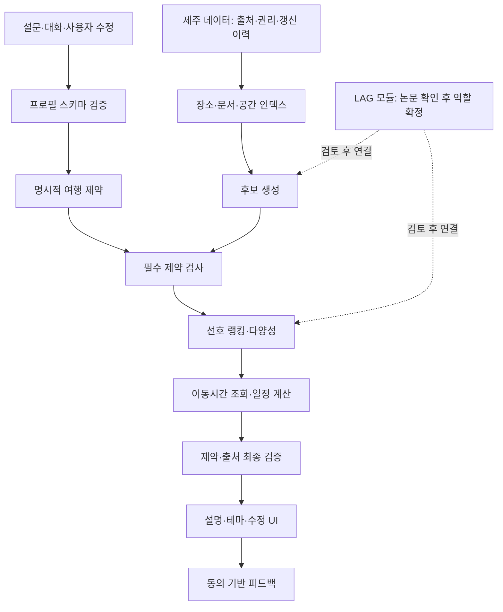

# 제품 목표와 시스템 설계

작성 기준: 2026-11-18 (한국 시간). 이 문서는 **구현 전 제안**이다. LAG는 사용자 결정(2026-11-18)에 따라 논문 2508.05509 Logic-Augmented Generation을 뜻한다. 처음 지정된 2504.09277은 SynthTRIPs 평가셋 생성 틀로 확인됐다([19 문서](19-agent-step2-data-foundation.md)). 원문 세부를 확인하기 전에는 내부 메커니즘을 구현 사실처럼 기술하지 않는다. RAG는 독립된 비교 대안이다.

## 1. 만들 제품과 성공의 의미

사용자가 짧은 문항에 응답하면 이번 여행에 맞는 테마 2~3개와 장소 후보를 받고, 필요하면 날짜·위치·이동수단에 맞는 일정을 만드는 서비스다. 핵심 가치는 그럴듯한 여행 문장이 아니라 **선호 반영, 실행 가능성, 근거, 수정 가능성**이다.

페르소나는 사람을 영구 분류하는 성격 검사나 연령·성별 예측이 아니다. 이번 여행의 관심, 활동 강도, 동행 요구, 비용·시간 제약을 표현하는 편집 가능한 여행 프로필이다. 예를 들어 ‘조용한 해안 산책’과 ‘로컬 음식 탐방’은 설명용 테마 제안이며, 실제 분류나 장소 적합성은 데이터와 사용자 평가로 검증한다.

| 범위 | MVP에서 제공할 것 | 후속 검토 |
|---|---|---|
| 입력 | 핵심 설문, 상황별 추가 질문, 답변 확인·수정 | 동의 기반 장기 선호 기억 |
| 추천 | 테마, 제약을 만족하는 후보, 이유·출처·정보 기준일 | 사용 로그가 충분할 때 학습 랭커 |
| 일정 | 당일/짧은 여행의 시간창·이동 고려 일정과 대안 | 다일 최적화·예약 연계 |
| 대화 | ‘덜 걷기’, ‘실내로 바꾸기’ 등을 구조화된 수정으로 반영 | 음성·다국어 |
| 실행 | 조회·계산·계획 | 예약·결제·외부 전송은 별도 사용자 승인 설계 후 |

## 2. 사용자에게 보이는 절차

1. **시작**: 예상 문항 수와 소요시간은 파일럿으로 측정해 표시한다. 비회원 추천을 기본으로 하고 저장·분석 동의는 분리한다.
2. **필수 여행 조건**: 날짜/시간, 출발·종료 위치, 이동수단, 동행·접근성, 예산을 받는다. 정하지 않은 값에는 ‘미정’을 허용한다.
3. **취향 문항**: 관심 테마, 활동 강도, 혼잡 선호, 날씨 대안을 받는다. 후속 질문은 답변과 관련된 경우에만 노출한다.
4. **프로필 확인**: ‘렌터카 없음 / 실내 선호 / 걷기 적게 / 1인 예산 상한’처럼 사용자가 읽을 수 있는 요약을 보여준다. 민감 특성을 추정하지 않는다.
5. **테마 제안**: 상위 테마와 이유, 적용된 응답, 근거의 충분함을 표시한다. 점수를 성격 진단 확률처럼 제시하지 않는다.
6. **후보 비교**: 좋아요/제외/필수 방문을 받아 순위를 재계산한다. 카드에 확인된 사실과 미확인 정보를 구분한다.
7. **일정 구성**: 선택한 후보로 실제 이동시간·체류시간·운영시간을 확인한다. 자료가 부족하면 ‘후보 목록’까지만 제공하고 확정 일정처럼 표현하지 않는다.
8. **설명·수정**: ‘왜 추천했는지’, ‘무슨 조건 때문에 제외했는지’, ‘무엇을 바꾸면 가능한지’를 설명한다. 특정 필수 조건을 사용자 모르게 완화하지 않는다.
9. **저장·피드백**: 저장 범위·보존기간을 안내한다. 실제 방문 여부와 만족도는 동의받아 수집하고 클릭과 구분한다.

상세 문항과 계산은 `04-questionnaire-and-scoring.md`를 단일 기준으로 삼는다.

## 3. 구성과 책임

배포 대상은 기존 `https://jeju-tour-six.vercel.app/`이다. [Ollama·Vercel 설계](09-ollama-lag-feasibility.md)와 [MCP 서버 구축·통합 계획](10-mcp-server-and-vercel-integration.md)을 적용 상세 기준으로 추가했다. 기존 Vercel 화면·Express API는 유지하고 외부 Agent Worker·사설 Ollama·HTTP MCP 서비스를 연결한다. 현재 로컬 stdio 교통 MCP는 Vercel에서 비활성화되는 코드 경로이므로 별도 원격 전송·권한·작업 관리가 필요하다. 설계 반영은 운영 배포 완료를 뜻하지 않는다.

기존 `OREUM-IT/jeju-tour`의 `prototype/`에는 React·TypeScript 웹과 Express 서버가 있고, `ThemeQuiz.tsx`의 4문항 추천 및 `src/assistant.ts`의 Gemini 요청 해석→서버 랭킹→설명 흐름이 이미 있다. 현재 분석 저장소가 비어 있었다는 사실과 기존 서비스에 기능이 없다는 판단은 다르다. 기존의 장소 ID 제한, 실패 시 규칙 검색, 코스빌더 연계를 재사용하고 공통 프로필·제약 검증·추천 근거 계약을 추가하는 방향을 우선한다. 이는 소스 검토 결과이며 배포 서비스 작동을 검증한 것은 아니다.

위 도식은 제품의 공통 처리 계층이며 **LAG 논문의 구조를 재현한 그림이 아니다**. 점선은 통합 위치 후보다. 논문에서 LAG가 요구하는 입력·상태·학습/추론 절차를 확인한 뒤 연결 지점을 확정한다. RAG 실험은 별도 후보 생성·근거 검색 대안으로 비교한다.

| 구성 요소 | 책임 | 허용하지 않을 동작 |
|---|---|---|
| 설문/프로필 서비스 | 타입·범위·모순 검사, 수정 이력 | 생략한 선호나 민감 정보를 임의 추정 |
| 데이터 서비스 | 장소 ID, 문서 근거, 시간/공간 단위, 갱신 이력 | 원본 통계의 집계 수준을 개인 수준으로 바꾸기 |
| 후보 생성기 | 구조화 조건 및 텍스트/의미 검색 | 검색 점수를 곧바로 여행 적합 확률로 표현 |
| 제약 검사기 | 확인된 필수 조건의 통과/탈락/미확인 판정 | 미확인을 통과로 간주 |
| 랭커 | 선호 적합도, 다양성, 이동 부담, 근거 수준 | 높은 취향 점수로 필수 제약 위반 상쇄 |
| 일정 엔진 | 이동시간·시간창·체류·여유시간 계산 | 직선거리를 검증된 대중교통 시간으로 대체 |
| Agent/LLM | 질문, 도구 호출, 근거에 맞는 설명 | 없는 장소·요금·영업시간 생성 |
| 최종 검증기 | 입력 조건·출처·출력 스키마 재검사 | 실패 결과를 정상 일정으로 노출 |

MVP는 한 Agent가 도구를 호출하는 구조로 시작한다. 역할별 다중 Agent는 병렬 전문가가 실제 품질 개선을 보이는 경우에만 실험한다. 다중 Agent 자체를 정확성 보장이나 LAG 필수 조건으로 가정하지 않는다.

## 4. 데이터 계약과 추천 한 건의 처리

아래 필드 목록은 책임을 설명하는 개념 목록이다. 설문 프로필의 실제 JSON 경로·단위·결측 의미는 `04-questionnaire-and-scoring.md` 5절을 기준으로 통일하고 API 명세로 확정한다.

프로필에는 `profile_id`, `schema_version`, `trip_window`, `origin`, `destination`, `transport_mode`, `budget_scope`, `budget_limit`, `party_requirements`, `hard_constraints`, `preferences`, `answered_question_ids`, `consents`가 필요하다. 미응답은 `null`로 유지한다. 나이·성별은 기본 추천 필수 항목이 아니다.

장소에는 `place_id`, `source_dataset_id`, 좌표·좌표계, 카테고리·태그, 운영시간과 예외일, 가격의 적용 범위, 접근성 상태, 근거 문서 ID, `observed_at`, `retrieved_at`, `valid_until`, `license`가 필요하다. 없는 필드는 미확인으로 둔다.

추천 응답은 `request_id`, `profile_version`, `data_snapshot_id`, `model_id`, `prompt_version`, `scoring_version`, `themes`, `candidates`, `constraint_checks`, `evidence`, `uncertainties`를 기록한다. 로그에 전체 자유서술 응답이나 정확한 위치를 무조건 남기지 않는다.

처리 순서는 다음과 같다.

1. 응답을 타입이 있는 프로필로 변환한다. 대화로 받은 값도 동일 스키마를 거친다.
2. 예산 범위(인당/동행 전체, 음식·교통 포함 여부), 날짜, 이동수단 등의 모순을 확인한다. 필요한 항목만 다시 묻는다.
3. 데이터 스냅샷과 해당 날짜에 유효한 조건으로 후보를 찾는다. 검색 후보 수는 부하·재현율 실험으로 정한다.
4. 필수 조건을 먼저 판정한다. 접근성 필수 정보가 없는 곳은 확인이 필요한 후보로 분리한다.
5. 응답으로 산출한 선호 벡터와 장소 특성을 비교한다. 동일 장소 중복을 제거하고 테마·지역 다양성을 조절한다.
6. 상위 후보의 운영시간·가격·이동정보를 필요 시 재조회한다. 실시간 접근 권한이나 자료가 없으면 그 제한을 드러낸다.
7. 일정 요청인 경우 시간창과 체류시간, 식사/휴식, 복귀 시각을 만족하는 경로를 계산한다.
8. LLM은 검증된 구조화 결과와 근거만 받아 설명한다. 도구 응답의 문서 내용은 명령이 아니라 데이터로 취급한다.
9. 최종 검사 실패 시 해당 결과를 제거하거나 재계산한다. 제한된 재시도 이후에는 불충분한 항목과 가능한 대안을 반환한다.
10. 동의된 피드백과 비식별 운영 지표를 수집한다. 클릭·저장·실제 방문·만족도는 서로 다른 신호다.

## 5. LAG·Llama·RAG의 구분과 모델 결정

| 항목 | 이 프로젝트에서의 의미 | 현재 결정 |
|---|---|---|
| LAG | 논문 2508.05509의 Logic-Augmented Generation(하위 질문 분해·의존 순서 풀이·답할 수 없을 때 중단) | 5단계 Agent 추론 비교 실험. 원문 세부 검토 전 구현/성능 주장 보류 |
| SynthTRIPs | 논문 2504.09277의 지식베이스 근거 합성 질의 생성 틀 | 3단계 평가셋 생성 방법. 추천 방법이 아님 |
| Llama | 비교할 공개 가중치 모델 계열 | LAG 또는 비교 시스템의 모델 후보. 방법과 모델을 동일시하지 않음 |
| 다른 공개 모델 | 한국어·도구 호출·운영비 비교 후보 | 예: Qwen 계열 등. 정확한 버전·라이선스·배포 조건 확인 필요 |
| API 모델 | 외부 서비스로 호출하는 모델 후보 | 빠른 실험 후보. 데이터 전송 범위와 실제 가격 확인 필요 |
| RAG | 검색 결과로 답변 근거를 보강하는 비교 구조 | LAG와 구분하여 기준선/보조 실험으로 사용 |
| 비LLM 추천 | 규칙·필터·랭킹과 템플릿 설명 | 반드시 유지할 기준선 및 장애 시 대안 |

현재 특정 모델을 ‘최적’이라고 선정할 근거는 없다. 동일 설문·데이터·평가셋에서 한국어 이해, 스키마/도구 성공률, 근거 준수, 추천 적합도, 지연, 총비용을 비교한다. 공개 모델은 가중치 라이선스·재배포 조건·모델 크기·양자화 영향을 확인한다. API는 인증·보존정책·단가·속도 제한을 확인한다. 체크포인트나 GPU 사양은 이 검증 이후 확정한다.

초기 파인튜닝은 필수로 두지 않는다. 근거가 부족한 답변이 검색·데이터 문제인지, 질문 이해·출력 일관성 문제인지 먼저 분리한다. LAG가 학습을 요구한다면 논문의 데이터 요구량·학습 자원·재현 조건을 별도 예산으로 검토한다.

## 6. 기술 구성 제안과 단계별 비용 통제

- **프런트엔드**: 기존 웹/Flutter 흐름을 확인해 재사용한다. 설문 정의와 점수 매핑은 버전 관리되는 공통 계약으로 분리해 플랫폼 간 결과가 달라지지 않도록 한다.
- **백엔드**: 기존 TypeScript/Express의 `prototype/src/assistant.ts`, `placesearch.ts`, 공유 타입 및 API 경로를 우선 확장 대상으로 검토한다. 기존 Gemini 경로를 비교 기준으로 보존하고 모델 공급자 인터페이스 뒤에서 Llama/API 대안을 비교한다. Python은 LAG 재현·추천 실험에서 필요성이 확인될 때 연결하며 전면 재작성을 전제하지 않는다.
- **저장소**: 원천 파일과 정제 테이블을 분리한다. 공간·시간 필터가 필요해지면 PostgreSQL/PostGIS를 후보로 평가한다. 벡터 인덱스는 검색 기준선으로 필요성을 확인한 후 선택한다.
- **최적화**: 소규모 탐욕 일정 기준선과 OR-Tools 같은 제약 최적화 대안을 비교한다. API 이동시간 조회 결과는 수단·조회시각·유효기간과 함께 캐시한다.
- **실험**: 작은 샘플·캐시된 근거·고정 모델 버전으로 시작한다. 요청별 토큰·호출·지연·비용과 실패 유형을 기록한다.
- **배포**: 문항 버전, 프로필 스키마, 추천 API를 먼저 호환되게 설계한다. GPU 서버·벡터 DB·다중 Agent는 근거 없이 동시에 도입하지 않는다.

## 7. 운영 프로세스와 책임

| 과정 | 책임 역할 | 산출물 | 완료 조건 |
|---|---|---|---|
| 자료 수령·논문 읽기 | 기획/리서치 | 출처 목록, LAG 재현 명세, 데이터 행별 목록 | 출처·권리·원문 위치 확인 |
| 문항 설계·파일럿 | UX/추천 담당 | 문항 버전, 응답 매핑, 혼동 사례 | 응답자가 문항 뜻과 예산 범위를 이해 |
| 데이터 처리 | 데이터 담당 | 스냅샷·품질 리포트·장소 연결표 | 필수 데이터의 실제 확보와 결측 정책 |
| 기준선 구현 | 백엔드/추천 담당 | 재현 가능한 후보·점수·설명 | 고정 사례에서 응답→점수 추적 가능 |
| LAG 재현·통합 | ML 담당 | 재현 결과·차이·비용·제주 적응안 | 논문 재현 조건과 제품 목표 구분 |
| 사용자 평가 | UX/품질 담당 | 비교 실험·오류 유형·사용성 결과 | 사전 수용 기준 충족 또는 제한 명시 |
| 출시·관측 | 운영/개발 담당 | 버전 배포·모니터링·되돌리기 절차 | 실패 시 검증된 기준선으로 복귀 가능 |

## 8. 실패 시 사용자에게 제공할 결과

- 데이터가 없으면 해당 사실을 ‘정보 없음’으로 표시하고 정보 확인을 요청하거나 확인된 후보로 범위를 줄인다.
- 요청이 불가능하면 필수 조건을 유지한 채 불가능 원인을 제시한다. 예산/지역/방문 수 변경은 사용자가 선택한다.
- 외부 모델이 실패하면 구조화 추천과 템플릿 설명을 제공할 수 있다. 검증되지 않은 내용을 생성해 빈칸을 채우지 않는다.
- 악천후·통제·운영시간 변경을 확증할 자료가 없으면 안전을 보장하지 않는다. 관련 공식 확인이 필요한 후보를 명시한다.
- 데이터 문서에 삽입된 명령, 사용자 입력의 경로/도구 조작, 무한 도구 재호출은 도구 허용 목록·스키마 검증·호출 예산으로 제한한다.

구체적인 점수식·평가 목표·일정은 각각 문항 설계 및 평가 문서에 있으며, 실제 측정 결과와 구분한다.
