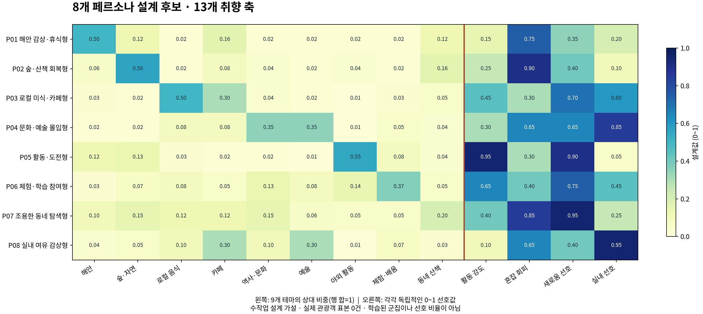
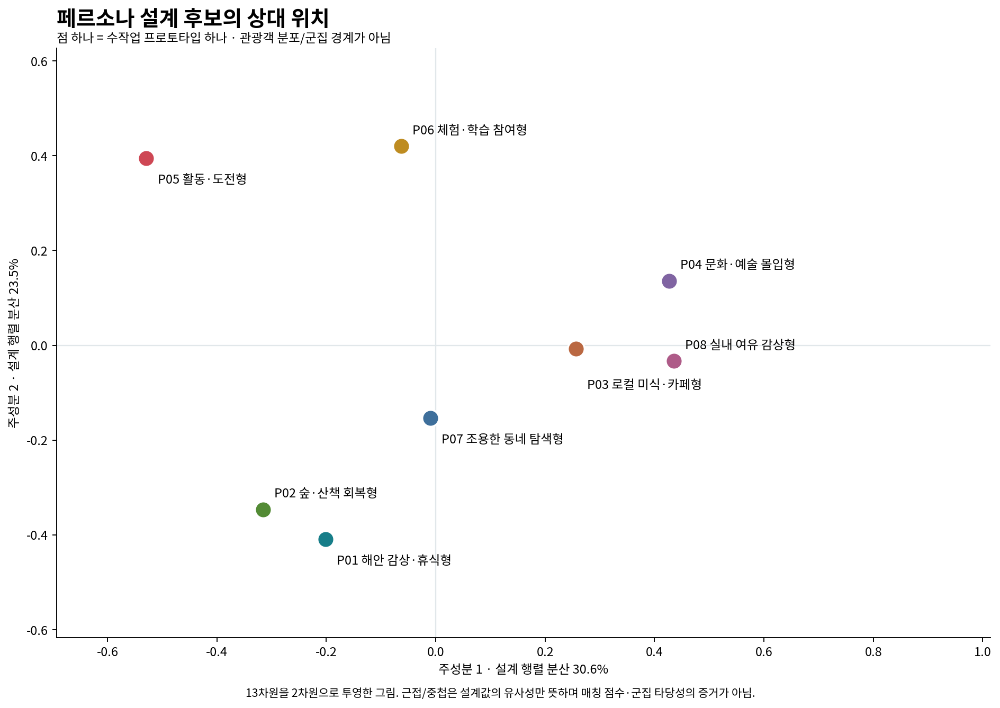

# 여행 세션 페르소나: 프로토타입 매칭, 군집 검증, 시각화

> 구현·검증 상태 구분: 아래 8개 유형은 기획자가 정의한 초기 프로토타입이다. 실제 제주 관광객 응답을 군집화한 결과가 아니며, 집단 비율·성능·통계적 타당성을 나타내지 않는다. 초기 매칭 규칙과 향후 데이터 기반 군집 연구를 분리한다. LAG의 방법론적 정의·기여는 원문 검토 전 확정하지 않으며, 이 문서의 거리 기반 매칭을 LAG라고 부르지 않는다.

관련 문서는 [설문·점수화](04-questionnaire-and-scoring.md), [평가·로드맵](03-evaluation-and-roadmap.md)다. 본 문서는 개인화 설명을 더 정교하게 만드는 제안이며 해당 문서의 필수 제약을 약화하지 않는다.

## 1. 분류 단위와 제품 역할

분류 단위는 **한 사람의 고정된 정체성이 아니라 이번 여행 세션에서 표현한 선호**다. 같은 사람이 이번에는 가족과 쉬고 다음에는 혼자 걷고 싶을 수 있다. 다른 날짜·동행·목적의 응답을 모순이나 잘못된 데이터로 취급하지 않는다.

- `user_id`: 동의가 있는 경우에만 반복 사용을 구분하는 별도 식별자.
- `trip_session_id`: 한 번의 여행 계획을 묶는 단위.
- `profile_version`: 동일 여행에서 답변을 수정할 때 증가하는 버전.
- `prototype_version` 또는 `cluster_model_version`: 매칭 기준을 재현하는 버전.

페르소나는 사용자에게 선택 이유를 설명하고 테마를 탐색하도록 돕는 도구다. 성격·건강·소득·가치관을 진단하는 지표가 아니며, ‘회복형’이라는 이름도 의학적 회복 효과를 뜻하지 않는다. 사용자에게는 ‘이번 여행에 가까운 테마’로 표현하고 수정·거부·이름 숨김을 허용한다.

원래 선호 벡터와 제약이 추천의 기준이다. 페르소나 이름을 붙였다는 이유로 관심 없는 활동을 추가하거나 필수 조건을 바꾸지 않는다.

## 2. 선호 공간과 설문 연결

초기 표현은 테마 9차원과 보조 선호 4차원의 총 13차원이다. 테마 9개를 하나의 블록으로 취급해 축이 많다는 이유만으로 다른 선호를 압도하지 않게 한다.

| 축 ID | 의미 | 입력·변환 | 주의점 |
|---|---|---|---|
| `coast` | 바다·해안 풍경 | Q07 순위 | 해안 선호가 수상활동 의향은 아님 |
| `nature` | 숲·자연 휴식 | Q07 순위 | 자연 선호로 산행 능력을 추정하지 않음 |
| `local_food` | 제주 로컬 음식 | Q07 순위 | 일반 음식 포함 선택과 구분 |
| `cafe` | 카페·디저트 | Q07 순위 | 식사와 독립된 관심 |
| `culture` | 역사·생활문화 | Q07 순위 | 실제 문화 장소 근거와 연결 |
| `art` | 미술·전시 | Q07 순위 | 모든 전시가 실내라는 가정 금지 |
| `outdoor` | 야외 활동 | Q07 순위 | 올레·한라산·스포츠의 구체적 선택은 F09/F10에 별도 보존 |
| `learning` | 체험·배움 | Q07 순위 | 아동 동반 여부와 별개 |
| `neighborhood` | 동네 산책 | Q07 순위 | 낮은 걷기 선호·걷기 상한과 함께 검증 |
| `pace` | 희망 활동 강도 | Q06의 여유·보통·활발을 임시로 0·0.5·1에 매핑 | 체력·장애·접근성의 대리변수로 사용하지 않음 |
| `crowd_avoidance` | 혼잡을 피하려는 선호 | 아래 PREF-C01 | 혼잡 데이터의 실제 가용성은 별도 문제 |
| `novelty` | 자신에게 새로운 경험을 원하는 정도 | 아래 PREF-N01 | 장소의 대중적 인기도와 동일하지 않음 |
| `indoor_preference` | 날씨와 별개인 실내 선호 | 아래 PREF-I01 | 우천 대응 정책 Q10과 구분 |

Q07의 1·2·3순위에 3·2·1을 부여한 뒤 합으로 나눠 테마 벡터를 만든다. 선택한 축만 양수이고 나머지는 선호를 표현하지 않은 축이다. 0은 ‘싫어함’이 아니다. 테마를 전혀 고르지 않은 응답은 영벡터를 유효한 선호로 사용하지 않고 테마 블록 미확인으로 처리한다.

합이 1인 테마 값은 표현된 관심의 상대적 비중이다. 코사인 매칭은 벡터의 크기보다 방향을 비교하므로, 전체 점수를 같은 비율로 높인다고 더 강한 확신이나 더 높은 정보 충족률을 얻지 않는다. 선택되지 않은 테마는 이번 상위 순위에 포함되지 않았다는 뜻이며 부정적 선호로 해석하지 않는다.

보조 선호는 0~1이다. 명시적으로 중간 선택을 한 0.5와 ‘아직 모름’의 결측을 구분한다. ‘상관없음’은 어느 특정 유형에 맞는 증거가 아니므로 매칭 거리에서 해당 차원을 제외한다. 무응답을 0.5로 채워 확실한 응답처럼 표시하지 않는다.

### 선택적 선호 보충 3문항

기존 핵심 10문항을 모두 늘려야 한다는 의미는 아니다. 기존 답으로 축을 알 수 없고 구분에 도움이 될 때만 다음을 묻는다. 기존 조건부 F01~F10과 별도 ID를 사용한다.

| ID | 정확한 질문 문구 | 선택값 |
|---|---|---|
| PREF-C01 | **가고 싶은 곳이 붐빌 때, 얼마나 피하고 싶으신가요?** | 붐벼도 괜찮아요 0 / 조금만 피하고 싶어요 0.25 / 어느 정도 피하고 싶어요 0.5 / 가급적 조용한 곳이 좋아요 0.75 / 혼잡한 곳을 매우 피하고 싶어요 1 / 선호 없음·아직 모름은 결측 |
| PREF-N01 | **이번 여행에서는 자신에게 새로운 장소·경험을 얼마나 원하시나요?** | 익숙한 경험 위주 0 / 익숙한 경험이 조금 더 좋아요 0.25 / 반반 0.5 / 새로운 경험이 조금 더 좋아요 0.75 / 새로운 경험 위주 1 / 선호 없음·아직 모름은 결측 |
| PREF-I01 | **날씨가 좋아도 실내와 야외 중 어느 쪽이 더 끌리시나요?** | 야외 위주 0 / 야외가 조금 더 좋아요 0.25 / 반반 0.5 / 실내가 조금 더 좋아요 0.75 / 실내 위주 1 / 선호 없음·아직 모름은 결측 |

이 문구와 간격은 검증 전 제안이다. 0.25 간격이 사람의 실제 선호 강도에서 동일 간격이라는 보장은 없으므로, 후속 분석에서 순서형 처리와 연속형 처리의 민감도를 비교한다.

Q08에서 ‘사람이 많은 곳’을 고르지 않았다는 사실만으로 혼잡을 좋아한다고 판단하지 않는다. 선택했다면 보충 질문을 생략할 근거가 아니라 해당 선호를 더 정확히 확인할 신호로 삼는다. 사용자가 ‘꼭 제외’한 경우에는 별도의 필수 조건도 유지한다.

기존 F07의 ‘익숙한 인기 장소/덜 알려진 장소’는 개인적 새로움과 대중적 인기도가 섞여 있다. 그 응답을 `novelty`의 정확한 숫자로 변환하지 않는다. 신규 분석에서는 PREF-N01을 사용하거나 문항을 분리해 검증한다.

Q10의 ‘비가 오면 실내로 변경’은 조건부 날씨 대응이다. 평소에는 야외 활동을 선호하는 사람도 같은 답을 할 수 있으므로 `indoor_preference=1`로 복사하지 않는다.

## 3. 변경할 수 없는 필수 제약의 분리

페르소나 매칭 함수에는 필수 제약을 취향 점수로 넣지 않는다. 다음은 별도 제약 객체와 검증 계층이 관리한다.

- 사용자가 필수로 확인한 예산·시간·이동 상한.
- 접근성·식이 관련 필수 조건, 운영·예약·연령·동반 제한.
- ‘반드시 포함’으로 확인한 카페·디저트·올레·한라산 등 경험.
- 제외한 장소·활동, 확정 일정.

여기서 ‘변경할 수 없음’은 매칭·군집·LLM이 임의 변경할 수 없다는 뜻이다. 사용자는 요약 화면에서 직접 수정할 수 있고 변경 시 새 프로필 버전으로 재계산한다. 유형의 전형적 활동이나 높은 점수가 필수 제약을 상쇄하지 못한다.

예를 들어 P05에 가깝더라도 한라산 정상 등정·장거리 걷기가 가능하다고 판단하지 않는다. P08에 가깝더라도 사용자가 반드시 넣고 싶다고 한 올레 경험을 삭제하지 않는다. 두 조건이 함께 불가능하면 이유와 선택지를 제공한다.

## 4. 8개 초기 프로토타입

프로토타입은 실제 응답이 없는 초기 단계에서 설명 가능한 탐색을 제공하기 위한 설계값이다. 유형 수 8은 현재 기획의 편의적 선택이며 제주 관광객이 정확히 8개 집단이라는 주장이 아니다. 세부 벡터 값은 시각화·데모와 같은 버전의 원본 데이터에서 관리하고, 본문 표현과 다른 값이 생기지 않게 한다.

| ID | 이름 | 중심 관심과 해석 | 금지할 추론 |
|---|---|---|---|
| P01 | 해안 감상·휴식형 | 해안 풍경을 보며 여유 있게 머무르는 여행 선호 | 해수욕·수상 스포츠 또는 장거리 산책을 자동 추가 |
| P02 | 숲·산책 회복형 | 숲·자연에서 쉬고 자신의 조건에 맞게 걷는 선호 | 건강 상태나 치료 효과, 오름 등반 능력 추정 |
| P03 | 로컬 미식·카페형 | 지역 음식과 카페·디저트를 즐기는 선호 | 높은 소비 여력 또는 모든 음식 섭취 가능성 추정 |
| P04 | 문화·예술 몰입형 | 역사·생활문화·전시를 자세히 경험하는 선호 | 특정 학력·교양·정체성 부여 |
| P05 | 활동·도전형 | 야외 활동과 적극적 체험을 원하는 선호 | 체력·자격·예약·안전 조건이 충족된 것으로 간주 |
| P06 | 체험·학습 참여형 | 직접 참여하고 배우는 경험을 원하는 선호 | 아동·학생·가족 여행자로 자동 분류 |
| P07 | 조용한 동네 탐색형 | 비교적 조용한 동네에서 새로운 경험을 찾아보는 선호 | 내향성·거주 성향·정확한 위치 정보 추정 |
| P08 | 실내 여유 감상형 | 실내 전시·카페 등에서 여유롭게 머무르는 선호 | 건강·이동 능력의 한계나 야외 활동 거부로 해석 |

모든 이용자를 하나에 고정 배정하지 않는다. 상위 유형 두 개가 비슷하면 혼합 선호로 보여주고, 어느 유형과도 가깝지 않으면 직접 선택한 축을 그대로 설명한다. ‘모든 여행자의 완전한 분류’보다 사용자 선택을 잘 설명하는지가 중요하다.

## 5. 초기 프로토타입 매칭 규칙

### 5.1 거리와 점수

블록 가중치의 초기 제안은 다음과 같다. 이 가중치는 학습된 결과가 아니다.

| 블록 | 기본 가중치 |
|---|---:|
| 테마 9차원 전체 | 0.60 |
| 활동 강도 `pace` | 0.15 |
| 혼잡 회피 `crowd_avoidance` | 0.10 |
| 새로움 `novelty` | 0.10 |
| 실내 선호 `indoor_preference` | 0.05 |

사용자 테마 벡터를 `u`, 프로토타입 테마 벡터를 `p`라 하면 테마 거리는 `d_theme = 1 − cosine(u,p)`다. 유효한 비음수·비영 벡터일 때 0~1 범위다. 보조 축의 거리는 `d_j = abs(u_j − p_j)`로 계산한다.

사용자가 실제 답한 활성 블록 집합을 `O`, 기본 가중치를 `w_b`라 하면 다음과 같다.

```text
coverage = Σ(b∈O) w_b
D(user, prototype) = Σ(b∈O) w_b × d_b / coverage
match_score = 100 × (1 − D)
```

`coverage=0`이거나 테마 벡터가 유효하지 않으면 일반적인 매칭을 확정하지 않는다. 누락된 보조 축은 거리에서 제외하되 정보 충족률은 낮게 유지한다. 어떤 유형에는 결측을 채우고 다른 유형에는 제외하는 식으로 후보별 정보량을 바꾸지 않는다.

**매칭을 제시하는 초기 조건은 유효한 테마 응답과 `coverage ≥ 0.70`이다.** 테마와 활동 강도만 있으면 0.75, 테마와 혼잡 회피만 있으면 0.70이다. 테마와 실내 선호만 있으면 0.65이므로 탐색 결과로 표시한다. 임계값은 검증 전 정책이다.

이 점수는 확률이 아니다. ‘P03과의 거리 기반 적합도 82점’은 ‘P03일 확률 82%’나 ‘추천에 만족할 확률 82%’가 아니다. 유형 점수를 소프트맥스 등으로 합이 100%가 되게 변환한 뒤 성격 비율처럼 표시하지 않는다.

### 5.2 혼합 선호와 정보 부족

- 상위 1·2위 점수 차이가 **5점 미만**이면 `mixed=true`로 표시하는 것을 초기 정책으로 제안한다.
- 혼합 상태는 상위 두 테마가 모두 설명에 도움이 된다는 뜻이며 혼합 비율을 측정한 것은 아니다.
- 점수 차이가 커도 정보 충족률이 낮으면 강한 확신으로 표현하지 않는다.
- 유효한 테마 응답과 `coverage ≥ 0.70`을 만족하더라도 **최상위 점수가 65점 미만**이면 ‘기존 프로토타입과 거리가 있는 탐색 결과’로 표시한다. 65점은 설계자가 정한 휴리스틱이며 검증된 OOD 탐지 기준이 아니다. 사용자를 이상 사례나 잘못된 응답자로 분류하지 않는다.
- 현재 카탈로그로 설명하기 어렵거나 사용자가 결과를 거부하면 ‘직접 고른 취향’ 설명으로 돌아간다. 그 응답을 새 유형 후보 검토에 사용할지는 별도 동의와 연구 절차를 따른다.

판정은 정보 충족 여부 → 기존 프로토타입과의 거리 → 상위 점수 차이 순서로 해석한다. 정보가 부족한 경우에는 65점 미만인지로 판단하지 않고 우선 정보 부족 탐색 상태다. 충분히 응답했어도 65점 미만이면 혼합 차이가 작더라도 ‘잘 맞는 두 유형’으로 확정하지 않는다.

0.70·65점·5점은 모두 조정 가능한 초안 임계값이며 신뢰수준이나 유의확률이 아니다. 실제 응답·사용자 판정에 대한 보정은 아직 수행하지 않았다. 초기 데모의 규칙과 향후 관측 결과를 구분해 기록한다.

### 5.3 불확실성 표시

정보 충족률, 상위 점수 차이, 사용자가 미정으로 둔 축, 어떤 응답이 순위에 영향을 주었는지를 함께 보여준다. 입력 한 단계 변화로 1위가 쉽게 바뀌는지 민감도 분석할 수 있지만, 그 변화 범위를 통계적 신뢰구간이라고 부르지 않는다.

초기 매칭 점수의 재현성 검사는 같은 입력·원본 프로토타입·가중치로 같은 결과가 나오는지를 확인한다. 실제 만족도와의 관계를 측정하기 전에는 예측 확률 보정이나 추천 효과가 검증되었다고 주장하지 않는다.

## 6. 기존 테마·장소 추천과의 관계

세 종류의 값을 혼동하지 않는다.

| 값 | 질문 | 사용처 |
|---|---|---|
| 프로토타입 매칭 점수 | 이번 응답은 어떤 설명용 유형과 가까운가? | 설문 결과 설명·탐색 |
| 테마 점수 | 실제 후보·제약 아래에서 어떤 여행 묶음을 제안할 수 있는가? | 상위 2~3개 실행 가능한 테마 선택 |
| 장소·일정 점수 | 이 후보나 일정이 선호·제약을 얼마나 잘 충족하는가? | 최종 추천·일정 검증 |

[설문·점수화 문서](04-questionnaire-and-scoring.md)의 테마 카탈로그와 본 문서의 8개 페르소나는 동일한 테이블이 아니다. 페르소나는 설명 계층이며 테마 카탈로그는 실제 장소·경험과 연결하는 제품 계층이다. 여러 페르소나가 같은 테마를 공유하거나 한 페르소나가 여러 테마와 연결될 수 있다. 연결표를 별도 버전으로 관리한다.

페르소나를 거쳐 다시 동일한 선호를 장소 점수에 가산하면 선호가 이중 반영된다. 기본안에서는 **원래 선호 벡터로 추천하고 페르소나는 설명에만 사용**한다. 페르소나를 모델 특징으로 추가하고 싶다면 원래 선호와의 중복·증분 효과를 제거 실험으로 확인한다. 서로 다른 점수 척도를 그대로 더하지 않는다.

군집과 만족도의 상관관계가 발견되어도 유형이 만족도를 일으킨다는 인과 효과는 입증되지 않는다. ‘페르소나 설명을 보여주는 UI’의 효과는 가능하면 동일한 추천 결과 아래에서 표시 유무를 무작위 비교한다. 추천 알고리즘까지 함께 바꾸면 두 효과를 구분해서 분석한다.

## 7. 실제 응답이 모인 뒤의 군집 연구

초기 프로토타입을 학습된 군집으로 부르지 않는다. 실제 연구는 동의·버전이 있는 응답 데이터로 별도 수행한다.

### 7.1 학습 단위와 누출 방지

1. 같은 여행의 연속 수정은 최종 확인본과 수정 이력을 구분한다. 수십 번 수정한 한 사람이 전체 구조를 지배하지 않게 한다.
2. 같은 사람의 여러 여행 세션을 연결할 수 있는 동의가 있다면 반복 사용자를 묶는다. 식별이 불가능하면 반복 사용자의 영향을 통제했다고 주장하지 않는다.
3. 사용자 단위로 개발·평가 데이터를 분리하고, 미래 시점의 세션은 별도 시간 검증에 사용한다.
4. 스케일링·대치·임베딩 설정·군집 수 선택은 개발 자료에서 결정하고 최종 평가 자료로 조정하지 않는다.
5. 부적절한 자동 입력, 반복 클릭, 문항 버전 차이를 분리한다. 단순히 기존 프로토타입에 맞지 않는다는 이유로 응답을 제거하지 않는다.
6. 표본의 모집 경로·계절·언어·동행 형태와 결측률을 보고한다. 편의 표본을 제주 관광객 전체의 분포로 일반화하지 않는다.

### 7.2 방법 비교

| 방법 | 장점·적용 목적 | 주의점 |
|---|---|---|
| 가중 Gower 거리 + PAM | 숫자·순서형·범주형 응답을 설명 가능한 거리로 비교. 대표 실제 응답인 medoid를 해석하기 쉬움 | 축·블록 가중치와 결측 처리에 민감. 9개 테마 축의 총 가중치를 제한해 변수 수 효과를 통제 |
| 테마 코사인 + 보조 축 거리의 혼합 거리 + PAM | 초기 매칭과 가까운 선호 방향을 유지하는 비교안 | 표준 Gower와 다른 거리이므로 이름과 계산식을 구분. 두 결과의 안정성을 비교 |
| 응답 임베딩 + HDBSCAN | 충분한 텍스트 응답에서 비선형 의미 구조·잡음 집합 탐색 | 임베딩 모델·문장화 방식·밀도 설정이 결과를 바꿈. 잡음은 잘못된 사용자라는 뜻이 아니며 군집이 없을 수도 있음 |
| 원래 13차원 표현의 밀도 기반 비교 | 텍스트 모델의 효과를 분리하는 대조 실험 | 차원별 의미·거리·결측을 처리한 뒤 적용. 시각화용 2차원 좌표를 그대로 군집 입력으로 사용하지 않음 |

Gower 비교에서는 각 축의 범위와 순서형 변환을 고정한다. 테마 9축의 기본 가중치 합을 0.60으로 두는 등의 블록 가중을 적용하되, 개별 축별 절대차 기반 Gower와 블록 코사인 기반 혼합 거리를 같은 방법으로 보고하지 않는다.

쌍별 결측에 따라 비교하는 차원이 달라지면 거리가 서로 비교하기 어려울 수 있다. 충분한 공통 응답이 있는 분석 집합과 결측 처리 민감도 분석을 우선한다. 부족한 쌍의 거리를 임의로 0으로 채워 유사한 사용자로 만들지 않는다. 완전 응답만 분석하면 어떤 응답자가 빠졌는지도 보고한다.

HDBSCAN은 사용자가 선택한 정보만 정형화해 입력한다. 텍스트에 ‘P05 활동형’ 같은 기존 유형명을 추가하면 설계한 라벨을 다시 발견하는 순환 평가가 되므로 피한다. 언어 모델이 생성한 가상의 취향 설명을 실제 응답처럼 학습시키지 않는다. 군집별 membership 값도 검증 없이 실제 페르소나 확률로 표시하지 않는다.

### 7.3 군집 수와 이름

PAM의 `K`는 8로 고정하지 않는다. 데이터 크기·해석 가능성에 맞는 후보 범위를 사전 정의하고 거리 기반 지표, 재표집 안정성, 최소 집단의 실질 표본 수, 제품 활용성을 함께 비교한다. K=1 또는 분리하지 않는 기준도 검토해 유형을 나누는 이득 자체를 확인한다.

HDBSCAN의 `min_cluster_size`·`min_samples` 등은 개발 자료에서 비교하고 잡음 비율·소수 집단의 일관성을 함께 보고한다. 군집이 적거나 많이 나왔다는 사실만으로 우수성을 판단하지 않는다.

학습된 군집은 처음에 `C01` 등의 중립 ID를 사용한다. medoid·응답 분포·문항별 차이·실제 참가자의 해석을 검토한 뒤 이름을 정한다. 초기 P01~P08과의 대응은 사후 비교표로 만들며 억지로 1:1 대응시키지 않는다. 이름보다 원본 분포와 군집 불확실성을 보존한다.

## 8. 안정성·유용성 검증 계획

아래는 예정된 실험이며 완료한 검증이나 관측값이 아니다. 표본 수는 모집 분포·결측·기대 차이를 관찰한 뒤 연구 목적에 맞게 결정한다.

| 검증 | 방법 | 판정 시 주의점 |
|---|---|---|
| 반복 사용자 영향 | 사용자 단위로 재표집하고, 한 반복에서 사용자별 한 세션을 뽑는 분석과 모든 세션을 사용자 균등 가중하는 분석 비교 | 같은 사람의 세션을 독립 사용자로 세지 않음. 알고리즘이 표본 가중을 지원하지 않으면 지원한다고 가정하지 않음 |
| 재표집 안정성 | 초기 제안으로 200회 사용자 단위 부트스트랩. 공통 평가 세션 또는 각 군집의 대응을 정한 뒤 ARI·집단별 Jaccard 보고 | 임의 군집 번호를 직접 비교하지 않음. 모든 표본을 매회 다시 학습하고 변환 단계도 포함 |
| 최소 집단 검토 | 집단별 고유 사용자 수·세션 수·대표성·재현성 | 아주 작은 집단의 높은 점수를 일반화하지 않음 |
| 시간·계절 변화 | 미래 시점·다른 모집 구간에서 구조와 매칭 분포 비교 | 진짜 여행 맥락 변화와 데이터 오류를 구분 |
| 민감도 | 가중치, 순서형 간격, 결측 처리, Q07 최대 선택 수, 알고리즘·모델 버전 변경 | 한 설정에서만 나타나는 분리를 강한 유형으로 해석하지 않음 |
| 사용자 해석 | 유형 설명의 납득도·누락된 선호·거부 이유 조사 | 그럴듯한 이름만으로 수학적 군집 타당성이 확보되지 않음 |
| 추천 기여 | 원래 선호만 사용하는 기준 대비 페르소나 추가의 증분 성능·비용 | 자기 생성 유형을 정답으로 삼아 정확도를 측정하지 않음 |

탐색 단계의 사전등록 후보로 **대응 군집의 중앙 Jaccard 0.75 이상**, **동일 평가 집합 배정의 중앙 ARI 0.70 이상**을 안정성 검토 기준으로 제안할 수 있다. 이는 보편적 합격선이나 실제 결과가 아니며, 비교 방식·표본 크기·잡음 처리에 따라 해석이 달라진다. 표본이 충분하지 않거나 재표집 간 동일 대상을 비교할 수 없으면 해당 지표를 미산출로 남긴다. 지표 기준만 충족했다고 제품 유형을 자동 승인하지 않는다.

HDBSCAN의 잡음·집단 수가 반복마다 달라질 수 있으므로 잡음 처리 규칙을 먼저 정하고 전체 결과와 비잡음 결과를 구분한다. 군집 내부 분리 지표와 시간·사용자 외부 검증을 모두 보며, 다수 집단의 안정성이 소수 집단의 붕괴를 가리지 않도록 집단별 결과를 남긴다.

## 9. 시각화와 인터랙티브 데모의 해석

### 프로토타입 히트맵

행은 P01~P08, 열은 9개 테마와 4개 보조 선호다. 색은 설계자가 정한 프로토타입 값이며 실제 관광객 평균·분포가 아니다. 테마와 보조 축의 경계·블록 가중치·값의 방향을 표시한다. 색만으로 구분하지 않도록 숫자·축 설명도 제공한다.

{width=17cm}

### 2차원 PCA 프로토타입 지도

각 점은 **설계된 프로토타입 하나**다. 사용자 응답을 만들어 뿌리거나 인공 군집 구름을 추가하지 않는다. PCA는 같은 원본 13차원 프로토타입 행렬을 중심화해 계산하고 입력 변환·스케일링·설명 분산을 기록한다. 실제 행렬에서 계산한 값만 표시한다.

시각화 변환은 테마 벡터를 L2 정규화한 뒤 `sqrt(0.60)`을 곱하고 보조 축에 각각 블록 가중치의 제곱근을 곱하는 방식이다. 변환된 8×13 설계 행렬을 평균 중심화해 PCA를 계산한다. 보조 축의 제곱 거리를 사용하는 그림과 절대 차이를 사용하는 실제 매칭은 같은 거리 함수가 아니다. 설명분산은 이 8개 설계점에 대한 값이지 관광객 선호를 설명하는 비율이 아니다.

{width=17cm}

PCA는 구조를 보는 보조 그림이다. 두 점이 화면에서 가깝거나 멀다는 사실이 실제 매칭 거리와 정확히 일치하지 않는다. 매칭은 5절의 원래 차원과 결측 규칙으로 수행하며 **2차원 PCA 좌표로 유형을 결정하지 않는다**. 축 방향·부호는 임의이며 ‘고급 여행자’처럼 의미를 부여하지 않는다.

정적 지도에는 프로토타입만 표시한다. 인터랙티브 데모에서 사용자 입력점을 겹쳐 보여주는 기능을 제공한다면 테마와 네 보조 축이 모두 실제로 입력된 경우에만 같은 변환으로 투영한다. 부분 응답을 임의로 채워 지도에 점을 만들지 않는다. 이 사용자 점도 연구 표본이 아니라 사용자가 조작한 데모 입력이다.

보고서용 자산 경로는 `reports/assets/persona-prototypes-heatmap.png`, `reports/assets/persona-prototypes-map.png`로 통일한다. 파일의 존재와 실제 내용은 보고서 생성 단계에서 검증하고, 이미지를 만들었다는 사실을 군집 연구 완료로 해석하지 않는다.

### 입력 슬라이더 데모

[독립 HTML 탐색기](../reports/persona-explorer.html)를 브라우저에서 열면 입력에 따른 순위와 정보 충족률을 확인할 수 있다. 인터넷 연결·별도 서버가 필요하지 않으며 입력을 저장하거나 전송하지 않는다. 설정 원본은 `data/persona-prototypes.json`, 비교 계산은 `scripts/persona_model.py`에 있다. 실제 추천 API나 LAG 연결은 구현하지 않았다.

- 사용자가 9개 테마와 4개 보조 선호를 바꾸면 원래 차원의 매칭 점수·정보 충족률·혼합 여부를 갱신한다.
- 미응답 토글을 두어 결측을 0으로만 표현하지 않게 한다. 테마 합이 0이면 선택되지 않은 블록이다.
- 슬라이더가 표현하는 촘촘한 연속 값은 실제 Q07의 최대 3개 순위 응답과 다르다. ‘전체 선호를 탐색하는 데모’임을 표시하고 실제 설문 입력 모드와 구분한다.
- 데모 프로필은 사용자가 만든 가상 입력이며 연구용 실제 응답 데이터가 아니다. 자동 저장·외부 전송을 하려면 별도 명시와 동의가 필요하다.
- 결과에 ‘설계된 유형과의 거리 기반 비교’, 상위 유형, 점수, coverage, 응답 영향 요약을 표시한다. 현재 관광객 집단의 비율·예측 확률로 표현하지 않는다.
- 히트맵·PCA·데모·문서가 같은 프로토타입 버전을 읽도록 하고, 캡처에는 데이터·계산 버전을 남긴다.

실제 응답이 수집되면 시각화에 세션 점을 추가할 수 있으나 개인정보·반복 사용자·표본 편향·축소 왜곡을 별도로 검토한다. 작은 집단의 식별 가능성을 고려하고 동의 범위를 벗어난 위치·건강 정보를 시각화하지 않는다.

## 10. 단계별 적용과 종료 조건

| 단계 | 수행 내용 | 종료 조건 |
|---|---|---|
| A. 설계 프로토타입 | 8개 프로토타입·13축·매칭 규칙·입력 문항을 버전 관리 | 값·수식·그림·데모가 일치하고 학습된 군집으로 표시되지 않음 |
| B. 응답 이해도 확인 | 소규모 사용자와 축·유형 설명·보충 질문의 이해도 확인 | 날씨/실내, 인기/새로움, 강도/능력의 혼동을 수정하고 질문 버전 고정 |
| C. 실제 자료 수집 | 동의·여행 세션·반복 사용자·결측을 관리하며 자료 수집 | 분석 가능한 표본과 모집·버전 기록 확보. 표본 규모·한계를 보고 |
| D. 군집 비교 연구 | Gower/PAM·혼합거리/PAM·임베딩/HDBSCAN 비교 | 학습·평가 분리, 반복 사용자 안정성·시간 검증·민감도 결과 확보 |
| E. 제품 채택 | 학습 군집과 초기 프로토타입의 사용성·추천 기여 비교 | 명확한 추가 이득이 있는 구조만 채택. 이득이 없으면 설명 가능한 프로토타입 유지 |

초기 시각화와 데모가 동작해도 C~E가 완료된 것은 아니다. 자료와 결과가 확보되기 전에는 ‘군집 분석 완료’, ‘8개 관광객 유형 검증’, ‘개인화 효과 입증’이라고 보고하지 않는다.

## 11. 인수 체크

- Q07의 9개 테마 코드가 설문·프로토타입 원본·시각화에서 일치한다.
- 보조 선호의 미응답·선호 없음·중간 응답을 구분하고 coverage를 정확히 계산한다.
- 동일 입력·버전에서 동일한 원래 차원의 매칭 결과가 재현된다.
- 테마가 없거나 coverage 0.70 미만이면 탐색 상태이며, 상위 점수 차이 5점 미만의 혼합 표시를 별도로 검증한다.
- 충분한 응답이 있어도 최상위 65점 미만이면 기존 프로토타입과의 거리로 인한 탐색 상태이며, 이 기준을 검증된 OOD 탐지로 표시하지 않는다.
- 필수 제약·특정 경험의 포함 여부가 유형 선택으로 변경되지 않는다.
- PCA 좌표를 바꿔도 추천에 사용하는 매칭 점수는 달라지지 않는다.
- 인터랙티브 PCA 사용자 점은 모든 블록에 실제 응답이 있을 때만 표시된다.
- 데모 입력을 실제 사용자 표본으로, 설계값을 관측 평균으로 혼동하는 문구가 없다.
- 실제 군집 연구를 수행하지 않은 단계의 지표·표본 수·검증 결과는 미실행으로 남는다.
