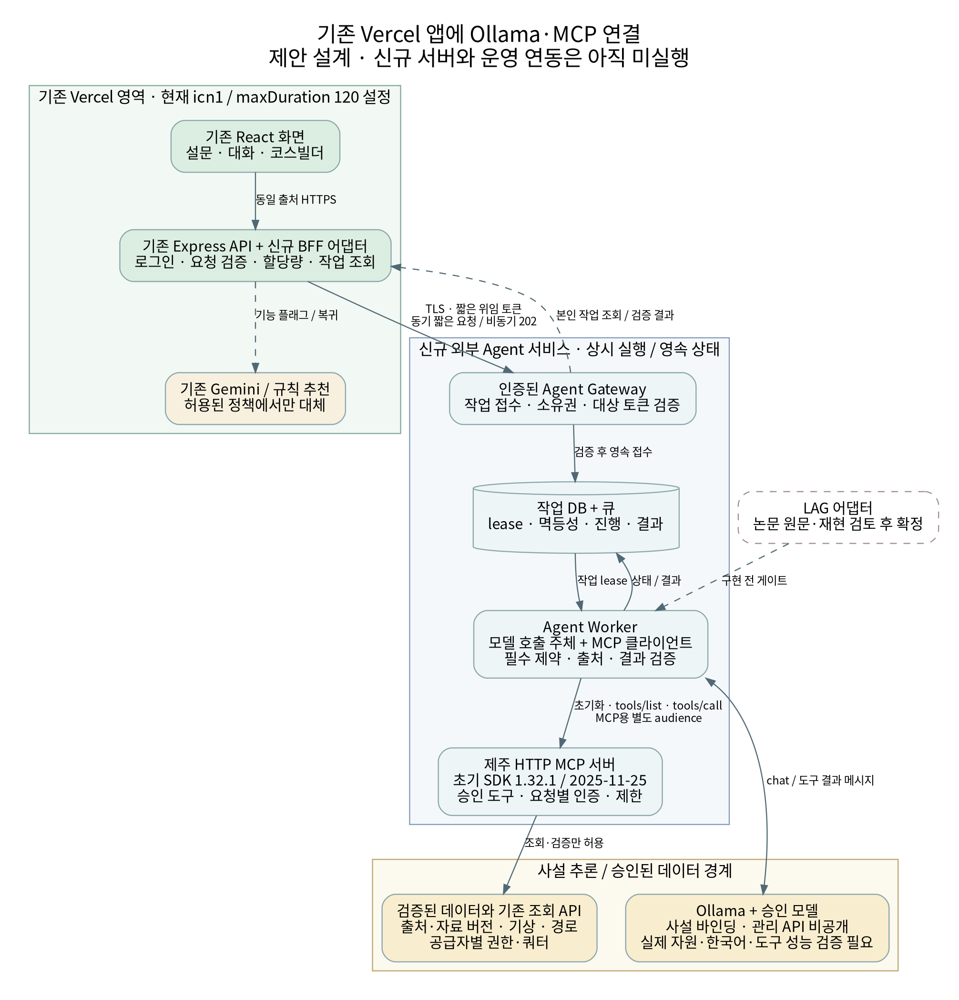
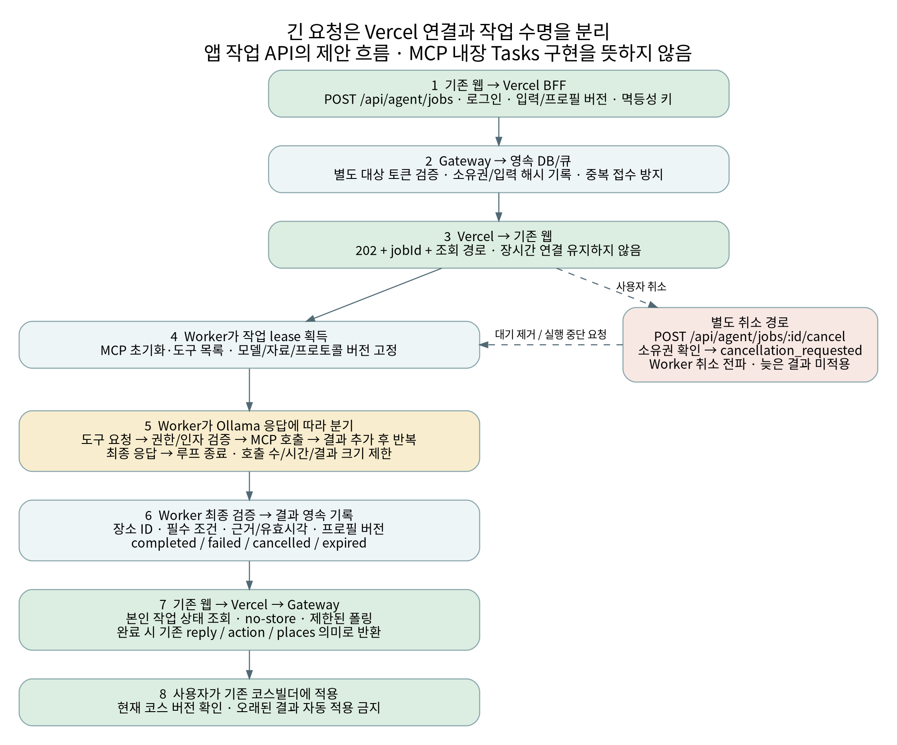

# Ollama 기반 LAG 적용 가능성과 Vercel 배포 설계

기준일: 2026-11-18 한국 시간. **Ollama를 모델 실행 계층으로 사용하는 Agent 구조는 공식 기능상 구성할 수 있다. LAG는 사용자 결정(2026-11-18)에 따라 논문 2508.05509 Logic-Augmented Generation을 뜻하며(처음 지정된 2504.09277은 SynthTRIPs 평가셋 생성 틀로 확인, [19 문서](19-agent-step2-data-foundation.md)), 그대로 재현할 수 있는지는 원문·필수 모델·학습 조건 확인 후 확정한다.** 이 문서는 실제 설치·GPU 추론·운영 배포 결과가 아닌 호환성 조사와 구현 계획이다.

## 1. 이번 조사로 확인한 범위

사용자가 제시한 `https://ollama.com/library`와 `docs.ollama.com`은 현재 클라우드의 HTTPS 프록시에서 403으로 차단됐다. 대신 공식 `ollama/ollama` 저장소의 **고정 커밋 `b8db8d5b5c8daedbbef7bb9ace2221a38bc384c2`**에 있는 API·도구 호출·구조화 출력·인증·운영 문서를 읽었다. 라이브러리의 최신 모델 목록을 직접 열람하거나 모든 모델을 시험했다는 의미는 아니다.

현재 계획 대상은 `jeju-tour-six.vercel.app`과 원본 `OREUM-IT/jeju-tour`다. 분석한 커밋은 `b0602a175c1d08959b7187da2b29ac450b52e0ba`다. 운영 도메인은 네트워크 차단으로 직접 확인하지 못했고, Vercel 프로젝트의 현재 설정·배포 커밋·계정 한도를 조회하지 않았다. 기존 소스를 확장할 설계를 작성했으며 운영 앱 파일은 수정하지 않았다.

현재 클라우드에는 Ollama 실행 파일과 노출된 GPU 장치가 없었다. 모델 다운로드·추론·학습·부하 검증은 수행하지 않았다. 연구 환경의 CPU/RAM 존재만으로 운영 성능을 보장하지 않는다.

## 2. Ollama, LAG, MCP의 역할 구분

| 구성 | 담당 역할 | 별도 구현·검증이 필요한 부분 |
|---|---|---|
| Ollama | 지원하는 모델의 추론·대화·도구 요청·임베딩 API | Agent 실행 루프, 데이터 권한, 실제 도구 실행, 일정 검증, 서비스 운영 |
| LAG | 사용자가 지정한 논문의 방법 | 정의·알고리즘·필수 입력·학습/추론 조건을 원문에서 확인 후 재현 |
| MCP | 애플리케이션과 도구 서버 간 도구·리소스 호출 계약 | 추천 알고리즘·모델·데이터베이스·잡 스케줄러를 자동 제공하지 않음 |
| Agent Worker | 모델 호출과 허용 도구 실행을 조정하고 작업 결과를 검증 | 호출 예산·취소·재시도·근거·LAG 어댑터를 구현 |
| 기존 Vercel 앱 | 사용자 화면·로그인·요청 접수·결과 표시·코스빌더 | 외부 서버 인증·작업 조회·새 응답 버전·제한된 공개 전환 |

**모델이 도구를 요청하면 Worker가 MCP 클라이언트로서 실행한다. Ollama가 자동으로 MCP 서버를 연결하거나 LAG를 구성하는 것은 아니다.** 페르소나 프로토타입·필수 제약·장소 ID 검증은 모델과 독립된 공통 계층으로 유지한다.

## 3. 공식 기능과 LAG 적용 조건

| 필요 기능 | 공식 문서 확인 | 설계에서의 사용과 조건 |
|---|---|---|
| 한국어 요청 해석·설명 | `POST /api/chat` 대화 API | 실제 모델의 한국어·제주 지명·오류 복구 성능은 평가해야 함 |
| 구조화 프로필·응답 | 로컬 요청 `format`에 JSON Schema 전달 가능 | `message.content` 파싱 후 서버에서 스키마 검증. 형식 준수가 사실성·제약 충족을 보장하지 않음 |
| 도구 요청 | 지원 모델에 `tools`를 전달하면 `tool_calls` 반환 | 배포 모델의 지원 여부 확인. 허용 목록·인자·권한을 검증한 뒤 Worker가 실행 |
| 여러 단계 추론 | 도구 결과를 `role:tool` 메시지로 추가해 다시 모델 호출 | 종료 조건·루프/시간/토큰 상한을 애플리케이션이 관리 |
| 검색용 임베딩 | `POST /api/embed`, 배치 입력 | 검색이 LAG의 구성인지 원문에서 확인. 별도 RAG 실험에도 사용 가능. 한국어 품질·차원·모델 버전 고정 |
| 스트리밍 | 기본 NDJSON, `stream:false`로 일반 JSON | 초기 프로필 추출은 non-streaming 사용. 스트림의 부분 JSON을 최종 결과로 검증하지 않음 |
| 모델 정보 조회 | `/api/show`, `/api/tags`, `/api/ps`, `/api/version` | capabilities·license·digest·실제 적재·서버 버전으로 배포 명세 작성 |
| LAG 전용 학습·그래프·메모리 | Ollama 기능만으로 요구 충족 여부를 알 수 없음 | 논문에서 요구하면 별도 학습/데이터/알고리즘 계층을 추가하고 Ollama가 해당 모델을 실행 가능한지 확인 |

판정은 다음과 같이 나눈다.

1. **일반 모델 호출과 도구 루프로 구현 가능한 부분**: Ollama를 추론 공급자로 사용하는 설계가 가능하다. 실제 모델별 구조화 출력·도구 능력은 검증한다.
2. **논문이 특정 체크포인트·가중치 접근·로그 확률·특수 디코딩·학습을 요구하는 부분**: Ollama의 해당 버전/API가 노출하는 기능과 대조한다. 지원하지 않으면 별도 런타임이 필요할 수 있다.
3. **LAG 재현 성립**: 원문 핵심 요소와 실험을 재현한 결과가 있어야 판정한다. 일반 Agent 루프를 만든 것을 논문 재현으로 대체하지 않는다.

### 로컬 실행과 Ollama Cloud는 같은 조건이 아니다

조사 커밋의 공식 문서는 **Ollama Cloud가 structured outputs를 지원하지 않는다**고 명시한다. 따라서 로컬의 JSON Schema 기능을 Cloud에서도 사용할 수 있다고 가정하지 않는다. 향후 Cloud를 평가하면 당시 실제 API·모델 지원을 다시 확인한다.

Cloud 추론은 외부 인프라로 데이터를 보낸다. 로컬 API 주소로 호출하더라도 원격 Cloud 모델이면 외부 전송이 발생할 수 있다. 로컬 전용 운영은 `OLLAMA_NO_CLOUD=1` 설정과 실제 모델의 원격 호스트 여부를 확인한다. 로컬 API는 기본 무인증이므로 사설 연결과 인증 게이트웨이가 필요하다.

## 4. 권장 배포 구조

OpenAI·Claude를 함께 사용하는 공급자 라우터, 다중 터널과 DB 위치·계정·비용은 [확장 설계](11-multi-provider-tunnels-database-and-cost.md)에 정리했다. 아래 그림은 Ollama·MCP 연결의 기본 구조이며 모델을 Ollama 하나로 제한하는 계약은 아니다.

{width=17cm}

그림의 외부 서비스는 아직 구축되지 않은 제안이다. [Mermaid 설계 원본](../design/ollama-mcp-vercel-architecture.mmd)도 함께 관리한다.

| 위치 | 배치할 구성 | 이유 |
|---|---|---|
| 기존 Vercel | React 화면, Express API/BFF, 로그인 확인, 요청·결과 어댑터, 기존 코스빌더 | 기존 도메인·사용 흐름 유지. 브라우저에 모델/MCP 비밀값을 주지 않음 |
| 외부 상시 실행 서비스 | 인증된 Agent Gateway, 작업 큐·Worker, MCP 클라이언트 | 긴 모델 로딩·여러 도구 호출·작업 재개·취소를 요청 함수의 수명과 분리 |
| GPU 또는 검증된 추론 호스트 | Ollama 데몬, 선택 모델·영속 모델 저장소 | 실제 적재 자원과 warm/cold 지연을 측정해 운영. Vercel 함수 안에 상주 데몬을 넣지 않음 |
| 외부 MCP 서비스 | 제주 데이터·근거·경로·검증 도구의 HTTP 서버 | 기존 로컬 stdio 경로를 원격 호출 가능한 계약으로 전환 |
| 영속 데이터 계층 | 작업 상태·출처 스냅샷·권한·공유 할당량·캐시 | 프로세스 메모리를 작업/권한/일일 한도의 유일한 저장소로 쓰지 않음 |

외부 서비스는 MVP에서 한 운영 호스트의 격리된 서비스로 시작할 수 있다. 인증 Gateway만 필요한 HTTPS 경로를 공개하고 Ollama·DB·관리 API는 사설망/로컬 주소에 둔다. 부하와 장애 분리 요구가 생기면 Worker·MCP·추론 호스트를 나눈다. 운영 리전은 기존 `icn1`과의 종단 지연·비용·데이터 제공자 접근을 측정해 정한다.

`Vercel 함수의 localhost`는 개발 PC나 GPU 서버가 아니다. `OLLAMA_HOST=0.0.0.0`만 설정하거나 11434 포트를 인터넷에 노출하는 방식을 배포 연결로 삼지 않는다. CORS는 서버 간 인증을 대신하지 않는다.

## 5. Vercel과의 호환성 및 요청 시간

기존 `prototype/vercel.json`은 `api/index.js`의 `maxDuration:120`, 서울 `icn1`, `dist/public`과 Express catch-all 경로를 설정한다. `assistant.ts`는 한 대화에 110초 예산을 둔다. 이는 **확인한 소스 설정**이며 모든 Vercel 요금제·런타임의 최대치라는 주장이 아니다.

새 기능의 동기 경로는 예열된 간단한 요청에 한정하고 **우선 25초 이내** 종료하는 목표를 제안한다. 복잡한 일정·콜드 스타트·여러 단계 LAG는 접수 후 `202`와 작업 ID를 반환하는 비동기 경로를 기본으로 한다. 25초는 측정 결과가 아니며 실제 계정 한도와 종단 측정에 맞춰 조정한다.

스트리밍 응답도 함수 실행 한도를 없애지 않는다. 연결을 계속 열어 두는 방식으로 장기 작업을 유지하지 않는다. 화면은 진행 상태를 폴링하는 경로부터 구현하고, SSE를 추가하더라도 재접속과 권한을 검증하며 영속 작업 상태를 기준으로 삼는다. MCP 전송의 SSE와 브라우저 진행 이벤트는 서로 다른 계약이다.

기존 `AssistantReply.engine`은 `gemini | keyword | none`으로 고정되어 있다. Ollama 결과를 `gemini`로 거짓 표기하지 않는다. 웹 공유 타입과 Flutter 파싱·표시를 확인해 `ollama` 및 방법/모델 버전 메타데이터를 추가하거나 명시적인 v2 응답을 도입한다. 기존 `/api/assistant`를 무조건 비동기 `202`로 바꾸면 기존 화면이 깨질 수 있으므로 신규 작업 경로와 기능 플래그를 먼저 사용한다.

## 6. 모델 후보 선정과 자원 검증

| 후보군 | 공식 자료에서 확인한 범위 | 프로젝트의 다음 확인 |
|---|---|---|
| Llama 계열 | API 예제에 `llama3.1`·`llama3.2` 등장 | 정확한 태그·크기·라이선스·한국어·도구·스키마 지원 |
| Qwen 계열 | 도구 호출 예제에 `qwen3` 등장 | 동일 과제의 도구 정확성·한국어·지연·메모리 |
| 다른 모델 | 구조화 출력 예제에 `gpt-oss` 등장 | 실제 로컬 제공 형태·자원·스키마 지원·라이선스 |
| 임베딩 모델 | 예제에 `embeddinggemma` 등장 | 제주 지명·별칭·테마 검색의 Recall·한국어 성능·인덱스 버전 |

위 이름은 공식 예시의 존재를 확인한 것이며 현재 라이브러리의 전체 태그나 한국어 최적 모델을 보증하지 않는다. 대화 모델과 임베딩 모델은 역할·버전·평가를 분리한다. Ollama 프로그램의 MIT 라이선스와 각 모델 가중치의 라이선스는 별개다.

배포 명세에는 Ollama 버전, 모델 태그·digest, 양자화, context 크기, 하드웨어, 동시 요청 수, 프롬프트/스키마 버전을 기록한다. 움직이는 `latest` 별칭만으로 실험을 재현하지 않는다. 가중치 다운로드 크기를 필요한 VRAM과 동일시하지 않는다. KV cache, context, 동시 요청, 모델 여러 개 상주가 추가 자원을 사용한다.

첫 검증은 한 개 모델·동시 추론 1개로 시작해 warm/cold 지연·메모리·큐 대기를 측정한다. 이후 부하를 단계적으로 올리고 실패율·p95·비용에 맞춰 병렬 처리와 큐 상한을 정한다. CPU 추론을 운영 대안으로 삼으려면 같은 목표 지연을 실제 측정해야 한다. GPU·모델 크기를 자료 없이 확정하지 않는다.

## 7. Worker에서 실행할 처리 루프

1. Gateway가 검증한 요청·사용자 컨텍스트·프로필 버전·데이터 스냅샷을 Worker가 읽는다.
2. 논문 원문 검토 전에는 기존 규칙/설명 경로와 공급자 비교 실험만 실행하고 `method=lag`로 표시하지 않는다.
3. 구조화가 필요한 입력은 Ollama `format`에 제한된 JSON Schema를 전달하고 `stream:false`로 받는다. 파싱·스키마 실패는 제한된 재시도 후 명시적 오류/대체 경로로 처리한다.
4. 모델에 제공하는 도구 목록은 Worker가 승인한 MCP 도구만 포함한다. MCP `inputSchema`를 모델의 함수 스키마로 변환할 때 지원하지 않는 JSON Schema 요소를 확인한다. 도구 출력은 외부 데이터이며 지시 권한이 없다.
5. `tool_calls`를 받으면 도구명·인자·사용자 범위·비용·남은 시간을 검사한다. 임의 URL·파일·명령·모델 다운로드를 실행하는 범용 도구를 제공하지 않는다.
6. Worker가 MCP 클라이언트로 `tools/call`을 실행하고, 검증된 출력·근거 ID·시각·오류 상태를 도구 결과 메시지로 돌려준다. 원문 전체·비밀값을 모델 컨텍스트에 무조건 넣지 않는다.
7. 모델을 다시 호출하되 반복 횟수·호출 수·시간·출력 크기를 제한한다. 초기 루프 상한 4회 등은 제안 설정이며 논문 요구 및 품질·지연 실험으로 조정한다.
8. 최종 결과를 장소 ID·응답 스키마·필수 조건·운영 정보·프로필 버전으로 다시 검증한다. 미확인은 미확인으로 남긴다.
9. 결과·근거·실행한 방법/모델·시간/비용을 영속 저장하고 작업 완료를 알린다. 원시 자유서술·정확 위치의 로그 보존은 최소화한다.

Ollama는 도구를 대신 실행하지 않는다. 병렬 도구 요청은 권한·총호출 한도·의존성을 검사한 뒤 독립된 조회에만 허용한다. 모델 출력이 반복되거나 후보가 부족하면 정해진 종료·사용자 확인 절차로 돌아간다.

## 8. 비동기 요청·취소·복구

{width=17cm}

작업의 정확한 API·상태·인증은 [MCP·Vercel 통합 계획](10-mcp-server-and-vercel-integration.md)을 기준으로 한다. 작업 상태는 최소 `queued/running/completed/failed/cancellation_requested/cancelled/expired`를 구분한다. 큐 ACK와 DB 상태 사이의 실패, Worker 종료, 중복 실행을 고려해 lease·heartbeat·idempotency·재시도 기록을 둔다.

브라우저가 닫혀도 실행 중인 작업이 자동으로 안전하게 종료된다고 가정하지 않는다. 명시적 취소는 Worker와 모델/도구 요청에 전달하고, 종료 보장이 없는 업스트림 결과는 늦게 도착하더라도 적용하지 않는다. 사용자가 프로필을 수정하면 구버전 작업의 결과를 새 추천으로 표시하지 않는다.

외부 추론이 실패한 경우 기존 규칙 추천을 제한된 기능으로 제공할 수 있다. Gemini 대체는 기존 인증·비용·전송 조건이 실제로 사용 가능하고 해당 사용 범위가 허용된 경우에만 사용한다. 자체 호스팅을 선택한 이유가 외부 전송 제한이라면 자동 Cloud/Gemini 대체를 허용하지 않는다.

## 9. 운영 설정과 구축 순서

| 위치 | 필요한 설정 이름 예시 | 관리 원칙 |
|---|---|---|
| Vercel 서버 | `AGENT_V2_ENABLED`, `AGENT_GATEWAY_URL`, Gateway 서비스 인증 설정 | 현재 예시이며 아직 등록하지 않음. 브라우저 번들에 포함하지 않음 |
| Agent 서비스 | `OLLAMA_BASE_URL`, `OLLAMA_CHAT_MODEL`, `OLLAMA_EMBED_MODEL`, `MCP_SERVER_URL`, 인증 검증·DB/큐 설정 | 운영자가 고정. 사용자/LLM이 목적지 URL·모델 ID·인증 범위를 변경하지 못함 |
| Ollama 호스트 | `OLLAMA_HOST`, `OLLAMA_NO_CLOUD`, context·상주·병렬 처리 설정 | 로컬/사설 바인딩. 공개 pull/create/delete 관리 경로 금지 |
| MCP 서버 | 데이터 제공자·경로 API 인증, 허용 도구·쿼터·캐시·권한 설정 | 도구별 비밀값 분리. 원본 토큰·서명 URL을 반환하거나 로그에 남기지 않음 |

구축은 다음 순서로 진행한다. 현재 실행한 명령이 아닌 **후속 구현 계획**이다.

1. LAG 원문·자료·모델 라이선스와 운영 예산을 확인한다. 논문 요구와 제품 공통 계층의 대응표를 확정한다.
2. 전용 호스트·영속 모델 저장소·TLS Gateway·사설 네트워크를 준비한다. 서명/체크섬을 검증하는 공식 설치 경로로 고정 버전 Ollama를 배포한다.
3. 관리 단계에서 승인된 모델만 받아 digest·license·capabilities를 기록한다. 사용자 요청에서 모델을 자동 다운로드하지 않는다.
4. 호스트 내부에서 `/api/version`, `/api/tags`, `/api/show`, `/api/ps`와 실제 JSON·도구·임베딩 요청을 확인한다. health 응답과 기능 readiness를 구분한다.
5. MCP 도구를 fixture→실제 허용 데이터 순서로 검증하고, Worker에서 모델 요청과 MCP 도구 호출을 연결한다.
6. 영속 작업·취소·중복 방지·사용자 격리를 검증한다. 추론 큐가 가득 차면 제한·재시도 가능 상태를 반환한다.
7. Vercel Preview에서 새 API·화면 상태와 구형 클라이언트 호환성을 확인한다. 현재 Production의 환경변수를 덮어쓰지 않고 환경별로 분리한다.
8. 기준선 비교 후 제한된 사용자의 opt-in 실험으로 공개한다. 기존 경로로 복귀 가능한 기능 플래그와 데이터 호환성을 유지한다.

## 10. 채택 전 필수 검증

- **모델 기능**: 한국어 프로필 스키마, 도구명/인자, 없는 장소, 상충 요구, JSON 파싱 실패, 여러 단계 종료를 실제 모델로 검증.
- **데이터·추천**: 출처·시각·접근성·예산·이동 조건을 기존 결정론적 검증으로 확인. 페르소나 점수를 확률이나 LAG 성능으로 표시하지 않음.
- **MCP**: 합의한 프로토콜 버전에서 초기화·도구 발견·호출·오류·취소·인증을 검증. SDK v1과 v2의 수명주기를 혼용하지 않음.
- **Vercel**: Preview와 Production의 실제 함수 설정, 인증·캐시·본문/응답 한도·시간·네트워크·클라이언트 파싱을 확인.
- **운영**: 콜드 스타트·메모리 부족·Worker 재시작·외부 API 실패·공유 할당량·늦은 결과·동일 작업 중복·비용을 검증.

운영 채택의 결론은 위 결과와 LAG 재현 근거를 확보한 뒤 내린다. 현재 확인한 결론은 **Ollama 기반 모델 실행과 MCP 도구 연결을 기존 Vercel 앱에 추가할 구체적인 설계 경로가 있다**는 것이다.

## 11. 고정 출처

- [Ollama API](https://github.com/ollama/ollama/blob/b8db8d5b5c8daedbbef7bb9ace2221a38bc384c2/docs/api.md): chat/embed/show/tags/ps/version.
- [도구 호출과 Agent 루프](https://github.com/ollama/ollama/blob/b8db8d5b5c8daedbbef7bb9ace2221a38bc384c2/docs/capabilities/tool-calling.mdx).
- [구조화 출력](https://github.com/ollama/ollama/blob/b8db8d5b5c8daedbbef7bb9ace2221a38bc384c2/docs/capabilities/structured-outputs.mdx) 및 [Cloud](https://github.com/ollama/ollama/blob/b8db8d5b5c8daedbbef7bb9ace2221a38bc384c2/docs/cloud.mdx): 로컬/Cloud 지원 구분.
- [인증](https://github.com/ollama/ollama/blob/b8db8d5b5c8daedbbef7bb9ace2221a38bc384c2/docs/api/authentication.mdx), [FAQ](https://github.com/ollama/ollama/blob/b8db8d5b5c8daedbbef7bb9ace2221a38bc384c2/docs/faq.mdx), [컨텍스트](https://github.com/ollama/ollama/blob/b8db8d5b5c8daedbbef7bb9ace2221a38bc384c2/docs/context-length.mdx), [GPU](https://github.com/ollama/ollama/blob/b8db8d5b5c8daedbbef7bb9ace2221a38bc384c2/docs/gpu.mdx).
- [임베딩](https://github.com/ollama/ollama/blob/b8db8d5b5c8daedbbef7bb9ace2221a38bc384c2/docs/capabilities/embeddings.mdx), [NDJSON 스트리밍](https://github.com/ollama/ollama/blob/b8db8d5b5c8daedbbef7bb9ace2221a38bc384c2/docs/api/streaming.mdx), [Ollama 소프트웨어 라이선스](https://github.com/ollama/ollama/blob/b8db8d5b5c8daedbbef7bb9ace2221a38bc384c2/LICENSE).
- [현재 앱 Vercel 설정](https://github.com/OREUM-IT/jeju-tour/blob/b0602a175c1d08959b7187da2b29ac450b52e0ba/prototype/vercel.json), [현재 응답 타입](https://github.com/OREUM-IT/jeju-tour/blob/b0602a175c1d08959b7187da2b29ac450b52e0ba/prototype/src/shared/types.ts#L598).

공식 문서 기본값에도 버전별·문서별 차이가 있을 수 있으므로 실제 배포 설정을 명시하고 관측한다. 라이브 사이트의 최신 동작·요금·모델 지원은 이 조사만으로 확정하지 않는다.
