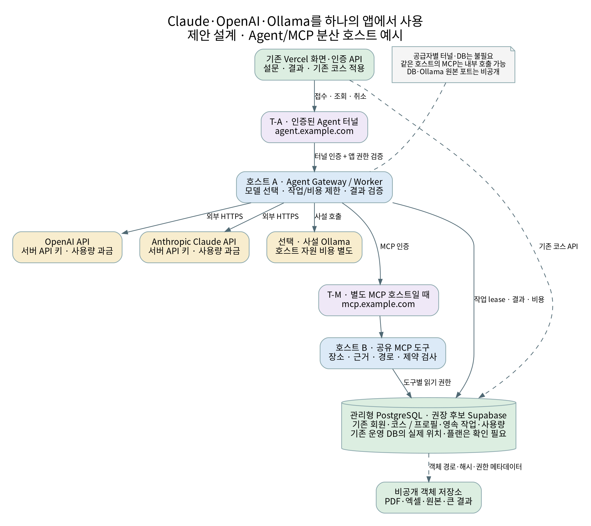

# Claude·OpenAI 동시 지원, 다중 터널, DB 위치와 계정·비용

기준일: 2026-11-18 한국 시간. 기존 Vercel 앱을 확장하는 **설계 제안**이다. 서버·터널·DB·계정을 새로 만들거나 결제·유료 모델 호출을 실행하지 않았다. 실제 운영 환경변수·계정 요금제·최신 단가를 조회한 결과가 아니다.

## 1. 권장 결론

**기존 Vercel 앱 + 공통 Agent Worker/모델 라우터 + OpenAI·Anthropic API + 선택적 사설 Ollama + 공유 MCP + 관리형 PostgreSQL**을 권장한다. 여행자는 기존 앱에서 로그인하고 추천을 받으며, 운영자가 공급자 계정과 사용료를 관리한다. 여행자마다 OpenAI·Claude 계정을 만들게 하지 않는다.

다중 터널은 서로 다른 위치의 Agent·MCP·추론 호스트를 연결하는 네트워크 구성이다. OpenAI와 Claude를 함께 사용할 수 있게 하는 구성은 **모델 라우터와 공급자별 어댑터**다. 두 API는 Worker가 외부 HTTPS로 호출하므로 공급자마다 인바운드 터널을 만들 필요가 없다. 터널 수를 늘려도 공급자의 요청 한도·토큰 한도·계정 크레딧이 늘어나지 않는다.

DB는 터널이나 Vercel 함수 안에 두지 않는다. **확인된 기존 운영 PostgreSQL을 우선 재사용**하고, 아직 DB 위치가 확정되지 않았다면 Supabase의 관리형 PostgreSQL을 권장한다. 모든 모델과 Worker가 하나의 논리적 작업 DB를 공유한다. 여러 모델을 쓴다는 이유로 사용자·코스 DB를 복제하지 않는다.

## 2. 기존 소스에서 재사용할 부분

원본 `OREUM-IT/jeju-tour` 커밋 `b0602a175c1d08959b7187da2b29ac450b52e0ba` 기준이다.

| 확인한 부분 | 의미와 후속 작업 |
|---|---|
| `server.ts:1148` 부근의 `openaiWebJson()` | 이미 OpenAI Responses API와 웹 검색을 호출하는 코드가 있다. OpenAI를 처음 추가하는 작업이 아니라 기존 호출을 공통 사용량·오류·모델 정책으로 통합하는 작업이다. 실제 운영 키·모델 사용 가능 여부는 미확인이다. |
| `server.ts:3114` 부근의 `explainWithOpenAI()` | 일정 설명용 OpenAI 경로도 있다. 모든 호출 위치를 조사해 라우터 적용 범위와 기존 동작 보존을 구분한다. |
| `assistant.ts`의 Gemini 비서 | 기존 비서의 기준선과 복귀 경로를 유지한다. 모델 라우터 확장이 기존 모든 호출을 자동 대체하지는 않는다. |
| `member-auth.ts`의 Supabase 인증 | 기존 회원 인증·사용자 ID를 유지한다. 새 AI 기능 때문에 별도 회원 체계를 만들지 않는다. |
| `server.ts:205`의 `SUPABASE_DB_URL` 또는 `DATABASE_URL` | PostgreSQL 연결은 확인되지만 실제 운영 DB 호스트·리전·요금제는 확정할 수 없다. Supabase Auth를 쓴다는 사실만으로 DB 호스팅 위치를 단정하지 않는다. |
| `course-plans.ts`의 소유자 조건과 기존 코스 저장 | 기존 테이블·ID·버전 충돌 처리를 유지한다. 새 추천은 검증된 제안으로 전달하고 사용자가 적용한다. |
| `prototype/supabase/README.md`의 운영 기록 | 과거 Supabase DB 설정과 공개 이메일 가입용 SMTP 필요가 기록되어 있다. 현재 계정·메일 발송 가능 상태는 별도 확인 대상이다. |

기존 DB 연결 예제의 `ssl.rejectUnauthorized:false`를 새 서비스에 복사하지 않는다. 선택한 DB 공급자가 안내하는 TLS·CA 검증 연결을 사용하고, 실제 Vercel·Worker 런타임에서 인증서와 풀러 연결을 확인한다. 이번 작업에서 원본 앱 코드를 변경한 것은 아니다.

## 3. 다중 터널 배치

{width=17cm}

그림은 Agent와 MCP가 서로 다른 호스트에 있는 경우다. 같은 호스트에서 운영하면 MCP를 사설 서비스로 호출할 수 있으며, 필요한 여러 공개 서비스는 하나의 named tunnel에 여러 호스트명을 연결할 수도 있다. `example.com` 주소는 모두 예시다.

| 연결 | 목적과 배치 | 공개 범위 |
|---|---|---|
| T-A: `agent.example.com` → Agent Gateway | Vercel이 작업 접수·조회·취소 API를 호출. Gateway·Worker는 상시 실행 호스트에 둔다. | 인증된 HTTPS API만 공개. 터널 접근 정책과 앱의 사용자·작업 권한 검사를 모두 적용한다. |
| T-M: `mcp.example.com` → 별도 MCP 호스트 | 데이터 도구를 별도 서버에서 운영할 때 Worker가 연결한다. 같은 호스트라면 내부 통신도 가능하다. | MCP 전용 인증·scope·허용 메서드. 일반 브라우저에 관리 엔드포인트를 노출하지 않는다. |
| 선택 T-I: `inference.example.com` → 추론 Gateway | Ollama GPU 호스트가 다른 네트워크에 있을 때 추가한다. 사설 네트워크 연결도 선택할 수 있다. | 인증 Gateway가 승인된 추론 경로·모델만 허용. 무인증 Ollama 11434와 pull/create/delete 관리 API를 직접 공개하지 않는다. |
| Worker → OpenAI·Anthropic | 각 공식 API로 나가는 HTTPS 호출 | 신규 라우터용 키는 Worker의 비밀 설정에 둔다. 기존 Vercel 호출용 서버 키는 해당 경로 이관 전까지 분리해 유지한다. 추가 인바운드 터널 불필요. |
| Vercel/Worker/MCP → DB | 공급자 관리 연결 또는 허용된 사설 연결 | DB 5432를 웹 공개 터널로 내보내지 않는다. TLS·최소 권한·사용자 격리를 적용한다. |

Cloudflare Tunnel을 후보로 삼되 세 개념을 구분한다. **여러 호스트명**은 한 터널의 라우팅 규칙이고, **별도 터널**은 서로 다른 origin·운영 경계를 연결하는 구성이다. **동일 터널의 replica**는 같은 논리 서비스의 가용성을 높이는 구성이다. 서로 다른 replica를 OpenAI 전용/Claude 전용 서버로 나누고 요청이 모델별로 알아서 전달될 것으로 가정하지 않는다. 모델 선택은 라우터가 수행한다.

로컬 실험에서는 개발 PC의 상시 실행·절전·인터넷 연결이 가용성을 결정한다. 24시간 서비스는 운영 호스트와 재시작 정책이 필요하다. 터널은 계산 자원·DB·백업을 제공하거나 Vercel 함수 실행 시간을 늘려 주지 않는다. 익명 임시 URL보다 운영자 계정·도메인/DNS·고정 호스트명을 사용하는 운영 구성을 계획한다.

별도 GPU 호스트에 Worker를 두고 그 Worker가 DB의 할당된 작업을 가져와 로컬 Ollama를 호출하는 방식도 가능하다. 이 경우 GPU 호스트에 추가 공개 터널이 필요하지 않으며, 작업별 요구 기능·모델을 확인해 해당 Worker만 점유하게 한다. 원격 HTTP 추론이 필요한 경우에 T-I를 선택한다.

공식 문서에서 Quick Tunnel은 개발용·임시 호스트명·SSE 미지원으로 설명되어 있어 운영 MCP 스트림의 기본 경로로 사용하지 않는다. Named Tunnel도 실제 egress·연결·타임아웃 검증이 필요하다. Cloudflare로 나가는 연결의 포트/프로토콜 정책을 확인하고, 별도 Load Balancing 상품이 일반 터널에 자동 포함된다고 가정하지 않는다.

Cloudflare Access를 추가한다면 Vercel→Agent와 Worker→MCP에 서버 간 서비스 인증을 적용한다. 이 인증은 네트워크 진입을 제어하며, 기존 위임 토큰의 사용자·audience·소유권 검사를 대신하지 않는다. 추후 Claude/ChatGPT 제품에서 MCP를 직접 연결하는 기능은 별도 OAuth·클라이언트 호환 검증으로 다룬다.

## 4. OpenAI·Claude·Ollama를 함께 사용하는 실행 계약

`ModelRouter → OpenAIAdapter / AnthropicAdapter / OllamaAdapter`를 Worker 내부에 둔다. 각 어댑터는 모델 ID·지원 기능·토큰/시간 한도·취소·오류·사용량을 공통 계약으로 변환한다. OpenAI Responses API, Anthropic Messages API, Ollama chat의 도구·메시지 형식이 동일하다고 가정하지 않는다. 지원하는 정확한 모델 ID와 스키마 기능을 배포 명세에 고정한다.

| 실행 모드 | 동작 | 비용·품질 관리 |
|---|---|---|
| 선택 실행 | 요청마다 OpenAI/Claude/Ollama 중 허용된 한 공급자를 선택 | 초기 기본 모드. 서버가 설정한 모델·권한·예산 안에서 선택한다. |
| 단계별 분담 | 구조화 입력, 일정 설명 등 단계별로 검증된 모델을 사용 | LAG 원문 요구를 바꾸는지 검토한다. 모델 이름만으로 특정 단계의 우수성을 단정하지 않는다. |
| 동시 비교 | 같은 프로필·데이터 스냅샷으로 OpenAI와 Claude의 읽기 전용 후보를 병렬 생성 | 두 호출의 비용이 모두 발생할 수 있다. 공통 필수 조건·근거 검증 후 비교하며, 두 결과가 코스를 각각 저장하지 못하게 한다. |
| 장애 시 대체 | 일시 장애·한도 등에 대해 허용된 대체 공급자 또는 규칙 추천 사용 | 데이터 외부 전송·비용 정책이 허용할 때만 수행. 중단·재시도·대체를 새 attempt로 기록한다. |

하나의 부모 작업 아래 공급자별 `attemptId`, 입력/프로필/자료 버전, 도구 결과 스냅샷, 모델 버전, deadline, 사용량을 기록한다. 비교 시 읽기 도구의 공통 결과를 재사용할 수 있지만 사용자·날짜·자료 버전과 최신성 조건이 같은 경우로 제한한다. 각 모델이 추가 요청한 도구의 비용도 합산한다. 선택된 최종 제안만 기존 코스 적용 버튼으로 전달한다.

브라우저 응답은 새 계약에서 `provider`, `model`, `method`, `attemptId`, `dataVersion`, `degraded` 등을 명시한다. 기존 `AssistantReply.engine`의 제한된 union을 그대로 두고 새 값을 보내지 않는다. 기존 웹·Flutter와 버전별 호환 어댑터를 함께 적용한다. OpenAI·Claude 지원은 논문 LAG 재현을 자동 증명하지 않는다.

## 5. DB는 실제로 어디에 두는가

**기본안: 관리형 PostgreSQL을 운영 데이터의 원본 저장소로 두고, Vercel·Agent·MCP가 역할별 권한으로 접속한다.** 기존 DB의 공급자·프로젝트·리전·소유권·복구 상태가 확인되면 그 DB를 확장한다. 신규 선택이 필요할 때 Supabase는 기존 Auth와 함께 관리하기 좋은 후보이며, 기존 운영 DB를 무조건 이전하라는 뜻은 아니다.

운영 리전은 현재 Vercel 소스의 `icn1`과 Worker의 위치, DB 공급자의 제공 리전을 함께 검토해 정한다. 서울 또는 가까운 제공 리전의 종단 지연을 측정한다. 기존 프로젝트가 다른 리전에 있다고 즉시 이동하지 않고 백업·복구·ID 연속성·이관 중 쓰기를 검증한다. 개발/Preview에는 운영 개인 데이터와 분리한 프로젝트 또는 적절한 격리 환경을 사용한다.

| 저장 대상 | 권장 위치 | 관리 원칙 |
|---|---|---|
| 기존 회원·로그인·코스 | 기존 Auth와 확인된 운영 DB | 기존 사용자 ID·테이블·코스 버전 유지. 새 회원 체계 중복 생성 금지. |
| 여행 프로필·응답·페르소나 버전 | PostgreSQL의 사용자 소유 테이블 | 최소 수집, 사용자별 조회·수정·삭제, 응답/프로토타입 버전 기록. |
| 장소·필드별 근거·데이터 목록 | 별도 catalog/evidence 스키마 | 원천 ID·출처·유효시각·라이선스·미확인/상충 상태 보존. |
| 작업·이벤트·시도·도구 호출·비용 | 비공개 `agent_private` 스키마 | `jobs`, `job_events`, `job_attempts`, `tool_runs`, `provider_usage`, 멱등성 기록을 예시로 설계. 브라우저에 원본 테이블을 직접 공개하지 않음. |
| PDF·엑셀·원본 스냅샷·큰 결과 | 비공개 객체 저장소, 예: Supabase Storage | DB에는 경로·해시·버전·권한·보존 기한. 원본 파일은 Git이나 Vercel 임시 파일시스템을 원본 저장소로 사용하지 않음. |
| 검색 임베딩 | 필요성이 확인되면 pgvector 등 | 모델·차원·정규화·청크 버전별 인덱스 분리. OpenAI/Ollama 벡터를 같은 공간으로 섞지 않음. LAG라는 이름 때문에 필수로 추가하지 않음. |
| API 키·DB 비밀번호·터널 토큰 | 각 플랫폼의 서버 비밀 설정 | 브라우저·프롬프트·MCP 출력·사용량 로그에 기록하지 않음. |

Supabase를 선택해도 새 스키마를 모두 `public`에 노출하지 않는다. RLS와 서버의 소유자 조건을 함께 적용하고, RLS 우회 가능한 관리자 역할을 Worker의 기본 역할로 사용하지 않는다. MCP는 업무에 필요한 읽기 역할, Worker는 작업 처리 역할, Vercel은 해당 API 역할을 사용한다. Auth와 DB가 서로 다른 서비스면 다른 DB의 `auth.users`에 직접 외래키를 걸 수 없으므로 신뢰된 Auth 주체 ID를 연계하는 계약을 별도로 둔다.

Vercel처럼 연결이 급증하는 경로는 공급자가 지원하는 transaction pooler를 검토한다. Worker는 작은 연결 풀을 사용하고 마이그레이션은 권장 직접/세션 연결로 수행한다. 풀러의 prepared statement·세션 상태·연결 수 제한은 선택 모드에 맞춰 검증한다.

## 6. 초기 작업 큐는 같은 PostgreSQL에서 시작

초기에는 Redis를 추가하지 않고 DB의 영속 작업 테이블을 큐로 사용할 수 있다. API는 작업·멱등성 기록을 트랜잭션으로 저장한 뒤 `202`를 반환한다. Worker는 짧은 트랜잭션에서 `FOR UPDATE SKIP LOCKED` 같은 방법으로 처리할 작업을 점유하고 **커밋한 뒤** 모델을 호출한다. 모델 응답을 기다리며 DB 트랜잭션·행 잠금을 유지하지 않는다.

lease·heartbeat·시도 횟수·재시도 예정 시각·취소 상태를 저장한다. 종료 시 lease/attempt 버전을 비교하는 조건부 갱신으로 늦은 Worker가 새 결과를 덮어쓰지 못하게 한다. 모델 요청은 외부 서비스이므로 DB 트랜잭션만으로 정확히 한 번 실행·과금을 보장할 수 없다. 네트워크 타임아웃 후 무조건 같은 유료 요청을 다시 보내지 않고 가능한 공급자 요청 ID·결과 조회·중단 상태를 확인한다.

상태 조회는 기존 작업 API를 사용한다. DB 연결 실패 시 개인 작업을 메모리 Map으로 성공 접수하지 않는다. 부하·잠금 경합·큐 지연이 실제로 문제가 되면 Redis/전용 큐를 추가하되 원본 상태·사용자 권한·outbox·중복 처리는 유지한다.

## 7. 필요한 계정과 결제

아래는 운영자의 준비 항목이다. 사용자의 현재 가입·결제 여부를 확인한 표가 아니며, 무료 제공량과 요금 조건은 신청 시 공식 화면에서 확인한다. OpenAI·Anthropic의 API 사용료는 일반적인 ChatGPT·Claude 채팅 구독과 별개다.

| 서비스 | 필요한 계정·권한 | 무료 시작과 결제 판단 |
|---|---|---|
| Vercel | 기존 프로젝트 접근 권한. 현재 프로젝트를 재사용 | 무료 플랜의 이용 목적·팀·사용량 조건 확인. 상업 운영/협업·자원 요구에 맞는 플랜을 선택하며 기존 플랜을 추정하지 않음. |
| 관리형 DB, 권장 후보 Supabase | 기존 프로젝트 권한 또는 새 조직·프로젝트 | 무료 개발 범위로 시작할 수 있으나 저장량·컴퓨트·백업/복구·비활성 정책·가용성에 따라 유료 선택. 여러 프로젝트의 비용·한도도 확인. |
| OpenAI API | API 플랫폼의 조직/프로젝트, 서버 API 키, 사용 가능한 크레딧·과금 설정 | 유료 API 사용 시 사용량 과금. 무료 체험 크레딧을 보장하지 않음. ChatGPT Plus/Pro 구독으로 대체하지 않음. |
| Anthropic API | Claude API Console 조직·키·크레딧/과금 설정 | 유료 API 사용 시 별도 과금. Claude Pro/Max 채팅 구독의 사용량을 서비스 API 예산으로 간주하지 않음. |
| Cloudflare named tunnel | Cloudflare 계정·도메인/DNS 제어·터널 구성 권한 | 일반 Tunnel은 무료 플랜에서도 사용 가능. 도메인 등록비·Access/Load Balancing·고급 기능·한도 조건은 별도 확인하며 터널 자체와 GPU 비용을 구분. |
| Agent/MCP 운영 호스트 | 보유 장비 또는 호스팅 사업자 계정 | 개발은 보유 PC 활용 가능. 24시간 가용성이 필요하면 서버·디스크·트래픽 비용 발생 가능. API 모델만 쓰는 Worker에는 GPU 필수 아님. |
| Ollama | 자체 실행 자체에 OpenAI/Claude 유료 구독 불필요 | 프로그램 비용과 별개로 장비·전기·GPU 임대·디스크 비용 검토. Ollama Cloud 선택 시 그 서비스 계정·조건 별도. |
| 인증 메일/외부 데이터 | 필요 시 SMTP·도메인, 지도·경로·데이터 제공자 계정 | 기존 Supabase 문서가 공개 이메일 가입에 별도 SMTP를 요구. 메일·경로·데이터 무료 한도와 사용권을 별도로 확인. |

OpenAI·Claude를 앱에서 모두 호출하려면 **두 공급자의 API 사용 권한과 과금 가능 상태를 각각 준비**해야 한다. 두 유료 채팅 구독을 구매할 필요가 있다는 뜻은 아니다. 통합 모델 중개 서비스를 선택하면 계정 구조가 달라질 수 있지만, 이 설계는 공급자 직접 연동을 기본으로 한다. 기존 로그인·Vercel·DB 계정을 새로 중복 구매할 이유는 없다.

Supabase 공식 소스에서 무료 프로젝트 한도와 조직 단위 과금, 유료 조직 내 프로젝트별 컴퓨트 비용을 확인했다. 개발/운영 프로젝트를 추가할 때 무료·유료 조건을 함께 확인한다. 특히 Compute Hours는 Spend Cap 적용 대상이 아니므로 이 설정을 모든 DB 비용의 절대 상한으로 취급하지 않는다.

## 8. 비용을 통제하는 방식

월 비용은 `호스팅 + DB/스토리지/백업 + 도메인·터널 관련 옵션 + GPU(선택) + 모델 API + 데이터 API/메일`로 나눈다. 모델 비용은 공급자·모델별 입력/출력 토큰 단가, 캐시·도구·검색 등 해당 기능의 과금 항목을 합산한다. 이번 문서는 최신 가격표를 직접 확인하지 못했으므로 월 정액이나 특정 모델의 현재 단가를 제시하지 않는다.

동시 비교를 모든 사용자 요청의 기본값으로 두면 두 모델과 도구의 비용이 함께 발생한다. 초기에는 한 모델 선택 실행을 기본으로 하고, 비교는 정해진 평가 표본·예산 안에서 수행한다. 비교 비용이 항상 정확히 두 배인 것은 아니며 토큰 길이·도구 수·재시도에 따라 달라진다.

작업 제출 전에 사용자·프로젝트·공급자별 예산을 원자적으로 예약하고, 완료 후 실제 usage로 정산한다. 출력 상한·동시 호출 수·하루 예산·최대 attempt를 서버가 제한한다. 실패·취소 응답도 이미 처리한 API 사용료가 발생할 수 있으므로 성공 작업만 비용에 포함하지 않는다. 공급자 대시보드의 예산 알림을 서비스의 강제 차단으로 간주하지 않는다. 미확정 비용은 추정치로 기록하고 정산 시 보정한다.

**초기 권장 조합:** 기존 Vercel/Auth/DB를 재사용하고, 소형 상시 Worker·MCP와 두 API의 제한된 사용량으로 시작한다. 보유 GPU가 있으면 Ollama를 비교 후보로 추가한다. GPU가 없다면 API 기능 검증을 위해 GPU 서버를 먼저 구매할 필요는 없다. 운영 규모와 자체 실행의 이점이 확인되면 GPU 비용과 API 비용을 비교한다.

## 9. 실제 적용 순서와 확인 기준

1. 기존 Vercel·Auth·DB의 소유 프로젝트·리전·플랜·백업/복구·메일 상태를 확인한다. 비밀값은 채팅·보고서에 붙이지 않고 플랫폼 보안 설정으로 관리한다.
2. 개발 DB에 새 스키마·권한·작업 lease·사용량 원장을 추가한다. 기존 회원·코스 데이터와 API의 호환을 확인한다.
3. 공통 모델 계약과 OpenAI/Anthropic 어댑터를 구현한다. 기존 OpenAI 검색·설명, Gemini 비서 각각의 연결 범위를 명시한다. 실제 모델로 스키마·도구·사용량·오류 처리를 검증한다.
4. 호스트 배치에 맞춰 T-A/T-M, 필요한 경우 T-I를 구성한다. 터널 자체와 앱 인증을 별도로 검증하고 URL이 열리는 것만으로 사용자 격리를 통과했다고 보지 않는다.
5. Vercel Preview에서 설문→프로필→모델 선택→공유 MCP→결과 검증→코스 적용을 확인한다. 공급자별 비용과 데이터 전송 범위도 표시/기록한다.
6. 제한된 비교 요청에서 모델별 제약 위반·근거 정확성·선호 일치·p95·비용을 측정한다. 두 모델의 동의가 사실성을 보장하지 않으므로 같은 결정론적 검증을 통과시킨다.
7. 터널 단절·모델 429/타임아웃·DB 재시작·lease 만료·중복 요청·취소·다른 사용자 job 접근을 검증한다. 예산을 넘는 신규 요청이 거절되고 이미 실행된 요청의 비용이 누락되지 않는지도 확인한다.
8. 기능 플래그로 제한 공개한 뒤 확대한다. 신규 경로를 끌 때 기존 Gemini/규칙 경로와 기존 코스 저장을 유지하고, 진행 중 작업의 조회·취소를 보존한다.

현재 단계의 산출물은 위 계약과 배치 계획이다. 실제 계정 생성·과금 활성화·유료 호출·터널 공개·DB 마이그레이션·운영 배포는 완료하지 않았다. LAG 원문·PDF·엑셀의 미확인 항목은 [근거 문서](06-evidence-and-open-items.md)를 따른다.

## 10. 근거와 공식 확인 경로

아래 고정 GitHub 문서는 실제로 읽은 근거다. 가격·구독 도움말·제품 사이트의 직접 접속은 환경 프록시에서 차단되어 최신 가격표와 사용자 계약은 확인하지 못했다. API 인증 방식의 확인과 실제 결제 상태의 확인을 구분한다.

- [OpenAI 공식 SDK의 API 키 사용](https://github.com/openai/openai-python/blob/f56a67f1f0c844135261ece304a90d2ec2571d4b/README.md), [Anthropic 공식 SDK의 API 키 사용](https://github.com/anthropics/anthropic-sdk-python/blob/10c82e8e8a968f624797df48d6115c4cc6b32551/README.md).
- [Cloudflare 다중 호스트 구성](https://github.com/cloudflare/cloudflare-docs/blob/70104effd4fc45829b2dbabf929eae4f9d44ea9b/src/content/docs/tunnel/features/locally-managed-tunnels/configuration-file.mdx), [replica와 라우팅](https://github.com/cloudflare/cloudflare-docs/blob/70104effd4fc45829b2dbabf929eae4f9d44ea9b/src/content/docs/tunnel/concepts/routing.mdx), [Quick Tunnel 제한](https://github.com/cloudflare/cloudflare-docs/blob/70104effd4fc45829b2dbabf929eae4f9d44ea9b/src/content/docs/tunnel/get-started/quick-tunnels/index.mdx), [계정·도메인·호스트 준비](https://github.com/cloudflare/cloudflare-docs/blob/70104effd4fc45829b2dbabf929eae4f9d44ea9b/src/content/docs/tunnel/get-started/index.mdx).
- [Supabase 과금 구조](https://github.com/supabase/supabase/blob/d7ead91b9fb4de21a077cc31323fe6e7f34caceb/apps/docs/content/guides/platform/billing-on-supabase.mdx), [컴퓨트와 Spend Cap](https://github.com/supabase/supabase/blob/d7ead91b9fb4de21a077cc31323fe6e7f34caceb/apps/docs/content/guides/platform/manage-your-usage/compute.mdx), [DB 연결·풀러](https://github.com/supabase/supabase/blob/d7ead91b9fb4de21a077cc31323fe6e7f34caceb/apps/docs/content/guides/database/connecting-to-postgres.mdx).

운영 전 최신 조건 확인 경로:

- [기존 DB와 OpenAI 호출 소스](https://github.com/OREUM-IT/jeju-tour/blob/b0602a175c1d08959b7187da2b29ac450b52e0ba/prototype/src/server.ts), [기존 Supabase 운영 문서](https://github.com/OREUM-IT/jeju-tour/blob/b0602a175c1d08959b7187da2b29ac450b52e0ba/prototype/supabase/README.md).
- [OpenAI API 가격](https://openai.com/api/pricing/)·[API 결제와 ChatGPT 결제 구분](https://help.openai.com/en/articles/9039756-billing-settings-in-chatgpt-vs-platform): 현재 환경에서 직접 조회는 차단되어 최신 단가를 인용하지 않음.
- [Anthropic API 가격](https://platform.claude.com/docs/en/about-claude/pricing)·[Claude 지원](https://support.claude.com/): API 사용권·결제와 채팅 구독의 적용 범위를 실제 계정에서 확인.
- [Supabase 요금제](https://supabase.com/pricing)·[DB 연결](https://supabase.com/docs/guides/database/connecting-to-postgres): DB/프로젝트·컴퓨트·풀러·백업 조건 확인 경로.
- [Cloudflare Tunnel](https://developers.cloudflare.com/cloudflare-one/networks/connectors/cloudflare-tunnel/)·[Vercel 요금제](https://vercel.com/pricing): 고정 터널·호스팅 조건 확인 경로. 최신 상업 조건과 한도는 신청 시 확인.
