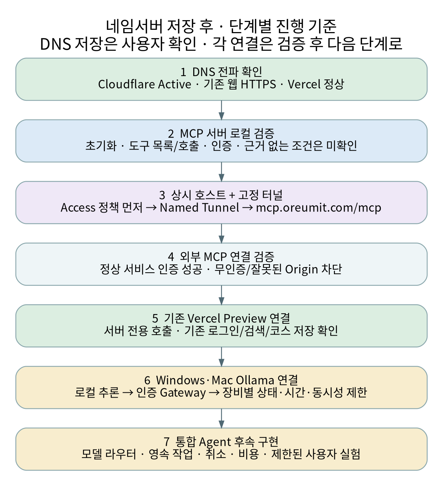
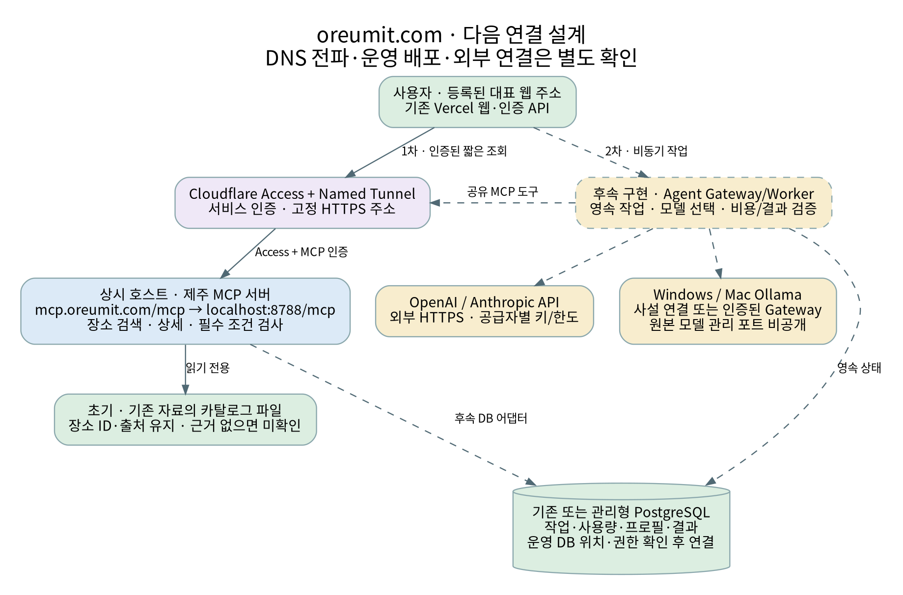

# 네임서버 저장 후 다음 단계와 MCP 구현 현황

기준일: 2026-11-18 한국 시간. 사용자는 `oreumit.com`의 Vercel `Valid Configuration` 표시와 Cloudflare 지정 네임서버 **`dilbert.ns.cloudflare.com`, `irma.ns.cloudflare.com` 저장**을 확인했다. 이는 사용자 보고이며, 이 작업환경에서 DNS 전파·Cloudflare `Active`·현재 HTTPS 인증서·계정 설정을 직접 조회한 결과는 아니다.

## 1. 지금부터의 순서

[단계도 Mermaid 원본](../design/oreumit-next-steps.mmd) · [단계도 SVG](../reports/assets/oreumit-next-steps.svg)

**다음 목표는 `mcp.oreumit.com/mcp`를 인증된 실제 MCP 도구 서버에 연결하는 것이다.** 도메인 등록기관을 옮기거나 새 도메인을 구매할 필요는 없다. DNS는 주소를 연결하는 역할이며 서버 실행·모델 추론·DB 저장을 대신하지 않는다. 로컬 MCP 구현과 검증은 먼저 완료했고, 공개 연결은 아래 순서로 진행한다.

| 단계 | 작업 | 다음 단계로 넘어갈 기준 |
|---|---|---|
| 1. DNS·웹 | Cloudflare zone의 Active, 지정 NS, Vercel 도메인 등록·DNS 레코드·인증서를 확인 | 기존 웹과 로그인 유지. 저장한 NS와 실제 권한 NS가 일치 |
| 2. MCP 로컬 | 카탈로그·서버 실행, 실제 SDK 초기화와 3개 도구 호출 | 현재 클라우드에서 완료. 운영 호스트에서는 설치 후 다시 확인 |
| 3. 상시 호스트·터널 | Access Service Auth 정책을 먼저 만들고 Named Tunnel 연결 | Connector 정상, 정확한 hostname·로컬 서비스·Access audience 연결 |
| 4. 외부 검증 | MCP URL에서 정상 인증·인증 거부·잘못된 Origin 검사 | 실제 클라이언트 초기화·도구 호출 성공. 공개 URL의 HTTP 200만으로 완료 처리하지 않음 |
| 5. Vercel Preview | 서버 전용 어댑터·짧은 MCP 조회·장애 처리 추가 | 로그인·검색·코스 적용/저장 회귀 검사, 기존 응답 계약 유지 |
| 6. Ollama | Windows·Mac의 로컬 모델부터 검사한 뒤 보호된 연결 추가 | 장비별 모델·가용성·시간·동시성 제한 확인. 중단 장비 제외 |
| 7. Agent | 공급자 라우터·작업 큐·영속 DB·취소·비용 제한 구현 | 제한된 사용자 평가·제약 위반 검사·운영 복귀 절차 통과 |

## 2. 연결 구조와 주소

[배치도 Mermaid 원본](../design/oreumit-next-deployment.mmd) · [배치도 SVG](../reports/assets/oreumit-next-deployment.svg)

그림의 실선은 1차 연결 대상, 점선은 후속 구현 대상이다. 실선도 현재 인터넷에 배포·연결 완료되었다는 뜻은 아니다. 웹의 apex와 `www` 중 대표 주소·리디렉션은 실제 Vercel 등록 목록에 맞춰 확인한다.

| 주소·계층 | 역할 | 현재 상태 |
|---|---|---|
| `oreumit.com`, `www.oreumit.com` | 기존 Vercel 웹. 등록된 주소와 대표 주소를 확인 | 사용자 지정 도메인 설정 보고. 현재 화면·로그인 미검증 |
| `https://mcp.oreumit.com/mcp` | 공통 관광 MCP. Tunnel 목적지는 `http://127.0.0.1:8788` | 제안 주소. 로컬 서버만 구현·검증 |
| `agent.oreumit.com` | 향후 장시간 작업 접수·조회·취소 API | 필요할 때 추가. API·Worker 미구현 |
| `ollama-win.oreumit.com`, `ollama-mac.oreumit.com` | 원격 HTTP가 필요한 경우 각 장비의 보호 Gateway | 선택 사항. 목적지는 각 장비의 `127.0.0.1:8787`이며 Ollama 관리 포트 11434를 직접 공개하지 않음 |
| OpenAI·Anthropic API | Worker에서 공식 HTTPS API 호출 | 별도 공급자 터널 불필요. 키·사용량·결제는 공급자별 관리 |
| PostgreSQL | 향후 프로필·작업·결과·사용량의 공통 저장소 | 기존 DB 위치·역할·백업 상태 확인 후 재사용. 새로 선택하면 관리형 Supabase 우선 검토 |

MCP의 초기 장소 카탈로그는 서버의 로컬 JSON 파일이다. 이번 구현을 실행하는 데 별도 DB나 유료 LLM 계정은 필요 없다. 다만 상시 서버·도메인 갱신·향후 모델 API와 DB 자원은 각각의 이용 조건에 따른다. Codex 클라우드 작업공간을 24시간 운영 서버로 간주하지 않는다.

처음에는 상시 Linux 호스트 한 대에서 MCP와 cloudflared를 함께 실행하는 구성이 단순하다. 터널은 해당 호스트에서 바깥으로 연결하므로 외부에서 8788 포트를 개방할 필요가 없다. Windows·Mac의 Ollama는 별도 모델 호스트로 관리한다. 한 호스트에서 Worker가 로컬 Ollama를 호출하고 공통 큐에서 작업을 가져가는 구조라면 장비별 공개 터널도 생략할 수 있다.

## 3. 원격 작업으로 완료한 코드와 검증

코드는 [services/jeju-mcp](../services/jeju-mcp/README.md)에 있다. Node.js 22 이상, 고정 SDK `1.32.1`, Zod `4.6.7`과 잠금파일을 사용한다. SDK v1의 stateless Streamable HTTP를 제공하며 요청별 transport를 생성·정리한다.

| 도구 | 구현한 동작 | 남은 범위 |
|---|---|---|
| `places.search` | 문자열·원본 분류로 검색, 최대 50개 결과 | 개인화 랭킹·벡터 검색·실시간 영업 정보는 후속 |
| `places.get` | 최대 20개 장소 ID 조회, 누락 ID를 별도 반환 | 현장 최신성·외부 공급자 동기화는 후속 |
| `constraints.check` | 휠체어 접근·실내·최대 방문비 조건 검사 | 필드별 현재 유효한 근거가 있어야 pass/fail. 값·근거가 없으면 unknown |

원본 `OREUM-IT/jeju-tour`의 커밋 `b0602a175c1d08959b7187da2b29ac450b52e0ba`, `prototype/data/jeju_tour_data.json`을 확인해 **7,561행을 가져왔으며 제외 행은 0개**였다. Git 출처·커밋·파일 일치를 검사하고 장소 ID·이름·분류·좌표와 원천 추적 정보를 보존했다. 원본에는 해당 접근성·가격 조건의 검증 근거가 없어 이를 추정해서 채우지 않았다. 데이터 사용권·최신성 검증은 별도다.

검증 결과:

- 자동 검사 **24개 통과**: 가져오기 6개, 도구 11개, HTTP·실제 SDK 통합 7개.
- 실제 가져온 카탈로그로 로컬 서버를 실행하고 SDK 클라이언트의 초기화 → 도구 목록 → 검색 → 상세 → 조건 검사를 통과했다. 근거 없는 조건은 `unknown`, 전체 응답은 `partial`로 반환했다.
- readiness는 무인증 401, 정상 인증 200이었다. 7,561건과 `reference-import`, 읽기 전용, `productionReady:false` 상태를 확인했다.
- 잠금 의존성의 npm audit에서 보고된 취약점은 검사 시점 0건이었다. 이는 전체 애플리케이션 보안 검증을 대신하지 않는다.
- 비밀 설정·가져온 로컬 카탈로그·node_modules는 Git에서 제외했다. 검증 서버는 종료했으며 공개 터널·운영 Vercel 변경·실제 LLM 호출은 수행하지 않았다.

현재 서비스 토큰은 내부 읽기 전용 도구의 서버 인증이다. 사용자 OAuth, 개인정보 도구 권한, 코스 쓰기, LAG, 모델 라우터, 영속 작업 큐를 구현했다고 해석해서는 안 된다. 해당 기능은 [전체 MCP 설계](10-mcp-server-and-vercel-integration.md)의 별도 단계다.

## 4. Cloudflare와 상시 서버에서 수행할 설정

1. Cloudflare에서 `oreumit.com`이 Active인지 확인한다. NS가 저장됐어도 아직 이전 값이 조회될 수 있다. 기존 Vercel A/CNAME, MX, TXT, 로그인·검증 레코드가 보존되었는지 확인한다. Vercel 웹 레코드는 해당 프로젝트에 표시되는 최신 값을 사용한다. 전환 초기에는 웹 레코드에 DNS only를 적용해 Vercel 인증·HTTPS를 먼저 확인하는 구성이 단순하다.
2. 상시 호스트에서 서비스 잠금파일로 설치하고 카탈로그를 배치한다. `node scripts/configure-local.mjs --catalog .local/catalog.json`으로 서비스 설정을 생성한다. 설정이 이미 있으면 덮어쓰지 않고 운영자가 경로를 수정한다. 상세 명령은 서비스 README를 따른다.
3. 자동 재시작을 제공하는 호스트의 서비스 관리 기능에 `node --env-file=.env.local src/server.mjs`를 등록한다. 작업 디렉터리는 `services/jeju-mcp`로 지정한다. 비밀 파일은 해당 서비스 계정만 읽도록 하고 서버는 `127.0.0.1:8788`에 바인딩한다.
4. Cloudflare Zero Trust의 Access 애플리케이션에 **`mcp.oreumit.com` 전체 호스트**를 등록한다. 전용 Service Token을 만들고 정책 action을 `Service Auth`로 지정한다. 일반 사용자 로그인용 `Allow` 정책으로 대체하지 않는다.
5. Named Tunnel을 만들고 화면의 connector 설치 명령을 **같은 상시 호스트**에서 실행한다. Published application의 hostname은 `mcp.oreumit.com`, service는 `http://127.0.0.1:8788`이다. path를 잘라내지 않아 외부 `/mcp`가 로컬 `/mcp`로 전달되어야 한다.
6. 지원 설정에서 `Protect with Access` 및 해당 앱의 team/issuer·audience 검증을 적용한다. Connector 토큰, Access Service Token, MCP 자체 Bearer 토큰은 서로 다른 비밀값이다.
7. 외부 확인 클라이언트에 아래 서버 전용 설정을 전달하고 `node --env-file=.env.local scripts/check-client.mjs`로 검사한다. Access를 통과해도 MCP 토큰이 없으면 401이어야 한다. 이 단계의 실제 외부 실행은 아직 완료하지 않았다.

| 설정 이름 | 값·용도 |
|---|---|
| `MCP_SERVER_URL` | `https://mcp.oreumit.com/mcp` |
| `MCP_SERVICE_TOKEN` | MCP 호스트에 등록한 자체 서비스 토큰 |
| `CF_ACCESS_CLIENT_ID` | 허용한 Cloudflare Service Token의 ID |
| `CF_ACCESS_CLIENT_SECRET` | 같은 Service Token의 secret |

클라이언트는 `Authorization: Bearer …`, `CF-Access-Client-Id`, `CF-Access-Client-Secret`을 전송한다. 토큰 원문을 URL·로그·채팅·브라우저 번들에 기록하지 않는다. `GET /healthz`는 로컬 생존 확인용이고, 외부에서는 호스트 전체에 Access 정책이 적용된다. 실제 MCP 연결 여부는 `/mcp` 초기화·도구 호출로 판단한다.

## 5. 기존 Vercel 앱에 적용하는 절차

Vercel에 환경변수만 추가하면 현재 UI가 새 MCP를 호출하지는 않는다. 기존 앱의 별도 변경으로 다음을 구현하고 Preview에서 확인한다.

1. 기존 서버 인증으로 사용자를 확인한 뒤 고정 MCP 주소에 연결하는 서버 전용 클라이언트 모듈을 추가한다. 위 네 설정은 Vercel의 해당 Preview 서버 환경에만 넣고 `VITE_` 등 클라이언트 공개 접두사를 사용하지 않는다.
2. 초기 연결은 장소 검색·상세·조건 검사로 제한한다. 전체 요청 제한 시간, 재시도 횟수, 동시성·사용자별 호출 한도, 응답 스키마 검사를 둔다. 사용자 입력으로 MCP 주소·카탈로그 경로를 바꾸지 못하게 한다.
3. 새 경로에서 실제 장소 ID를 검증하고 조건 미확인은 UI에서도 미확인으로 표시한다. 현재 응답에 없는 공급자 문자열·개인화 점수를 임의로 기존 타입에 넣지 않는다.
4. 로그인, 기존 검색, 코스 초안 적용, 저장·다시 불러오기, MCP 중단 시 오류 안내를 확인한다. 도메인 전환으로 Supabase Site/Redirect URL·Naver 복귀 주소·Flutter URL이 영향을 받는지 함께 확인한다.
5. 서버 기능 플래그로 제한된 사용에 개방한다. 실패하면 새 MCP 경로를 비활성화해 검증된 기존 경로로 돌아간다. DB·기존 코스 저장 형식을 이 첫 연결과 함께 변경하지 않는다.

## 6. Ollama·다중 공급자·DB를 잇는 후속 작업

Windows와 Mac에서 각각 로컬 추론이 성공해야 한다. [인증 Gateway 예제](../examples/ollama-tunnel/README.md)는 설치 모델을 고정하고 요청 크기·출력·시간·동시성을 제한한다. 원격 호출이 필요하면 장비별 Named Tunnel과 Access 정책을 적용한다. 장비별 모델이 다를 때 같은 터널의 동등한 replica로 섞지 않는다.

공통 Worker는 OpenAI·Claude·Ollama 중 요청에 맞는 공급자를 선택한다. 병렬 비교는 명시적으로 제한한 평가 요청에서만 허용하고 두 API의 비용을 각각 집계한다. 긴 추론은 Vercel 요청을 붙잡지 않고 작업 ID를 반환하며, DB에 소유자·상태·기한·시도 횟수·모델/자료 버전·사용량을 저장한다. 모델 호출과 개인정보를 추가하기 전에 사용자 권한·보존 정책·취소와 재실행 계약을 구현한다.

현재 MCP는 DB를 쓰지 않지만, 통합 Agent는 기존 PostgreSQL의 실제 위치와 서버 역할·TLS·백업 조건을 확인해야 한다. 신규 관리형 Supabase를 고르면 계정과 프로젝트가 필요하며 무료 할당량·유료 전환 조건은 신청 시 확인한다. 모델 공급자마다 DB를 나누지 않고, 공통 데이터베이스에서 사용자별 접근을 통제한다.

논문 LAG의 정의·구성·실험 조건은 원문 확인 후 별도 모듈과 평가 기준으로 확정한다. 이번 도메인 연결이나 MCP 성공을 LAG 재현 성공으로 표시하지 않는다.
