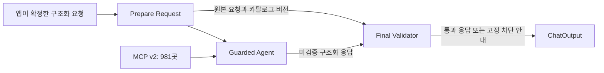

# Agent 카탈로그 v2와 최종 추천 검증

기준일: 2026-11-19. [PR #8](https://github.com/OREUM-IT/jeju-tour-data-analysis/pull/8)이 병합된 `main@354fe507`에서 `codex/agent-catalog-v2-validation` 브랜치를 만들었다. 앱·평가셋과 같은 981곳의 MCP 카탈로그, 원본 요청에 따른 최종 구조화 응답 검증, 별도 Langflow 흐름을 구현하고 로컬 SDK·모의 모델로 검증했다. 실제 Vertex AI·Gemini 실행 요청 1건에서도 서버의 최종 수락과 미확인 조건 안내를 확인했다.

기존 [Gemini 92응답·4실패](../reports/baseline-gemini-live-20261119.json), [Langflow 80응답·16실패](../reports/baseline-langflow-live-20261119.json)의 96문항씩 집계는 보존한다. 새 흐름의 실제 요청 1건은 별도의 연결 확인이며 96문항 재평가나 추천 품질 개선의 증거가 아니다. 사람 검수는 0/24건, 합성 보안 사례 14개는 미실행, 비용은 미측정이다.

현재 단계는 로컬 개발 환경에서 가능하며 운영 배포는 하지 않았다. 사용자 요청에 따라 **운영 Linux 서버·cloudflared·Gateway 구축이 필요한 단계에서는 진행을 멈추고 필요한 범위를 알린다.** 이 문서의 로컬 구성을 운영 인프라 구축 승인으로 확대하지 않는다.

## 1. 바꾸려는 동작

[이전 실측](25-live-baseline-execution.md)의 Langflow는 MCP v1의 7,561곳을 검색했고 평가 기준은 앱의 981곳이었다. 모델이 조건을 확인할 수 없다고 답해도 후보 밖 ID를 반환할 수 있었으며, 수집 HTTP를 취소해도 서버 실행이 계속되는 사례가 있었다.

구현한 동작은 다음과 같다.

- v2 MCP가 앱과 같은 장소 ID·테마·권역을 사용한다. 기존 `places.search`, `places.get`, `constraints.check` 이름과 기본 계약을 유지하면서 테마·권역·제외 ID 조건을 추가한다.
- 원본 구조화 요청은 Agent 출력과 별도로 전달한다. 서버가 이 요청에서 후보를 다시 계산하고, 모델이 제시한 후보 목록이나 조건 축소를 신뢰하지 않는다.
- 검증된 필드 근거가 없는 필수 조건은 `unknown`으로 유지한다. 최종 결과가 이 판정과 어긋나면 출력하지 않는다.
- 새 Langflow 흐름에서 Agent 중간 메시지·토큰 출력을 억제하고, 최종 검증을 통과한 구조화 응답만 ChatOutput으로 보낸다.
- Agent 전체 작업의 시간 예산과 모델 호출 횟수를 제한하고 취소를 전파한다. 로컬 취소와 원격 공급자 작업 종료는 구분해 기록한다.

기존 v1 서버 `127.0.0.1:8788`과 기준선 흐름은 보존하고 v2 서버는 별도 `127.0.0.1:8789`에서 검증한다. 여기서 v2는 **장소 카탈로그 형식**이며 MCP 프로토콜 v2로 전환한다는 뜻이 아니다.

## 2. 요청과 출력이 지나가는 경로



Prepare와 Final Validator는 모델을 호출하지 않는 결정론적 컴포넌트다. 원본 요청을 담은 별도 연결은 Agent가 답변 안에서 요청·조건·허용 ID를 다시 써서 검증 기준을 바꾸는 일을 막기 위한 것이다. 최종 서버는 Prepare의 후보 목록을 그대로 승인하지 않고 자신의 카탈로그로 후보를 다시 계산한다.

새 흐름 파일은 [`jeju-tour-agent-vertex-v2.flow.json`](../services/langflow/jeju-tour-agent-vertex-v2.flow.json)이다. 노드는 `ChatInput → JejuPrepareRequest → Agent-jejuV2 → JejuFinalValidation → ChatOutput-jejuV2`이며 Prepare에서 Final Validator로 가는 별도 요청 연결을 유지한다. 기존 `JEJU_MCP_TOKEN`과 `JEJU_VERTEX_SERVICE_ACCOUNT_JSON` Credential을 재사용하고 MCP 연결 이름은 `jeju-mcp-v2`, 주소는 `http://127.0.0.1:8789/mcp`로 분리한다. 비밀값은 흐름 파일에 넣지 않는다.

이 경계가 자연어 요구를 자동으로 정확하게 해석해 주지는 않는다. 앱이나 사용자가 확정한 `filters`, `excludedIds`, `requirements`가 입력 계약이다. 원문 `query`에만 있고 구조화 필드에서 빠진 조건까지 검증했다고 주장하지 않는다. 구조화 입력을 만드는 UI·파서가 사용자 의도를 보존하는지 별도로 확인해야 한다.

## 3. 인증된 준비·검증 API

기존 MCP 서비스 토큰으로 인증하는 두 POST 경로를 추가한다. 목적지는 로컬 v2 서버로 고정하고 요청이나 모델 출력에서 URL을 받지 않는다. 구체적인 실행 명령과 환경변수는 [서비스 README](../services/jeju-mcp/README.md)에 둔다.

| 경로 | JSON 본문 | 역할 |
|---|---|---|
| `/prepare-request` | 원본 구조화 `request` 자체 | 요청 스키마·조건·제외 ID 검사, 요청 해시·카탈로그 버전 결합 |
| `/validate-response` | `{request, response, expectedCatalogVersion}` | 원본 요청에서 후보 재계산, 응답 ID·조건 판정·안내·동작 검증 |

구조화 요청 예시다. 아래는 형식 설명용이며 모델 호출이나 실제 추천 결과가 아니다.

```json
{
  "schemaVersion": "1.0",
  "requestId": "local-review-001",
  "query": "비를 피해 실내에서 관람할 곳을 추천해 주세요.",
  "timezone": "Asia/Seoul",
  "visitDate": "2026-12-07",
  "filters": {},
  "excludedIds": [],
  "requirements": [
    {"type": "indoor_required", "value": true}
  ]
}
```

요청은 알려진 필드만 허용하는 엄격한 스키마로 다룬다. 필터는 `category`, `theme`, `zone`, `text`를 AND로 적용한다. 테마는 가중치 0.5 이상, `text`는 명시적 부분 문자열 검색이며 `query`를 검색어로 추정하지 않는다. 카탈로그에 없는 테마·권역과 제외 ID는 거부한다. 최종 후보는 도구 검색에서 우연히 반환한 상위 몇 개가 아니라 전체 카탈로그에 필터·제외 조건을 적용해 다시 계산한다.

필수 조건은 `indoor_required`, `wheelchair`, `open_at`, `budget_cap`이고 같은 종류를 중복하지 않는다. 영업시간 조건에는 `HH:MM`와 방문일이 필요하며, 예산 단위는 `KRW_per_person_per_day`다. 서버 시계·근거·허용 후보 ID·평가 정답은 요청 필드로 받지 않는다.

Prepare의 응답은 구조를 검증한 요청(`query` 원문 보존)과 `requestSha256`, `catalogSha256`, `catalogVersion`, `policyVersion`, `evaluatedAt`, `candidateCount`를 담는다. 요청 해시는 canonical JSON, 카탈로그 내용 해시는 `dataVersion`을 제외한 내용의 canonical JSON으로 계산한다. `catalogVersion`은 서버가 적재한 카탈로그 버전이다. Final Validator는 이 요청과 버전을 별도 입력으로 받고 서버에 다시 전달한다. HTTP 검증 요청에는 `expectedCatalogVersion`을 반드시 넣으며 카탈로그가 중간에 바뀌면 버전 불일치로 차단한다. 정책 버전은 `recommendation-validation-v1`이다.

새 런타임 응답 계약은 기존 기준선 채점 형식과 구분한다. `schemaVersion`, `requestId`, `action`, `placeIds`, `requirementClaims`, `confirmationNotice`, `noticeTopics`만 받으며 자유 문장 필드는 받지 않는다. 조건 주장은 반환한 각 장소 ID와 요청한 각 필수 조건에 대해 명시한다. 기존 모델 판정 형식의 `placeId: null` blanket 주장을 이 런타임 형식으로 옮겨 쓰지 않는다.

## 4. 최종 판정 기준

| 확인 대상 | 차단하는 경우 |
|---|---|
| 요청 결합 | 다른 `requestId`, 카탈로그 버전 불일치, 잘못된 스키마 |
| 장소 ID | 카탈로그에 없음, 요청 필터 후보 밖, 사용자 제외 장소, 중복 ID |
| 조건 주장 | 필요한 주장 누락, 중복 주장, 요청하지 않은 조건, 반환하지 않은 장소에 대한 주장 |
| 근거와 판정 | `unknown`인데 pass/fail 단언, 검증 근거 판정과 모순, 필수 조건이 검증된 fail인 장소 추천 |
| 확인 안내 | 필요한 확인 주제 또는 안내 누락, 근거와 무관한 확인 주제 |
| 답변 동작 | 미확인 조건을 `recommend`로 확정, 미확인 후보 없는 `cannot_confirm`, 근거 없이 `impossible` 단언 |

`verified`라는 표지만으로 통과시키지 않는다. 필드 출처와 올바른 검증 시각·유효기간이 있어야 하며, 서버 현재 시점과 요청한 한국 시간 방문일을 모두 덮는지 검사한다. 영업시간은 정확한 `매일 HH:MM~HH:MM` 문구와 수치가 일치하는 단순 매일 운영 구간만 판단한다. 숫자 시간만 있고 `text: null`이면 매일 반복을 확인하지 못하므로 `unknown`이다. 종료 시각 `24:00`과 자정을 넘는 구간은 지원하되 휴무·휴게시간 같은 자유 문구나 확장 분 단위 값은 임의로 해석하지 않는다. 이 런타임 규칙을 강화해도 과거 평가의 근거 함수·정답·집계를 다시 쓰지 않는다.

무장애 목록 등재는 휠체어 이용 가능과 같은 사실이 아니며, 비용 속성이 없는 카탈로그로 하루 전체 예산을 판정하지 않는다. 현재 실제 카탈로그는 `verified` 0건·비용 0건이므로 이 연결만으로 필수 조건 pass가 새로 생기지 않는다. `source_reported`·`app_curated`·`inferred`·`computed` 신호를 검증된 사실로 승격하지 않는다.

서버가 `accepted`로 반환한 경우에만 원래 구조화 응답을 내보내고, 실패 시 모델 문장을 수정해서 성공처럼 보이게 만들지 않는다. 최종 흐름은 실패의 상세 원문을 사용자에게 전달하지 않고 고정된 차단 안내를 사용한다. 이는 구조화 계약 검증이며 임의 자유 문장 전체의 사실성·안전성 검증은 아니다.

## 5. Agent 실행 제한과 취소

새 흐름의 제한은 **Agent 전체 작업 90초, 모델 호출 최대 4회**다. 90초는 Agent 내부 작업에 적용하며 Prepare·Final Validator나 전체 HTTP 수집 시간을 합친 제한이 아니다. 공급자 요청 60초 제한과도 구분한다. 모델 호출 상한이 MCP 도구 호출 수나 실제 청구 요청 수의 상한과 같은 뜻은 아니다. 한 번의 모델 응답에서 여러 도구를 요청할 수 있다.

현재 설치된 Langflow 1.13.3은 `max_iterations=4`를 `ModelCallLimitMiddleware(run_limit=4)`로 연결한다. 새 흐름은 기본 계산기·현재 날짜 도구를 끄고 대화 기억을 0으로 설정하며 파싱 도구 오류의 자동 재시도도 끈다. 실제 설치 런타임의 모의 모델이 검색을 반복하는 검사에서 모델 호출이 정확히 4회에서 차단됐고, Final Validator는 고정된 차단 응답을 반환했다.

검증 전 사용자 메시지·토큰·중간 로그 발행을 억제해도 관리자용 실행 추적이나 빌드 자료에 미검증 결과가 남을 수 있다. 최종 서비스가 Final Validator의 ChatOutput만 반환하도록 연결해야 하며, 관리자 추적을 사용자 응답에 함께 노출하지 않는다.

시간 제한은 협력적 취소에 의존한다. 취소를 무시하는 의존성이나 원격 공급자 작업이 같은 순간에 끝난다고 보장하지 않으며, HTTP 연결 종료만으로 비용·서버 작업이 멈췄다고 기록하지 않는다. 모의 검사에서 취소·시간 초과 후 결과 차단과 메시지 억제를 확인했지만, 원격 공급자의 취소·과금 중단을 검증한 것은 아니다.

## 6. 확인한 로컬 결과와 남은 검증

아래는 새 흐름의 실제 모델 품질 평가와 구분한 로컬 결과다.

| 대상 | 확인할 내용 | 현재 상태 |
|---|---|---|
| MCP v2 실제 SDK 연결 | `127.0.0.1:8789` 초기화·도구 목록·기존 3개 도구 호출, `/readyz` 카탈로그 스키마 2.0·981곳 | 통과 |
| 실제 카탈로그 조건 | 981곳 × 4조건 = 3,924개 판정 | 모두 `unknown`, pass 0·fail 0 |
| 자동 검사 | MCP 179개 + Gateway 10개 + Python 20개 | 209개 통과 |
| 저장소 검사 | 새 흐름의 고정 버전·내장 소스 일치 등을 포함 | 13개 항목 통과 |
| Langflow 실제 런타임·모의 모델 통합 | Langflow 1.13.3·가짜 ChatModel·실제 v2 MCP와 검증 HTTP로 정상 응답 수락, 가짜 ID 차단, unknown의 pass 승격 차단 | 통과, Google 추론을 호출한 검사가 아님 |
| 잘못된 준비 입력 | Prepare에서 잘못된 요청 차단 | Agent 호출 0·최종 출력 0 확인 |
| 모델 호출 횟수 | 실제 설치 런타임의 모의 모델이 검색을 반복 | 정확히 4회에서 차단, Final Validator의 차단 출력 확인 |
| 공급자 오류 경계 | 최종 직접 실행 경로에서 모의 공급자 오류 1회 | HTTP 500 `AGENT_EXECUTION_FAILED`, 최종 출력 0·canary 미노출 |
| 이전 평가 재현 | 과거 96문항 정답 해시 `--check`, 기존 기준선 DB 흐름 해시 | 유지 확인 |
| 새 흐름의 실제 연결 확인 | Vertex AI·`gemini-3.8-flash` 실행 요청 1건 | HTTP 200·12.165초, 최종 서버 `accepted`, `cannot_confirm`, 후보 5개, `indoor_unverified` 확인 안내 |
| 새 96문항 품질 평가 | 새 도구·흐름 버전으로 기존 평가셋 전체 재수집·채점 | 미실행 |
| 사람 표본 검수 | 기존 Gemini 자유 문장 24개 실제 사람이 대조 | 0/24 |
| 합성 보안 사례 | 기존 14개 전체 사례와 부수 효과 계측 | 미실행 |

실제 Langflow 런타임과 모의 모델의 통합은 위 정상·가짜 ID·unknown 승격·잘못된 준비 입력·모델 호출 상한·공급자 오류의 6개 시나리오다. 이 검사에서는 외부 모델 공급자 호출이 0회였다. 임시 모의 흐름은 검사 후 제거했으며 기존 기준선 흐름은 변경하지 않았다.

실제 요청 1건에서는 Gemini 모델 호출 3회와 MCP 호출 2회(`places.search`·`constraints.check` 각 1회)가 모두 성공했다. 실내 근거가 미확인인 후보를 확정 추천으로 승격하지 않았고, 저장 메시지는 사용자 1개·최종 검증 Machine 1개뿐이었다. Agent 원문 저장·remediation·재시도 경고는 해당 추적에서 0건이고 429·503·504도 관측하지 않았다. 실행 종료 후 서버 활성 작업은 0개였다.

이 요청 뒤 remediation으로 Agent 그래프가 다시 만들어져 모델 호출 상한이 초기화될 수 있는 경로를 제거하고 `_guarded_agent_run(self, _run_once)`를 직접 호출하도록 강화했다. 실제 요청에서는 remediation이 0회여서 관측한 정상 `_run_once` 경로는 같다. 최종 흐름에서 모의 모델의 4회 제한과 공급자 오류 1회 후 HTTP 500·최종 출력 0·canary 미노출을 다시 확인했고 Python 20개 검사도 재통과했다. 최종 파일에 대한 Google 추가 실행은 하지 않았으며, 이 1건의 연결 확인을 최종 버전의 전체 품질 평가로 표시하지 않는다. 원문·추적·모의 검증 증거는 비공개 `.local`에 보관한다.

정상 동작을 확인한 뒤에도 새 실제 모델 점수, 공격 방어 성공률, 실제 관광객 만족도, 운영 배포 성공으로 확대하지 않는다. 기존 96문항의 실패를 새 버전의 성공으로 덮어쓰지 않고, 이후 재평가는 새 도구·정책·흐름 버전과 별도 실행 파일로 남긴다. 비밀값·원문·장소 카탈로그는 `.local`과 비밀 설정에 보관하고 공개 PR에는 코드·검사·비밀 없는 흐름·집계만 포함한다.
