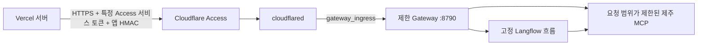

# 제한 Agent Gateway와 Cloudflare Access·Tunnel 연결

2026-11-25에는 AWS Gateway 흐름이 사용자 실행으로 여러 번 바뀌었다. 처음 세 번은 다음과 같다(모두 사용자 제공 출력). 먼저 **[Langflow 메시지 저장 끄기](#langflow-메시지-저장-끄기와-오래된-원문-정리)**를 [적용](#저장-끔-aws-적용-결과2026-11-25-사용자-제공-출력)했다. 적용 직전 저장된 빌드는 `vertex-8-call`(Gemini 8회)이었고, 재생성은 `up 1/1`(helper가 `agent-gateway`만 재생성)이었으며 모델은 실행하지 않았다. 이어서 [규칙 동작 흐름을 적용](#aws-적용-결과사용자-제공-출력-2026-11-25)했고(PR #36), 도구 이름 문제로 실제 호출 전에 `--rollback`했다([PR #37 기록](#도구-이름-수정과-되돌림2026-11-25)). 두 변경 모두 `messageStore:false`를 유지했다. 그 뒤로도 규칙 동작 재적용(다른 세션 기록)과 [`reasoning_effort` 수정](#openai-400-reasoning_effort-수정2026-11-25) 빌드 적용(추정) 등으로 흐름이 더 바뀌었고, 마지막 변경은 20:09:59 KST였다([기록](#저장-끔-aws-적용-결과2026-11-25-사용자-제공-출력)). 사용자가 그 뒤 [적용 뒤 확인 SQL](#적용-뒤-확인-sql)을 실행해 `can_judge:t`·`passed:t`를 받았다([결과](#aws-실행-결과2026-11-25-사용자-제공-출력): 경계 뒤 수락 2건, 메시지 0). 수로 보면 이날 Gateway 실행 102건 모두 요청·최종 출력 메시지(저장된 메시지)를 남기지 않았다(추정. Agent 오류 3건의 오류 메시지는 저장 설정과 관계없이 남았다). [지연·토큰 집계 SQL](#집계-sql-aws-실행-결과2026-11-25-사용자-제공-출력)의 AWS 출력 두 개도 받았다. 11-25 `gpt-5.4-mini` 실행이 100건(최종 검증까지 간 것 97건) 있었고, GPT 호출 235회는 모두 토큰 기록이 없다. 아래 [규칙 동작 절](#규칙-동작-흐름과-gpt-54-mini-전환)에서 실제 gpt-5.4-mini 호출을 미확인으로 적은 문장은 이 출력 전의 기록이다(그 문장들은 다른 세션의 기록이다). 아래 2026-11-21 문단은 이전 기록이다.

2026-11-21 변경은 **[모델 호출 예산 조정](#모델-호출-예산-조정)**이다. Gateway 흐름의 모델 호출을 8회로 늘리고 마지막 호출을 답변 전용으로 바꾼다. PR #21·#22는 main에 병합됐고, 2026-11-21 사용자가 AWS에서 `main@ce2f657` 적용 성공 출력을 제공했다(모델 미실행). 실제 웹 요청의 차단 감소는 아직 확인하지 않았다. 직전 변경은 **[요청 큐와 동시 처리 업데이트](#요청-큐와-동시-처리-업데이트)**다. 기존 PR #19의 후보 복구를 포함해 MCP·Gateway를 함께 갱신한다. 이미 연결된 AWS에서는 아래 최초 설치·Langflow bootstrap을 반복하지 않는다. 기본 동시 2건은 설정·코드 상한이며, 사용자 AWS 8GB에서 실제 모델 2건을 동시에 실행해 성능을 확인한 결과는 아니다.

사용자 AWS에서 **981곳 MCP → Langflow → Vertex 단건 응답·최종 검증 성공**에 이어 **Gateway·Cloudflare HTTPS·Access 서비스 인증·앱 HMAC/JWT의 공개 준비 검사(`scope:public`)까지 통과**했다. PR #16은 `main@2b44228`에 병합됐고 공개 연결 수정은 PR #17의 `7890060`으로 적용됐다. 다음은 Vercel 서버 어댑터·서버 비밀 설정·Preview 연결이다. 공개 준비 검사는 모델을 실행하지 않으며 기존 성공한 Vertex 단건 실행이나 96문항 평가를 반복하지 않는다.



공개 대상은 **`agent.oreumit.com` 한 호스트의 Gateway**다. Langflow 관리 화면·MCP·PostgreSQL은 공개 경로가 아니다. `oreumit.com`, `www.oreumit.com`의 기존 DNS나 Vercel 연결은 수정하지 않는다. AWS 방화벽에 8790·7860·8788·5432의 인바운드 포트를 추가하지 않는다. Tunnel은 외부로 연결하며, Gateway 호스트 포트는 `127.0.0.1:8790`이다.

## 1. AWS에서 비공개 Gateway 준비

기존 저장소 `~/oreumit-agent`, Compose 프로젝트 `oreumit-bootstrap`을 사용한다. 아래 새 브랜치는 최초 전환용이다. 이미 같은 로컬 브랜치가 있으면 `git switch codex/lightsail-agent-gateway` 후 `git merge --ff-only origin/codex/lightsail-agent-gateway`를 사용한다. 수정 파일이 있으면 강제 덮어쓰지 않는다.

```bash
cd ~/oreumit-agent &&
git status --short &&
test -z "$(git status --porcelain)" &&
git fetch origin refs/heads/codex/lightsail-agent-gateway:refs/remotes/origin/codex/lightsail-agent-gateway &&
git switch --no-track -c codex/lightsail-agent-gateway origin/codex/lightsail-agent-gateway
```

같은 SSH 터미널에서 다음을 실행한다. Gateway용 요청 범위·키·별도 흐름을 추가하기 위해 **MCP와 Langflow만 한 번 재생성**한다. 기존 DB·볼륨·카탈로그와 기존 Vertex 자격증명은 보존한다. 마지막 검사는 모델을 호출하지 않는다.

```bash
gateway_compose=(sudo env COMPOSE_PROJECT_NAME=oreumit-bootstrap docker compose
  -f deploy/compose.yaml -f deploy/compose.catalog.yaml
  -f deploy/compose.langflow.yaml -f deploy/compose.gateway.yaml)

sudo python3 deploy/prepare-gateway.py --init &&
"${gateway_compose[@]}" config --quiet &&
"${gateway_compose[@]}" up -d --build --no-deps --force-recreate --wait --wait-timeout 180 jeju-mcp &&
"${gateway_compose[@]}" up -d --no-deps --force-recreate --wait --wait-timeout 300 langflow &&
sudo env COMPOSE_PROJECT_NAME=oreumit-bootstrap python3 deploy/prepare-gateway.py --provision &&
"${gateway_compose[@]}" up -d --build --no-deps --wait --wait-timeout 90 agent-gateway &&
"${gateway_compose[@]}" exec -T agent-gateway node check.mjs --internal
```

기대 결과는 Gateway `status:passed`, `mode:private`, `ready:true`, `catalogPlaces:981`, `modelExecuted:false`, `productionReady:false`다. `healthz`와 Docker의 Healthy는 프로세스 생존만 뜻한다. `check.mjs --internal`은 실제 고정 Langflow 흐름의 해시·실행 키, MCP 카탈로그·호출 제한과 비인증 경로 거부를 별도로 검사한다.

`--provision` 실패로 `.gateway-provisioning`이 남으면 자동 재시도하거나 키·파일을 삭제하지 않는다. 기존 Langflow의 전용 흐름/키와 설정을 확인해야 한다. 정상 완료 후 같은 준비 명령은 기존 키를 보존한다. 키·환경 파일·일반 `docker compose config` 출력은 공유하지 않고 마지막 집계 JSON·고정 오류 코드만 공유한다.

### 새 Gateway 경로의 실응답 한 건

내부 준비 검사가 통과하면 아래를 **한 번만** 실행한다. 기존 AWS 단건 실행과 달리 새 Gateway 인증·요청 범위 도구·최종 검증을 모두 거치는 요청이다. 기존 Vertex API 사용료가 발생할 수 있다. 실패하면 결과를 먼저 확인하고 자동 반복하지 않는다.

```bash
"${gateway_compose[@]}" exec -T agent-gateway node check.mjs --run-once
```

기대 결과는 `status:passed`, `finalValidationAccepted:true`, `action:cannot_confirm`이며 실내 근거가 없는 후보에 확인 안내가 유지된다. 모델 호출 횟수·비용을 실측한 출력은 아니다. 최초 Gateway의 한도는 동시 1개·주체당 시간당 6개·전체 시간당 30개였다. 요청 큐 적용 후의 한도는 [최신 업데이트 절](#요청-큐와-동시-처리-업데이트)을 따른다. 도구 8회, 출력 2048토큰, 요청 실행 예산 105초와 범위 폐기 최대 3초는 유지한다. 모델 호출은 처음 4회였고 [모델 호출 예산 조정](#모델-호출-예산-조정)을 적용하면 8회(마지막 호출은 답변 전용), 되돌리면 다시 4회다. PR #21 이후 새로 설치하면 처음부터 8회 흐름이 만들어지며, 4회 빌드는 그 전에 설치한 서버나 되돌린 뒤에만 있다. 시간 초과나 불확실한 실행 뒤에는 해당 실행 슬롯의 보호 시간을 유지한다. Gateway readiness는 모델을 실행하지 않는다.

## 2. Cloudflare Zero Trust와 전용 서비스 토큰 만들기

이 절은 계정 소유자가 [Cloudflare 대시보드](https://dash.cloudflare.com/)에서 진행한다. 현재 계정은 도메인 관리만 설정돼 있으므로 **Zero Trust** 최초 설정이 필요하다. 팀 이름과 요금제를 선택한다. 공식 온보딩 안내는 Free 요금제도 결제정보 입력 단계가 있을 수 있다고 설명한다. 기존 도메인의 DNS 레코드는 건드리지 않는다.

1. **Zero Trust → Access controls → Service credentials → Service Tokens → Create Service Token**을 연다.
2. 이름 `jeju-vercel-gateway`, 운영에 맞는 만료 기간을 선택하고 **Generate token**을 누른다.
3. **Client ID와 Client Secret을 비밀 저장소에 보관**한다. Secret은 생성 시에만 표시된다. 채팅·GitHub·문서에는 붙이지 않는다.
4. AWS SSH 터미널에서 아래 두 입력에 각각 붙인다. 화면에 입력값이 표시되지 않는다. `sudo -v`로 먼저 인증한 뒤 stdin으로만 전달한다.

```bash
cd ~/oreumit-agent
set +x
sudo -v &&
read -rsp 'Access Client ID: ' access_client_id && printf '\n' &&
read -rsp 'Access Client Secret: ' access_client_secret && printf '\n' &&
printf '%s\n%s\n' "$access_client_id" "$access_client_secret" | sudo python3 deploy/tunnel/configure.py service-token
unset access_client_id access_client_secret
```

저장은 `deploy/.local/tunnel/service-token.env`, root 소유 0600이다. 파일이나 값은 컨테이너에 마운트하지 않으며 나중에 공개 `/readyz` 인증 검사에 사용한다. 새 `cfast_` 형식과 기존 64자리 hex Secret을 지원한다.

## 3. 공개 경로보다 먼저 Access 정책·앱 만들기

1. **Zero Trust → Access controls → Policies → Add a policy**에서 이름을 `jeju-vercel-service-only`로 지정한다.
2. Action은 **Service Auth**를 선택한다. Include 조건은 **Service Token → `jeju-vercel-gateway`** 하나로 지정한다. **Any Access Service Token, Everyone, Bypass**를 선택하지 않는다.
3. **Access controls → Applications → Create new application → Self-hosted and private → Add public hostname**으로 이동한다.
4. 앱 이름 `jeju-agent-gateway`, 공개 호스트 **`agent.oreumit.com`**을 설정하고 **Path는 비운다**. `/v1/recommend`에만 보호를 걸면 다른 경로가 남으므로 전체 호스트를 보호한다.
5. 앞서 만든 서비스 전용 정책만 연결하고 **Create**로 저장한다.
6. 앱 **Edit → Additional settings → Application Audience (AUD) Tag**에서 AUD를 복사한다.
7. **Zero Trust → Settings → Team name and domain → Team name**에서 팀 이름을 확인한다. issuer는 **`https://<팀이름>.cloudflareaccess.com`**이다.

issuer와 AUD는 공개 설정값이다. 아래 예시의 팀 이름과 AUD만 실제 값으로 바꾼다. 아직 Tunnel route를 만들지 않는다.

```bash
sudo python3 deploy/tunnel/configure.py access \
  --issuer 'https://YOUR-TEAM.cloudflareaccess.com' \
  --audience 'YOUR_APPLICATION_AUD_64_LOWERCASE_HEX' \
  --hostname 'agent.oreumit.com' &&
sudo python3 deploy/tunnel/check.py --scope config
```

설정 검사 `scope:config`는 파일 형식·권한만 검사하며 Gateway control token이나 Tunnel token이 없어도 가능하다. Gateway가 준비됐다는 뜻은 아니다. 별도 `gateway-access.env`만 생성하고 기존 `gateway.env`의 HMAC·MCP·Langflow 비밀값과 `GATEWAY_MODE=private`는 바꾸지 않는다. 최종 Tunnel overlay가 Access 설정을 마지막으로 읽고 `GATEWAY_MODE=access`를 강제한다.

다음은 **Gateway만** access 모드로 재생성한다. Tunnel 파일이 아직 없으므로 이 단계에 전체 `up`이나 `--wait` 대상 생략을 사용하지 않는다.

```bash
tunnel_compose=(sudo env COMPOSE_PROJECT_NAME=oreumit-bootstrap docker compose
  -f deploy/compose.yaml -f deploy/compose.catalog.yaml
  -f deploy/compose.langflow.yaml -f deploy/compose.gateway.yaml
  -f deploy/compose.tunnel.yaml)

"${tunnel_compose[@]}" config --quiet &&
"${tunnel_compose[@]}" up -d --no-deps --force-recreate --wait --wait-timeout 90 agent-gateway &&
sudo env COMPOSE_PROJECT_NAME=oreumit-bootstrap python3 deploy/tunnel/check.py --scope gateway
```

`scope:gateway`, `status:passed`가 나와야 다음으로 간다. 이 검사는 실행 중인 컨테이너의 issuer·AUD·host·mode가 파일과 일치하고 내부 준비 검사도 통과하는지 확인한다. Access JWT 없이 사용할 수 있는 HTTP 인증 우회 경로는 만들지 않는다.

## 4. Named Tunnel 만들고 connector만 시작

1. [Cloudflare 대시보드](https://dash.cloudflare.com/)에서 **Networking → Tunnels → Create a tunnel**을 연다. 계정 UI에 이전 메뉴가 보이면 Zero Trust의 **Networks → Connectors → Cloudflare Tunnels**에 해당한다.
2. 이름을 `jeju-agent-aws`로 지정하고 **Create Tunnel**을 누른다. connector 유형 선택 화면이 나오면 **Cloudflared**를 선택한다.
3. Docker 설치 화면에서 **Tunnel token 값만** 복사한다. 토큰이 포함된 전체 `docker run ... --token ...` 명령을 셸에 붙이지 않는다.
4. 다음 숨김 입력으로 저장한다. 아직 Published application route는 만들지 않는다.

```bash
cd ~/oreumit-agent
set +x
sudo -v &&
read -rsp 'Tunnel token: ' tunnel_token && printf '\n' &&
printf '%s' "$tunnel_token" | sudo python3 deploy/tunnel/configure.py token
unset tunnel_token
```

원본은 `deploy/.local/tunnel/token` root:root 0600, 실행용 복사본은 `token.runtime` UID:GID 65532:65532·0400이다. 부모 `tunnel/`은 root:root 0700이다. Docker에는 실행용 **단일 파일만 읽기 전용**으로 마운트한다. settings 디렉터리 전체·Access 서비스 Secret·Gateway 키는 cloudflared에 전달하지 않는다. 표준 Cloudflare 공용 endpoint의 remotely managed token을 지원하며 별도 endpoint가 지정된 token은 거부한다.

같은 SSH 세션의 `tunnel_compose` 배열을 사용한다. 새 터미널이면 3절에서 배열 정의만 다시 실행한다. 이 기동은 cloudflared만 대상으로 하며 다른 서비스나 DB를 재생성하지 않는다.

```bash
sudo python3 deploy/tunnel/configure.py check &&
sudo env COMPOSE_PROJECT_NAME=oreumit-bootstrap python3 deploy/tunnel/check.py --scope gateway &&
"${tunnel_compose[@]}" up -d --no-deps --wait --wait-timeout 120 cloudflared &&
sudo env COMPOSE_PROJECT_NAME=oreumit-bootstrap python3 deploy/tunnel/check.py --scope connector
```

`scope:connector`, `status:passed`는 Gateway 내부 준비와 cloudflared의 Cloudflare 연결을 확인한다. Published application route·Access 정책까지 확인한 결과는 아니다. 호스트 인바운드를 열지 않아도 동작한다. AWS 아웃바운드를 제한했다면 [Cloudflare Tunnel 방화벽 요건](https://developers.cloudflare.com/cloudflare-one/networks/connectors/cloudflare-tunnel/configure-tunnels/tunnel-with-firewall/)의 TCP/UDP 7844, DNS와 Gateway JWKS용 HTTPS 접근을 확인한다.

## 5. route 추가 후 공개 인증 검사

위 Gateway access 모드와 connector 검사가 통과한 다음 진행한다. Access 앱과 Service Auth 정책이 전체 호스트에 연결된 것을 먼저 다시 확인한다.

1. **Networking → Tunnels → `jeju-agent-aws` → Routes → Add route → Published application**을 연다.
2. **Subdomain `agent`**, **Domain `oreumit.com`**, **Path 빈칸**을 지정한다.
3. Service URL에 **`http://agent-gateway:8790`**을 입력한다. Type과 URL이 분리된 화면이면 Type **HTTP**, URL **`agent-gateway:8790`**이다.
4. HTTP 설정의 **HTTP Host Header**가 있으면 **`agent.oreumit.com`**으로 지정한다. 기본값으로도 원래 공개 Host가 유지돼야 하며 내부 서비스 이름으로 바꾸면 Gateway가 거부한다.
5. **Add route**를 누른다. `agent` 이름의 기존 DNS 레코드와 충돌한다면 덮어쓰지 말고 그 레코드 용도부터 확인한다. apex/root·www는 변경하지 않는다.
6. SSH에서 공개 검사를 실행한다.

```bash
sudo env COMPOSE_PROJECT_NAME=oreumit-bootstrap python3 deploy/tunnel/check.py --scope public
```

이 검사는 고정 URL `https://agent.oreumit.com/readyz`만 호출한다. **무인증 거부 → Access 서비스 인증만 있을 때 앱 인증 거부 → Access 서비스 인증+올바른 HMAC으로 준비 응답 성공**을 확인한다. 리다이렉트를 따라가지 않고 HTTPS 인증서 검증을 유지한다. 응답 원문·비밀값은 출력하지 않는다. `scope:public`, `status:passed`, `modelExecuted:false`가 완료 기준이다. 공개 추천 실행이나 실제 Vercel 호출의 성공을 의미하지 않으며 `productionReady:false`를 유지한다.

다음은 Vercel **서버 환경**에 Gateway URL·HMAC 키와 Cloudflare Client ID/Secret을 비밀값으로 연결하고, 설문 입력 변환과 실제 요청 주체를 결합한 서버 어댑터를 Preview에서 검사하는 단계다. `NEXT_PUBLIC_*`나 브라우저 번들에 이 인증값을 넣지 않는다. 여기서는 Vercel 환경변수나 배포를 변경하지 않는다.

### 공개 검사의 1010과 단계별 실패 확인

2026-11-19 사용자 AWS 출력에서 `/healthz`·`/readyz`는 각각 17바이트의 403을 반환했다. Tunnel 로그의 route는 `http://agent-gateway:8790`, 빈 Path, 올바른 Host였고 추가 Tunnel Access 검증은 꺼져 있었으며 해당 JWT 거부 로그도 0건이었다. 작성자가 같은 공개 주소에 무인증 요청을 보내 Python 기본 User-Agent의 `error code: 1010`을 확인했다. `User-Agent: oreumit-agent-check/1.0`을 사용하자 1010이 사라졌다. [Cloudflare 공식 1010 안내](https://developers.cloudflare.com/support/troubleshooting/http-status-codes/cloudflare-1xxx-errors/error-1010/)도 라이브러리 기본 User-Agent 대신 실제 앱 식별자를 보내도록 안내한다. 브라우저 식별자 사칭이나 보안 기능 비활성화가 필요하다는 근거는 없다.

검사기는 세 공개 요청 모두에 앱 식별자를 넣고, 실패 시 `TUNNEL_PUBLIC_CHECK_FAILED` JSON으로 `phase`, `httpStatus`, `bodyBytes`, `responseKind`와 확인 가능한 고정 오류 코드만 반환한다. 응답 원문·Cookie·JWT·Client ID/Secret·HMAC은 출력하지 않는다. `cloudflareCode`는 본문 전체가 알려진 짧은 오류 형식일 때만 숫자로 추출하고 `gatewayCode`는 Gateway 코드 허용 목록으로 제한한다.

| phase | 기대 결과 | 실패 시 확인할 범위 |
|---|---|---|
| `anonymous` | 무인증 거부(리다이렉트/401/403) | 공개 호스트 전체의 Access 보호, Cloudflare 오류 번호 |
| `access_only` | 앱 HMAC이 없으므로 401 | Access 서비스 인증과 Gateway의 헤더 거부 |
| `signed` | 두 인증을 통과한 200 | HMAC·Host·Access JWT·고정 흐름 준비 |
| `readiness_response` | `ready:true`, `mode:access`, 981곳 등 응답 계약 | 다른 서비스로 연결됐는지 또는 준비 상태 불일치 |

앱 식별자 추가 후 사용자 AWS 출력은 `anonymous:403`·61,599바이트와 `access_only:403`·36바이트·`ORIGIN_REJECTED`다. 이는 요청이 Gateway까지 도착한 근거이며 공개 검사 전체 성공은 아니다. `ORIGIN_REJECTED`에는 `gatewayHeaderContext`의 `originPresent`, `cookiePresent`, `cookieEmpty`, `singleCfAuthorizationCookie`, `cookieMatchesAssertion` boolean만 표시한다. 실제 사용자 진단은 `originPresent:false`, `cookiePresent:true`, `cookieEmpty:false`, `singleCfAuthorizationCookie:true`, `cookieMatchesAssertion:true`였다. Cloudflare의 서비스 인증을 거친 요청에 JWT 헤더와 같은 단일 `CF_Authorization` 쿠키가 도착했고, 기존 일괄 Cookie 거부가 이를 막았다.

Gateway는 Access 모드의 보호 경로에서만 JWT 헤더와 정확히 같은 단일 `CF_Authorization` 쿠키를 수용한다. 최초 경로는 `GET /readyz`·`POST /v1/recommend`이며 큐 적용 후에는 `POST /v1/jobs`·`GET/DELETE /v1/jobs/<jobId>`에도 같은 검증을 적용한다. 쿠키는 인증 근거로 사용하지 않으며 기존 앱 HMAC·공개 Host·JWT 서명/issuer/AUD/만료 검증을 모두 통과해야 한다. Origin 헤더, 일반·추가·중복·불일치 쿠키, 빈 쿠키, private 모드와 healthz의 쿠키는 계속 거부한다. Cloudflare 보안 기능이나 Access 정책을 끄지 않는다.

업데이트는 호스트 검사기와 Gateway의 한정된 쿠키 호환 처리·오류 진단을 바꾼다. 수정 브랜치를 적용한 뒤 3절의 `tunnel_compose` 배열을 정의하고 Gateway만 갱신한다. DB·MCP·Langflow·cloudflared 재설치는 필요하지 않다.

```bash
"${tunnel_compose[@]}" up -d --build --no-deps --wait --wait-timeout 90 agent-gateway &&
sudo env COMPOSE_PROJECT_NAME=oreumit-bootstrap python3 deploy/tunnel/check.py --scope public
```

`scope:public`, `status:passed`가 확인되기 전에는 Vercel 연결 완료나 운영 준비 완료로 기록하지 않는다.

### AWS 공개 인증 검사 성공

2026-11-19 사용자가 수정 커밋 `7890060`을 적용하고 Gateway만 다시 빌드한 뒤 아래 결과를 제공했다. 작성자가 AWS에 직접 SSH 접속한 결과는 아니다.

```json
{"status":"passed","scope":"public","tokenConfigured":true,"runtimeChecked":true,"modelExecuted":false,"productionReady":false}
```

이 검사는 무인증 거부, Access 서비스 인증만 있을 때 앱 HMAC 거부, 두 인증이 모두 있을 때 HTTP 200 및 Access 모드·고정 흐름·981곳 준비 응답을 확인한다. 실제 공개 추천 POST나 Vercel 서버 호출·웹 사용자 흐름을 검증한 결과는 아니다. 다음은 Vercel 서버 어댑터와 서버 비밀 설정·Preview 연결이며, `productionReady:false`를 유지한다.

## 6. 보존·중단·검증 범위

설정 helper는 같은 값이면 기존 파일을 보존하고, 다른 값·잘못된 소유권/권한·symlink·hardlink·일부만 남은 token 쌍을 거부한다. 실패했다고 파일을 지우거나 key를 자동 교체하지 않는다. 저장 중 실패하면 이번 호출에서 만든 링크만 되돌리고, 중단으로 partial pair가 남으면 일치하는 백업/현재 connector 설정부터 확인한다. 기존 DB·Langflow 암호나 암호화 키를 재생성할 이유는 없다.

공개 연결만 중단하려면 3절의 `tunnel_compose` 배열을 정의한 동일한 SSH 세션에서 아래를 사용한다. Gateway는 access 모드를 유지하고 다른 컨테이너·볼륨은 보존한다.

```bash
"${tunnel_compose[@]}" stop cloudflared
```

공식 이미지 확인일은 2026-11-19다. `cloudflare/cloudflared:2026.11.1`의 registry manifest-list digest는 **`sha256:e613aadbc2d9511785d2e67a86b0c8ac18dd63a3f9af0d06faf04cbfdcb35f2d`**이며 amd64/arm64를 제공한다. 실행 사용자 `65532:65532`, `--token-file`, 셸 없는 `cloudflared tunnel --metrics 127.0.0.1:2000 ready`를 공식 이미지 metadata와 릴리스 소스에서 확인했다. metrics는 컨테이너 loopback에만 바인딩한다.

로컬 단위 검사는 비밀값 보존, 권한·소유자·링크 거부, 토큰 쌍의 부분 실패, 잘못된 issuer/host/AUD, 서비스 Secret 형식과 공개 인증 응답 계약을 다룬다. Docker CI의 가상 카탈로그·모의 모델 검사는 실제 Cloudflare 계정·DNS·AWS·Vertex 실행 검증을 대신하지 않는다. 실제 계정 설정·Tunnel 연결·공개 인증 결과는 위 사용자 AWS 성공 기록과 구분해 읽는다.

```bash
python3 -m unittest discover -s deploy/tunnel -p 'test_*.py'
```

## 후보 표시 완화 적용

이 절은 **후보 복구만 적용하던 이전 절차**다. 요청 큐까지 포함한 현재 브랜치는 아래 [요청 큐 업데이트](#요청-큐와-동시-처리-업데이트)의 helper를 사용한다.

2026-11-19 사용자가 운영 웹에서 AI 결과가 차단됐다고 보고했다. 모델 응답 원문과 차단 사유를 확보하지 않았으므로 **그 요청의 정확한 원인은 아직 확정하지 않았다.** 아래 수정은 등록된 Gateway 요청의 후보 ID·조건 근거를 기준으로, 복구 가능한 구조화 응답을 좁게 정리한다. AWS 적용 및 수정 이후 실제 웹 추천 결과는 별도 확인이 필요하다.

`/gateway/validate-response`의 요청 범위 안에서만 모델이 이미 선택한 ID를 사용한다. 원래 필터·제외 목록 밖 ID와 확인된 필수 조건 실패 후보를 제거하고, 중복 제거 후 최대 5곳을 남긴다. 조건별 판정과 확인 안내는 카탈로그의 실제 근거로 다시 만들며 미검증 값은 `unknown`·`cannot_confirm`으로 유지한다. 새 장소를 대체 삽입하지 않고, 남길 후보가 없거나 엄격한 최종 검증을 통과하지 못하면 계속 차단한다. 요청 범위 밖의 기존 엄격 검증과 Langflow 그래프·프로토콜은 변경하지 않는다.

아래는 AWS SSH에서 실행할 적용 명령이다. 이미지 빌드 중에는 기존 MCP가 계속 실행된다. **웹 추천 요청이 없는 때 실행한다.** helper는 재시작 직전 기존 MCP의 인증된 `/gateway/readyz`를 확인하고 `activeScopes`가 0이 아니면 재시작 없이 중단한다. `ACTIVE_REQUEST_PRESENT`이면 현재 요청이 끝난 뒤 같은 helper를 직접 실행한다. 자동 재시도나 활성 요청 취소는 하지 않는다.

```bash
cd ~/oreumit-agent &&
git diff --quiet && git diff --cached --quiet &&
git fetch origin refs/heads/codex/gateway-candidate-recovery:refs/remotes/origin/codex/gateway-candidate-recovery &&
git merge --ff-only origin/codex/gateway-candidate-recovery &&
sudo env COMPOSE_PROJECT_NAME=oreumit-bootstrap bash deploy/apply-candidate-recovery.sh
```

helper는 다섯 Compose 파일을 모두 사용하고 **`jeju-mcp`만** `--no-deps --wait`로 갱신한다. Gateway·Langflow·DB·Tunnel 컨테이너와 기존 자격증명·볼륨은 갱신하지 않는다. 다만 상태 확인과 재시작 사이 신규 요청을 원자적으로 막는 maintenance gate는 없으므로 무중단 적용을 보장하지 않는다. 이미지 갱신 중 새로 들어온 요청은 실패할 수 있다.

재기동 후에는 새 MCP 이미지와 현재 981곳 카탈로그를 별도 프로세스에서 불러와 합성 요청으로 후보 정리를 확인한다. 이 검사에 쓰는 scope는 **프로세스 메모리 안에만** 존재하며 실행 중 서비스에 등록하지 않는다. 이어 기존 공개 인증 준비 검사를 실행한다. 최종 성공 표시는 다음과 같으며 모델은 실행하지 않는다.

```json
{"status":"passed","scope":"candidate-recovery-applied","service":"jeju-mcp","modelExecuted":false,"productionReady":false}
```

## 요청 큐와 동시 처리 업데이트

사용자 요청으로 PR #19·`codex/gateway-candidate-recovery`에 후보 복구와 함께 요청 큐를 추가했고 main에 병합했다. 기본값은 **전체 실행 2건·대기 최대 8건·사용자별 실행과 대기 합계 1건**이다. AWS 적용과 실제 합성 요청 2건의 결과는 아래 실측 기록을 따른다. AWS 메모리 8GB와 단발 검사만으로 지속 처리량이나 지연을 보장하지 않는다. 기존 Langflow·Vertex 공급자 설정을 유지한다.

| Compose 설정 | 기본값 | 허용 범위 |
|---|---:|---|
| `GATEWAY_MAX_CONCURRENT` | 2 | 정수 1~4, Gateway와 MCP가 같은 값을 사용 |
| `GATEWAY_MAX_QUEUE` | 8 | 정수 0~8, 0이면 대기 접수 안 함 |
| `GATEWAY_GLOBAL_HOURLY_LIMIT` | 60 | 시간당 전체 1~240건 |
| `GATEWAY_SUBJECT_HOURLY_LIMIT` | 12 | 시간당 사용자 1~48건, 전체 한도 이하 |

위 값은 Compose를 실행하는 환경 또는 `deploy/.env`에서 지정하는 **비밀이 아닌 설정**이다. 두 서비스의 동시 처리 값을 따로 바꾸지 않는다. `deploy/.local/gateway.env`에만 적으면 Compose의 `environment` 기본값이 우선하므로 적용되지 않는다. 기본값을 쓸 때 새 파일이나 키를 만들 필요가 없다. 기존 시간당 사용량·재전송 방지 기록을 지워 한도를 초기화하지 않는다.

### AWS에 적용할 명령

웹에서 새 추천을 제출하지 않는 때 AWS SSH에서 실행한다. 두 이미지를 모두 빌드한 뒤 **인증된 Gateway 준비 응답의 queued/running/uncertain가 모두 0이고 MCP activeScopes가 0인지** 확인한다. 큐가 없는 구버전은 `/app/jobs.mjs` 부재와 SQLite `user_version=1`을 확인한 경우에만 기존 DB를 읽기 전용으로 열어 살아 있는 inflight/uncertain lease 수를 확인한다. DB가 없거나 스키마·읽기·인증 검사에 실패하면 재시작 전에 중단한다. 새 상태 저장소를 만들거나 마이그레이션해서 유휴 상태를 추정하지 않는다.

```bash
cd ~/oreumit-agent &&
git diff --quiet && git diff --cached --quiet &&
git fetch origin refs/heads/codex/gateway-candidate-recovery:refs/remotes/origin/codex/gateway-candidate-recovery &&
git merge --ff-only origin/codex/gateway-candidate-recovery &&
sudo env COMPOSE_PROJECT_NAME=oreumit-bootstrap bash deploy/apply-agent-queue.sh
```

`ACTIVE_REQUEST_PRESENT` 또는 종료 코드 75는 요청·대기 작업·불확실 실행 보호 시간이 남았다는 뜻이다. 모두 끝난 뒤 같은 helper를 직접 다시 실행한다. 다른 실패도 원인을 확인한 뒤 재개하며 자동 반복하지 않는다. 상태 확인과 재기동 사이 신규 요청을 원자적으로 막는 maintenance gate는 없으므로 무중단 적용을 보장하지 않는다. 이 사이 새 요청이 접수되면 영향을 받을 수 있다.

helper는 Compose 파일 5개를 모두 사용해 **`jeju-mcp`와 `agent-gateway`만** `--no-deps --wait`로 갱신한다. Langflow·DB·cloudflared를 재생성하지 않고 자격증명·SQLite·볼륨을 삭제하거나 작업을 취소하지 않는다. MCP 후보 복구의 오프라인 검사, 새 Gateway 이미지의 임시 SQLite·모의 작업 기반 큐/상태 검사, 기존 공개 인증 준비 검사 순으로 확인한다. 테스트 파일은 이미지에서 제외하므로 호스트의 파일 두 개를 각각 stdin으로 전달해 `/app`의 설치된 모듈을 검증한다. 마지막으로 인증된 준비 응답의 `asyncJobs:true`와 Gateway `maxConcurrent`·MCP `maxConcurrentScopes` 일치를 확인한다. 이 준비 검사는 새 사용자의 활성 작업을 취소하지 않는다.

이미 컨테이너 갱신과 후보 오프라인 검사가 통과했으나 `queue_offline_check`에서 `Could not find 'state.test.mjs, jobs.test.mjs'`로 멈췄다면 이전 검사 스크립트의 이미지 파일 경로 오류다. 수정본을 받은 뒤 아래 명령으로 검사만 재개한다. 빌드·유휴 검사·서비스 재시작은 하지 않는다. 성공 출력은 `scope:agent-queue-verified`, `servicesRestarted:false`다.

```bash
sudo env COMPOSE_PROJECT_NAME=oreumit-bootstrap bash deploy/apply-agent-queue.sh --verify-only
```

최종 완료 출력은 다음과 같다. **실제 모델을 호출하거나 Langflow bootstrap·기존 성공한 단건 모델 검사를 반복하지 않는다.**

```json
{"status":"passed","scope":"agent-queue-applied","services":["jeju-mcp","agent-gateway"],"modelExecuted":false,"productionReady":false}
```

### 대기·실패·재시작의 의미

- 서명된 `POST /v1/jobs`는 요청을 한 번 접수한다. 같은 사용자만 서명된 `GET /v1/jobs/<jobId>`로 상태·결과를 조회하며 조회는 모델 실행·시간당 한도를 추가 소비하지 않는다. 기존 동기식 `/v1/recommend`도 호환한다.
- 실행 슬롯이 비면 대기열의 다음 작업이 실행된다. 대기 순서는 예상 완료 시간이 아니다. 대기 만료는 10분, 전체 작업 수명은 최대 12분이며 실행 예산은 실제 작업이 시작할 때 적용한다.
- 접수 전의 `BUSY`·`QUEUE_FULL`·`RATE_LIMITED`와 접수 후 `queued`·`running`을 구분한다. 웹은 먼저 기존 `/readyz`의 `asyncJobs:true`를 확인한 뒤 큐를 사용하고, 이 기능 표시가 없는 구버전은 기존 동기 경로를 사용한다. 큐 기능을 확인한 뒤에도 경로가 명확한 404 `NOT_FOUND`를 반환하는 경우에만 동기 경로를 한 번 사용한다. 다른 오류나 사라진 개별 작업은 자동 재제출하지 않는다.
- Langflow 종료 응답이 확인된 뒤 최종 검증에서 실패한 작업은 슬롯을 해제한다. 시간 초과·중단·전송 실패처럼 종료 여부를 확인하지 못한 작업은 기존 120초 보호 lease를 유지한다. 실패를 완료로 임의 처리하거나 곧바로 반복 실행하지 않는다.
- 대기 요청·결과 원문은 RAM에만 있고 완료 결과는 최대 5분·128건으로 제한한다. 재시작 후 대기 작업을 복원·자동 실행하지 않는다. SQLite에는 해시와 사용량·재전송·lease 상태만 남기며, 재시작 전 실행 결과가 불확실하면 그 보호 시간을 유지한다. 사라진 작업의 404는 재전송 승인이 아니다.
- 취소 API는 **아직 대기 중인 작업만** 취소한다. 이미 실행 중인 모델은 취소 API로 중단하거나 재실행하지 않는다. 적용 helper는 취소 API를 호출하지 않는다.
- 실패로 끝난 작업의 결과는 HTTP 상태와 Gateway 오류 코드로 남는다. 그중 차단된 답은 422, 시간 초과는 504 `UPSTREAM_TIMEOUT_NO_RETRY`, 상류 실패(Langflow·Agent 오류, 형식이 맞지 않는 최종 출력, MCP 호출 실패)는 `GATEWAY_UNAVAILABLE`이다. 상류 실패의 상태는 처음에 502였고 2026-11-26 아래처럼 500으로 바꿨다.

**2026-11-26 상류 실패를 500으로(구현. AWS 적용은 2026-11-27, [아래](#2026-11-27-gateway-변경-aws-적용사용자-제공-출력)).** `claude/gateway-edge-hidden-failure`([PR #46](https://github.com/OREUM-IT/jeju-tour-data-analysis/pull/46))는 Gateway가 502로 답하던 상류 실패를 500으로 답한다. 바뀐 곳은 `UpstreamError`의 기본 상태(대기열 작업 결과와 동기 `/v1/recommend`·`/v1/overtourism` 응답 모두), 상태 없는 오류에 쓰던 기본값(`jobs.mjs`의 `errorResult`, `server.mjs`의 오류 응답), 오버투어리즘 결과 불일치(`OVERTOURISM_RESULT_MISMATCH`)에 명시하던 502다.

- 이유: Cloudflare는 원점이 502·504로 답하면 자기 502·504 오류로 바꿔 답한다([Cloudflare 문서](https://developers.cloudflare.com/support/troubleshooting/http-status-codes/cloudflare-5xx-errors/error-502-504/)). 원점 응답을 그대로 넘기는 영역 설정 `origin_error_page_pass_thru`는 Enterprise 전용이다. 그래서 502로는 Gateway 오류 코드가 클라이언트에 닿지 않는다. 2026-11-26 Gemini 비교 수집에서 결과 8건을 받지 못한 원인으로 본다(추정, [35 문서](35-gateway-model-comparison.md#결과를-받지-못한-8건)).
- 시간 초과는 504로 둔다. 웹 앱이 504라는 상태만으로 다시 요청하지 않음(`AGENT_TIMEOUT_NO_RETRY`)을 정하기 때문이다. 그 본문은 계속 Cloudflare가 가린다.
- 추천 경로의 웹 앱은 지금 500을 502와 똑같이 다룬다(`AGENT_UPSTREAM_UNAVAILABLE`, 자동 재요청 없음). 앱 `prototype/src/agent-gateway-client.ts`의 `upstreamError()`가 500과 502를 같은 오류로 바꾸므로 그 뒤의 처리도 같다. 읽기 전용 로컬 사본(`fab4547`, 2026-11-24)으로 확인했다.
- 오버투어리즘 진단(같은 사본의 `prototype/src/overtourism-gateway.ts`)은 오류 본문에 Gateway 코드가 보이면 그 코드를, 아니면 `HTTP_<상태>`를 오류 이름으로 쓴다. 어느 오류든 같은 대체 경로(앱 안 에이전트→규칙 진단)로 넘어간다. 바뀌는 것은 진단 안내에 남는 이유(`AWS: …`)뿐이다. 가려진 502는 `HTTP_502`이고, 500이 그대로 지나면 `GATEWAY_UNAVAILABLE`·`OVERTOURISM_RESULT_MISMATCH` 같은 Gateway 코드가 된다.
- Cloudflare 문서가 바꾼다고 밝힌 상태는 502·504다. 500이 그대로 지나는지는 AWS에 적용한 뒤 다음 실패 작업으로 확인한다. 비교 수집기의 기록이 `failed:GATEWAY_UNAVAILABLE`·`gatewayHttp` 500이면 지난 것이다. `unknown:RESULT_RESPONSE_INVALID`이고 `diagnostic`의 `http`가 500, `bodyKeys`에 `cloudflare_error`가 있으면 Cloudflare가 500도 바꾼 것이다(수집기는 코드 없는 500을 가장자리 오류로 보지 않는다). 그 줄은 가려진 Gateway 실패로 보고 `--retry-unknown`으로 다시 보내지 않는다. 다시 보내면 그 모델에만 시도를 한 번 더 주게 된다.
- 적용은 사용자가 `agent-gateway` 이미지를 다시 빌드해 재생성하면 된다. 이 저장소에 Gateway만 다시 빌드하는 helper는 없다. Gateway 이미지를 다시 빌드하는 helper는 위 [요청 큐 적용](#aws에-적용할-명령)의 `deploy/apply-agent-queue.sh`와 [오버투어리즘 진단](34-overtourism-diagnosis-agent.md)의 `deploy/apply-overtourism-agent.sh`(적용 모드)다. 뒤의 것은 진단 흐름도 만들고 고정하므로, 이 변경만 적용할 때는 `apply-agent-queue.sh`를 쓴다. 이 helper는 MCP·Gateway 이미지를 함께 빌드하고, 대기·실행 작업이 없을 때만 두 서비스를 갱신한 뒤 큐·공개 준비 검사를 한다. 2026-11-19 [공개 인증 수정](#공개-검사의-1010과-단계별-실패-확인) 때 쓴 Gateway만의 재빌드 명령은 큐가 생기기 전 것이라 대기 작업을 확인하지 않는다. 35 문서의 비교를 마치는 데는 이 적용이 필요 없다.
- 이 변경을 받은 checkout에서 이미지를 다시 빌드하기 전에 `apply-agent-queue.sh --verify-only`를 실행하면 `AGENT_QUEUE_APPLY_FAILED: phase=queue_offline_check`로 멈춘다. 호스트의 새 `jobs.test.mjs`(500을 기대)를 실행 중인 이전 이미지의 `/app` 모듈(502)에 넣어 돌리기 때문이다. Gateway 고장이 아니며 서비스도 바뀌지 않는다(작업 환경 확인: main의 Gateway 모듈에 새 `jobs.test.mjs`를 넣어 돌리면 2개가 실패한다). 적용은 아래처럼 `--verify-only` 없이 하고, `--verify-only`는 적용이 끝난 뒤에만 쓴다.

```bash
cd ~/oreumit-agent &&
git diff --quiet && git diff --cached --quiet &&
git fetch origin refs/heads/main:refs/remotes/origin/main &&
git merge --ff-only origin/main &&
sudo env COMPOSE_PROJECT_NAME=oreumit-bootstrap bash deploy/apply-agent-queue.sh
```

AWS 적용 출력과 이후 실제 사용자 응답을 따로 확인한다. 오프라인 검사·공개 준비 검사 통과만으로 병렬 모델 성공·운영 품질 완료를 기록하지 않고 `productionReady:false`를 유지한다.

#### 2026-11-27 Gateway 변경 AWS 적용(사용자 제공 출력)

사용자가 `main@26029b2`(PR #46 병합)에서 위 `apply-agent-queue.sh`를 `--verify-only` 없이 실행하고 출력을 붙여 줬다. 작성자의 AWS 실행이 아니다. 35 문서 비교 뒤 [GPT 규칙 동작 빌드를 다시 적용한](#비교-뒤-다시-적용2026-11-27-사용자-제공-출력) 다음의 일이다.

- 두 이미지를 빌드했다. `agent-gateway`는 `COPY --chown=node:node *.mjs ./` 층부터 다시 만들었고, `jeju-mcp`는 모든 층이 캐시였다.
- 유휴 확인(`idle-before-queue-update`: 대기·실행·불확실 0, `maxConcurrent` 2) 뒤 `jeju-mcp`는 1.4초, `agent-gateway`는 16.4초에 Healthy가 됐다.
- 설치된 MCP의 오프라인 검사(`candidate-recovery-offline-runtime`, 981곳, `unscopedStrictPreserved:true`)를 통과했다. 새 이미지의 모듈에 넣어 돌린 호스트 시험도 state 17/17, jobs 14/14로 통과했다. jobs 시험에는 "상류 실패는 500 `GATEWAY_UNAVAILABLE`로 저장하고 502로 저장하지 않으며, 시간 초과는 504로 둔다"는 시험이 들어 있다. 그래서 설치된 Gateway가 이 변경을 쓰고 있다고 본다.
- 공개 인증(`tokenConfigured`·`runtimeChecked`)과 큐 준비(`queue-runtime-ready`)를 통과하고 `agent-queue-applied`(`services` `jeju-mcp`·`agent-gateway`, `modelExecuted:false`, `productionReady:false`)로 끝났다. 모델은 실행하지 않았다.
- 이 helper는 Langflow 흐름을 바꾸지 않는다. 큐 준비 검사는 Gateway의 흐름 고정 확인(`flowVerified`)을 요구하므로, 저장된 흐름은 그대로 GPT 규칙 동작 빌드다. 그래서 [적용 뒤 확인 SQL](#적용-뒤-확인-sql)의 경계는 옮겨지지 않는다.
- 아직 확인하지 않은 것: Cloudflare가 500 본문을 그대로 넘기는지. 실제로 실패하는 작업이 생긴 뒤 위 기준으로 확인한다.

### 선택: AWS에서 실제 모델 요청 2건 확인

위 적용이 성공한 뒤 기본 동시 처리 2건 설정·유휴 상태에서만 실행한다. **합성 추천 요청 2건을 실제 Langflow/Vertex로 전송하므로 API 사용료가 발생할 수 있다.** 요청 하나 안에서 모델이 여러 차례 호출될 수 있으므로 모델 API를 정확히 두 번 부른다는 뜻은 아니다. 기존 성공한 단건 검사를 반복하는 절차가 아니며 적용 helper가 자동으로 실행하지 않는다.

```bash
cd ~/oreumit-agent &&
sudo env COMPOSE_PROJECT_NAME=oreumit-bootstrap python3 -I deploy/check-agent-queue-model.py --execute-model
```

검사기는 기존 AWS 비밀 파일을 내부에서 읽어 서명하며 키를 새로 만들거나 채팅 입력을 요구하지 않는다. 서로 다른 합성 주체의 `/v1/jobs` 제출을 각각 한 번만 하고 이후에는 상태 GET만 조회한다. 요청 전송 결과가 불확실해도 POST를 다시 보내지 않는다. 마지막의 정제된 JSON 집계만 공유하며 비밀 파일·응답 원문·컨테이너 환경 전체를 출력하지 않는다.

`scope:aws-two-job-model-check`, `recommendationPostAttempts:2`, `acceptedResults:2`, `twoRunningObserved:true`이면 두 작업의 Gateway 실행 상태와 최종 응답 수락을 관측한 것이다. 경과 시간과 메모리 표본을 함께 남기지만 비용·최대 처리량·모델 공급자 내부의 정확한 병렬 구간은 측정하지 않는다(`providerModelSpanOverlapVerified:false`). 두 결과가 수락돼도 두 running 상태를 관측하지 못하면 `inconclusive`다. 실패·불확실 결과가 나오면 같은 명령을 반복하기 전에 집계와 기존 작업 상태를 확인한다. 이 문서 작성 환경에서는 실제 요청을 실행하지 않았다.

실패하면 표시된 단계와 고정 오류 코드만 공유한다. 환경 파일·키·서비스 응답 원문을 출력하거나 새로 발급할 필요가 없다. 적용 성공은 소스·카탈로그·공개 준비 확인이며 실제 추천 품질이나 운영 준비 완료를 뜻하지 않는다. 이후 웹에서 사용자가 직접 요청한 실제 결과를 확인하되, 이 확인을 위해 기존 모델 평가를 반복하지 않는다.

### AWS 실제 추천 2건 검사 결과

2026-11-19(KST) 사용자가 AWS SSH에서 실행한 출력이다. 작성자의 직접 원격 실행과 구분한다. 첫 적용은 서비스 갱신과 981곳 후보 오프라인 검사 후 이미지에서 제외된 `*.test.mjs`를 찾지 못해 중단됐다. 호스트 테스트를 stdin으로 전달해 재시작 없이 남은 검사를 마쳤고 `scope:public`·`scope:queue-runtime-ready` 모두 통과했다. 이때 `maxConcurrent:2`, queued/running/uncertain 및 MCP activeScopes는 모두 0이었다. 검사 스크립트의 영구 수정은 PR #20이다.

그 후 `check-agent-queue-model.py --execute-model`을 한 번 실행한 결과:

| 항목 | 사용자 제공 출력 |
|---|---|
| 검사 상태 | `passed`, `aws-two-job-model-check` |
| 추천 제출·수락 | POST 2건·최종 수락 2건, 자동 재제출 없음 |
| 실행 관측 | `twoRunningObserved:true`, 상태 조회 15회 |
| 결과별 경과 시간 | 16.79초·14.71초, 전체 16.79초 |
| 후보·최종 검증 | 각 3곳, 두 결과 모두 `finalValidationAccepted:true` |
| 조건 안내 | 둘 다 `cannot_confirm`, `confirmationNotice:true`; 미검증 실내 조건의 정상 안내 |
| 실행 중 메모리 표본 | Gateway 36.54/256 MiB, MCP 34.80/512 MiB, Langflow 1376.26/3072 MiB |
| 종료 후 메모리 표본 | Gateway 36.05 MiB, MCP 35.08 MiB, Langflow 1380.35 MiB |

두 Gateway 작업의 running 상태를 같은 확인 주기에서 관측했고 최종 응답이 모두 수락됐다. `providerModelSpanOverlapVerified:false`이므로 공급자 내부 모델 실행 구간의 정확한 겹침은 확인하지 않았다. 추천 2건은 모델 API 호출 총 2회라는 뜻이 아니다. 메모리 값은 전·중·후 표본이며 최고 사용량·지속 부하·요금은 측정하지 않았다. 이 실측은 AWS Gateway→Langflow/Vertex 경로이며 로그인 웹 사용자의 화면 확인과 구분한다. `productionReady:false`를 유지하고 성공한 검사를 반복하지 않는다.

## 모델 호출 예산 조정

2026-11-21 구현·로컬·CI 검증과 사용자 AWS 적용 기록이다. **AWS 적용은 [사용자 제공 출력](#aws-적용-결과사용자-제공-출력)으로 성공했고, 실제 웹 추천의 차단 감소는 아직 확인하지 않았다.**

### 원인 진단(사용자 제공 운영 집계와 추정)

사용자가 운영 웹에서 "조건과 장소를 확인할 수 없어 AI 결과를 표시하지 않았어요"가 자주 표시된다고 보고했다. 2026-11-21 사용자가 AWS Langflow DB에서 읽기 전용 SQL로 Gateway 흐름(`gw-` 세션)의 실행 기록을 집계해 제공했다. 대상 실행은 모두 DB(UTC) 날짜 2026-11-19분이다. 작성자의 직접 원격 실행 결과가 아니다.

| 최종 결과 | 건수 | 실행당 모델 호출 | 평균 도구 호출 |
|---|---:|---:|---:|
| 최종 검증 수락 | 2 | 4회 | 3회 |
| `VALIDATION_FAILED` | 13 | 4회 | 4회 |

마지막 모델 출력에는 코드 블록·`impossible`·`ask_clarification`이 없었다(세션 16개, Agent 오류 1건). 수락 2건도 4회를 모두 썼고 4번째 호출에서 최종 JSON을 냈다. 실패 13건은 4회를 모두 도구 호출에 쓴 것으로 보인다. 그러면 한도에 이른 LangChain `ModelCallLimitMiddleware`가 `Model call limits exceeded: run limit (4/4)` 문장을 마지막 응답으로 남긴다. 최종 검증 컴포넌트가 이를 JSON으로 읽지 못해 `VALIDATION_FAILED`로 차단하고, Gateway가 HTTP 422로 바꾸며, 웹이 위 문구를 표시한다.

이 원인은 집계와 코드 경로에 근거한 **추정**이다. 당시 SQL은 한도 문장 자체나 마지막 출력의 도구 호출 여부를 세지 않았다. 이 모델은 한 응답에서 여러 도구를 함께 부르기도 하므로([28 문서](28-agent-v2-evaluation.md)) 평균만으로 실행별 원인을 확정할 수 없다. 아래 [확인 SQL](#적용-전후-확인-sql)의 `limit_notice` 열로 직접 확인한다.

### 변경 범위

- **Gateway 흐름에만** 적용한다. 측정된 v2 기준선 흐름·템플릿·기본 bootstrap과 MCP 최종 검증 규칙은 바꾸지 않는다.
- 모델 호출 상한을 4회에서 **8회**로 올린다. MCP의 요청당 도구 호출 상한 8회에 맞춘 값이며 두 상한은 따로 센다.
- 마지막 허용 호출(8번째)은 **답변 전용**이다. 대화 기록이 유효하도록 도구 선언은 유지하고 `tool_choice="none"`(Gemini `function_calling_config.mode=NONE`)으로 새 도구 호출을 막는다. 시스템 지침 끝에는 "마지막 호출이므로 지금까지의 도구 결과로 위 형식의 JSON 객체 하나만 출력한다"는 안내를 붙인다. 판정 규칙은 바꾸지 않으며 응답은 기존처럼 MCP 최종 검증을 다시 통과해야 한다.
- 출력 2048토큰·90초 제한·응답 형식·요청 범위 도구는 그대로다. 요청당 모델 호출이 최대 2배가 될 수 있어 지연과 비용이 늘 수 있다(미측정).
- 4번째 호출 안에 끝나던 실행은 처음 4회의 요청이 같으므로 이전과 같게 동작한다. 늘어난 5~8번째 호출은 원래 차단되던 실행에만 쓰인다.

### 검증한 것과 하지 않은 것

- 오프라인 단위 테스트: 흐름 변환(Agent 코드·상한·설명만 변경), 4↔8 교체·되돌리기·멱등성, 알 수 없는 그래프와 동시 편집 거부, 저장 결과가 다를 때 이전 그래프 복원, 보호 미들웨어 판정, 중단된 교체의 재개, 적용 helper의 순서와 실패별 안내.
- 로컬 실제 런타임(모델 공급자 호출 없음): Langflow의 lfx 1.13.3 로더로 실제 Agent 코드를 컴파일하고, 항상 도구를 요청하는 가짜 모델을 LangChain 1.3.18 에이전트 루프에 연결했다. Langflow가 계산하는 재귀 한도에서 4회 흐름은 한도 문장으로 끝났다. 운영 실패의 추정 경로와 같은 형태다. 8회 흐름은 도구 호출 7회 뒤 8번째 호출에서 도구 없이 최종 JSON을 반환했다(동기·비동기 모두). langchain-google-genai 4.1.3 요청 생성기에서 `tool_choice="none"`이 `function_calling_config.mode=NONE`이 되고 도구 선언이 유지됨을 오프라인으로 확인했다.
- CI(PR #21): `agent-gateway-docker.yml`이 공식 Langflow 1.13.3 컨테이너에서 저장된 흐름을 8→4→8회로 바꿨다. 매번 Gateway 흐름 고정 검사(`flowVerified:true`)와 저장된 Agent 코드의 가짜 모델 실행 검사를 통과했다. 허구 카탈로그이며 Google 추론은 없다.
- 적용 전 검토(작성 측 검토 에이전트, 두 차례): 1차에서 흐름 교체 뒤 Gateway 재고정 전에 중단되면 재실행으로 복구할 수 없는 문제를 찾아 진행 표시와 재개 경로를 넣었다. 2차에서 재개 확인이 MCP만 보면 대기·불확실 작업을 놓칠 수 있음을 찾아 Gateway 내부 상태 DB 확인을 더했다. 가짜 명령으로 만든 중단 지점 조합 시뮬레이션에서 유휴 상태의 1회·2회 중단이 모두 같은 최종 상태로 수렴했다. 실제 Docker 동작은 시뮬레이션하지 않았다.
- 하지 않은 것: 실제 Gemini 응답에서 차단이 얼마나 줄어드는지, 지연·비용, 사용자 AWS 적용, 로그인 웹 사용자의 결과 표시. 실제 Vertex에서 8번째 호출 형식(이전 함수 호출 기록 + `mode=NONE`)이 그대로 받아들여지는지도 아직 실측하지 않았다.

알려진 한계:

- 8회 안에서도 최종 JSON이 형식이나 검증 규칙을 어기면 계속 차단된다.
- 최종 검증 컴포넌트는 Agent 메시지 전체 텍스트를 읽는다. 도구를 부르는 응답에 모델이 설명 문장을 붙이면 그 문장이 최종 JSON 앞에 합쳐져 차단된다. 이 변경 전부터 있던 경로이며 호출이 늘면 기회도 늘어난다.
- 5~8번째 호출의 공급자 오류·시간 초과는 재시도 없이 Agent 오류가 된다. Gateway는 이를 502(2026-11-26 [수정](#대기실패재시작의-의미)부터 500, 2026-11-27 AWS 적용)와 120초 이상의 불확실 실행 보호로 처리한다. 원래 422로 바로 끝나던 실행이므로 성공을 잃지는 않지만 실행 슬롯과 같은 사용자의 재요청이 잠시 묶일 수 있다.
- 쓸 수 있는 장소 ID 없이 8번째 호출에 이르면 장소 없는 `ask_clarification`만 검증을 통과한다. 이는 웹에서 차단 문구 대신 추가 확인 안내로 보이지만 추천 성공은 아니다.

### AWS에 적용할 명령

웹에서 새 추천을 제출하지 않는 때 AWS SSH에서 **한 줄씩** 실행한다. 모델을 호출하지 않고 API 키·흐름 ID·토큰을 바꾸지 않는다. Langflow·MCP·DB·cloudflared 컨테이너는 재시작하지 않는다. 각 명령은 `cd ~/oreumit-agent`로 시작하므로 SSH에 다시 접속한 직후에도 그대로 붙여 넣으면 된다.

```bash
cd ~/oreumit-agent && git diff --quiet && git diff --cached --quiet && git fetch origin refs/heads/claude/agent-step3-evaluation:refs/remotes/origin/claude/agent-step3-evaluation && git merge --ff-only origin/claude/agent-step3-evaluation
```

```bash
cd ~/oreumit-agent && sudo env COMPOSE_PROJECT_NAME=oreumit-bootstrap bash deploy/apply-agent-call-budget.sh
```

helper는 Compose 설정 확인 → 이전 교체 미완료 여부 확인 → 유휴 확인 → `prepare-gateway.py --update-flow` → `agent-gateway`만 재생성 → `--check-flow` → 공개 인증 준비 검사 → 큐 준비 검사 → 미완료 표시 해제 순서로 진행한다. 유휴 확인은 기존 큐 적용과 같다. queued/running/uncertain 또는 MCP activeScopes가 남아 있으면 종료 코드 75로 멈추며 아무것도 바꾸지 않는다. 모두 끝난 뒤 직접 다시 실행한다.

`--update-flow`는 설치 스크립트를 Langflow 컨테이너의 단일 파일 바인드 마운트(컨테이너 생성 시점 내용) 대신 stdin으로 보낸다. 저장된 Gateway 흐름이 **검토된 4회 빌드와 정확히 같을 때만** `If-Match` PATCH로 그래프와 설명만 8회 빌드로 바꾸고, 다시 읽어 일치를 확인한다. 이미 8회 빌드면 바꾸지 않는다. 그 밖의 그래프는 `GATEWAY_EXISTING_FLOW_DIFFERS`로 거부한다. 이어 `deploy/.local/gateway.env`의 `LANGFLOW_GATEWAY_FLOW_SHA256` 한 값만 같은 잠금 아래 원자적으로 바꾼다. Langflow는 PATCH 때 `updated_at`을 갱신하고 재사용 그래프 캐시를 이 값으로 구분하므로 이전 그래프를 계속 쓰지 않는다. 같은 이유로 `--provision`도 이제 stdin으로 같은 설치 스크립트를 보낸다.

성공 출력:

```json
{"status":"passed","scope":"agent-call-budget-applied","modelCallLimit":8,"services":["agent-gateway"],"modelExecuted":false,"productionReady":false}
```

### AWS 적용 결과(사용자 제공 출력)

2026-11-21 사용자가 AWS SSH에서 `main@ce2f657`로 빨리 감은 뒤 적용 helper를 한 번 실행한 출력이다. 작성자의 직접 원격 실행 결과가 아니다.

| 단계 | 사용자 제공 출력 |
|---|---|
| 미완료 교체 확인 | `flowChangePending:false` |
| 유휴 확인 | queued·running·uncertain 0, MCP activeScopes 0, `maxConcurrent:2` |
| 흐름 교체 | `flowStatus:updated`, `settingsChanged:true`, `modelCallLimit:8` |
| Gateway 재생성 | `agent-gateway`만 재생성, 16.3초에 Healthy |
| 흐름 고정 확인 | `gateway-flow-checked` |
| 공개 인증 준비 검사 | `scope:public`, `runtimeChecked:true` |
| 큐 준비 검사 | `queue-runtime-ready`, 작업 0, `maxConcurrent:2` |
| 마무리 | `markerCleared:true` → `agent-call-budget-applied` |

`flowStatus:updated`는 AWS에 저장돼 있던 Gateway 흐름이 검토된 4회 빌드와 정확히 같았고 같은 흐름 ID에서 8회 빌드로 바뀌었다는 뜻이다. API 키·흐름 ID·토큰은 바뀌지 않았고 Langflow·MCP·DB·cloudflared는 재시작하지 않았다. 이 적용은 모델을 실행하지 않았다(`modelExecuted:false`).

적용 뒤 사용자가 공유한 운영 웹 화면 1건에서는 차단 문구 대신 AI 후보 5곳(전시·역사 2곳, 카페 3곳)이 표시됐다. 단건 관측이며 그 요청의 모델 호출 수·차단 비율은 확인하지 않았다.

아직 확인하지 않은 것: 실제 Vertex에서 8번째 호출 형식(이전 함수 호출 기록 + `mode=NONE`)이 받아들여지는지, 실제 웹 요청에서 차단이 줄어드는지, 지연·비용. 다음은 실제 웹 요청이 쌓인 뒤 아래 [확인 SQL](#적용-전후-확인-sql)로 적용 전후를 비교하는 것이다. 2026-11-25 [메시지 저장 끔](#저장-끔-aws-적용-결과2026-11-25-사용자-제공-출력)을 적용해 그 SQL의 경계가 옮겨졌으므로, 이 비교는 이제 [지연·토큰 집계 SQL](#지연토큰-집계-sql) [2]의 날짜(`kst_day`)별 `accepted`·`blocked`·`agent_error`로 한다. 8회 적용일인 2026-11-21에는 4회·8회 실행이 섞일 수 있다. 2026-11-25 사용자가 이 작업에 붙여 준 이 SQL의 AWS 출력은 [집계 SQL AWS 실행 결과](#집계-sql-aws-실행-결과2026-11-25-사용자-제공-출력)에 있다. 8회 흐름만 쓴 날(11-22)은 9건이라 아직 판단하지 않는다. `productionReady:false`를 유지한다.

### 중단됐을 때

흐름을 바꾼 뒤 Gateway를 재생성하기 전까지 Gateway는 `FLOW_CHANGED`(503)로 새 요청을 거부하며 고정되지 않은 그래프를 실행하지 않는다. 이 사이에 브라우저 SSH가 끊기거나 명령이 실패할 수 있다. 이때는 **위 적용 명령을 다시 실행한다**(되돌리려면 아래 `--rollback`).

- 흐름 교체를 시작하기 전에 `deploy/.local/.gateway-flow-change` 표시 파일을 만든다. Gateway 재고정과 모든 준비 검사를 통과한 뒤에만 지운다. 교체 스크립트가 PATCH를 보내기 전에 거부(`GATEWAY_EXISTING_FLOW_DIFFERS` 등)로 끝나 아무것도 바뀌지 않았으면, 그 실행이 만든 표시는 바로 지운다.
- 다시 실행했을 때 공개 준비 확인이 `FLOW_CHANGED`로 실패하거나, 표시 파일이 남아 있는데 공개 확인이 실패하면 **로컬 재개 확인**으로 넘어간다. Gateway 컨테이너 안의 상태 DB를 읽기 전용으로 열어 대기·실행·불확실 작업 수를 세고, MCP의 실행 중 요청 범위도 확인한다. 하나라도 남아 있으면 종료 코드 75로 멈추고 아무것도 바꾸지 않는다. 모두 0이면 흐름 고정과 Gateway 재생성을 이어서 마친다. Gateway 컨테이너가 멈춰 있으면 MCP만 확인한다.
- 표시 파일이 없고 공개 확인이 `FLOW_CHANGED`가 아닌 이유로 실패하면, 이번 실행은 아무것도 바꾸지 않고 멈춘다.
- 실패 안내에 `흐름 변경이 끝나지 않았습니다`가 나오면 위와 같이 다시 실행한다. 표시 파일이 남아 있는 동안 `--verify-only`는 마무리를 요구하며 실패한다.
- 적용이 중단된 뒤 `--rollback`으로 재개하면(또는 그 반대), PATCH와 Gateway 재생성 사이 1~3초 동안 이전 Gateway가 다시 요청을 받을 수 있다. 이 경우에도 반드시 웹 제출을 멈춘 상태에서 실행한다.

### 확인과 되돌리기

재시작 없이 다시 확인하는 명령이다. 8회 흐름 상태만 확인한다.

```bash
cd ~/oreumit-agent && sudo env COMPOSE_PROJECT_NAME=oreumit-bootstrap bash deploy/apply-agent-call-budget.sh --verify-only
```

기존 4회 흐름으로 되돌리는 명령이다. 같은 유휴 확인 뒤 4회 빌드를 고정하고, 그 실행 안에서 저장 그래프 재조회와 Gateway 준비 검사로 확인한다. 되돌린 뒤의 `--verify-only`는 8회 기준이라 실패하므로 쓰지 않는다.

```bash
cd ~/oreumit-agent && sudo env COMPOSE_PROJECT_NAME=oreumit-bootstrap bash deploy/apply-agent-call-budget.sh --rollback
```

### 적용 전후 확인 SQL

**이전 기록용이다.** 이 SQL은 결과를 Langflow `message` 표의 최종 검증 메시지로 나눈다. [메시지 저장을 끈](#langflow-메시지-저장-끄기와-오래된-원문-정리) 뒤의 실행과, 원문을 정리한 실행은 [2]·[4]에 나오지 않고 [3]에는 오류 실행만 남는다. `limit_notice`도 정리한 실행에서는 셀 수 없다. 그 뒤의 수락·차단·Agent 오류는 아래 [지연·토큰 집계 SQL](#지연토큰-집계-sql)의 `accepted`·`blocked`·`agent_error`로 본다. 차단 코드별 내역(`VALIDATION_FAILED` 등)은 메시지를 저장하던 실행에만 있다.

Langflow DB를 읽기만 하는 명령이다. 모델이나 서비스를 호출하지 않고 응답 원문·비밀값을 출력하지 않는다. 시각과 기간 경계는 DB 기준인 UTC(+00)다. KST는 9시간을 더한다.

- 기간은 [1]에 나오는 **가장 최근 흐름 변경**(적용·되돌리기·재적용 모두 포함) 전후로 나뉜다.
- 적용 전에 실행하면 Gateway 설치 이후의 실행이 모두 `after_flow_change`로 나오며, 이때 `limit_notice`로 위 추정을 확인할 수 있다.
- 적용하면 그 전 실행은 `before_flow_change`, 새 실행은 `after_flow_change`가 된다.
- 되돌리거나 다시 적용한 뒤에는 경계가 그 시각으로 옮겨진다. 8회 흐름의 실행은 `model_calls`가 5 이상인 행으로 구분한다.

```bash
cd ~/oreumit-agent && sudo docker compose -p oreumit-bootstrap -f deploy/compose.yaml -f deploy/compose.catalog.yaml -f deploy/compose.langflow.yaml exec -T langflow-db sh -eu -c 'PGPASSWORD="$LANGFLOW_DB_PASSWORD" psql -h 127.0.0.1 -U langflow_app -d langflow -P pager=off -v ON_ERROR_STOP=1' <<'SQL'
\echo '[1] last Gateway flow change (the call-budget PATCH updates it)'
SELECT max(updated_at) AS flow_changed_at FROM flow WHERE name = '제주 관광 Agent v2 — Gateway 제한 실행';
\echo '[2] runs by period, final outcome, action and model calls'
WITH changed AS (SELECT max(updated_at) AS at FROM flow WHERE name = '제주 관광 Agent v2 — Gateway 제한 실행'), final AS (SELECT m.session_id, CASE WHEN m."timestamp" > (SELECT at FROM changed) THEN 'after_flow_change' ELSE 'before_flow_change' END AS period, CASE WHEN m."text" LIKE '{"status":"blocked"%' THEN substring(m."text" from '"code":"([A-Z_]+)"') ELSE 'ACCEPTED' END AS outcome, CASE WHEN m."text" LIKE '{"status":"blocked"%' THEN NULL ELSE m."text"::jsonb ->> 'action' END AS action, CASE WHEN m."text" LIKE '{"status":"blocked"%' THEN NULL ELSE jsonb_array_length(m."text"::jsonb -> 'placeIds') END AS places FROM message m WHERE m.session_id LIKE 'gw-%' AND m.sender = 'Machine' AND m.properties::jsonb -> 'source' ->> 'id' = 'JejuFinalValidation-v2'), spans AS (SELECT t.session_id, s.span_type, coalesce(s.inputs::text, '') || coalesce(s.outputs::text, '') AS body FROM trace t JOIN span s ON s.trace_id = t.id WHERE t.session_id LIKE 'gw-%'), calls AS (SELECT session_id, count(*) FILTER (WHERE span_type = 'llm') AS llm, count(*) FILTER (WHERE span_type = 'tool') AS tool, bool_or(body LIKE '%Model call limits exceeded%') AS limit_notice FROM spans GROUP BY 1) SELECT f.period, f.outcome, coalesce(f.action, '-') AS action, coalesce(c.llm, 0) AS model_calls, count(*) AS runs, round(avg(coalesce(c.tool, 0)), 1) AS avg_tool_calls, count(*) FILTER (WHERE c.limit_notice) AS limit_notice, count(*) FILTER (WHERE f.places > 0) AS with_places FROM final f LEFT JOIN calls c USING (session_id) GROUP BY 1, 2, 3, 4 ORDER BY 1 DESC, 2, 3, 4;
\echo '[3] sessions and agent errors by period'
WITH changed AS (SELECT max(updated_at) AS at FROM flow WHERE name = '제주 관광 Agent v2 — Gateway 제한 실행') SELECT CASE WHEN m."timestamp" > (SELECT at FROM changed) THEN 'after_flow_change' ELSE 'before_flow_change' END AS period, count(DISTINCT m.session_id) AS sessions, count(DISTINCT m.session_id) FILTER (WHERE m.category = 'error') AS with_agent_error, round(100.0 * count(DISTINCT m.session_id) FILTER (WHERE m.category = 'error') / count(DISTINCT m.session_id), 1) AS agent_error_pct FROM message m WHERE m.session_id LIKE 'gw-%' GROUP BY 1 ORDER BY 1 DESC;
\echo '[4] shares by period (blocked = every non-ACCEPTED outcome)'
WITH changed AS (SELECT max(updated_at) AS at FROM flow WHERE name = '제주 관광 Agent v2 — Gateway 제한 실행'), final AS (SELECT m.session_id, CASE WHEN m."timestamp" > (SELECT at FROM changed) THEN 'after_flow_change' ELSE 'before_flow_change' END AS period, CASE WHEN m."text" LIKE '{"status":"blocked"%' THEN substring(m."text" from '"code":"([A-Z_]+)"') ELSE 'ACCEPTED' END AS outcome, CASE WHEN m."text" LIKE '{"status":"blocked"%' THEN NULL ELSE m."text"::jsonb ->> 'action' END AS action, CASE WHEN m."text" LIKE '{"status":"blocked"%' THEN NULL ELSE jsonb_array_length(m."text"::jsonb -> 'placeIds') END AS places FROM message m WHERE m.session_id LIKE 'gw-%' AND m.sender = 'Machine' AND m.properties::jsonb -> 'source' ->> 'id' = 'JejuFinalValidation-v2'), spans AS (SELECT t.session_id, s.span_type, coalesce(s.inputs::text, '') || coalesce(s.outputs::text, '') AS body FROM trace t JOIN span s ON s.trace_id = t.id WHERE t.session_id LIKE 'gw-%'), calls AS (SELECT session_id, count(*) FILTER (WHERE span_type = 'llm') AS llm, count(*) FILTER (WHERE span_type = 'tool') AS tool, bool_or(body LIKE '%Model call limits exceeded%') AS limit_notice FROM spans GROUP BY 1) SELECT f.period, count(*) AS runs, count(*) FILTER (WHERE f.outcome <> 'ACCEPTED') AS blocked, round(100.0 * count(*) FILTER (WHERE f.outcome <> 'ACCEPTED') / count(*), 1) AS blocked_pct, count(*) FILTER (WHERE f.places > 0) AS with_places, round(100.0 * count(*) FILTER (WHERE f.places > 0) / count(*), 1) AS with_places_pct, count(*) FILTER (WHERE f.outcome = 'ACCEPTED' AND coalesce(f.places, 0) = 0) AS accepted_without_places, count(*) FILTER (WHERE c.limit_notice) AS limit_notice FROM final f LEFT JOIN calls c USING (session_id) GROUP BY 1 ORDER BY 1 DESC;
SQL
```

결과는 집계 표만 공유한다. 열의 뜻은 다음과 같다.

- `limit_notice`: 그 실행의 추적 기록에 한도 문장이 있는 실행 수다. Langflow 1.13.3은 검증 컴포넌트의 입력(Agent 응답)을 추적에 남긴다. 그러므로 `model_calls`가 1 이상인 행에서 `limit_notice`가 `runs`보다 작으면, 그만큼은 한도 문장으로 끝난 실행이 아니며 그 실행에 대한 위 추정은 맞지 않는다. 추적이 없는 `model_calls` 0인 행만 판단할 수 없다.
- `with_places`: 수락 결과 중 장소가 1곳 이상인 실행 수다. `accepted_without_places`는 장소 없는 수락(예: `ask_clarification`)이며 차단 감소로 세지 않는다.
- `blocked`: `ACCEPTED`가 아닌 모든 결과(`VALIDATION_FAILED`, `RECOMMENDATION_BLOCKED`)다. 웹에서는 모두 같은 차단 문구로 보인다.
- `model_calls`가 5 이상인 행은 8회 흐름의 실행이다. 4 이하인 실행은 어느 흐름이었는지 이 열만으로 구분하지 않는다.

되돌리기를 검토할 기준이다. 건수가 아니라 [3]·[4]의 **비율**로 비교하며, 적용 후 실행이 적어도 20건 쌓인 뒤 판단한다.

- `after_flow_change`의 `agent_error_pct`가 이전보다 뚜렷이 높거나, 웹에서 502·잠시 후 재시도 안내가 늘어난다.
- `blocked_pct`가 줄지 않거나 `with_places_pct`가 늘지 않는다. 이때 `model_calls`가 8인 실행이 주로 차단으로 끝나면 설명 문장 결합 같은 다른 원인을 조사한다.
- 응답 지연이나 비용이 받아들일 수 없게 늘어난다. 이 SQL로는 측정하지 않는다.

2026-11-25 [메시지 저장 끔](#저장-끔-aws-적용-결과2026-11-25-사용자-제공-출력)을 적용한 뒤에는 이 SQL의 `after_flow_change` 비율을 위 기준에 쓰지 않는다. 저장 끔 뒤에는 오류로 끝난 실행만 메시지를 남긴다. 그래서 [3]의 `after_flow_change` 행은 `agent_error_pct`가 100%로 나오고(오류가 늘었다는 뜻이 아니다), [2]·[4]에는 그 행이 없다. 대신 [지연·토큰 집계 SQL](#지연토큰-집계-sql) [2]에서 날짜·모델(`model`)별 `blocked`·`agent_error`를 `runs`로 나눠 비교한다. 4회·8회 흐름은 둘 다 Gemini라 날짜로만 나뉘고, 규칙 동작(gpt-5.4-mini)과 Vertex 흐름은 `model` 열로 나뉜다. `with_places`는 그 SQL로 볼 수 없다.

적용 성공은 흐름 교체와 준비 검사 통과이며 추천 품질 개선이나 운영 준비 완료를 뜻하지 않는다. `productionReady:false`를 유지한다.

## 규칙 동작 흐름과 gpt-5.4-mini 전환

2026-11-22 구현·로컬 검증 기록이다. **2026-11-25 사용자 AWS 적용은 [성공](#aws-적용-결과사용자-제공-출력-2026-11-25)했고, 실제 gpt-5.4-mini 호출은 아직 확인하지 않았다.**

### 왜 바꾸는가

로컬 Qwen 실험([33 문서 2.1절](33-huggingface-models-evaluation.md#21-고도화-실험-동작은-서버-규칙-모델은-장소-선택만-2026-11-22))에서 모델이 동작까지 정하면 차단이 26/96이었다. 서버 규칙이 동작을 정하고 모델은 장소만 고르게 하자 차단이 0/96이 됐다. 같은 결과는 새 96문항에서도 유지됐다. 운영 차단도 대부분 최종 JSON 형식 문제였다(위 [원인 진단](#원인-진단사용자-제공-운영-집계와-추정)).

사용자 선택(2026-11-22)은 다음과 같다.
- 흐름 전체를 교체한다.
- 후보 검색은 지금처럼 모델이 도구로 하고, 판단은 서버가 한다.
- 모델은 Vercel 앱의 여행 도우미와 같은 **gpt-5.4-mini**를 쓴다.
- 모델 호출 위치는 **AWS Langflow**다.

### 변경 범위

- **모델의 출력**은 `{"placeIds":["…", …]}` 하나뿐이다.
  - 모델은 지금처럼 `places.search`·`places.get` 도구로 장소를 찾는다. 도구는 원래 요청 범위로 제한되고 요청당 8회까지다.
  - 동작·조건 판정·확인 안내는 모델이 쓰지 않는다.
- **MCP의 응답 조립**(`/gateway/validate-response`):
  - 위 모양의 응답을 받으면 등록된 요청 범위 안의 ID만 남긴다.
  - 확인된 조건 실패 장소, 중복, 범위 밖 ID를 버리고 모델 순서대로 최대 5곳을 남긴다.
  - 조건 판정은 카탈로그 근거로 만든다. 모두 pass이면 `recommend`, 아니면 `cannot_confirm`과 확인 주제를 붙인다.
  - 조건 실패를 빼고도 남는 후보가 하나도 없으면 모델 출력과 관계없이 `impossible`이다.
  - 후보는 있는데 고른 ID가 하나도 남지 않으면 지금처럼 차단한다. **서버가 장소를 대신 고르지 않는다.**
  - 조립한 응답은 기존 엄격 최종 검증을 다시 통과해야 한다.
  - 웹 요청에는 날짜 충돌 정보가 없으므로 `ask_clarification`은 만들지 않는다.
  - 기존 전체 형식 응답의 엄격 검증과 후보 복구는 그대로다. 그래서 되돌린 Vertex 흐름과도 호환된다.
- **Langflow Gateway 흐름**: 같은 흐름 ID·API 키를 유지하고 Agent 노드만 바꾼다.
  - 모델 클라이언트: 검토된 Vertex 생성 코드를 OpenAI 전용 코드로 교체한다. 주소 `api.openai.com`·모델 `gpt-5.4-mini`는 고정이며, 추론 강도 low, 재시도 1회, 60초 제한이다.
  - 자격증명: 새 Langflow Credential 변수 `JEJU_OPENAI_API_KEY`를 쓴다.
  - 시스템 지침: `placeIds`만 출력하도록 바꾼다.
  - 출력 한도: 4096토큰. 추론 토큰이 출력 한도에 함께 들어가기 때문이다.
  - 모델 8회(마지막은 도구 없는 답변 전용)·90초·도구 3종·최종 검증 노드는 그대로다.
  - Vertex 자격증명은 되돌리기용으로 남긴다.
- **바뀌지 않는 것**: Gateway·대기열·인증·Tunnel·Vercel 앱·웹 화면 계약.
- **데이터 흐름의 변화**: 설문 답변이 Google Vertex 대신 **OpenAI**로 전달된다. Vercel 앱의 여행 도우미·번역은 이미 OpenAI로 보내고 있다.
- **OpenAI 키**: Vercel과 같은 계정이어도 AWS용 **별도 프로젝트 키**와 사용 한도를 권장한다. 그래야 사용량을 구분하고 따로 폐기할 수 있다.

### 검증한 것과 하지 않은 것

- MCP 단위 테스트(`gateway-scopes`) 4개를 추가했다. 대상은 선택→조립, 5곳 상한·순서, 후보 없음→`impossible`, 남는 ID 없음→차단, 재검증 멱등성이다. jeju-mcp 245개, agent-gateway 77개가 통과했다.
- 흐름 변환·전환·되돌리기 테스트(`test_gateway_bootstrap`) 3개를 추가했다.
  - Agent의 모델 클라이언트·키 이름·모델 값·지침·출력 한도·설명만 바뀐다.
  - OpenAI 키가 없으면 PATCH 전에 거부한다. 되돌리기는 키 없이 가능하다.
  - 4회 흐름에서 바로 전환하지 않는다.
  - prepare-gateway(1개), 적용 helper(7개), 키 등록(4개) 테스트도 추가했다. 기존 테스트와 함께 deploy 145개 중 144개가 통과했다. 나머지 1개(`test_export_catalog`)는 main에서도 이 작업 환경의 git 제한으로 실패한다.
- 실제 981곳 카탈로그로 오프라인 조립 검사(`deploy/tests/check-rule-action.mjs`)를 통과했다. 모델과 네트워크는 쓰지 않았다.
- langchain-openai 1.8.5로 저장될 Agent 코드의 클라이언트를 만들어 요청 본문을 확인했다(네트워크 없음).
  - 본문은 `model:gpt-5.4-mini`, `stream:true`, `reasoning_effort:low`, `max_completion_tokens:4096`이다. `temperature`와 `max_tokens`는 없다.
  - `tool_choice="none"` 바인딩도 유지된다.
- CI(`agent-gateway-docker.yml`)는 공식 Langflow 1.13.3에서 다음을 확인하도록 했다.
  - 8회 흐름→규칙 흐름→8회 흐름 교체.
  - 키 없음 거부.
  - 흐름 고정 검사.
  - 가짜 모델 8회 예산 검사.
  - 저장된 코드로 OpenAI 클라이언트를 네트워크 없이 생성.

  PR #32 CI(`3d2e0d6`)에서 모두 통과했다.
  - 키 없음 거부: `GATEWAY_CREDENTIAL_UNAVAILABLE`, 표시 파일 없음.
  - 전환: `gateway-rule-action-applied`(`updated`, 재실행은 `already-current`).
  - 흐름 고정: `flowVerified:true`, `gateway-rule-action-checked`.
  - 가짜 모델 8회: 마지막 호출에서 JSON.
  - 클라이언트: `openaiClientInitialized:true`, `networkCalls:0`.
  - 되돌리기: `gateway-rule-action-rolled-back` 뒤 8회 흐름 고정 확인.

  첫 실행은 이 단계가 Langflow 로그인 제한(분당 5회)을 넘어 실패했다. 단계 안에 대기를 넣어 해결했다. 운영 helper는 실행당 로그인이 2회라 해당하지 않는다.
- **하지 않은 것**:
  - 실제 gpt-5.4-mini 호출.
  - Langflow 1.13.3 Agent가 OpenAI 모델 값으로 실제 실행되는지.
  - 장소 선택 품질, 차단 감소, 지연, 비용.
  - 사용자 AWS 적용.

### AWS에 적용할 명령

PR이 main에 병합된 뒤, 웹에서 새 추천을 제출하지 않는 때 AWS SSH에서 **한 줄씩** 실행한다.

```bash
cd ~/oreumit-agent && git diff --quiet && git diff --cached --quiet && git fetch origin refs/heads/main:refs/remotes/origin/main && git merge --ff-only origin/main
```

OpenAI 키를 Langflow Credential로 등록한다. 입력은 화면에 표시되지 않으며 키는 명령 인자·환경변수·파일·로그에 남지 않는다. OpenAI를 호출하지 않는다. 같은 이름 변수가 이미 있으면 `existing_preserved`로 그대로 둔다. 바꿔야 하면 Langflow 관리 화면에서 변수를 지운 뒤 다시 실행한다.

```bash
cd ~/oreumit-agent && sudo env COMPOSE_PROJECT_NAME=oreumit-bootstrap bash deploy/set-openai-key.sh
```

성공하면 `{"status":"configured_without_inference",…}`가 나온다. 이어서 적용한다.

```bash
cd ~/oreumit-agent && sudo env COMPOSE_PROJECT_NAME=oreumit-bootstrap bash deploy/apply-agent-rule-action.sh
```

helper는 다음 순서로 진행한다.

1. Compose 설정을 확인하고, 이전 교체가 미완료인지 확인한다.
2. 새 MCP 이미지를 빌드한다. 기존 MCP는 계속 서비스한다.
3. 유휴 확인 뒤 `jeju-mcp`를 재생성한다.
4. 설치된 MCP로 오프라인 조립 검사를 한다.
5. 다시 유휴를 확인하고 `prepare-gateway.py --rule-action-flow`를 실행한다.
6. `agent-gateway`만 재생성한다.
7. `--check-rule-action-flow`로 흐름 고정을 확인한다.
8. 공개 인증 준비 검사와 큐 준비 검사를 한다.
9. 미완료 표시를 해제한다.

MCP를 먼저 바꾸는 이유는 새 MCP만 `placeIds` 응답을 조립하기 때문이다. 유휴·중단·재개의 의미는 [모델 호출 예산 조정](#중단됐을-때)과 같다. 종료 코드 75는 진행 중 요청이 있다는 뜻이며 모두 끝난 뒤 다시 실행한다. 저장 흐름이 검토된 8회 Vertex 빌드나 알려진 이전 규칙 동작 빌드([`reasoning_effort` 수정](#openai-400-reasoning_effort-수정2026-11-25) 전의 `rule-action-low`, [토큰 기록 수정](#토큰-기록-수정stream_usage-2026-11-28) 전의 `rule-action-no-usage`)가 아니면 `GATEWAY_EXISTING_FLOW_DIFFERS`로 거부한다. 이미 지금 규칙 동작 빌드면 흐름을 바꾸지 않는다(`already-current`). OpenAI 키가 없으면 `GATEWAY_CREDENTIAL_UNAVAILABLE`로 PATCH 전에 멈춘다.

성공 출력:

```json
{"status":"passed","scope":"agent-rule-action-applied","model":"gpt-5.4-mini","modelCallLimit":8,"services":["jeju-mcp","agent-gateway"],"modelExecuted":false,"productionReady":false}
```

적용은 모델을 실행하지 않는다. 적용 뒤 로그인한 웹 사용자로 추천 1건을 확인하고, 실행이 쌓이면 위 [확인 SQL](#적용-전후-확인-sql)로 전환 전후를 비교한다. 이 전환도 흐름의 `updated_at`을 바꾸므로 기간 경계가 이 시각으로 옮겨진다. 수락 결과의 `action`은 서버가 조립한 값이다. 2026-11-25 메시지 저장 끔 뒤에는 그 SQL로 전후를 비교할 수 없다. 저장 끔은 [적용 뒤 확인 SQL](#적용-뒤-확인-sql)로 확인하고, 비율은 [지연·토큰 집계 SQL](#지연토큰-집계-sql) [2]의 `model`별 `accepted`·`blocked`·`agent_error`로 본다.


### AWS 적용 결과(사용자 제공 출력, 2026-11-25)

사용자가 AWS SSH에서 `main@6898212`(#31·#32에 #33~#35 포함)로 실행한 출력이다. 작성자의 직접 원격 실행 결과가 아니다.

| 단계 | 사용자 제공 출력 |
|---|---|
| 키 등록 | `set-openai-key.sh` 실행. 확인 모드가 키 확인을 통과해 저장 흐름 비교까지 갔으므로 `JEJU_OPENAI_API_KEY`가 등록돼 있었다 |
| 적용 전 확인(`--verify-only`) | `GATEWAY_EXISTING_FLOW_DIFFERS`(phase=flow_check). 아직 적용 전이라 예상된 실패이며 아무것도 바뀌지 않았다 |
| 적용 전 흐름(`--check-flow`) | `build:vertex-8-call`, `messageStore:false`(#35의 메시지 저장 끔이 이미 적용된 상태) |
| MCP 이미지 | 빌드 1.5초, 유휴 확인(작업 0·activeScopes 0·`maxConcurrent:2`) 뒤 `jeju-mcp` Healthy |
| 설치된 MCP 오프라인 조립 검사 | `rule-action-offline-runtime`, 981곳, `composedFromSelection:true` |
| 흐름 교체 | 두 번째 유휴 확인 뒤 `build:rule-action`, `messageStore:false`, `flowStatus:updated`, `settingsChanged:true` |
| Gateway | `agent-gateway`만 재생성, 16.5초에 Healthy |
| 흐름 고정·공개 인증·큐 | `gateway-rule-action-checked`, `scope:public`·`runtimeChecked:true`, `queue-runtime-ready` |
| 마무리 | `markerCleared:true` → `agent-rule-action-applied`, `model:gpt-5.4-mini`, `modelExecuted:false` |

- 메시지 저장 끔(#35)은 흐름 교체 뒤에도 유지됐다(`messageStore:false`).
- 흐름 ID·Gateway API 키는 바뀌지 않았다. Langflow·DB·cloudflared는 재시작하지 않았다.
- 이 적용은 모델을 실행하지 않았다.
- 아직 확인하지 않은 것:
  - 실제 gpt-5.4-mini 호출이 Langflow 1.13.3 Agent에서 동작하는지
  - 웹 추천 결과
  - 차단·장소 포함 비율, 지연, 비용
- 다음은 로그인한 웹 사용자 추천 1건과, 실행이 쌓인 뒤의 확인 SQL 비교다.
- `productionReady:false`를 유지한다.
### 도구 이름 수정과 되돌림(2026-11-25)

- 적용 직후 실제 호출 전에 문제를 찾았다. 규칙 동작 흐름의 도구 이름 `places.search`·`places.get`·`constraints.check`에는 점이 있는데, OpenAI 함수 이름은 영문·숫자·`_`·`-`만 허용한다. 그래서 실제 gpt-5.4-mini 호출이 거부될 가능성이 컸다(34 문서 8절에서 먼저 지적).
- 기존 테스트·CI는 가짜 모델만 써서 이 규칙을 검사하지 않았다.
- 사용자가 같은 날 `--rollback`을 실행했다. 출력은 `gateway-rule-action-rolled-back`, `build:vertex-8-call`, `messageStore:false`였고 `agent-gateway`만 재생성했다. 운영은 Gemini 8회 흐름으로 돌아갔다. 되돌리기 전후로 웹 추천 요청은 없었다(집계 SQL에 11-22 이후 실행 없음).
- 수정 내용:
  - 규칙 동작 빌드에서만 `JejuScopedTools` 노드가 모델에 보이는 이름을 `places_search`·`places_get`·`constraints_check`로 바꾼다. MCP 호출 이름과 Vertex 빌드는 그대로다.
  - 시스템 지침의 도구 이름도 맞췄다.
  - CI(`deploy/tests/check-openai-client.py`)가 저장된 흐름의 도구를 Langflow 로더로 만들고, langchain-openai로 OpenAI 요청 본문을 만들어 이름 규칙을 검사한다.
- 작업 환경에서 langchain-openai 1.8.5로 요청 본문의 도구 이름이 바뀐 것을 확인했다. 실제 OpenAI 호출은 하지 않았다.
- 다시 적용할 때는 위 [AWS에 적용할 명령](#aws에-적용할-명령-2)을 그대로 쓴다. 저장 흐름이 Vertex 8회라서 예전 규칙 빌드를 거치지 않는다.

### OpenAI 400 `reasoning_effort` 수정(2026-11-25)

도구 이름 수정 뒤 다시 적용한 흐름(`main@fbd0a31`)으로 실제 호출이 처음 일어났다. 사용자 제공 확인 SQL에서 `gpt-5.4-mini` 실행 3건이 모두 모델 호출 1회·약 1초·토큰 0으로 실패했다. 오류 코드만 뽑은 읽기 전용 SQL 결과는 LLM span 3건·Chain span 6건 모두 HTTP 400, `param`은 `reasoning_effort`였다(키·네트워크 문제 아님). gpt-5.4 계열은 Chat Completions에서 함수 도구와 `none`이 아닌 `reasoning_effort`를 함께 받으면 거절한다(커뮤니티 보고, 공식 변경 기록은 찾지 못했다). 앱은 같은 모델을 도구 없이 Chat Completions로 쓰거나 Responses API로 써서 영향이 없었다.

수정: 규칙 동작 빌드의 OpenAI 클라이언트를 `reasoning_effort="none"`으로 바꿨다. 판단은 서버가 하고 모델은 장소 ID만 고르므로 추론 토큰을 요청하지 않는다. Responses API 전환(추론 유지)은 Langflow Agent의 응답 형식 영향이 확인되지 않아 하지 않았다. 문제가 된 이전 빌드는 `rule-action-low`로 알려진 그래프에 남겨, AWS에 저장된 그 흐름에서 새 빌드로 바로 바꾸거나 Gemini 8회 흐름으로 되돌릴 수 있다(메시지 저장 끔 유지). 오버투어리즘 진단 흐름도 같은 클라이언트를 쓰므로 같은 값으로 바뀐다. 실제 OpenAI 호출 성공은 다시 적용한 뒤 확인한다.

### 비교 뒤 다시 적용(2026-11-27, 사용자 제공 출력)

[35 문서](35-gateway-model-comparison.md) 비교의 채점과 실패 8건 판정을 마친 뒤, 사용자가 `main@26029b2`(PR #46 병합)에서 그 문서 3절 6단계대로 위 [적용 명령](#aws에-적용할-명령-2)(`apply-agent-rule-action.sh`)을 실행하고 출력을 붙여 줬다. 작성자의 AWS 실행이 아니다.

| 단계 | 사용자 제공 출력 |
|---|---|
| 이전 변경 확인 | `flowChangePending:false` |
| MCP 이미지 | 모든 층이 캐시. 유휴 확인(대기·실행·불확실 0, `maxConcurrent` 2) 뒤 `jeju-mcp` Healthy |
| 설치된 MCP 오프라인 조립 검사 | `rule-action-offline-runtime`, 981곳, `composedFromSelection:true` |
| 흐름 교체 | 두 번째 유휴 확인 뒤 `build:rule-action`, `messageStore:false`, `modelCallLimit:8`, `flowStatus:updated`, `settingsChanged:true`(`gateway-rule-action-applied`) |
| Gateway | `agent-gateway`만 재생성, 16.5초에 Healthy |
| 흐름 고정·공개 인증 | `gateway-rule-action-checked` 통과, 공개 검사 `tokenConfigured:true`·`runtimeChecked:true` |

- 붙여 준 출력은 공개 검사 줄 가운데서 끊겨, 큐 준비 검사와 마지막 줄은 보이지 않았다.
- 이어 사용자가 `--verify-only`를 실행했다. `flowChangePending:false`, `gateway-rule-action-checked`(`build:rule-action`·`messageStore:false`·`modelCallLimit:8`·`settingsChanged:false`), 공개 인증 통과, `queue-runtime-ready`(대기·실행·불확실 0, `maxConcurrent` 2)를 거쳐 `agent-rule-action-verified`(`model:gpt-5.4-mini`, `servicesRestarted:false`, `modelExecuted:false`, `productionReady:false`)로 끝났다.
- 적용 helper는 큐 준비 검사까지 통과한 뒤에만 미완료 표시를 지운다(코드 확인). `--verify-only`의 `flowChangePending:false`로 보아 첫 적용도 마지막 단계까지 갔다고 본다(추정).
- 두 명령 모두 모델을 실행하지 않았다.
- 웹 추천은 지금 이 빌드(gpt-5.4-mini, 메시지 저장 끔)로 동작한다. 이 재적용을 운영 준비 완료로 보지 않는다.
- 이 helper는 `jeju-mcp` 이미지만 빌드하고 `agent-gateway`는 기존 이미지로 다시 만든다. 그래서 이 적용만으로는 PR #46의 Gateway 변경(상류 실패 500)이 들어가지 않았다. 사용자가 이어서 `apply-agent-queue.sh`로 그 변경을 적용했다([기록](#2026-11-27-gateway-변경-aws-적용사용자-제공-출력)).
- 흐름이 바뀌었으므로 [적용 뒤 확인 SQL](#적용-뒤-확인-sql)의 경계가 이 재적용 시각으로 옮겨졌다. 로그인 웹 추천이 최종 검증까지 간 뒤 그 SQL을 다시 실행하면, 규칙 동작 빌드를 경계 뒤에서 직접 판정한다(`can_judge:t`·`passed:t`가 나와야 한다).
- 아직 확인하지 않은 것: 재적용 뒤 웹 추천 결과, 실제 웹 실행 20건 이상의 `model`별 차단·Agent 오류 비율(아래 되돌리기 기준), 토큰 기록([제안](#집계-sql-aws-실행-결과2026-11-25-사용자-제공-출력)만 했다. 2026-11-28 [수정을 구현](#토큰-기록-수정stream_usage-2026-11-28)했고 AWS에는 적용하지 않았다), 비용.

### 토큰 기록 수정(`stream_usage`, 2026-11-28)

2026-11-28 구현과 작업 환경 확인의 기록이다. **작성자는 AWS에서 아무것도 실행하지 않았고 실제 OpenAI도 호출하지 않았다.** 적용은 사용자가 아래 명령으로 한다. `productionReady:false`를 유지한다.

**왜 바꾸는가.**
- 관측(사용자 제공 출력): 2026-11-25 [지연·토큰 SQL](#집계-sql-aws-실행-결과2026-11-25-사용자-제공-출력)에서 `gpt-5.4-mini` 모델 호출 235회 모두 토큰 기록이 없었다. 그래서 [35 문서](35-gateway-model-comparison.md#5-두-안-비교2026-11-27-사용자-제공-출력)의 비교도 비용을 견주지 못했다.
- 원인(코드 확인과 아래 작업 환경 재현, AWS의 실제 호출로는 확인하지 않음): 규칙 동작 클라이언트는 `base_url`을 명시한다. langchain-openai는 `base_url`이 없을 때만 `stream_usage`를 기본으로 켠다. 그래서 스트리밍 요청에 `stream_options.include_usage`가 없다. OpenAI는 그 옵션이 없으면 사용량 조각을 보내지 않고, Langflow 추적은 사용량이 없는 호출에 토큰 속성을 남기지 않는다.

**변경(구현).**
- `deploy/langflow/gateway-bootstrap.py`의 `OPENAI_GET_LLM`: `ChatOpenAI(...)`에 `stream_usage=True`를 더하고 문서 문자열에 이유를 적었다. 주소·모델·`reasoning_effort="none"`·재시도 1회·60초·출력 4096토큰과 빌드 이름 `rule-action`은 그대로다.
- 지금 AWS에 저장된 빌드(main@5328235부터 main@26029b2까지가 만든 클라이언트)는 `rule-action-no-usage`라는 알려진 이전 그래프로 남겼다. 그 메서드 원문의 SHA-256(`449d40ea…1271`)을 테스트로 고정했다. `rule-action-low`처럼 두 전환의 출발 상태로만 받는다.

  | 모드 | 저장된 흐름이 `rule-action-no-usage`일 때 |
  |---|---|
  | `--rule-action`(적용) | 새 `rule-action`으로 바꾼다. 메시지 저장 켬·끔은 그대로다 |
  | `--rule-action-rollback`(되돌리기) | Gemini 8회(`vertex-8-call`)로 바꾼다 |
  | `--check-rule-action`·`--check`, 메시지 저장 켬·끔 전환과 확인 | 받지 않는다. PATCH 전에 `GATEWAY_EXISTING_FLOW_DIFFERS`로 멈추고 흐름·서비스를 바꾸지 않는다 |

  그래서 이 변경이 main에 들어간 뒤 다시 적용하기 전에는 `apply-agent-rule-action.sh --verify-only`와 `apply-agent-message-store-off.sh`의 모든 모드가 이 오류로 멈춘다. 운영 추천은 이전 빌드와 기존 고정으로 그대로 동작한다. 이전 빌드 이름은 어떤 모드의 결과에도 나오지 않는다(`prepare-gateway.py`가 그런 결과를 고정하지 않는다). helper의 동작과 출력 JSON은 바뀌지 않았다(설명 주석과 도움말만 고쳤다).
- 오버투어리즘 진단 흐름은 같은 클라이언트 줄에서 호출당 제한만 80초로 바꿔 만든다. 바꿀 줄(`deploy/langflow/overtourism-bootstrap.py`의 `TIMEOUT_OLD`·`TIMEOUT_NEW`)을 새 줄에 맞춰, 진단 흐름도 `stream_usage=True`가 된다. 이 흐름은 고정 빌드 하나만 알고 `--replace-flow`로 바꾼다([34 문서](34-overtourism-diagnosis-agent.md#확인--갱신--끄기)).
- CI 검사(`deploy/tests/check-openai-client.py`, 공식 Langflow 1.13.3 컨테이너):
  - 저장된 흐름의 클라이언트로 도구를 묶은 동기·비동기 호출을 한 번씩 보낸다. 호출은 프로세스 안의 가짜 OpenAI로 가며 소켓을 열지 않는다. 가짜는 OpenAI처럼 요청의 `stream_options.include_usage`가 참일 때만 마지막 사용량 조각을 보낸다.
  - 요청 본문의 그 옵션, 응답의 `usage_metadata`, Langflow 자체 추적 처리기가 남긴 `gen_ai.usage.*` 속성(지연·토큰 SQL이 읽는 값)을 확인한다.
  - 마운트된 빌더의 이전 빌드 문자열로도 같은 호출을 보내, 사용량을 요청하지 않고 토큰이 남지 않는 것을 확인한다.
  - 컨테이너의 langchain-openai 버전을 출력한다. AWS와 같은 digest 이미지라 그 버전을 이 출력으로 처음 보게 된다.

**작업 환경에서 확인한 것**(관측, 모델 공급자·AWS 호출 없음).
- 단위 테스트를 더했다. 대상은 다음과 같다.
  - 새 클라이언트와 이전 클라이언트의 차이가 `stream_usage=True`뿐인 것과 이전 빌드 원문의 고정.
  - 저장 켬·끔 두 변형에서 이전 빌드 → 새 빌드, 이전 빌드 → 8회 전환(PATCH 1회·If-Match·키와 흐름 ID 유지, 재실행 `already-current`). 확인과 저장 전환 모드는 PATCH 없이 거부한다.
  - 이전 빌드 이름이 두 전환의 출발 상태에만 있고, `prepare-gateway.py`가 그 이름의 결과를 고정하지 않는 것.
  - 진단 흐름의 줄 교체가 정확히 한 번 적용되고, 이전 클라이언트에서는 실패로 멈추는 것. 이 변경 전에 만든 진단 흐름은 `--replace`일 때만 바뀌는 것.

  deploy 262개 중 261개가 통과했다. 남은 1개(`test_export_catalog`)는 main에서도 이 작업 환경의 git 제한으로 실패한다. 빌더를 일부러 네 가지로 틀어 본 사본(`stream_usage` 제거, 이전 빌드 목록에서 빼기, 저장 전환이나 규칙 확인이 이전 빌드를 받게 하기)은 모두 새 테스트가 잡았다.
- 실제 라이브러리(작업 환경 venv의 lfx·Langflow 1.13.3, langchain-openai 1.8.5, 네트워크 없음): 새 클라이언트는 `_should_stream_usage()`가 `True`이고 요청 본문에 `{"include_usage": true}`가 붙었다. 사용량 조각을 받아 `usage_metadata`와 Langflow 추적 속성이 남았다. 이전 클라이언트는 `False`·옵션 없음·토큰 없음이었다.
- 실제 흐름 실행: 실제 Langflow 1.13.3(venv)을 PostgreSQL 16.15에 연결했다. 이 브랜치의 MCP(CI용 허구 981곳)와 가짜 OpenAI 서버(TLS, `api.openai.com` 이름)를 loopback만 있는 별도 네트워크 이름공간에서 띄웠다. 가짜 서버는 OpenAI처럼 요청에 `include_usage`가 있을 때만 사용량 조각을 보낸다. 2026-11-24 [메시지 저장 끄기 확인](#확인한-것과-하지-않은-것) 때의 가짜 서버는 요청과 관계없이 사용량을 보내 이 문제를 가렸다. 추천 요청은 Gateway 상류 코드(`createUpstream`)로 보냈다.
  1. main@3ad3649의 빌더로 AWS와 같은 상태(규칙 동작·저장 끔)를 만들고 4건(수락 3·차단 1)을 보냈다. 모델 호출 8회 모두 `stream_options`가 없었다. 지연·토큰 SQL [3]은 `gpt-5.4-mini` 모델 호출 8·입력·출력 토큰 0·`calls_without_usage` 8로 AWS 출력과 같은 모양이었다.
  2. 새 빌더로 `--rule-action`과 같은 전환을 했다. 그 전에 실행한 네 모드(`--check-rule-action`·`--check-message-store-off`·`--message-store-on`·`--check`)는 `GATEWAY_EXISTING_FLOW_DIFFERS`·`flowPatchAttempted:false`였다. 전환은 `flowStatus:updated`·`build:rule-action`·`messageStore:false`였고 재실행은 `already-current`였다.
  3. 같은 4건(수락 3·차단 1)을 보냈다. 8회 모두 `include_usage:true`였다. [3]은 모델 호출 16·입력 4400·출력 167·`calls_without_usage` 8(앞의 8회 그대로)이었다. 마지막 흐름 변경 시각으로 나눈 작업용 조회에서는 변경 뒤 8회가 모두 토큰을 남겼다(없는 호출 0).
  4. 새 빌드와 이전 빌드 모두에서 8회로 되돌리면 `updated`였고 처음 SHA로 정확히 돌아왔다. 저장 켬인 이전 빌드에서 전환하면 저장 켬이 유지됐다.
  5. CI 검사 스크립트를 이 Langflow에 그대로 실행했다. 이전 빌드 문자열을 읽는 경로만 작업 사본으로 바꿨다. 새 빌드가 저장된 동안은 `passed`(`streamOptions:{"include_usage":true}`, `tracedTokens` 입력 321·출력 12, `networkCalls:0`)였고, 이전 빌드가 저장된 동안은 `OPENAI_CLIENT_CHECK_FAILED`였다.
  6. 진단 흐름: main@3ad3649 빌더로 만든 진단 흐름이 있을 때 새 빌더의 provision·check는 `OVERTOURISM_EXISTING_FLOW_DIFFERS`(PATCH 없음)였다. replace는 `updated`였고 그 뒤 check·provision이 통과했다. 저장된 진단 클라이언트는 사용량을 요청하고 토큰을 남겼다(호출당 80초·출력 8192토큰 유지).

  작업 환경만의 차이: Langflow 로그인 한도를 분당 60회로 높였다(운영 기본 5회). 흐름 실행과는 관계없다.
- **CI의 지연·토큰 SQL로는 토큰을 대조하지 못한다.** CI의 Langflow 실행은 가짜 Vertex 자격증명의 8회 빌드뿐이라 Agent 오류로 끝난다. 공식 컨테이너가 `api.openai.com` 대신 가짜 서버를 부르게 하려면 CI 전용 DNS 별칭, 신뢰할 테스트 CA, Langflow 재생성이 필요하다. 이 작업 환경에는 Docker 데몬이 없어 그 단계를 만들어 돌려 보지 못했고, 위 작업 환경 실행으로 대신했다. 이 브랜치의 CI 결과는 PR에서 확인한다.

**하지 않은 것.** AWS 적용, 실제 OpenAI 호출(실제 OpenAI가 이 요청에 사용량 조각을 보내는지는 OpenAI API 설명과 langchain-openai 설명으로만 안다), AWS 이미지의 langchain-openai 버전 확인(CI 출력으로 처음 본다), 비용 계산(저장소에 단가가 없다).

**AWS에 적용할 명령.** PR이 main에 병합된 뒤, 웹에서 새 추천을 제출하지 않는 때 AWS SSH에서 **한 줄씩** 실행한다. OpenAI 키는 이미 등록돼 있으므로 `set-openai-key.sh`는 다시 실행하지 않는다. 적용 전에 [지연·토큰 집계 SQL](#지연토큰-집계-sql)을 한 번 실행해 표를 받아 둔다(아래 비교용).

```bash
cd ~/oreumit-agent && git diff --quiet && git diff --cached --quiet && git fetch origin refs/heads/main:refs/remotes/origin/main && git merge --ff-only origin/main
```

```bash
cd ~/oreumit-agent && sudo env COMPOSE_PROJECT_NAME=oreumit-bootstrap bash deploy/apply-agent-rule-action.sh
```

- helper 순서는 위 [적용 명령](#aws에-적용할-명령-2)과 같다. 이 변경은 MCP를 바꾸지 않는다(MCP 이미지 빌드와 오프라인 조립 검사는 helper 순서대로 지나간다). 다만 [걷기 최소화 경로 규칙](35-gateway-model-comparison.md#6-걷기-최소화-경로-규칙2026-11-28)(PR #51)이 병합된 checkout에서는 이 MCP 빌드에 그 규칙이 들어간다. 그때는 적용 뒤 35 문서 6.6절의 확인 명령(`check-walk-route.mjs`)도 실행한다.
- 흐름 교체 줄은 `build:rule-action`·`messageStore:false`·`flowStatus:updated`·`settingsChanged:true`여야 한다. 흐름 ID·Gateway API 키는 그대로이고 `gateway.env`의 고정 SHA만 바뀐다. 성공 출력은 이전과 같은 `agent-rule-action-applied`다.
- 흐름이 바뀌므로 [적용 뒤 확인 SQL](#적용-뒤-확인-sql)의 경계가 이 적용 시각으로 다시 옮겨진다. 로그인 웹 추천이 최종 검증까지 간 뒤 그 SQL을 다시 실행해 이 빌드의 `can_judge:t`·`passed:t`를 본다.
- 되돌리기는 아래 [확인과 되돌리기](#확인과-되돌리기-1)의 `--rollback`(Gemini 8회)이다. 토큰을 남기지 않던 이전 GPT 빌드로 돌아가는 명령은 두지 않았다.
- 진단 흐름의 AWS 적용 출력은 받지 않았다. 적용한 서버라면 이어서 `apply-overtourism-agent.sh --replace-flow`를 실행한다([34 문서](34-overtourism-diagnosis-agent.md#확인--갱신--끄기)). 멈추면 `overtourism-flow-replaced`가 나올 때까지 같은 명령을 다시 실행한다(흐름을 바꾼 뒤 멈추면 그동안 진단 경로가 `OVERTOURISM_FLOW_CHANGED`로 거절된다).

**적용 뒤 확인.** 웹 추천이 몇 건 쌓인 뒤 [지연·토큰 집계 SQL](#지연토큰-집계-sql)을 다시 실행한다.
- 적용한 날(KST)의 `gpt-5.4-mini` 행에는 적용 전 호출이 섞인다. 받아 둔 표와 견줘, `model_calls`가 늘어난 만큼 `calls_without_usage`가 늘지 않았는지와 `input_tokens`·`output_tokens`가 0보다 커졌는지 본다.
- 다음 날부터의 행은 `calls_without_usage`가 `failed_model_calls` 수준이어야 한다. 실패하거나 끊긴 호출은 토큰을 남기지 않는다.
- 토큰이 계속 0이면 AWS 이미지의 라이브러리나 실제 OpenAI 응답이 작업 환경과 다른 것으로 본다(추정). helper 출력과 표를 붙여 준다. 토큰 기록은 추천 결과와 관계없으므로 그것만으로 되돌리지 않는다(제안).
- 붙여 줄 것: helper 출력 전체, 적용 전후의 지연·토큰 SQL [2]·[3]·[4].

### 확인과 되돌리기

규칙 흐름 상태만 재시작 없이 확인한다. 적용 뒤에는 `apply-agent-call-budget.sh --verify-only`가 저장 흐름 불일치로 실패하므로 이 명령을 쓴다.

```bash
cd ~/oreumit-agent && sudo env COMPOSE_PROJECT_NAME=oreumit-bootstrap bash deploy/apply-agent-rule-action.sh --verify-only
```

8회 Vertex 흐름으로 되돌린다. `agent-gateway`만 재생성하고 MCP는 새 이미지를 유지한다. 새 MCP는 전체 형식 응답을 이전과 같게 검증한다. 되돌린 뒤에는 `apply-agent-call-budget.sh --verify-only`가 다시 통과해야 한다.

```bash
cd ~/oreumit-agent && sudo env COMPOSE_PROJECT_NAME=oreumit-bootstrap bash deploy/apply-agent-rule-action.sh --rollback
```

되돌리기를 검토할 기준은 위 예산 조정과 같다. 적용 후 20건 이상이 쌓인 뒤 비율로 판단한다. 2026-11-25 메시지 저장 끔 적용 뒤에는 이전 확인 SQL의 `after_flow_change` 비율을 쓸 수 없다. 위 [예산 조정의 기준](#적용-전후-확인-sql) 끝의 안내대로 [지연·토큰 집계 SQL](#지연토큰-집계-sql) [2]의 날짜·모델별 비율로 본다. 규칙 동작 실행과 Vertex 실행은 `model` 열로 구분한다.
- 차단 비율이 줄지 않는다. 이전 SQL의 `blocked_pct`, 저장 끔 뒤에는 지연·토큰 SQL의 `blocked`/`runs`다.
- Agent 오류 비율이 늘어난다. 이전 SQL의 `agent_error_pct`, 저장 끔 뒤에는 `agent_error`/`runs`다. OpenAI 인증·한도 오류(401·429)도 Agent 오류로 나타난다.
- 지연이나 비용을 받아들일 수 없다.

`productionReady:false`를 유지한다.

## 지연·토큰·부하 측정 도구

2026-11-23 준비 기록이다. **도구를 만들고 이 저장소 작업 환경에서만 확인했다. 작성자는 AWS에서 아무것도 실행하지 않았다.** 운영 수치는 사용자가 아래 명령을 실행해 출력을 붙여 준 뒤에 생긴다. 2026-11-25 사용자가 AWS에서 집계 SQL을 실행해 붙여 준 출력 두 개를 받았고, 2026-11-27 세 번째 출력을 받았다([결과](#집계-sql-aws-실행-결과2026-11-25-사용자-제공-출력)). 제한 부하 검사의 출력은 받지 않았다.

| 도구 | 하는 일 | 요금 | 실행 조건 |
|---|---|---|---|
| 지연·토큰 집계 SQL | 이미 쌓인 Langflow 실행 기록을 읽어 집계한다 | 없음. 요청을 보내지 않는다 | 언제든 실행할 수 있다 |
| 제한 부하 검사 | 합성 추천 요청을 최대 20건 보낸다 | 실제 모델 요금이 든다 | **사용자가 명시적으로 승인한 뒤에만** |

기존 제약은 그대로다. 활성 요청을 취소하지 않는다. SQLite를 지우지 않는다. 키를 교체하지 않는다. Langflow를 재설정하지 않는다. 이미 성공한 적용·검사를 재확인하려고 반복하지 않는다. 큐 한도와 검증 규칙은 바꾸지 않는다.

### 지연·토큰 집계 SQL

Langflow DB를 읽기만 한다. 세션을 읽기 전용으로 두고 문장마다 15초 제한을 건다. 세션 ID·질의·응답 원문·회원 정보는 출력하지 않는다. 집계 숫자와 모델 이름만 나온다. AWS 저장소를 새로 받지 않아도 실행된다. 같은 SQL이 `deploy/agent-run-metrics.sql`에 있고, 테스트가 두 곳이 같은지 확인한다.

```bash
cd ~/oreumit-agent && sudo docker compose -p oreumit-bootstrap -f deploy/compose.yaml -f deploy/compose.catalog.yaml -f deploy/compose.langflow.yaml exec -T langflow-db sh -eu -c 'PGPASSWORD="$LANGFLOW_DB_PASSWORD" psql -h 127.0.0.1 -U langflow_app -d langflow -P pager=off -v ON_ERROR_STOP=1' <<'SQL'
-- Read-only aggregates of Gateway runs (session ids starting with gw-) from the Langflow tracing tables.
-- Output is counts, latency percentiles and token sums only: no session ids, texts or member data.
-- Outcomes come from the component spans (fixed prefixes of the final validation output or the
-- redaction marker), so they also cover runs that store no message and runs whose text was redacted.
-- docs/32-agent-gateway-tunnel.md holds the same text inside the AWS command; a deploy test keeps them equal.
SET default_transaction_read_only = on;
SET statement_timeout = '15s';
SET TIME ZONE 'UTC';
\echo '[0] session time zone (UTC: Langflow 1.13.3 stores trace times with a time zone; kst_day adds 9 hours)'
SHOW TimeZone;
\echo '[1] Gateway traces covered (times in UTC); redacted = raw text removed; sessions_without_trace counts only runs that left a message'
SELECT count(*) AS traces, count(DISTINCT t.session_id) AS sessions,
  min(t.start_time) AS first_start_utc, max(t.start_time) AS last_start_utc,
  count(*) FILTER (WHERE t.end_time IS NULL) AS unfinished,
  count(*) FILTER (WHERE NOT EXISTS (SELECT 1 FROM span s WHERE s.trace_id = t.id)) AS without_spans,
  count(*) FILTER (WHERE EXISTS (SELECT 1 FROM span s WHERE s.trace_id = t.id AND s.outputs::text LIKE '{"redacted":true%')) AS redacted,
  (SELECT count(DISTINCT m.session_id) FROM message m WHERE m.session_id LIKE 'gw-%'
    AND NOT EXISTS (SELECT 1 FROM trace t2 WHERE t2.session_id = m.session_id)) AS sessions_without_trace
FROM trace t WHERE t.session_id LIKE 'gw-%';
\echo '[2] runs, outcome and Langflow run latency (ms) by KST day and recorded model'
WITH s AS (
  SELECT sp.trace_id, lower(sp.span_type::text) AS kind, sp.attributes::jsonb AS a, sp.name
  FROM span sp JOIN trace t ON t.id = sp.trace_id
  WHERE t.session_id LIKE 'gw-%' AND lower(sp.span_type::text) = 'llm'),
c AS (
  SELECT trace_id, string_agg(DISTINCT coalesce(nullif(a ->> 'gen_ai.response.model', ''), '(' || name || ')'), '+'
    ORDER BY coalesce(nullif(a ->> 'gen_ai.response.model', ''), '(' || name || ')')) AS model
  FROM s GROUP BY 1),
f AS (
  SELECT sp.trace_id,
    bool_or(CASE WHEN sp.name = 'Jeju Final Validation' THEN coalesce(sp.outputs::text LIKE '{"redacted":true,"finalStatus":"%'
      OR sp.outputs -> 'message' ->> 'text' IS NOT NULL, false) END) AS has_final,
    bool_or(CASE WHEN sp.name = 'Jeju Final Validation' THEN coalesce(sp.outputs::text = '{"redacted":true,"finalStatus":"blocked"}'
      OR sp.outputs -> 'message' ->> 'text' LIKE '{"status":"blocked"%', false) END) AS blocked,
    bool_or(lower(sp.status::text) = 'error') AS agent_error
  FROM span sp JOIN trace t ON t.id = sp.trace_id
  WHERE t.session_id LIKE 'gw-%' AND sp.parent_span_id IS NULL GROUP BY 1),
run AS (
  SELECT (t.start_time + interval '9 hours')::date AS kst_day, coalesce(c.model, '-') AS model,
    lower(t.status::text) AS trace_status, t.total_latency_ms AS ms,
    CASE WHEN f.has_final AND NOT f.blocked THEN 'accepted' WHEN f.has_final THEN 'blocked'
      WHEN f.agent_error THEN 'agent_error' ELSE 'no_final' END AS outcome
  FROM trace t LEFT JOIN c ON c.trace_id = t.id LEFT JOIN f ON f.trace_id = t.id
  WHERE t.session_id LIKE 'gw-%')
SELECT kst_day, model, count(*) AS runs,
  count(*) FILTER (WHERE outcome = 'accepted') AS accepted,
  count(*) FILTER (WHERE outcome = 'blocked') AS blocked,
  count(*) FILTER (WHERE outcome = 'agent_error') AS agent_error,
  count(*) FILTER (WHERE outcome = 'no_final') AS no_final,
  count(*) FILTER (WHERE trace_status = 'error') AS error_traces,
  round(percentile_cont(0.5) WITHIN GROUP (ORDER BY ms)) AS p50_ms,
  round(percentile_cont(0.95) WITHIN GROUP (ORDER BY ms)) AS p95_ms,
  max(ms) AS max_ms
FROM run GROUP BY 1, 2 ORDER BY 1, 2;
\echo '[3] model calls, tool calls and tokens by KST day and recorded model'
WITH s AS (
  SELECT sp.trace_id, lower(sp.span_type::text) AS kind, lower(sp.status::text) = 'error' AS failed,
    sp.attributes::jsonb AS a, sp.name
  FROM span sp JOIN trace t ON t.id = sp.trace_id
  WHERE t.session_id LIKE 'gw-%' AND lower(sp.span_type::text) IN ('llm', 'tool')),
u AS (
  SELECT trace_id, kind, failed,
    CASE WHEN a ->> 'gen_ai.usage.input_tokens' ~ '^[0-9]{1,15}$'
      THEN (a ->> 'gen_ai.usage.input_tokens')::bigint END AS input_tokens,
    CASE WHEN a ->> 'gen_ai.usage.output_tokens' ~ '^[0-9]{1,15}$'
      THEN (a ->> 'gen_ai.usage.output_tokens')::bigint END AS output_tokens,
    coalesce(nullif(a ->> 'gen_ai.response.model', ''), '(' || name || ')') AS model
  FROM s),
c AS (
  SELECT trace_id,
    count(*) FILTER (WHERE kind = 'llm') AS model_calls,
    count(*) FILTER (WHERE kind = 'llm' AND failed) AS failed_model_calls,
    count(*) FILTER (WHERE kind = 'tool') AS tool_calls,
    coalesce(sum(input_tokens) FILTER (WHERE kind = 'llm'), 0) AS input_tokens,
    coalesce(sum(output_tokens) FILTER (WHERE kind = 'llm'), 0) AS output_tokens,
    count(*) FILTER (WHERE kind = 'llm' AND (input_tokens IS NULL OR output_tokens IS NULL)) AS calls_without_usage,
    string_agg(DISTINCT model, '+' ORDER BY model) FILTER (WHERE kind = 'llm') AS model
  FROM u GROUP BY 1),
run AS (
  SELECT (t.start_time + interval '9 hours')::date AS kst_day, coalesce(c.model, '-') AS model,
    coalesce(c.model_calls, 0) AS model_calls, coalesce(c.failed_model_calls, 0) AS failed_model_calls,
    coalesce(c.tool_calls, 0) AS tool_calls, coalesce(c.input_tokens, 0) AS input_tokens,
    coalesce(c.output_tokens, 0) AS output_tokens, coalesce(c.calls_without_usage, 0) AS calls_without_usage
  FROM trace t LEFT JOIN c ON c.trace_id = t.id
  WHERE t.session_id LIKE 'gw-%')
SELECT kst_day, model, count(*) AS runs,
  sum(model_calls) AS model_calls, round(avg(model_calls), 2) AS avg_model_calls, max(model_calls) AS max_model_calls,
  sum(failed_model_calls) AS failed_model_calls, round(avg(tool_calls), 2) AS avg_tool_calls,
  sum(input_tokens) AS input_tokens, sum(output_tokens) AS output_tokens,
  round(avg(input_tokens)) AS avg_input_per_run, round(avg(output_tokens)) AS avg_output_per_run,
  sum(calls_without_usage) AS calls_without_usage
FROM run GROUP BY 1, 2 ORDER BY 1, 2;
\echo '[4] latency per call (ms): model calls by recorded model, tool calls together'
SELECT CASE WHEN lower(sp.span_type::text) = 'tool' THEN 'tool'
    ELSE 'model ' || coalesce(nullif(sp.attributes::jsonb ->> 'gen_ai.response.model', ''), '(' || sp.name || ')') END AS call_type,
  count(*) AS calls, count(*) FILTER (WHERE lower(sp.status::text) = 'error') AS failed,
  round(percentile_cont(0.5) WITHIN GROUP (ORDER BY sp.latency_ms)) AS p50_ms,
  round(percentile_cont(0.95) WITHIN GROUP (ORDER BY sp.latency_ms)) AS p95_ms,
  max(sp.latency_ms) AS max_ms
FROM span sp JOIN trace t ON t.id = sp.trace_id
WHERE t.session_id LIKE 'gw-%' AND lower(sp.span_type::text) IN ('llm', 'tool')
GROUP BY 1 ORDER BY 1;
SQL
```

표 다섯 개가 나온다.

| 표 | 내용 |
|---|---|
| [0] | 이 조회 세션의 시간대. SQL이 `UTC`로 고정한다 |
| [1] | 집계에 들어간 Gateway 실행 수, 첫 실행과 마지막 실행 시각(UTC), 원문을 정리한 실행 수, **집계에서 빠진 실행 수** |
| [2] | KST 날짜·모델별 실행 수, 결과, Langflow 실행 지연 |
| [3] | KST 날짜·모델별 모델 호출 수, 도구 호출 수, 토큰 |
| [4] | 호출 1회의 지연. 모델 호출은 모델별, 도구 호출은 합쳐서 |

읽는 법이다.

- [1]의 `traces`·`sessions`: 추적이 기록된 Gateway 실행 수와 세션 수다. [2]~[4]는 **추적이 기록된 실행만** 센다.
- [1]의 `redacted`: [정리 도구](#오래된-원문-정리선택)로 원문을 지운 실행 수다. 이 실행의 결과는 정리 때 남긴 고정 표지(`finalStatus`)로 센다. 시간·상태·모델 이름·토큰은 그대로라 [2]~[4]에 똑같이 들어 있다.
- [1]의 `sessions_without_trace`: 메시지는 남았는데 추적이 없는 `gw-` 세션 수다. 이 실행은 [2]~[4]의 실행 수와 지연에 들어 있지 않다.
  - [메시지 저장을 끈](#langflow-메시지-저장-끄기와-오래된-원문-정리) 뒤에는 구성 요소 오류로 끝난 실행만 메시지를 남긴다. 그래서 그 뒤의 추적 없는 실행은 오류 실행만 이 수에 나온다. 정리 도구가 지운 오래된 세션도 더는 세지 않는다.
  - Langflow 1.13.3은 추적과 호출 기록을 실행이 끝날 때 한 번에 쓴다(코드 확인). 중간에 취소된 실행, Langflow가 재시작된 실행, 기록 쓰기에 실패한 실행은 추적이 없다.
  - 시간 초과로 끊긴 실행이라면 가장 느린 실행이다. 이 값이 0이 아니면 `p95_ms`·`max_ms`는 실제보다 작게 나온 값으로 읽는다. 결과 건수도 그만큼 빠져 있다.
- [1]의 `unfinished`: 종료 시각이 없는 추적 수다. Langflow 1.13.3은 추적을 종료 시각과 함께 쓰므로 0이 정상이다. 끊긴 실행은 이 열에 나오지 않는다. 0이 아니면 알려 준다.
- [1]의 `without_spans`: 호출 기록이 하나도 없는 추적 수다. 이런 실행은 [2]·[3]에서 `model`이 `-`다.
- `kst_day`: 실행 시작 시각(UTC)에 9시간을 더한 날짜다.
  - Langflow 1.13.3은 모든 마이그레이션(`f2a7c9e4b681` 포함)을 거친 PostgreSQL에서 이 시각을 **시간대가 있는 값**(`timestamptz`)으로 저장한다. 2026-11-24 실제 Langflow 1.13.3을 PostgreSQL 16에 연결해 확인했다. 이전 판의 "시간대 없이 저장한다"는 설명은 마이그레이션 하나만 옮긴 임시 표에 근거한 것이라 틀렸다.
  - 이런 값을 날짜로 바꾸면 조회 세션의 시간대를 따른다. 그래서 SQL 첫머리에서 세션 시간대를 `UTC`로 고정한다. [0]에 `UTC`가 나와야 한다.
  - 직접 확인하려면 [1]의 `last_start_utc`가 마지막 요청 시각(UTC, KST에서 9시간을 뺀 값)과 맞는지 본다.
- `model`: 모델 호출 기록에 남은 모델 이름이다. 운영 흐름이 `gemini-3.8-flash`인지 `gpt-5.4-mini`인지 실행마다 이 열로 확인한다. 2026-11-25에는 저장 끔 적용 직전 저장된 흐름이 8회 Vertex 빌드였고([적용 결과](#저장-끔-aws-적용-결과2026-11-25-사용자-제공-출력)), 이어서 규칙 동작 흐름을 적용했다가([PR #36 기록](#aws-적용-결과사용자-제공-출력-2026-11-25)) 되돌렸다([PR #37 기록](#도구-이름-수정과-되돌림2026-11-25)).
  - 2026-11-25 AWS 출력에는 `gemini-3.8-flash`와 `gpt-5.4-mini`가 나왔다([결과](#집계-sql-aws-실행-결과2026-11-25-사용자-제공-출력)). Langflow 1.13.3은 이 이름을 모델 호출의 요청 인자(`invocation_params`)에서 읽는다(코드 확인). 공급자 응답이 밝힌 모델 식별은 아니다.
  - `(ChatOpenAI)`처럼 괄호 안 이름은 모델 이름이 기록되지 않아 호출 종류 이름으로 대신한 것이다.
  - `-`는 모델 호출 기록이 없는 실행이다. `a+b`는 한 실행에 두 이름이 있었다는 뜻이다.
- `accepted`·`blocked`·`agent_error`·`no_final`: 실행 추적 안의 최종 검증 구성 요소(`Jeju Final Validation`) 기록으로 나눈다. 합은 `runs`와 같다.
  - 최종 검증 출력이 `{"status":"blocked"`로 시작하면 `blocked`, 다른 출력이면 `accepted`다. 출력 원문은 이 고정 앞부분 비교에만 쓰고 결과로 내보내지 않는다. 원문을 정리한 실행은 정리 때 남긴 `finalStatus` 표지로 나눈다.
  - 메시지 표를 읽지 않으므로 메시지를 저장하지 않는 실행도 센다. 이전 판은 메시지 표로 나눴다. 그래서 저장을 끈 실행이 모두 `no_final`로 나왔다(2026-11-24 임시 DB에서 6건 확인).
  - `accepted`는 흐름 안 검증을 통과한 실행이다. Gateway는 그 뒤에 MCP로 한 번 더 검증하므로 웹의 최종 수락 수와 다를 수 있다.
  - `blocked`의 코드별 내역은 아래 [차단 사유 집계 SQL](#차단-사유-집계-sql)의 [1]에서 본다. 메시지 저장과 관계없이 최종 검증 span으로 나눈다. 위 [확인 SQL](#적용-전후-확인-sql)의 [2]는 메시지를 저장하던 실행만 나눈다(이전 기록용).
  - `agent_error`는 최종 검증 출력이 없고 구성 요소(Agent 등) 하나가 오류로 끝난 실행이다. `no_final`은 둘 다 없는 실행이다.
- `error_traces`: Langflow가 오류로 표시한 실행 수다.
- `p50_ms`·`p95_ms`·`max_ms`: Langflow가 기록한 흐름 1회의 실행 시간이다. 단위는 밀리초다. 추적이 기록된 실행만 들어 있다. 실행 수가 적으면 `p95_ms`는 약한 값이다. 20건 이상 쌓인 날짜를 본다.
- `model_calls`·`avg_model_calls`·`max_model_calls`: 모델 호출 수의 합, 실행당 평균, 최대다. 8회 흐름의 상한은 8이다.
- `failed_model_calls`: 오류로 끝난 모델 호출 수다.
- `input_tokens`·`output_tokens`: 모델 호출에 기록된 토큰의 합이다. `avg_input_per_run`·`avg_output_per_run`은 실행당 평균이다.
- `calls_without_usage`: 입력이나 출력 토큰 기록이 없는 모델 호출 수다. 실패한 호출도 여기에 들어간다. 이 수만큼 토큰 합은 실제보다 작다. 2026-11-25 AWS 출력에서는 `gpt-5.4-mini` 호출이 모두 여기에 들었다([원인과 제안](#집계-sql-aws-실행-결과2026-11-25-사용자-제공-출력), 2026-11-28 [수정 구현](#토큰-기록-수정stream_usage-2026-11-28)·AWS 미적용).

이 SQL에 들어 있지 않은 것이다.

- **사용자가 기다린 전체 시간이 아니다.** Gateway 큐 대기, Gateway가 MCP에 하는 요청 범위 등록·흐름 뒤 재검증·범위 해제, Cloudflare Tunnel, Vercel 왕복은 Langflow 실행 시간 밖이다. 흐름 안의 MCP 호출(요청 준비·도구·최종 검증 구성 요소)은 실행 시간에 들어 있다. Gateway는 이 시간을 기록하지 않는다. 큐 대기는 아래 부하 검사에서만 잰다.
- **비용이 아니다.** 저장소에는 토큰 단가가 없다([11 문서](11-multi-provider-tunnels-database-and-cost.md)). 이 SQL은 토큰 수만 준다. 비용은 단가와 출처·날짜를 따로 확인해 계산하는 추정이며 이 문서에는 아직 없다. 공급자 청구 화면의 실제 금액이 더 강한 근거다.
- 공급자 SDK 안의 재시도는 호출 한 번으로 보인다. 캐시 토큰과 추론 토큰은 나뉘어 있지 않다. 호출 기록은 공급자 청구 기록이 아니다.
- `gw-` 실행에는 실제 웹 요청과 합성 검사 요청(2건 검사, 아래 부하 검사, 단건 검사)이 섞여 있다. 이 SQL은 둘을 구분하지 못한다.
- Gateway는 Langflow 호출을 100초에 끊는다. 끊긴 실행이 Langflow 기록에 어떻게 남는지는 **실행으로 확인하지 않았다.** 코드로 읽으면 다음과 같다.
  - Langflow 1.13.3에는 호출자가 끊기면 실행을 취소하는 미들웨어가 정의만 돼 있고 등록돼 있지 않다. 그러면 실행은 끝까지 가고, `max_ms`가 100000을 넘는 추적으로 남는다. 사용자는 그 결과를 받지 못했다.
  - 실행이 취소되거나 Langflow가 재시작되면 추적이 없다. 이 수는 그 실행이 메시지를 남겼을 때만 [1]의 `sessions_without_trace`로 나온다.
  - 메시지도 남기지 못한 실행은 어느 수에도 없다.

붙여 줄 것은 [0]부터 [4]까지의 표 전체다. 오류가 나면 `ERROR:`로 시작하는 줄만 붙인다. 환경 파일이나 다른 조회 결과는 필요 없다.

### 집계 SQL의 확인 범위

2026-11-24 결과 분류를 구성 요소 기록으로 옮기고 세션 시간대를 고정한 판을 다시 확인했다. 모델 공급자와 AWS에는 요청하지 않았다.

- 이번에는 실제 Langflow 1.13.3(작업 환경 venv)을 PostgreSQL 16.15에 직접 연결했다. 드라이버(psycopg 3.3.9·psycopg2-binary 2.9.13)는 임시 폴더에만 설치했다. Langflow가 모든 마이그레이션을 실행해 만든 표에서 추적 시각이 `timestamptz`임을 확인했다.
- 행은 [메시지 저장 끄기](#langflow-메시지-저장-끄기와-오래된-원문-정리)의 임시 실행으로 만들었다. 이 저장소의 Gateway 상류 코드가 규칙 동작 빌드를 저장 켬·끔 두 변형으로 실행했다. 모델은 가짜 OpenAI 서버였다. 8회 Vertex 빌드는 가짜 자격증명 때문에 Agent 오류로 끝났다.
- 새 SQL의 결과 칸은 Gateway가 받은 결과와 같았다. 실행 15건에서 수락 8·차단 3·Agent 오류 4였다. 이전 SQL은 저장을 끈 수락 4건·차단 2건을 `no_final`로 셌다. 메시지를 저장한 세션 9개에서는 이전 SQL과 새 SQL의 결과가 세션마다 같았다.
- 원문 정리 전후로 [2]~[4]의 출력이 글자 하나까지 같았다. [1]에서는 `redacted`만 0에서 8로 바뀌었다. 정리 대상은 시각을 40일 앞당긴 사본의 실행 8건이다. 이 시각은 편집한 값이다.
- CI(`agent-gateway-docker.yml`)가 이제 이 SQL을 일회용 Langflow DB(PostgreSQL 17 이미지)에 실행한다. 오류 없이 끝나는지만 보고 숫자는 대조하지 않는다. 이 작업 환경에는 Docker 데몬이 없어 그 단계를 돌려 보지 못했다. PR #35의 CI(실행 45450903931)에서는 오류 없이 끝났다([CI 기록](#확인한-것과-하지-않은-것)).

아래는 2026-11-23 이전 판의 확인 기록이다.

- PostgreSQL 16.15 임시 인스턴스에 Langflow 1.13.3의 추적 테이블 마이그레이션(`3478f0bd6ccb`)을 PostgreSQL용 DDL로 만들어 적용했다. `flow`·`message`는 같은 버전의 모델 정의로 만들었다.
- 실제 Langflow 1.13.3을 로컬 Ollama 평가 흐름과 가짜 모델로 31회 실행해 추적 31행·호출 563행·메시지 62행을 만들었다. 이 행을 값 그대로 옮겼다. 수락 23·차단 4·Agent 오류 4, 모델 호출 70(실패 4, 토큰 기록 없음 14), 도구 호출 39다.
- 접두사만 로컬 값으로 바꿔 실행한 결과가 SQL을 쓰지 않은 독립 재계산과 모든 칸에서 같았다.
- 세션 ID를 `gw-` 형식으로 바꾸고 날짜 경계, 두 모델 이름, 호출 없는 실행, 메시지 없는 실행, 깨진 토큰 값을 넣은 사본에서 **위 SQL을 고치지 않고** 실행했다. 7개 그룹과 호출 4행이 독립 재계산과 같았다. 이 사본의 값은 편집한 것이며 측정값이 아니다.
- 예전 Langflow가 만들던 대문자 enum 라벨로 바꾼 사본에서도 결과가 같았다. 세션 시간대를 `Asia/Seoul`로 바꿔도 [1]~[4]가 같았다. 이 사본의 시각 열은 시간대가 없는 형식이었다. 실제 Langflow 1.13.3 표(`timestamptz`)에서는 세션 시간대에 따라 `kst_day`가 달라져, 2026-11-24 판에서 세션 시간대를 `UTC`로 고정했다.
- 쓰기 문장은 `read-only transaction` 오류로 거부됐고, 16초 걸리는 문장은 시간 제한으로 끊겼다.
- `sessions_without_trace`를 넣은 뒤 다시 확인했다. 편집 사본에 추적 없는 `gw-` 세션 2개(하나는 사용자 메시지만 남김)와 접두사가 다른 추적 없는 세션 1개를 넣었다. 고치지 않은 파일과 위 명령의 SQL이 같은 출력을 냈다. `sessions_without_trace`는 2였고, [1]~[4]의 199칸이 독립 재계산과 같았다. 넣기 전 사본에서는 0이었다.

이 숫자 대조는 임시 DB에서 한 번 한 확인이다. 계속 지켜지는 보장이 아니다.

- 저장소 테스트는 이 SQL을 DB에 실행하지 않는다. CI는 2026-11-24부터 일회용 DB에 실행만 한다(위).
- `deploy/tests/test_agent_run_metrics_sql.py`는 SQL 글자만 읽는 정적 검사다. 문서의 명령과 파일이 같은지, 읽기 전용 설정, 읽는 테이블과 열, 세션 ID와 메시지 원문의 쓰임, 반환 열의 모양, 통계 정의의 표기를 고정한다.
- 정적 검사는 숫자가 맞는지를 확인하지 못한다. SQL을 고치면 숫자 대조를 다시 한다.

확인하지 않은 것이다. 2026-11-25 사용자의 AWS 실행으로 알게 된 것을 각 항목에 덧붙였다([결과](#집계-sql-aws-실행-결과2026-11-25-사용자-제공-출력)).

- **작성자는 AWS DB에서 실행하지 않았다.** 첫 실행이 실제 확인이다. 2026-11-25 사용자의 AWS 출력 두 개(가·나)를 받았고 둘 다 오류 줄이 없었다. (가)는 [0]~[4]였고 [0]은 `UTC`였다. (나)는 [1]~[4]를 기록했다. 같은 날 다른 세션이 받은 출력([PR #41 기록](#openai-400-reasoning_effort-수정2026-11-25): GPT 실행 3건 실패)도 있다. 원래 행을 다시 세는 숫자 대조는 AWS 행으로는 하지 않았다. 다만 2026-11-21 메시지로 나눈 이전 집계와 같은 실행의 결과 합계가 맞았다.
- (2026-11-23 판) Langflow를 PostgreSQL에 직접 연결해 실행하지 않았다. 작업 환경의 Langflow에 PostgreSQL 드라이버가 없었고 외부에서 내려받지 않았다. 행은 SQLite에서 옮겼다. 열 이름·형식은 마이그레이션에서, 값은 실제 실행에서 왔다. 2026-11-24 판은 직접 연결해 확인했다(위).
- AWS는 PostgreSQL 17이다. 로컬은 16이다. 같은 PostgreSQL 17 이미지의 CI 일회용 DB에서는 오류 없이 실행됐다(위). 2026-11-25 AWS에서도 오류 없이 실행됐다.
- 운영 세션 ID 접두사 `gw-`와 Compose 서비스 이름은 위 [확인 SQL](#적용-전후-확인-sql)과 같은 값을 썼다. 그 명령은 사용자가 AWS에서 실행한 적이 있다. 이번에 다시 확인하지는 않았다. 2026-11-25 AWS 출력에 `gw-` 실행이 45건, 다시 147건 나와 두 값이 맞았다.
- 운영 모델의 기록 이름은 로컬에서 만들지 못했다. 가짜 모델(Ollama 클라이언트)은 모델 이름을 남기지 않아 `(ChatOllama)`로 나왔다. 이전 로컬 Gemini 평가([실행 감사](../reports/agent-v2-runtime-audit-20261119.json))에서는 255회 모두 `gemini-3.8-flash`로 기록됐다. OpenAI 클라이언트는 호출 인자에 `gpt-5.4-mini`를 넣는 것까지만 네트워크 없이 확인했다. 실제 OpenAI·Vertex 호출의 토큰 기록 여부는 AWS 출력으로 확인하기로 했다. 2026-11-25 출력의 기록 이름은 `gemini-3.8-flash`·`gpt-5.4-mini`였다. Vertex 호출은 실패한 1회를 빼고 모두 토큰이 기록됐고, OpenAI 호출 235회는 모두 토큰 기록이 없었다(원인은 아래 결과).

### 집계 SQL AWS 실행 결과(2026-11-25, 사용자 제공 출력)

2026-11-25 사용자가 AWS SSH에서 위 [지연·토큰 집계 SQL](#지연토큰-집계-sql)을 실행하고 붙여 준 출력 가운데 이 작업이 받은 두 개다. 2026-11-27 받은 세 번째 출력 (다)(11-26 행)는 이 절 끝에 있다. 같은 날 다른 세션이 받은 사용자 SQL 출력([PR #41 기록](#openai-400-reasoning_effort-수정2026-11-25): GPT 실행 3건 실패)은 여기 넣지 않았다. 작성자의 AWS 실행이 아니다. 출력에는 집계 숫자·시각·모델 이름만 있었다. 첫 출력(가)은 07:05 UTC(16:05 KST)께 받았다. 두 번째 출력(나)은 마지막 실행 시작(11:11:05 UTC) 뒤에 받았고, 사용자는 바로 이어 [적용 뒤 확인 SQL](#aws-실행-결과2026-11-25-사용자-제공-출력)을 실행했다.

| [1] | (가) | (나) |
|---|---|---|
| `traces`·`sessions` | 45·45 | 147·147 |
| `first_start_utc` | `2026-11-19 08:39:56` | 같음 |
| `last_start_utc` | `2026-11-22 12:57:45` | `2026-11-25 11:11:05` |
| `unfinished`·`without_spans`·`redacted`·`sessions_without_trace` | 0·0·0·0 | 0·0·0·0 |

시각은 초 아래를 줄였다. [2]·[3]은 KST 날짜·모델별이다. 11-19~11-22 네 행은 (가)와 (나)가 같았고, 11-25 두 행은 (나)에만 있다. 모든 행에서 `no_final`은 0이고 `error_traces`는 `agent_error`와 같았다. (가)의 [0]은 `UTC`였다. (나)는 [1]부터 기록했다.

| 날짜 | `model` | 실행 | 수락·차단·Agent 오류 | 실행 p50·p95·최대(ms) | 모델 호출 합(평균·최대)·실패 | 평균 도구 호출 | 입력·출력 토큰(실행당) | 토큰 없는 호출 |
|---|---|---:|---|---|---|---:|---|---:|
| 11-19 | `gemini-3.8-flash` | 10 | 2·8·0 | 12235·58534·63874 | 40(4.00·4)·0 | 3.80 | 168494·5085(16849·509) | 0 |
| 11-20 | `gemini-3.8-flash` | 6 | 0·5·1 | 12460·54948·60610 | 21(3.50·4)·1 | 3.33 | 108898·2826(18150·471) | 1 |
| 11-21 | `gemini-3.8-flash` | 20 | 9·9·2 | 29822·90095·90116 | 131(6.55·8)·0 | 6.10 | 1258567·21890(62928·1095) | 0 |
| 11-22 | `gemini-3.8-flash` | 9 | 6·3·0 | 21765·47233·62499 | 69(7.67·8)·0 | 6.89 | 790148·12222(87794·1358) | 0 |
| 11-25 | `gemini-3.8-flash` | 2 | 2·0·0 | 12980·13696·13776 | 8(4.00·4)·0 | 3.00 | 47659·2058(23830·1029) | 0 |
| 11-25 | `gpt-5.4-mini` | 100 | 82·15·3 | 2146·4172·6079 | 235(2.35·5)·3 | 1.37 | 0·0(0·0) | 235 |

| [4] 호출 종류 | (가) 호출·실패·p50·p95·최대(ms) | (나) |
|---|---|---|
| `model gemini-3.8-flash` | 261·1·2842·14338·60306 | 269·1·2842·14128·60306 |
| `model gpt-5.4-mini` | 없음 | 235·3·907·1609·5006 |
| `tool` | 242·0·13·22·46 | 385·0·13·23·56 |

출력으로 말할 수 있는 것과 추정이다.

- **표끼리 맞는다**(계산): (가) [3]의 모델 호출 합 261과 도구 호출 합 242(평균×실행)가 [4]와 같다. (나)에서 늘어난 모델 호출 8·235와 도구 호출 143(2×3.00 + 100×1.37)도 [4]의 증가분과 같다.
- **이전 집계와 맞는다**(계산): (가)의 11-19·11-20 합(실행 16: 수락 2·차단 13·Agent 오류 1)은 2026-11-21 사용자가 메시지 표로 나눠 준 [이전 집계](#원인-진단사용자-제공-운영-집계와-추정)(UTC 11-19분 세션 16: 수락 2·`VALIDATION_FAILED` 13·Agent 오류 1)와 같다. 같은 실행을 이 SQL은 최종 검증 span으로, 이전 집계는 메시지로 나눈 것으로 본다. 합계만 견줬고 실행별 대조는 아니다.
- **11-25 `gpt-5.4-mini` 100건**:
  - 관측: 모두 Gateway를 거친 실행(`gw-` 세션)이다. 수락 82·차단 15·Agent 오류 3이다. 실행 시간은 p50 2146 ms·p95 4172 ms·최대 6079 ms(Agent 오류 3건 포함)다. 실행당 모델 호출은 평균 2.35회(최대 5)이고, 호출 1회는 p50 907 ms·p95 1609 ms·최대 5006 ms다. 실행당 도구 호출은 평균 1.37회다. Langflow 실행 시간이며 사용자가 기다린 시간이 아니다(위 "이 SQL에 들어 있지 않은 것").
  - 추정: 대부분 [35 문서](35-gateway-model-comparison.md)의 GPT 비교 수집(다른 세션: 시험 2건과 96문항)의 실행이다. 다른 세션 기록(PR #40의 첫 시험 2건, PR #43의 GPT 96건 수집)과 건수·시각이 어긋나지 않는다. 이 SQL은 웹 요청과 합성 요청을 나누지 못하므로 실제 웹 추천이 섞였는지는 모른다.
  - 추정: Agent 오류 3건(실패 모델 호출 3, `error_traces` 3)은 [PR #41 기록](#openai-400-reasoning_effort-수정2026-11-25)의 첫 실제 GPT 호출 실패(실행 3건, 각 모델 호출 1회, HTTP 400 `param:reasoning_effort`)와 수가 같다. 나머지 97건(수락 82·차단 15)은 최종 검증까지 갔고 실패한 호출이 없다. 그 기록대로 이전 빌드(`reasoning_effort="low"`)의 호출이 모두 거절됐다면, 이 97건은 고친 빌드(`"none"`)의 실행이다.
  - 모델 품질이나 우열은 여기서 말하지 않는다. 흐름 구조(모델은 장소 ID만 고름)와 요청이 Gemini 행과 다르다. 비교는 [35 문서](35-gateway-model-comparison.md)가 맡는다.
- **GPT 토큰 기록 공백**:
  - 관측: `gpt-5.4-mini` 호출 235회 모두 토큰 기록이 없다(`calls_without_usage` 235, 입력·출력 토큰 0). 그래서 지금은 Langflow 추적으로 GPT 흐름의 토큰과 비용을 잴 수 없다. [35 문서](35-gateway-model-comparison.md) 비교의 GPT 쪽 토큰도 이 SQL로는 볼 수 없다. Gemini 호출은 실패한 1회(11-20)를 빼고 모두 기록됐다.
  - 원인(코드 확인, 실제 호출로는 확인하지 않음): langchain-openai 1.8.5의 `ChatOpenAI`는 `stream_usage`를 따로 주지 않으면, `base_url`(환경변수로 준 것 포함)·클라이언트·프록시가 모두 없을 때만 이 값을 켠다(`chat_models/base.py`의 초기화 검사와 `_should_stream_usage`). 규칙 동작 빌드의 클라이언트(`deploy/langflow/gateway-bootstrap.py`의 `OPENAI_GET_LLM`)는 `streaming=True`이면서 `base_url="https://api.openai.com/v1"`을 명시한다. 그래서 스트리밍 요청에 `stream_options.include_usage`가 붙지 않는다. 이 옵션이 없으면 OpenAI Chat Completions 스트림에 사용량 조각이 오지 않는다(langchain-openai의 `stream_usage` 설명과 OpenAI API 설명). Langflow 1.13.3의 추적(`native_callback`)은 응답에 사용량이 없으면 토큰 속성을 남기지 않는다.
  - 작업 환경 확인(네트워크 없음): lfx 1.13.3 venv의 langchain-openai 1.8.5로 같은 인자의 클라이언트를 만들었다. `_should_stream_usage()`는 `False`였고, `stream_usage=True`를 더하면 `True`였다(`base_url`을 빼도 `True`). 스트리밍 요청 본문으로 만들면 지금 인자에는 `stream_options`가 없고, `stream_usage=True`이면 `{"include_usage": true}`가 붙었다. AWS 이미지(`langflowai/langflow:1.13.3`, digest 고정)의 langchain-openai 버전은 저장소에 기록이 없어 확인하지 못했다. 작업 환경의 lfx-openai 0.2.0은 1.1.6 이상을 요구하고, 1.8.5의 `stream_usage` 설명으로는 0.3.35부터 기본 주소·기본 클라이언트일 때만 켜진다.
  - 제안(구현하지 않음): 그 `ChatOpenAI(...)` 호출에 `stream_usage=True`를 더한다. 검토된 규칙 동작 빌드가 바뀌므로, 지금 빌드를 알려진 이전 그래프로 남기는 빌드 고정과 AWS 재적용이 필요하다. 오버투어리즘 진단 흐름은 같은 코드 줄을 글자 그대로 바꿔 만들므로(`deploy/langflow/overtourism-bootstrap.py`의 `TIMEOUT_OLD`) 함께 고친다. [35 문서](35-gateway-model-comparison.md)의 비교(다른 세션)가 끝난 뒤에 한다. 2026-11-27 그 비교는 끝났고, 이 수정은 아직 구현하지 않았다. 적용 뒤에는 이 SQL의 `gpt-5.4-mini` 행 `calls_without_usage`가 실패한 호출 수만큼만 남는지로 확인한다. → 2026-11-28 구현했다(AWS 미적용, [토큰 기록 수정](#토큰-기록-수정stream_usage-2026-11-28)).
- **예산 조정(8회) 질문의 첫 AWS 수치**(관측, 표본이 작아 판단하지 않음): 수락/실행은 11-19 2/10·11-20 0/6(4회 흐름), 11-21 9/20(이날 8회를 적용해 두 흐름이 섞일 수 있음), 11-22 6/9(8회 흐름)다. 차단/실행은 8/10·5/6·9/20·3/9, 실행당 평균 모델 호출은 4.00·3.50·6.55·7.67, 실행 p50은 12235·12460·29822·21765 ms다.
  - [되돌리기 기준](#적용-전후-확인-sql)(적용 뒤 20건 이상, 비율 비교)에 쓸 8회 흐름만의 실행은 11-22의 9건뿐이다. 날짜마다 요청이 다르고 합성 검사 요청이 섞여 있을 수 있어(위) 이 차이를 8회 적용의 효과로 읽지 않는다. 11-25 Gemini 2건은 비교 수집의 시험으로 보여(추정, [아래](#aws-실행-결과2026-11-25-사용자-제공-출력)) 여기에 넣지 않았다.
  - 추정: 11-21의 p95(90095 ms)로 계산하면 그날 가장 느린 두 실행이 약 90.1초다. Agent 실행 상한 90초(`GUARDED_AGENT_MAX_SECONDS`)에 닿아 끝난 실행으로 보이며, 그날 Agent 오류 2건과 수가 같다.

**(다) 2026-11-27 세 번째 출력(사용자 제공 출력).** 사용자가 같은 SQL을 AWS에서 다시 실행해 [1]~[4]를 붙여 줬다. 작성자의 AWS 실행이 아니다. [2]·[3]의 11-19~11-25 여섯 행은 (나)와 같았다. 새로 생긴 것은 11-26 행과 [1]·[4]의 합이다.

| [1] | (다) |
|---|---|
| `traces`·`sessions` | 241·241 |
| `first_start_utc` | (가)·(나)와 같음 |
| `last_start_utc` | `2026-11-26 04:11:18` |
| `unfinished`·`without_spans`·`redacted`·`sessions_without_trace` | 0·0·0·0 |

| 날짜 | `model` | 실행 | 수락·차단·Agent 오류 | 실행 p50·p95·최대(ms) | 모델 호출 합(평균·최대)·실패 | 평균 도구 호출 | 입력·출력 토큰(실행당) | 토큰 없는 호출 |
|---|---|---:|---|---|---|---:|---|---:|
| 11-26 | `gemini-3.8-flash` | 94 | 82·4·8 | 18719·69477·90145 | 391(4.16·8)·5 | 3.20 | 2742323·124177(29174·1321) | 6 |

| [4] 호출 종류 | (다) 호출·실패·p50·p95·최대(ms) |
|---|---|
| `model gemini-3.8-flash` | 660·6·3128·18875·60312 |
| `model gpt-5.4-mini` | 235·3·907·1609·5006((나)와 같음) |
| `tool` | 686·0·13·22·56 |

- **표끼리 맞는다**(계산): [1]의 241은 (나)의 147에 11-26 실행 94를 더한 수다. [4]의 Gemini 호출 660·실패 6은 (나)의 269·1에 11-26의 391·5를 더한 수다. 도구 호출 686은 (나)의 385에 94×3.20(평균을 반올림한 값이라 약 301)을 더한 수와 맞는다. 11-26 행의 `no_final`은 0이고 `error_traces`는 8로 `agent_error`와 같다.
- **쓰임**: 11-26 행으로 [35 문서](35-gateway-model-comparison.md#결과를-받지-못한-8건)에서 결과를 받지 못한 Gemini 비교 8건을 판정했다. 실행 94가 비교 본 실행의 제출 수와 같고 Agent 오류 8·`no_final` 0이어서, 모델·Agent 쪽 실패로 보고 다시 보내지 않았다. 이 행과 11-25 GPT 행의 지연·호출 수는 [35 문서 5절](35-gateway-model-comparison.md#5-두-안-비교2026-11-27-사용자-제공-출력)의 두 안 비교에 쓴다.
- 관측: 11-26 행의 토큰 기록 없는 호출(6)이 실패한 호출(5)보다 1회 많다. 그 1회가 무엇인지는 이 출력으로 알 수 없다.
- 추정: 실패한 모델 호출 5회와 가장 긴 실행 90145 ms로 보아, Agent 오류 8건은 모델 호출 오류와 Agent 실행 상한 90초(`GUARDED_AGENT_MAX_SECONDS`)가 섞인 것으로 본다. 이 SQL은 실행별로 나누지 못한다.

### 차단 사유 집계 SQL

2026-11-27 구현 기록이다. **작성자는 AWS에서 아무것도 실행하지 않았다.** [35 문서](35-gateway-model-comparison.md)의 GPT 비교 수집에서 96문항 중 15건이 Gateway HTTP 422 `RECOMMENDATION_BLOCKED`로 끝났다(사용자 제공 출력. 수치는 35 문서가 아니라 [PR #47](https://github.com/OREUM-IT/jeju-tour-data-analysis/pull/47)이 더한 수집 보고서 `reports/gateway-eval-heldout-gpt-5.4-mini-rule-action-collection-20261125.json`에 있다: `accepted` 81·`failed:RECOMMENDATION_BLOCKED` 15). 흐름 안 최종 검증 구성 요소(`services/langflow/gateway_components.py`의 `JejuFinalValidation`)는 MCP가 수락하지 않은 이유를 내보내지 않고 고정 차단 문구만 출력한다. 이 SQL은 그 차단이 어떤 실행이었는지를 Langflow 실행 기록(`trace`·`span`)에 남은 것으로 나눠 센다. 모델이나 서비스를 호출하지 않는다.

Langflow DB를 읽기만 한다. 세션을 읽기 전용으로 두고 문장마다 15초 제한을 건다. 세션 ID·질의·답 원문·장소 ID·회원 정보는 출력하지 않는다. 건수와 고정 이름표만 나온다. 데이터에서 온 이름표는 고정 문자열이거나, 엄격한 형식을 통과한 모델 이름이다. 실행 결과와 모델 이름은 [지연·토큰 집계 SQL](#지연토큰-집계-sql)과 글자까지 같은 부분으로 나눈다(테스트로 고정). PostgreSQL 16 이상이 필요하다(`pg_input_is_valid`. AWS는 17이다). 같은 SQL이 `deploy/agent-block-reasons.sql`에 있고, 테스트가 두 곳이 같은지 확인한다.

```bash
cd ~/oreumit-agent && sudo docker compose -p oreumit-bootstrap -f deploy/compose.yaml -f deploy/compose.catalog.yaml -f deploy/compose.langflow.yaml exec -T langflow-db sh -eu -c 'PGPASSWORD="$LANGFLOW_DB_PASSWORD" psql -h 127.0.0.1 -U langflow_app -d langflow -P pager=off -v ON_ERROR_STOP=1' <<'SQL'
-- Read-only breakdown of the Gateway runs (session ids starting with gw-) that final validation blocked, from
-- the Langflow tracing tables. Output is counts and fixed labels only: no session ids, query or answer texts, place
-- ids or member data. A label taken from data is a fixed string or a recorded model name that passes a strict pattern.
-- Run outcomes and model names use the CTEs of deploy/agent-run-metrics.sql, character for character.
-- [3] and [4] read the agent answer as the final validation span received it (inputs.agent_response.text), parsed
-- only when it holds at most 10000 opening brackets (deeper JSON raises a stack depth error that pg_input_is_valid
-- does not catch) and passes pg_input_is_valid, and search the stored tool call outputs of the same run for fixed id
-- needles; neither text is returned. The MCP's own rejection reasons are not stored anywhere: [3] and [4] approximate
-- them.
-- docs/32-agent-gateway-tunnel.md holds the same text inside the AWS command; a deploy test keeps them equal.
SET default_transaction_read_only = on;
SET statement_timeout = '15s';
SET TIME ZONE 'UTC';
\echo '[0] session time zone (UTC)'
SHOW TimeZone;
\echo '[1] Gateway runs by KST day and recorded model; blocked runs split by the fixed code in the final validation output'
WITH s AS (
  SELECT sp.trace_id, lower(sp.span_type::text) AS kind, sp.attributes::jsonb AS a, sp.name
  FROM span sp JOIN trace t ON t.id = sp.trace_id
  WHERE t.session_id LIKE 'gw-%' AND lower(sp.span_type::text) = 'llm'),
c AS (
  SELECT trace_id, string_agg(DISTINCT coalesce(nullif(a ->> 'gen_ai.response.model', ''), '(' || name || ')'), '+'
    ORDER BY coalesce(nullif(a ->> 'gen_ai.response.model', ''), '(' || name || ')')) AS model
  FROM s GROUP BY 1),
f AS (
  SELECT sp.trace_id,
    bool_or(CASE WHEN sp.name = 'Jeju Final Validation' THEN coalesce(sp.outputs::text LIKE '{"redacted":true,"finalStatus":"%'
      OR sp.outputs -> 'message' ->> 'text' IS NOT NULL, false) END) AS has_final,
    bool_or(CASE WHEN sp.name = 'Jeju Final Validation' THEN coalesce(sp.outputs::text = '{"redacted":true,"finalStatus":"blocked"}'
      OR sp.outputs -> 'message' ->> 'text' LIKE '{"status":"blocked"%', false) END) AS blocked,
    bool_or(lower(sp.status::text) = 'error') AS agent_error
  FROM span sp JOIN trace t ON t.id = sp.trace_id
  WHERE t.session_id LIKE 'gw-%' AND sp.parent_span_id IS NULL GROUP BY 1),
v AS (
  SELECT sp.trace_id,
    CASE WHEN bool_or(sp.outputs::text = '{"redacted":true,"finalStatus":"blocked"}') THEN 'blocked_redacted'
      WHEN bool_or(starts_with(sp.outputs -> 'message' ->> 'text', '{"status":"blocked","code":"RECOMMENDATION_BLOCKED",'))
        THEN 'RECOMMENDATION_BLOCKED'
      WHEN bool_or(starts_with(sp.outputs -> 'message' ->> 'text', '{"status":"blocked","code":"VALIDATION_FAILED",'))
        THEN 'VALIDATION_FAILED'
      ELSE 'blocked_other' END AS code
  FROM span sp JOIN trace t ON t.id = sp.trace_id
  WHERE t.session_id LIKE 'gw-%' AND sp.parent_span_id IS NULL AND sp.name = 'Jeju Final Validation' GROUP BY 1),
run AS (
  SELECT t.id AS trace_id, (t.start_time + interval '9 hours')::date AS kst_day,
    CASE WHEN c.model IS NULL THEN '-' WHEN c.model ~ '^[A-Za-z0-9 ._:+()/-]{1,120}$' THEN c.model ELSE '(other)' END AS model,
    CASE WHEN f.has_final AND NOT f.blocked THEN 'accepted' WHEN f.has_final THEN 'blocked'
      WHEN f.agent_error THEN 'agent_error' ELSE 'no_final' END AS outcome, v.code
  FROM trace t LEFT JOIN c ON c.trace_id = t.id LEFT JOIN f ON f.trace_id = t.id LEFT JOIN v ON v.trace_id = t.id
  WHERE t.session_id LIKE 'gw-%')
SELECT kst_day, model, count(*) AS runs,
  count(*) FILTER (WHERE outcome = 'accepted') AS accepted,
  count(*) FILTER (WHERE outcome = 'blocked') AS blocked,
  count(*) FILTER (WHERE outcome = 'blocked' AND code = 'RECOMMENDATION_BLOCKED') AS recommendation_blocked,
  count(*) FILTER (WHERE outcome = 'blocked' AND code = 'VALIDATION_FAILED') AS validation_failed,
  count(*) FILTER (WHERE outcome = 'blocked' AND code = 'blocked_redacted') AS blocked_redacted,
  count(*) FILTER (WHERE outcome = 'blocked' AND code = 'blocked_other') AS blocked_other,
  count(*) FILTER (WHERE outcome = 'agent_error') AS agent_error,
  count(*) FILTER (WHERE outcome = 'no_final') AS no_final
FROM run GROUP BY 1, 2 ORDER BY 1, 2;
\echo '[2] accepted and blocked runs by model calls and tool calls per run; runs_with_tool_error = a tool call returned an error'
WITH s AS (
  SELECT sp.trace_id, lower(sp.span_type::text) AS kind, sp.attributes::jsonb AS a, sp.name
  FROM span sp JOIN trace t ON t.id = sp.trace_id
  WHERE t.session_id LIKE 'gw-%' AND lower(sp.span_type::text) = 'llm'),
c AS (
  SELECT trace_id, string_agg(DISTINCT coalesce(nullif(a ->> 'gen_ai.response.model', ''), '(' || name || ')'), '+'
    ORDER BY coalesce(nullif(a ->> 'gen_ai.response.model', ''), '(' || name || ')')) AS model
  FROM s GROUP BY 1),
f AS (
  SELECT sp.trace_id,
    bool_or(CASE WHEN sp.name = 'Jeju Final Validation' THEN coalesce(sp.outputs::text LIKE '{"redacted":true,"finalStatus":"%'
      OR sp.outputs -> 'message' ->> 'text' IS NOT NULL, false) END) AS has_final,
    bool_or(CASE WHEN sp.name = 'Jeju Final Validation' THEN coalesce(sp.outputs::text = '{"redacted":true,"finalStatus":"blocked"}'
      OR sp.outputs -> 'message' ->> 'text' LIKE '{"status":"blocked"%', false) END) AS blocked,
    bool_or(lower(sp.status::text) = 'error') AS agent_error
  FROM span sp JOIN trace t ON t.id = sp.trace_id
  WHERE t.session_id LIKE 'gw-%' AND sp.parent_span_id IS NULL GROUP BY 1),
v AS (
  SELECT sp.trace_id,
    CASE WHEN bool_or(sp.outputs::text = '{"redacted":true,"finalStatus":"blocked"}') THEN 'blocked_redacted'
      WHEN bool_or(starts_with(sp.outputs -> 'message' ->> 'text', '{"status":"blocked","code":"RECOMMENDATION_BLOCKED",'))
        THEN 'RECOMMENDATION_BLOCKED'
      WHEN bool_or(starts_with(sp.outputs -> 'message' ->> 'text', '{"status":"blocked","code":"VALIDATION_FAILED",'))
        THEN 'VALIDATION_FAILED'
      ELSE 'blocked_other' END AS code
  FROM span sp JOIN trace t ON t.id = sp.trace_id
  WHERE t.session_id LIKE 'gw-%' AND sp.parent_span_id IS NULL AND sp.name = 'Jeju Final Validation' GROUP BY 1),
run AS (
  SELECT t.id AS trace_id, (t.start_time + interval '9 hours')::date AS kst_day,
    CASE WHEN c.model IS NULL THEN '-' WHEN c.model ~ '^[A-Za-z0-9 ._:+()/-]{1,120}$' THEN c.model ELSE '(other)' END AS model,
    CASE WHEN f.has_final AND NOT f.blocked THEN 'accepted' WHEN f.has_final THEN 'blocked'
      WHEN f.agent_error THEN 'agent_error' ELSE 'no_final' END AS outcome, v.code
  FROM trace t LEFT JOIN c ON c.trace_id = t.id LEFT JOIN f ON f.trace_id = t.id LEFT JOIN v ON v.trace_id = t.id
  WHERE t.session_id LIKE 'gw-%'),
k AS (
  SELECT sp.trace_id, count(*) FILTER (WHERE lower(sp.span_type::text) = 'llm') AS model_calls,
    count(*) FILTER (WHERE lower(sp.span_type::text) = 'tool') AS tool_calls,
    count(*) FILTER (WHERE lower(sp.span_type::text) = 'tool' AND (lower(sp.status::text) = 'error'
      OR strpos(sp.outputs::text, ' status=''error''') > 0)) AS tool_errors
  FROM span sp JOIN trace t ON t.id = sp.trace_id
  WHERE t.session_id LIKE 'gw-%' AND lower(sp.span_type::text) IN ('llm', 'tool') GROUP BY 1)
SELECT run.kst_day, run.model, CASE WHEN run.outcome = 'blocked' THEN run.code ELSE run.outcome END AS result,
  count(*) AS runs,
  count(*) FILTER (WHERE coalesce(k.model_calls, 0) = 0) AS model_calls_0,
  count(*) FILTER (WHERE k.model_calls = 1) AS model_calls_1,
  count(*) FILTER (WHERE k.model_calls = 2) AS model_calls_2,
  count(*) FILTER (WHERE k.model_calls BETWEEN 3 AND 7) AS model_calls_3_7,
  count(*) FILTER (WHERE k.model_calls >= 8) AS model_calls_8_plus,
  count(*) FILTER (WHERE coalesce(k.tool_calls, 0) = 0) AS tool_calls_0,
  count(*) FILTER (WHERE k.tool_calls = 1) AS tool_calls_1,
  count(*) FILTER (WHERE k.tool_calls = 2) AS tool_calls_2,
  count(*) FILTER (WHERE k.tool_calls >= 3) AS tool_calls_3_plus,
  count(*) FILTER (WHERE k.tool_errors > 0) AS runs_with_tool_error
FROM run LEFT JOIN k ON k.trace_id = run.trace_id
WHERE run.outcome IN ('accepted', 'blocked')
GROUP BY 1, 2, 3 ORDER BY 1, 2, 3;
\echo '[3] accepted and blocked runs by the shape of the agent answer that final validation received (no answer text is printed)'
WITH s AS (
  SELECT sp.trace_id, lower(sp.span_type::text) AS kind, sp.attributes::jsonb AS a, sp.name
  FROM span sp JOIN trace t ON t.id = sp.trace_id
  WHERE t.session_id LIKE 'gw-%' AND lower(sp.span_type::text) = 'llm'),
c AS (
  SELECT trace_id, string_agg(DISTINCT coalesce(nullif(a ->> 'gen_ai.response.model', ''), '(' || name || ')'), '+'
    ORDER BY coalesce(nullif(a ->> 'gen_ai.response.model', ''), '(' || name || ')')) AS model
  FROM s GROUP BY 1),
f AS (
  SELECT sp.trace_id,
    bool_or(CASE WHEN sp.name = 'Jeju Final Validation' THEN coalesce(sp.outputs::text LIKE '{"redacted":true,"finalStatus":"%'
      OR sp.outputs -> 'message' ->> 'text' IS NOT NULL, false) END) AS has_final,
    bool_or(CASE WHEN sp.name = 'Jeju Final Validation' THEN coalesce(sp.outputs::text = '{"redacted":true,"finalStatus":"blocked"}'
      OR sp.outputs -> 'message' ->> 'text' LIKE '{"status":"blocked"%', false) END) AS blocked,
    bool_or(lower(sp.status::text) = 'error') AS agent_error
  FROM span sp JOIN trace t ON t.id = sp.trace_id
  WHERE t.session_id LIKE 'gw-%' AND sp.parent_span_id IS NULL GROUP BY 1),
v AS (
  SELECT sp.trace_id,
    CASE WHEN bool_or(sp.outputs::text = '{"redacted":true,"finalStatus":"blocked"}') THEN 'blocked_redacted'
      WHEN bool_or(starts_with(sp.outputs -> 'message' ->> 'text', '{"status":"blocked","code":"RECOMMENDATION_BLOCKED",'))
        THEN 'RECOMMENDATION_BLOCKED'
      WHEN bool_or(starts_with(sp.outputs -> 'message' ->> 'text', '{"status":"blocked","code":"VALIDATION_FAILED",'))
        THEN 'VALIDATION_FAILED'
      ELSE 'blocked_other' END AS code
  FROM span sp JOIN trace t ON t.id = sp.trace_id
  WHERE t.session_id LIKE 'gw-%' AND sp.parent_span_id IS NULL AND sp.name = 'Jeju Final Validation' GROUP BY 1),
run AS (
  SELECT t.id AS trace_id, (t.start_time + interval '9 hours')::date AS kst_day,
    CASE WHEN c.model IS NULL THEN '-' WHEN c.model ~ '^[A-Za-z0-9 ._:+()/-]{1,120}$' THEN c.model ELSE '(other)' END AS model,
    CASE WHEN f.has_final AND NOT f.blocked THEN 'accepted' WHEN f.has_final THEN 'blocked'
      WHEN f.agent_error THEN 'agent_error' ELSE 'no_final' END AS outcome, v.code
  FROM trace t LEFT JOIN c ON c.trace_id = t.id LEFT JOIN f ON f.trace_id = t.id LEFT JOIN v ON v.trace_id = t.id
  WHERE t.session_id LIKE 'gw-%'),
a AS MATERIALIZED (
  SELECT DISTINCT ON (sp.trace_id) sp.trace_id, sp.outputs::text LIKE '{"redacted":true%' AS redacted,
    p.doc IS NOT NULL AS readable,
    CASE WHEN jsonb_typeof(p.doc #> '{agent_response,text}') = 'string' THEN p.doc #>> '{agent_response,text}' END AS answer,
    CASE WHEN jsonb_typeof(p.doc #> '{prepared_request,text}') = 'string' THEN p.doc #>> '{prepared_request,text}' END AS prepared
  FROM span sp JOIN trace t ON t.id = sp.trace_id
    CROSS JOIN LATERAL (SELECT CASE WHEN pg_input_is_valid(sp.inputs::text, 'jsonb') THEN sp.inputs::text::jsonb END AS doc
      OFFSET 0) p
  WHERE t.session_id LIKE 'gw-%' AND sp.parent_span_id IS NULL AND sp.name = 'Jeju Final Validation'
  ORDER BY sp.trace_id, sp.start_time DESC, sp.id),
b AS (
  SELECT trace_id, redacted, readable, answer,
    CASE WHEN length(answer) - length(translate(answer, '[{', '')) > 10000 THEN NULL
      WHEN pg_input_is_valid(answer, 'jsonb') THEN answer::jsonb END AS j,
    CASE WHEN pg_input_is_valid(prepared, 'jsonb') THEN prepared::jsonb -> 'request' END AS request
  FROM a),
x AS (
  SELECT trace_id,
    CASE WHEN redacted THEN 'redacted' WHEN NOT readable THEN 'unreadable'
      WHEN answer IS NULL THEN 'no_answer_text' WHEN answer ~ '^[[:space:]]*$' THEN 'empty_text'
      WHEN j IS NULL THEN CASE WHEN answer ~ '^[[:space:]]*`{3}' THEN 'not_json_code_fence'
        WHEN strpos(answer, 'Model call limits exceeded') > 0 THEN 'not_json_call_limit_notice'
        WHEN strpos(answer, 'placeIds') > 0 THEN 'not_json_mentions_placeIds' ELSE 'not_json' END
      WHEN jsonb_typeof(j) <> 'object' THEN 'json_not_object'
      WHEN (SELECT count(*) FROM json_object_keys(answer::json)) <> (SELECT count(*) FROM jsonb_object_keys(j))
        THEN 'duplicate_keys'
      WHEN NOT j ? 'placeIds' THEN 'json_without_placeIds'
      WHEN (SELECT count(*) FROM jsonb_object_keys(j)) > 1 THEN 'json_with_other_keys'
      WHEN jsonb_typeof(j -> 'placeIds') <> 'array' THEN 'placeIds_not_array'
      WHEN jsonb_array_length(j -> 'placeIds') = 0 THEN 'placeIds_empty'
      WHEN jsonb_array_length(j -> 'placeIds') > 50 THEN 'placeIds_over_50'
      WHEN EXISTS (SELECT 1 FROM jsonb_array_elements(j -> 'placeIds') e WHERE jsonb_typeof(e) <> 'string')
        THEN 'non_string_ids'
      WHEN EXISTS (SELECT 1 FROM jsonb_array_elements_text(j -> 'placeIds') e (id)
        WHERE id = '' OR length(id) > 160 OR id ~ '^[[:space:]]|[[:space:]]$') THEN 'bad_id_strings'
      WHEN jsonb_array_length(j -> 'placeIds') <= 5 THEN 'placeIds_1_to_5' ELSE 'placeIds_6_to_50' END AS answer_shape
  FROM b)
SELECT run.kst_day, run.model, CASE WHEN run.outcome = 'blocked' THEN run.code ELSE run.outcome END AS result,
  x.answer_shape, count(*) AS runs
FROM run JOIN x ON x.trace_id = run.trace_id
WHERE run.outcome IN ('accepted', 'blocked')
GROUP BY 1, 2, 3, 4 ORDER BY 1, 2, 3, 4;
\echo '[4] runs whose answer lists 1 to 50 place ids as strings, split by answer keys: were the ids in the tool results of the same run (seen)?'
WITH s AS (
  SELECT sp.trace_id, lower(sp.span_type::text) AS kind, sp.attributes::jsonb AS a, sp.name
  FROM span sp JOIN trace t ON t.id = sp.trace_id
  WHERE t.session_id LIKE 'gw-%' AND lower(sp.span_type::text) = 'llm'),
c AS (
  SELECT trace_id, string_agg(DISTINCT coalesce(nullif(a ->> 'gen_ai.response.model', ''), '(' || name || ')'), '+'
    ORDER BY coalesce(nullif(a ->> 'gen_ai.response.model', ''), '(' || name || ')')) AS model
  FROM s GROUP BY 1),
f AS (
  SELECT sp.trace_id,
    bool_or(CASE WHEN sp.name = 'Jeju Final Validation' THEN coalesce(sp.outputs::text LIKE '{"redacted":true,"finalStatus":"%'
      OR sp.outputs -> 'message' ->> 'text' IS NOT NULL, false) END) AS has_final,
    bool_or(CASE WHEN sp.name = 'Jeju Final Validation' THEN coalesce(sp.outputs::text = '{"redacted":true,"finalStatus":"blocked"}'
      OR sp.outputs -> 'message' ->> 'text' LIKE '{"status":"blocked"%', false) END) AS blocked,
    bool_or(lower(sp.status::text) = 'error') AS agent_error
  FROM span sp JOIN trace t ON t.id = sp.trace_id
  WHERE t.session_id LIKE 'gw-%' AND sp.parent_span_id IS NULL GROUP BY 1),
v AS (
  SELECT sp.trace_id,
    CASE WHEN bool_or(sp.outputs::text = '{"redacted":true,"finalStatus":"blocked"}') THEN 'blocked_redacted'
      WHEN bool_or(starts_with(sp.outputs -> 'message' ->> 'text', '{"status":"blocked","code":"RECOMMENDATION_BLOCKED",'))
        THEN 'RECOMMENDATION_BLOCKED'
      WHEN bool_or(starts_with(sp.outputs -> 'message' ->> 'text', '{"status":"blocked","code":"VALIDATION_FAILED",'))
        THEN 'VALIDATION_FAILED'
      ELSE 'blocked_other' END AS code
  FROM span sp JOIN trace t ON t.id = sp.trace_id
  WHERE t.session_id LIKE 'gw-%' AND sp.parent_span_id IS NULL AND sp.name = 'Jeju Final Validation' GROUP BY 1),
run AS (
  SELECT t.id AS trace_id, (t.start_time + interval '9 hours')::date AS kst_day,
    CASE WHEN c.model IS NULL THEN '-' WHEN c.model ~ '^[A-Za-z0-9 ._:+()/-]{1,120}$' THEN c.model ELSE '(other)' END AS model,
    CASE WHEN f.has_final AND NOT f.blocked THEN 'accepted' WHEN f.has_final THEN 'blocked'
      WHEN f.agent_error THEN 'agent_error' ELSE 'no_final' END AS outcome, v.code
  FROM trace t LEFT JOIN c ON c.trace_id = t.id LEFT JOIN f ON f.trace_id = t.id LEFT JOIN v ON v.trace_id = t.id
  WHERE t.session_id LIKE 'gw-%'),
a AS MATERIALIZED (
  SELECT DISTINCT ON (sp.trace_id) sp.trace_id, sp.outputs::text LIKE '{"redacted":true%' AS redacted,
    p.doc IS NOT NULL AS readable,
    CASE WHEN jsonb_typeof(p.doc #> '{agent_response,text}') = 'string' THEN p.doc #>> '{agent_response,text}' END AS answer,
    CASE WHEN jsonb_typeof(p.doc #> '{prepared_request,text}') = 'string' THEN p.doc #>> '{prepared_request,text}' END AS prepared
  FROM span sp JOIN trace t ON t.id = sp.trace_id
    CROSS JOIN LATERAL (SELECT CASE WHEN pg_input_is_valid(sp.inputs::text, 'jsonb') THEN sp.inputs::text::jsonb END AS doc
      OFFSET 0) p
  WHERE t.session_id LIKE 'gw-%' AND sp.parent_span_id IS NULL AND sp.name = 'Jeju Final Validation'
  ORDER BY sp.trace_id, sp.start_time DESC, sp.id),
b AS (
  SELECT trace_id, redacted, readable, answer,
    CASE WHEN length(answer) - length(translate(answer, '[{', '')) > 10000 THEN NULL
      WHEN pg_input_is_valid(answer, 'jsonb') THEN answer::jsonb END AS j,
    CASE WHEN pg_input_is_valid(prepared, 'jsonb') THEN prepared::jsonb -> 'request' END AS request
  FROM a),
l AS (
  SELECT trace_id, j -> 'placeIds' AS chosen, (SELECT count(*) FROM jsonb_object_keys(j)) = 1 AS ids_only, request
  FROM b
  WHERE CASE WHEN jsonb_typeof(j -> 'placeIds') = 'array' THEN jsonb_array_length(j -> 'placeIds') BETWEEN 1 AND 50
    AND NOT EXISTS (SELECT 1 FROM jsonb_array_elements(j -> 'placeIds') e WHERE jsonb_typeof(e) <> 'string') ELSE false END),
n AS (
  SELECT l.trace_id, e.id, bool_or(coalesce(l.request -> 'excludedIds' @> jsonb_build_array(e.id), false)) AS excluded
  FROM l CROSS JOIN LATERAL jsonb_array_elements_text(l.chosen) AS e (id) GROUP BY 1, 2),
o AS (
  SELECT sp.trace_id, sp.outputs::text AS output
  FROM span sp JOIN trace t ON t.id = sp.trace_id
  WHERE t.session_id LIKE 'gw-%' AND lower(sp.span_type::text) = 'tool'),
q AS (
  SELECT n.trace_id, n.id, n.excluded, count(o.trace_id) AS tools,
    coalesce(bool_or(n.id ~ '^[A-Za-z0-9._:-]{1,160}$' AND (strpos(o.output, E'\\"id\\":\\"' || n.id || E'\\"') > 0
      OR strpos(o.output, E'\\"id\\": \\"' || n.id || E'\\"') > 0 OR strpos(o.output, '"id":"' || n.id || '"') > 0
      OR strpos(o.output, '"id": "' || n.id || '"') > 0)), false) AS seen
  FROM n LEFT JOIN o ON o.trace_id = n.trace_id GROUP BY 1, 2, 3),
r AS (
  SELECT trace_id, count(*) AS ids, count(*) FILTER (WHERE seen) AS seen, bool_or(excluded) AS excluded,
    max(tools) AS tools
  FROM q GROUP BY 1)
SELECT run.kst_day, run.model, CASE WHEN run.outcome = 'blocked' THEN run.code ELSE run.outcome END AS result,
  CASE WHEN l.ids_only THEN 'placeIds_only' ELSE 'with_other_keys' END AS answer_keys, count(*) AS runs,
  count(*) FILTER (WHERE r.seen = r.ids) AS all_seen,
  count(*) FILTER (WHERE r.seen > 0 AND r.seen < r.ids) AS some_unseen,
  count(*) FILTER (WHERE r.seen = 0) AS none_seen,
  count(*) FILTER (WHERE r.seen = 0 AND r.tools = 0) AS none_seen_without_tool_call,
  count(*) FILTER (WHERE r.excluded) AS with_excluded_id,
  count(*) FILTER (WHERE CASE WHEN jsonb_typeof(l.request -> 'requirements') = 'array'
    THEN jsonb_array_length(l.request -> 'requirements') > 0 ELSE false END) AS with_requirement
FROM run JOIN l ON l.trace_id = run.trace_id JOIN r ON r.trace_id = run.trace_id
WHERE run.outcome IN ('accepted', 'blocked')
GROUP BY 1, 2, 3, 4 ORDER BY 1, 2, 3, 4;
SQL
```

표 다섯 개가 나온다. [1]~[4]는 KST 날짜와 기록된 모델 이름(`model`)별이다.

| 표 | 내용 |
|---|---|
| [0] | 조회 세션의 시간대. SQL이 `UTC`로 고정한다 |
| [1] | Gateway 실행의 결과. 차단은 흐름 출력의 고정 코드로 나눈다 |
| [2] | 수락·차단 실행의 실행당 모델 호출·도구 호출 수와 도구 오류 |
| [3] | 최종 검증이 받은 Agent 최종 답의 모양 |
| [4] | 답이 장소 ID를 고른 실행에서, 그 ID가 같은 실행의 도구 결과에 있었는지. 답의 키가 `placeIds` 하나뿐인지로도 나눈다 |

읽는 법이다.

- [1]의 `runs`·`accepted`·`blocked`·`agent_error`·`no_final`은 지연·토큰 SQL [2]의 같은 이름 열과 정의가 같다. `blocked`는 아래 네 열로 나뉘고, 넷의 합이 `blocked`다.
  - `recommendation_blocked`: 흐름 출력이 `RECOMMENDATION_BLOCKED`다. 답을 JSON 객체로 읽어 MCP에 보냈고, MCP가 수락하지 않았다.
  - `validation_failed`: 흐름 출력이 `VALIDATION_FAILED`다. 답을 JSON 객체로 읽지 못했거나(중복 키·`NaN`·128 KiB 초과 포함), MCP 검증 호출 자체가 실패했다(코드 확인).
  - `blocked_redacted`: [정리 도구](#오래된-원문-정리선택)가 원문을 지워 코드가 남지 않은 차단이다. `blocked_other`: 그 밖의 코드다. 지금 빌드에는 없다.
  - Gateway는 두 코드를 모두 HTTP 422 `RECOMMENDATION_BLOCKED`로 돌려준다(`services/agent-gateway/upstream.mjs`, 코드 확인). 그래서 35 문서의 차단 15건에는 두 코드가 섞여 있을 수 있다.
- [2]의 `result`는 `accepted` 또는 [1]의 코드 이름이다. 모델 호출은 0·1·2·3~7·8 이상, 도구 호출은 0·1·2·3 이상으로 나눈다. 두 분포는 따로 센 것이다. 8회 흐름에서 `model_calls_8_plus`는 호출 예산을 다 쓴 실행이고, `tool_calls_0`은 도구를 한 번도 부르지 않고(검색 없이) 답한 실행이다.
  - `runs_with_tool_error`: 도구 호출이 오류로 끝났거나 오류 결과(`GATEWAY_TOOL_FAILED`·`GATEWAY_TOOL_ARGUMENTS_INVALID`)를 받은 실행 수다. 범위 밖 ID 조회, 검색 10건 초과, 도구 예산 초과 같은 MCP 거절이 이렇게 남는다(코드 확인). 거절된 도구 호출이 기록 원문에 `status='error'`로 남는 것은 작업 환경의 langchain-core 1.8.4로 재현했고, 실제 Langflow 실행 기록으로는 확인하지 않았다.
- [3]의 `answer_shape`는 최종 검증 span 입력의 `agent_response.text`를 흐름 검증·MCP와 같은 순서로 나눈 이름이다. 답 원문은 출력하지 않는다.
  - `redacted`: 원문을 정리한 실행. `unreadable`: PostgreSQL이 그 span 입력을 JSON으로 바꾸지 못했다(`\u0000` 등). `no_answer_text`: 답 문자열이 없다.
  - `VALIDATION_FAILED`로 끝나는 답: `empty_text`(빈 답), `not_json_code_fence`(코드 블록 표시로 감쌈), `not_json_call_limit_notice`(모델 호출 한도 문장), `not_json_mentions_placeIds`(설명 문장 속 `placeIds`), `not_json`, `json_not_object`(배열 등), `duplicate_keys`(같은 키 반복. 흐름 검증은 거절한다).
  - MCP가 선택으로 읽지 않는 모양(규칙 동작 계약 `{"placeIds":[...]}` 밖): `json_without_placeIds`, `json_with_other_keys`, `placeIds_not_array`, `placeIds_over_50`, `non_string_ids`, `bad_id_strings`(빈 문자열·160자 초과·앞뒤 공백). Vertex 8회 빌드는 전체 응답 JSON으로 답하므로, JSON으로 답한 실행은 수락이든 차단이든 `json_with_other_keys`다.
  - `placeIds_empty`: `{"placeIds":[]}`다. 확인된 조건 실패가 아닌 후보가 하나라도 있으면 차단이고, 없으면 서버가 `impossible`로 조립해 수락한다(`services/jeju-mcp/src/gateway-scopes.mjs`의 `selection()`, 코드 확인).
  - `placeIds_1_to_5`·`placeIds_6_to_50`: 계약에 맞는 선택이다. 이 모양이 `RECOMMENDATION_BLOCKED`이면 고른 ID가 하나도 남지 않은 것이다. 후보 범위 밖이거나(제외·검색 조건 밖·카탈로그에 없음), 확인된 조건 실패다. 드물게는 서버가 조립한 응답이 다시 검증에서 거절된 경우다. 어느 쪽인지는 [4]의 `placeIds_only` 행으로 짐작한다. 이 모양이 `VALIDATION_FAILED`이면 고른 ID와 관계없이 MCP 검증 호출 자체가 실패한 것이다(10초 시간 초과, 범위 만료처럼 200이 아닌 응답 등. 코드 확인).
  - 모양의 경계는 근사다. JSON은 흐름(Python)이 아니라 PostgreSQL이 읽는다. 여는 괄호(`[`·`{`, 문자열 안 포함)가 1만 개를 넘는 답은 올바른 JSON이어도 읽지 않고 `not_json`으로 시작하는 이름으로 센다. 깊게 중첩된 JSON(작업 환경 PostgreSQL 16에서 약 1만6천 단계)은 깊이 제한 오류로 SQL을 멈추게 하고, `pg_input_is_valid`도 이 오류는 막지 못해서다. 계약에 맞는 답(ID 50개 이하·각 160자 이하)은 이 수를 넘지 않는다. `\u0000` 이스케이프가 든 답도 PostgreSQL은 읽지 못해 `not_json`으로 시작하는 이름이 된다. 흐름은 그런 답을 읽어 MCP에 보내므로 `RECOMMENDATION_BLOCKED`로 끝날 수 있다(코드 확인).
  - `bad_id_strings`의 앞뒤 공백은 PostgreSQL의 `[[:space:]]`로 본다. DB 로캘에 따라 다르고, 시험한 C 로캘에서는 ASCII 공백만이다. MCP의 `trim()`은 줄바꿈 없는 공백(U+00A0)·전각 공백(U+3000) 같은 유니코드 공백도 지우므로, 그런 공백이 붙은 ID는 `placeIds_1_to_5` 등으로 셀 수 있다. 둘 다 드문 경우다.
- [4]는 답의 `placeIds`가 1~50개 문자열인 수락·차단 실행을 센다(다른 키가 있어도 센다). 고른 ID마다 같은 실행의 도구 호출 기록 원문에서 `"id":"<ID>"` 꼴을 찾는다.
  - `answer_keys`: 답의 키가 `placeIds` 하나뿐이면 `placeIds_only`, 다른 키도 있으면 `with_other_keys`다. MCP는 `placeIds_only`인 답만 규칙 동작 선택(`selection()`)으로 읽는다. `with_other_keys`인 답은 엄격 검증을 거치고, 수락되지 않으면(장소 6곳 이상 포함) `schemaVersion`·`requestId`·`action`이 맞을 때만 고른 ID로 복구한다(`gateway-scopes.mjs`의 `validate()`, 코드 확인). 그래서 이 행의 차단은 고른 ID와 관계없이 생길 수 있다. 규칙 동작 빌드의 답이 `placeIds`에 `reason` 같은 키만 더했다면 그 세 키가 없어 고른 ID와 관계없이 차단된다. Vertex 8회 빌드의 답은 전체 응답 JSON이라 [4]에서는 모두 이 행이다.
  - 고른 ID가 도구 결과에 모두 있었다(`all_seen`)·일부만 있었다(`some_unseen`)·하나도 없었다(`none_seen`). `none_seen_without_tool_call`은 `none_seen` 가운데 도구를 한 번도 부르지 않은 실행이다.
  - `with_excluded_id`: 요청의 제외 ID(`excludedIds`)를 고른 실행이다. `with_requirement`: 요청에 필수 조건이 1개 이상인 실행이다.
  - 도구 결과의 장소는 모두 등록된 후보 범위 안에서 나온다(`gateway-scopes.mjs`의 `call()`, 코드 확인). 그래서 `RECOMMENDATION_BLOCKED`·`placeIds_only`인데 `all_seen`이면, 고른 장소가 모두 범위 안이었고 장소마다 확인된 조건 실패로 빠졌을 가능성이 크다(추정). `none_seen`이면 도구 결과에 없던 ID다. 모델이 지어냈거나 요청의 제외 ID를 옮겼다(`with_excluded_id`로 일부 가른다).
  - 영문·숫자·`._:-`로만 된 ID만 찾는다. 작업 환경의 981곳 카탈로그 사본에서는 ID가 모두 이 형식이었다(관측). 다른 글자가 든 ID는 없었던 것으로 센다.

이 SQL이 알려 주지 않는 것이다.

- **MCP의 거절 이유는 어디에도 저장되지 않는다.** MCP는 검증 결과의 `reasons`를 흐름에 돌려주지만, 최종 검증 구성 요소가 출력에 넣지 않는다. [3]·[4]는 답과 도구 기록으로 본 근사다. 실행별·ID별 원인을 단정하지 않는다.
- 흐름 뒤 Gateway의 두 번째 검증(`FINAL_VALIDATION_REJECTED`·`TOO_MANY_PLACES`)은 Langflow 기록에 없다. `accepted`는 흐름 안 수락이다.
- 웹 요청과 합성 요청을 나누지 못한다. 35 문서의 15건과는 날짜·모델 행으로만 맞춰 본다.
- 정리 도구가 원문을 지운 실행은 차단 코드와 답이 남지 않는다. 차단은 [1]에서 `blocked_redacted`로 나오고, 수락·차단 모두 [3]에서 `redacted`이며 [4]에는 없다. 수락 여부와 [2]의 호출 수는 그대로 나온다. [2]의 도구 오류는 span 상태가 오류인 호출만 센다(오류 결과 표시는 원문과 함께 지워진다).

확인한 범위다(구현·관측, 작업 환경에서만).

- 실제 Langflow 1.13.3이 쓴 행: [메시지 저장 끄기](#확인한-것과-하지-않은-것)를 확인할 때 만든 PostgreSQL 16 DB(규칙 동작 빌드·가짜 OpenAI)를 복원했다. Gateway 실행 20건(수락 11·차단 4·Agent 오류 5)에서 출력이 SQL을 쓰지 않은 독립 재계산과 모든 칸에서 같았다. 차단 4건은 모두 `RECOMMENDATION_BLOCKED`·`placeIds_1_to_5`·`placeIds_only`·`none_seen`이었다(가짜 모델이 카탈로그에 없는 ID를 고르게 한 시험 실행이다). 수락 11건은 모두 `placeIds_only`·`all_seen`이었다.
- `deploy/tests/test_agent_block_reasons_sql_runtime.py`: PostgreSQL 16 임시 클러스터(서버 기본 시간대 `Asia/Seoul`)에 Langflow 1.13.3 마이그레이션의 `trace`·`span` 정의와 합성 실행 66건(Gateway 61건)을 넣는다. 모든 코드·호출 구간·답 모양·키 구분·ID 판정(테스트가 [1]·[2]·[4]의 건수 열마다 한 건 이상 있는지 확인한다), 경계의 ID 수(5·6·50·51개), `\u0000`·짝 없는 서로게이트, 여는 괄호가 1만 개를 넘는 답, 따옴표를 넣어 찾는 꼴을 흉내 내는 ID, `gw-`가 아닌 세션이 들어 있다. 출력이 독립 재계산과 같은지, `PGTZ` 3개에서 같은지, 같은 세션의 `DELETE`가 거부되는지 본다. PostgreSQL 16 이상이 없으면 건너뛴다.
- `deploy/tests/test_agent_block_reasons_sql.py`: SQL 글자만 읽는 정적 검사다. 문서의 명령과 파일이 같은지, 읽기 전용 설정, 읽는 표와 열, 지연·토큰 SQL과 같은 부분, 고정 이름표, JSON을 확인한 뒤에만(답은 여는 괄호 1만 개까지만) 읽는지를 고정한다.
- 규모: 위 실제 행을 1000벌 복제한 사본(실행 2만·span 28만7천)에서 [1]·[2]는 1.1~1.5초, [3]은 약 3.9초, [4]는 약 5.1초였다(괄호 수 상한과 `answer_keys`를 더한 지금 판. 더하기 전과 같은 수준이다). 처음 판의 [4]는 15초 제한에 걸려, 도구 기록을 JSON으로 바꾸지 않고 원문에서 찾게 고쳤다. AWS의 실제 행 수와 디스크에서는 재지 않았다.
- CI(`agent-gateway-docker.yml`)가 일회용 Langflow DB(PostgreSQL 17)에서 실행해 다섯 표와 열 수, [1]의 합을 확인한다. CI 실행은 최종 검증 전에 끝나므로 [2]~[4]는 비어 있을 수 있다. 이 작업 환경에는 Docker 데몬이 없어, 그 단계는 명령을 가로채는 가짜 `docker`와 위 DB로만 돌려 보았다.

붙여 줄 것은 [0]부터 [4]까지의 표 전체다. 오류가 나면 `ERROR:`로 시작하는 줄만 붙인다. 원인에 맞는 수정(프롬프트, 서버 조립 등)은 그 표를 본 뒤 정한다(제안).

### 제한 부하 검사(승인 뒤에만)

`deploy/check-agent-load.py`는 합성 추천 요청을 정해진 수만큼 실제 Gateway로 보내고 대기·실행 시간과 메모리를 잰다. **실제 모델 요금이 든다. 사용자가 건수와 시간대를 정해 명시적으로 승인하기 전에는 실행하지 않는다.** 이 문서 작성 환경에서는 실제 Gateway에 실행하지 않았다.

승인 전에 알아야 할 것이다.

- **요금:** 8회 한도 흐름에서 요청 1건은 모델을 최대 8회 부른다. 10건이면 최대 80회, 20건이면 최대 160회다. 모델 클라이언트에는 호출마다 재시도 1회가 설정돼 있어 더 늘 수 있다. 어느 공급자에 요금이 드는지는 지금 적용된 흐름에 따른다. 금액 상한은 단가가 없어 계산하지 못한다.
- **시간당 한도:** 전체 시간당 60건 한도를 실제 웹 사용자와 함께 쓴다. 보낸 건수만큼 줄어든다.
- **대기열:** 한 묶음이 끝날 때까지 실행 2자리를 모두 쓴다. 기본 묶음 6건이면 대기 8자리 중 4자리를 쓴다. `--wave-size 10`이면 대기열이 가득 차서 그동안 실제 사용자는 접수가 거부된다(`QUEUE_FULL`). 그 사이 접수된 실제 요청은 합성 요청 뒤에서 기다린다.
- **시간대:** 새 요청을 막는 장치는 없다. 웹 사용이 없는 시간에 실행한다.
- **횟수:** 한 시간에 한 번만 실행된다. 한 번 끝난 측정을 재확인하려고 반복하지 않는다. 이미 통과한 [2건 검사](#aws-실제-추천-2건-검사-결과)도 다시 실행하지 않는다.

검사기가 지키는 것이다.

- `--execute-model`이 없으면 비밀 파일을 읽지 않고 요청도 보내지 않는다.
- 요청 수는 기본 10건, 최대 20건이다. 묶음 크기는 기본 6건, 최대 10건(실행 2 + 대기 8)이다. 범위를 벗어나면 실행하지 않는다.
- 시작 전에 Gateway가 유휴(대기·실행·불확실 0, `maxConcurrent:2`)인지 한 번 확인한다. 유휴가 아니면 **기다리지 않고** 바로 끝낸다(`LOAD_CHECK_REQUIRES_IDLE_TWO_SLOT_GATEWAY`). 요청을 보내지 않았으므로 한 시간 제한에 걸리지 않는다.
- 묶음 사이에도 유휴를 확인한다. 이때만 최대 150초 기다린다. 그래도 유휴가 아니면 남은 요청을 보내지 않고 끝낸다.
- 요청마다 다른 합성 주체로 `POST /v1/jobs`를 **한 번만** 보낸다. 거부되거나 결과가 불확실하면 그 요청을 다시 보내지 않고 이후 제출을 모두 멈춘다. 이후에는 상태 조회(GET)만 한다.
- 취소 요청을 보내지 않는다. Gateway SQLite를 열지 않는다. 키를 만들거나 바꾸지 않으며 서명에 쓰는 기존 비밀 파일만 읽는다. 서비스를 재시작하지 않는다.
- 묶음에 시간 초과·서비스 오류·알 수 없는 결과가 있거나 수락이 하나도 없으면 다음 묶음을 시작하지 않는다. 최종 검증 차단(`RECOMMENDATION_BLOCKED` 등)은 요청의 결과로 기록하고 계속한다.
- 첫 요청을 보내기 직전에 시작 시각을 `deploy/.local/.agent-load-check.lock`에 적는다. 한 시간 안에 다시 실행하면 `LOAD_CHECK_RECENT_RUN`으로 거부한다.
- 실행 중 `Ctrl+C`를 누르지 않는다. 이미 제출된 요청은 서버에서 계속 실행되고 집계만 잃는다.

승인 뒤 실행 순서다. 먼저 AWS 저장소에 이 검사기가 있어야 한다. 아래 명령은 main을 받기만 한다. 적용 helper를 실행하지 않으며 서비스는 재시작되지 않는다.

```bash
cd ~/oreumit-agent && git diff --quiet && git diff --cached --quiet && git fetch origin refs/heads/main:refs/remotes/origin/main && git merge --ff-only origin/main
```

승인한 건수로 한 번 실행한다. 아래는 10건(6건 + 4건)이다.

```bash
cd ~/oreumit-agent && sudo env COMPOSE_PROJECT_NAME=oreumit-bootstrap python3 -I deploy/check-agent-load.py --execute-model --requests 10
```

마지막에 JSON 한 줄이 나온다. 응답 원문·장소 ID·요청 ID·비밀값은 들어 있지 않다.

| 항목 | 뜻 |
|---|---|
| `status` | `completed`는 계획한 요청을 모두 보내고 결과를 읽었다는 뜻이다. `stopped`는 중간에 멈췄다는 뜻이며 `stoppedReason`에 이유가 있다 |
| `recommendationPostAttempts` | 실제로 보낸 추천 제출 수다. 요청이 검사기를 떠나는 지점에서 센다. 시간당 한도에서 이만큼 썼다 |
| `requestCounts` | 검사기가 보낸 요청을 종류별로 센 값이다. `GET /readyz`, `GET /v1/jobs/<id>`, `POST /v1/jobs` 세 가지만 나와야 한다. 취소 요청이 있었다면 다른 이름으로 여기에 보인다 |
| `automaticResubmission` | 같은 합성 주체로 제출을 두 번 보냈으면 `true`다. 보낸 요청에서 계산한다. `false`여야 한다 |
| `outcomes` | 결과별 건수다. `accepted`, `failed:<코드>`, `unknown:<코드>`, `not_submitted` |
| `timing.queueWaitSeconds` | 제출부터 실행 상태를 처음 본 때까지다. p50·p95·최대 |
| `timing.runSeconds` | 실행 상태를 처음 본 때부터 결과를 본 때까지다 |
| `timing.totalSeconds` | 제출부터 결과까지다 |
| `maxRunningObserved`·`maxQueuedObserved` | 한 번의 조회에서 본 실행·대기 작업 수의 최대다 |
| `requests` | 요청별 묶음 번호, 제출·결과 HTTP 코드, 최종 상태, 세 시간 값, 동작 이름, 장소 수다 |
| `memorySamples` | 시작 전·종료 후 표본과, 그 사이 15초 간격 표본의 서비스별 최대 사용량이다 |

읽을 때 주의할 점이다.

- 시간 값은 2초 간격 조회 시점으로 잰다. 값마다 2초쯤의 오차가 있다.
- 조회 사이에 시작해서 끝난 요청은 실행 상태를 본 적이 없다. 이런 요청은 `queueWaitSeconds`·`runSeconds`가 없고 `totalSeconds`만 있다. 그래서 두 항목의 `count`는 요청 수보다 작을 수 있다.
- 합성 질의는 짧다. 실제 설문 요청보다 토큰과 실행 시간이 작을 수 있다. 요청당 토큰과 실제 요청의 지연은 위 SQL로 본다. 이 검사는 대기·동시 처리·메모리를 본다.
- 메모리는 표본이다. 표본 사이의 최고값은 놓칠 수 있다.
- 이 검사의 실행도 `gw-` 기록으로 남아 위 SQL의 그날 집계에 더해진다.
- 한 번의 20건 이하 측정은 지속 부하나 최대 처리량의 보장이 아니다. `productionReady:false`를 유지한다.

붙여 줄 것은 마지막 JSON 한 줄이다. 실패하면 표준 오류의 JSON 한 줄(`code`, `phase`, `recommendationPostAttempts`)만 붙인다. `submissionOutcomeMayBeUnknown:true`이면 일부 요청이 서버에서 실행됐을 수 있으니 다시 실행하지 않고 그 출력을 먼저 공유한다.

로컬 확인 범위다.

- 가짜 Gateway를 쓰는 오프라인 테스트 39개가 통과했다. 이 중 6개는 `main()`을 임시 폴더에서 실제로 돌린다. 첫 제출 직전에만 시각이 기록되는지, 한 시간 안의 두 번째 실행이 요청 없이 거부되는지, 메모리 표본기가 연결돼 있는지를 본다.
- 실행 루프를 이 저장소의 실제 Gateway 코드(가짜 Langflow·MCP, `127.0.0.1`)에 붙여 10건(6+4)과 20건(10+10)을 돌렸다. 실행 2·대기 8을 넘지 않았다. `requestCounts`는 따로 기록한 HTTP 메서드 수와 같았다(GET 30·POST 10, GET 50·POST 20).
- Cloudflare Access, 실제 Langflow·모델, Docker 메모리 표본은 이 확인에 없다. **실제 AWS 실행은 하지 않았다.**

## Langflow 메시지 저장 끄기와 오래된 원문 정리

2026-11-24 구현·작업 환경 검증과 2026-11-25 사용자 AWS 적용 기록이다. **작성자는 AWS·Supabase·모델 공급자에 아무것도 실행하지 않았다.** 적용은 사용자가 아래 명령으로 했다([적용 결과](#저장-끔-aws-적용-결과2026-11-25-사용자-제공-출력)). 같은 날 그 뒤의 규칙 동작 적용(PR #36)과 되돌리기([PR #37 기록](#도구-이름-수정과-되돌림2026-11-25))도 저장 끔을 유지했다. [적용 뒤 확인 SQL](#적용-뒤-확인-sql)은 같은 날 사용자가 AWS에서 실행해 `can_judge:t`·`passed:t`였다([결과](#aws-실행-결과2026-11-25-사용자-제공-출력)). 정리 도구의 실행 결과는 아직 받지 않았다.

### 왜 바꾸는가

Langflow 1.13.3의 Chat Input·Chat Output은 기본값이 `should_store_message=true`다. 지금까지의 Gateway 흐름 빌드(4회·8회 Vertex·규칙 동작)는 이 기본값을 그대로 썼다. 그래서 추천 실행마다 요청 JSON과 최종 출력이 AWS Langflow DB의 `message` 표에 보존 기한 없이 쌓였다. 요청 JSON의 `query`에는 회원의 설문 답변 원문(자유 응답 포함)이 들어 있다. 2026-11-21 사용자의 읽기 전용 집계에서도 `gw-` 세션의 메시지가 세어졌다.

앱은 회원에게 추천 기록을 "최신 20개, 직접 삭제 가능, 탈퇴 시 삭제"로 안내한다(앱 저장소 `docs/agent-recommendation-history.md`, Supabase 기록). AWS Langflow DB의 사본은 이 안내 밖에 있다.

### 어디에 무엇이 남는가

작업 환경에서 실제 Langflow 1.13.3을 PostgreSQL 16에 연결해 실행하고, 설문 문장에 넣은 표지어가 어느 표에 남는지 셌다(아래 [확인 범위](#확인한-것과-하지-않은-것)). 규칙 동작 빌드에서 수락으로 끝난 실행 1건 기준이다.

| 표 | 들어 있는 것 | 저장 켬(이전 빌드) | 저장 끔(새 빌드) | 보존 |
|---|---|---|---|---|
| `message` | 요청 JSON(설문 원문), 최종 출력 | 2행, 그중 1행에 표지어 | **0행** | 기한 없음. 정리 도구가 N일 지난 `gw-` 행을 지운다 |
| `message`(오류) | 구성 요소가 오류로 끝났을 때 lfx가 남기는 오류 메시지 | 1행 | 1행. 표지어 없음(고정 코드 `AGENT_EXECUTION_FAILED`와 추적 정보) | 저장 설정과 관계없이 남는다. 정리 대상 |
| `trace`·`span` | 실행·구성 요소·모델·도구별 시간, 상태, 모델 이름, 토큰, **입력·출력 원문** | 추적 1·span 17, 입력 14·출력 4에 표지어 | 같음 | **기한 없음.** 지연·토큰 SQL이 쓰므로 그대로 켜 둔다. 정리 도구를 실행할 때만 N일 지난 span 원문이 지워진다(시간·모델·토큰과 `trace` 행은 남는다) |
| `transaction` | 구성 요소 입력·출력 원문 | 6행, 3곳에 표지어 | 같음 | **흐름마다** 최신 3000행. 이 Gateway 흐름은 실행당 약 6행이라 최근 약 500회 실행분이다. Langflow가 1분마다 건수로만 지운다(코드 기본값, 실행으로는 확인하지 않음). 정리 대상 |
| `vertex_build` | 구성 요소 매개변수·출력 | 6행, 6곳에 표지어 | 같음 | 구성 요소마다 최신 50회(이 흐름은 최근 약 50회 실행분), 전체 3000행. 1분마다 건수로만 지운다(코드 기본값). 추적이 남은 실행의 행만 정리 대상 |
| `job` | 실행 상태·시각 | 표지어 없음 | 같음 | 정리하지 않는다 |
| Gateway SQLite | nonce·주체 해시·요청 ID·시각 | 원문 없음 | 같음 | 이 변경과 무관 |

### 변경 범위

- **메시지 저장 끔 변형**: 검토된 Gateway 빌드마다 Chat Input·Chat Output의 `should_store_message`만 `false`로 바꾼 변형을 둔다(`without_message_store`). 흐름 설명 끝에 "입력·최종 출력 메시지를 Langflow 대화 기록(message 표)에 저장하지 않는다." 한 문장이 붙는다. 노드 ID·간선·Agent 코드·모델·도구·최종 검증은 그대로다.
  - Agent와 사용자 구성 요소는 Chat Output과 바로 연결돼 있지 않아 lfx가 메시지 저장을 건너뛴다(`Component._should_skip_message`). 예외는 구성 요소가 오류로 끝날 때의 오류 메시지다. 이것은 흐름 설정으로 끌 수 없어 정리 도구로 지운다.
  - Gateway가 받는 실행 응답은 같다. Chat Output이 저장하지 않아도 최종 메시지의 `sender`·`properties.source`를 그대로 돌려주므로 Gateway의 최종 출력 선택과 MCP 재검증이 그대로 통과한다(작업 환경 실행으로 확인).
- **새 helper `deploy/apply-agent-message-store-off.sh`**: AWS에 저장된 빌드가 8회 Vertex인지 규칙 동작인지 몰라도 된다. 저장된 흐름이 두 빌드 중 하나(저장 켬)와 정확히 같으면 같은 빌드의 저장 끔 변형으로 바꾼다. 이미 저장 끔이면 바꾸지 않는다(`already-current`). 4회 빌드나 편집된 흐름은 PATCH 전에 `GATEWAY_EXISTING_FLOW_DIFFERS`로 거부한다.
  - 기존 helper와 같은 방식이다. 유휴 확인, 미완료 표시 파일과 `FLOW_CHANGED` 재개, 같은 흐름 ID·API 키 유지, `If-Match` PATCH, `gateway.env`의 고정 SHA 한 값만 교체, `agent-gateway`만 재생성, 진행 줄, 마지막 JSON 한 줄.
  - Langflow·MCP·DB·cloudflared는 재시작하지 않는다. 모델을 호출하지 않는다.
- **기존 helper는 저장 설정을 유지한다**: `apply-agent-call-budget.sh`와 `apply-agent-rule-action.sh`는 빌드만 바꾸고 저장 켬·끔은 그대로 둔다. 그 `--verify-only`도 두 변형을 모두 받아들인다. 진행 줄에 `build`·`messageStore`가 나온다. 새로 provision하면 저장 끔 변형이 만들어진다.
- **오버투어리즘 진단 흐름은 바꾸지 않는다.** 이 흐름의 Langflow 입력은 `{"diagnosisId":"ot-…"}`뿐이다. 최종 검증 출력도 상태와 해시뿐이다. 회원 설문 원문이나 회원 식별자가 Langflow에 들어가지 않는다. 지표는 MCP가 앱의 공개 관광 자료 스냅숏으로 계산한다. 이 흐름은 규칙 동작 빌드에서 파생되므로, 빌더를 바꾸면 이미 만들어졌을 수 있는 진단 흐름이 다음 `apply-overtourism-agent.sh` 실행에서 `OVERTOURISM_EXISTING_FLOW_DIFFERS`로 멈춘다. 그래서 저장 끔은 별도 변형으로만 두고 진단 흐름은 그대로 뒀다. 정리 도구도 `gw-` 세션만 다룬다.
- **native tracing은 켠 채 둔다.** 지연·토큰 SQL이 추적에 의존한다. 대신 오래된 원문을 지우는 정리 도구를 따로 둔다.
- **지연·토큰 SQL**: 결과(`accepted`·`blocked`·`agent_error`)를 메시지 표 대신 최종 검증 구성 요소의 추적 기록으로 나눈다. 세션 시간대를 `UTC`로 고정한다. 자세한 내용은 위 [읽는 법](#지연토큰-집계-sql)에 있다. 이전 [확인 SQL](#적용-전후-확인-sql)은 이전 기록용으로 표시했다.

### 확인한 것과 하지 않은 것

- 단위 테스트: 저장 끔 변형이 두 저장 값과 설명 한 문장만 바꾸는지, AWS의 이전 상태(저장 켬 8회·규칙 동작)에서 저장 끔으로 갔다가 정확히 이전 그래프로 돌아오는지(흐름 ID·키 유지, PATCH 1회, 재실행은 `already-current`), 빌드 교체가 저장 설정을 유지하는지, 4회·편집된 흐름 거부, OpenAI 키 없이도 저장 설정만 바꿀 수 있는지, 다시 provision할 때 저장된 이전 빌드의 SHA를 고정하는지. helper 순서·재개·거부(6개), prepare-gateway 결과 검증, 정리 도구(9개)도 있다.
- **작업 환경 실제 실행**(모델 공급자 호출 없음):
  - 실제 Langflow 1.13.3(venv)을 PostgreSQL 16.15에 연결했다. 이 저장소의 MCP는 CI용 허구 981곳 카탈로그로 띄웠다. 가짜 OpenAI 호환 서버(TLS, `api.openai.com` 이름)도 함께 띄웠다.
  - 모두 바깥 네트워크가 없는 별도 네트워크 이름공간(loopback만)에서 실행했다. Langflow가 시작할 때 외부 주소로 나가려던 시도(LiteLLM 비용표 내려받기)는 이 격리로 실패했다.
  - 흐름은 이 저장소의 `gateway-bootstrap.py`가 만든 검토 빌드를 그대로 썼다. 이전 AWS 상태(저장 켬 8회 Vertex)에서 시작해 규칙 동작(저장 켬)으로 바꾸고, 저장 끔으로 바꿨다가 되돌린 뒤 다시 바꿨다. 되돌리면 처음 SHA로 정확히 돌아왔다.
  - 실행은 이 저장소의 Gateway 상류 코드(`createUpstream`)가 MCP 범위 등록 → Langflow 실행 → 최종 출력 선택 → MCP 재검증 → 범위 해제 순서로 했다. 모델 호출은 실제 `ChatOpenAI` 클라이언트가 가짜 서버로 보냈다.
  - 결과: 저장 켬 실행은 매번 메시지 2행(오류 실행은 요청 1행 + 오류 1행)을 남겼다. 저장 끔 실행은 수락·차단 모두 **메시지 0행**이었다. Gateway는 그대로 수락(3곳)과 `RECOMMENDATION_BLOCKED`를 받았다. 오류 실행은 표지어 없는 오류 메시지 1행만 남겼다.
  - 8회 Vertex 빌드는 가짜 자격증명이라 Agent가 클라이언트를 만들다 멈춘다. 그래서 요청 쪽만 확인했다. 저장 끔은 오류 1행만 남겼고, 저장 켬은 요청 1행과 오류 1행을 남겼다. 이 빌드의 Chat Output 경로는 가짜 Vertex 서버가 없어 실행하지 않았다. Chat Output 노드는 두 빌드에서 같다(단위 테스트로 확인).
- **CI**(`agent-gateway-docker.yml`): 공식 Langflow 1.13.3 컨테이너에서 저장 켬→끔을 바꾸며 Gateway 고정 검사를 하는 단계를 더했다. 저장된 흐름을 Gateway 키로 한 번씩 실행해 요청 문장이 든 메시지 수를 센다. 저장 끔이면 0이고 남은 메시지는 오류뿐이어야 하며, 저장 켬이면 요청 메시지가 있어야 한다. CI의 Vertex 자격증명은 가짜라 실행은 오류 메시지로 끝나므로 "메시지 0행"이 아니라 "요청 문장이 든 메시지 0행"을 본다. 같은 검사를 작업 환경 런타임에서 돌려 통과·실패가 맞게 나오는 것을 확인했다. 지연·토큰 SQL과 정리 도구(1일 기준, 바뀔 행 없음)의 실행 단계도 더했다. Langflow 로그인 한도(같은 주소에서 분당 5회)에 닿지 않도록 로그인하는 명령을 61초 대기로 나눈 세 묶음(각 3회)에 넣었다.
- **PR #35의 CI에서 이 단계들이 통과했다.** 이 작업 환경에는 Docker 데몬이 없어 직접 돌리지 못했다. 아래 값은 작성자가 GitHub Actions 실행 45450903931의 작업 `private-gateway`(138647398998, 머리 커밋 `762ce2f`, 2026-11-24 17:39~17:51 UTC) 로그에서 읽은 것이다.
  - 이 단계 처음의 `--check-message-store-off-flow`가 통과했다(`build:"vertex-8-call"`, `messageStore:false`). 앞 단계들의 빌드 교체(8→4→8회, 8회→규칙 동작→8회) 줄도 모두 `messageStore:false`였다. 처음 provision이 저장 끔 변형을 만들었고 빌드 교체가 그 설정을 유지했다는 뜻이다.
  - 저장 끔 실행: `messages:1`, `messagesWithRequestText:0`, `errorMessages:1`, `runHttpStatus:500`.
  - 저장 켬으로 바꾼 뒤(`--message-store-on-flow`): `messages:2`, `messagesWithRequestText:1`, `errorMessages:1`, `runHttpStatus:500`.
  - 다시 저장 끔(`--message-store-off-flow`): `--check-flow`가 그대로 통과했고, 실행은 `messages:1`, `messagesWithRequestText:0`, `errorMessages:1`이었다.
  - 지연·토큰 SQL(일회용 Langflow DB, PostgreSQL 17 이미지): [0] `UTC`, [1] 추적 3·세션 3·`redacted` 0·`sessions_without_trace` 0, [2] 2026-11-25(KST) 실행 3·`agent_error` 3(가짜 Vertex 자격증명), [4] 0행.
  - 정리 도구 `--older-than-days 1`: 건수 보기는 `older` 0·`keptNewer` 3·모든 `toRedact` 0이었다. `--execute`의 JSON은 확인 명령으로 바로 넘어가 로그에 나오지 않는다. 그 확인(`changed:false`)이 실패하면 단계가 실패하므로, 단계가 성공한 것으로 통과를 안다.
  - 위 값으로 본 해석이다. CI 실행 3건은 모두 Agent 오류로 끝났다(`runHttpStatus:500`, 지연·토큰 SQL의 `agent_error` 3). 그래서 수락·차단 실행의 Chat Output 경로는 CI에서 실행되지 않았다.
- **병합**(GitHub PR 기록): PR #35의 다섯 검사(bootstrap, private-gateway, Local MCP/HF/Ollama, Offline documents, private-langflow)는 모두 성공이었다. 사용자가 2026-11-25 01:03~01:04 UTC에 앱 PR #77과 PR #35를 병합했다(main `6898212`).
- **PR #38의 CI**: 적용 뒤 확인 SQL 단계가 실행 45552152805(작업 `private-gateway` 138995589334, 머리 커밋 `305a857`)에서 PostgreSQL 17 이미지의 일회용 DB로 처음 실행돼 통과했다. [1] 흐름 1, [2] `t` 1건(Agent 오류 1)·`f` 2건(Agent 오류 2), [3] `t` 저장 0·오류 1, `f` 저장 1·오류 2, [4] `f`·빈칸이었다. 가짜 Vertex 자격증명이라 경계 뒤 실행이 Agent 오류뿐이어서 판정은 빈칸이다.
- **AWS 적용**: 2026-11-25(KST) 사용자가 적용했다. 출력은 아래 [AWS 적용 결과](#저장-끔-aws-적용-결과2026-11-25-사용자-제공-출력)에 있다. 적용 직전 AWS에 저장된 빌드는 `vertex-8-call`이었다. 같은 날 그 뒤의 규칙 동작 적용(PR #36)과 되돌리기([PR #37 기록](#도구-이름-수정과-되돌림2026-11-25))도 `messageStore:false`를 유지했다.
- **2026-11-24에 확인하지 않았던 것**(2026-11-25 사용자 제공 출력으로 알게 된 것을 → 뒤에 덧붙였다, [결과](#aws-실행-결과2026-11-25-사용자-제공-출력)):
  - 적용 뒤 실제 웹 추천이 저장된 메시지를 남기지 않는지. 사용자가 [적용 뒤 확인 SQL](#적용-뒤-확인-sql)을 실행하기 전까지 미확인이다. → **Gateway 실행으로 확인했다.** 그 SQL이 `can_judge:t`·`passed:t`였다(마지막 흐름 변경 20:09:59 KST 뒤 수락 2건, 메시지 0). 이 2건은 웹 추천이 아니라 [35 문서](35-gateway-model-comparison.md)의 비교 수집 시험으로 보인다(추정). 그때 저장된 흐름은 Gemini 8회 빌드였다(뒤의 `--verify-only`로 확인, [AWS 실행 결과](#aws-실행-결과2026-11-25-사용자-제공-출력)). 웹 추천도 같은 Gateway 흐름을 실행하므로 저장 설정의 판정은 같다고 본다.
  - 실제 OpenAI·Vertex 호출을 넣은 저장 끔 실행. 작업 환경에서 규칙 동작 빌드는 가짜 OpenAI 서버로, 8회 Vertex 빌드는 가짜 자격증명으로 실행했다. CI도 가짜 Vertex 자격증명이었다. → **있었다.** 이날 Gateway 실행 102건(`gpt-5.4-mini` 100·`gemini-3.8-flash` 2)이 실제 모델을 불렀다. 수로 보면 어느 실행도 요청·최종 출력 메시지(저장된 메시지)를 남기지 않았다(추정, 결과의 계산). Agent 오류 3건의 오류 메시지는 저장 설정과 관계없이 남았다.
  - AWS에서 저장 끔 상태로 최종 검증·Chat Output까지 간 실행(빌드와 관계없이). 작업 환경에서 수락·차단 실행의 메시지 0행은 규칙 동작 빌드(가짜 OpenAI 서버)로만 확인했다. 8회 Vertex 빌드의 실행은 작업 환경과 CI 모두 가짜 자격증명이라 Agent 오류로 끝났다. Chat Output 노드가 두 빌드에서 같다는 것은 단위 테스트로만 안다. [적용 뒤 확인 SQL](#적용-뒤-확인-sql)의 `can_judge:t`·`passed:t`가 경계 뒤에 저장된 빌드의 첫 실행 확인이 된다. → **확인했다**(위 2건). 어느 빌드였는지는 출력에 없다. Gemini 8회 빌드로 추정하며, 그렇다면 이 빌드의 Chat Output 경로를 처음 확인한 것이다. 규칙 동작 빌드는 GPT 97건이 최종 검증까지 가고도 메시지를 남기지 않았다는 수로 본 추정만 있다.
  - AWS의 PostgreSQL 17에서 적용 뒤 확인 SQL과 정리 도구를 실행한 결과. 둘 다 받지 않았다. 지연·토큰 SQL은 [PR #37 기록](#도구-이름-수정과-되돌림2026-11-25)에 AWS 결과 요약("11-22 이후 실행 없음")만 있고 표는 없다. 저장 끔 적용 helper는 이 SQL들과 정리 도구를 실행하지 않는다(흐름은 Langflow API로 읽고 PATCH했다). 일회용 PostgreSQL 17에서는 위 CI가 지연·토큰 SQL과 정리 도구를 실행했다. → 적용 뒤 확인 SQL과 지연·토큰 SQL은 AWS에서 오류 없이 실행됐다([지연·토큰 결과](#집계-sql-aws-실행-결과2026-11-25-사용자-제공-출력), 출력 (가)의 마지막 실행도 11-22였다). 정리 도구의 결과는 아직 받지 않았다.
- **아직 확인하지 않은 것**:
  - 규칙 동작 빌드가 경계 뒤에 저장된 상태의 직접 판정. 2026-11-27 사용자가 비교를 마치고 GPT를 [다시 적용해](#비교-뒤-다시-적용2026-11-27-사용자-제공-출력) 경계가 그 시각으로 옮겨졌다(사용자 제공 출력). 그 뒤 실행이 최종 검증까지 가면 [적용 뒤 확인 SQL](#적용-뒤-확인-sql)을 다시 실행한다.
  - AWS에서 정리 도구를 실행한 결과.

### AWS에 적용할 명령

PR이 main에 병합된 뒤, 웹에서 새 추천을 제출하지 않는 때 AWS SSH에서 **한 줄씩** 실행한다. 모델을 호출하지 않고 API 키·흐름 ID·토큰을 바꾸지 않는다.

**먼저 이전 기록을 보관한다.** 적용하기 전에 위 [적용 전후 확인 SQL](#적용-전후-확인-sql)을 한 번 실행하고 [1]~[4] 표를 붙여 준다(또는 보관한다). 적용 뒤에는 같은 표를 다시 낼 수 없다. 2026-11-25 적용에서는 이 표를 받지 못했다(아래 [적용 결과](#저장-끔-aws-적용-결과2026-11-25-사용자-제공-출력)).

- 저장 끔 적용도 흐름 변경이다. 그 SQL은 가장 최근 흐름 변경 시각([1])으로 기간을 나누므로, 적용하면 경계가 적용 시각으로 옮겨진다. 8회 적용(2026-11-21)이나 규칙 동작 적용의 전후 비교를 그 SQL로 다시 낼 수 없다.
- 저장을 끈 뒤의 실행은 메시지를 남기지 않아 그 SQL에 나오지 않는다. 그 뒤로는 [지연·토큰 집계 SQL](#지연토큰-집계-sql)로 수락·차단·Agent 오류 수만 본다. `with_places`, 차단 코드별 내역(`VALIDATION_FAILED` 등), `limit_notice`는 지금 SQL로 볼 수 없다.
- 나중에 [정리 도구](#오래된-원문-정리선택)를 실행하면 N일 지난 메시지가 지워져 그 이전 실행도 그 SQL에서 사라진다.
- 그래서 [예산 조정](#적용-전후-확인-sql)이나 [규칙 동작](#규칙-동작-흐름과-gpt-54-mini-전환)의 되돌리기 판단(적용 후 20건 이상, 비율 비교)에 쓸 실행이 아직 적다면, 저장 끔 적용을 미룰지 지금 적용하고 그 뒤 비율만으로 판단할지 사용자가 정한다. 2026-11-25 사용자가 적용했다([적용 결과](#저장-끔-aws-적용-결과2026-11-25-사용자-제공-출력)).

```bash
cd ~/oreumit-agent && git diff --quiet && git diff --cached --quiet && git fetch origin refs/heads/main:refs/remotes/origin/main && git merge --ff-only origin/main
```

```bash
cd ~/oreumit-agent && sudo env COMPOSE_PROJECT_NAME=oreumit-bootstrap bash deploy/apply-agent-message-store-off.sh
```

helper는 Compose 설정 확인 → 이전 교체 미완료 여부 확인 → 유휴 확인 → `prepare-gateway.py --message-store-off-flow` → `agent-gateway`만 재생성 → `--check-message-store-off-flow` → 공개 인증 준비 검사 → 큐 준비 검사 → 미완료 표시 해제 순서로 진행한다. 종료 코드 75는 진행 중 요청이 있다는 뜻이다. 아무것도 바꾸지 않았으니 모두 끝난 뒤 다시 실행한다. 중간에 끊기면 같은 명령을 다시 실행해 마무리한다(재개 방식은 [모델 호출 예산 조정](#중단됐을-때)과 같다).

흐름 교체 줄의 `build`가 AWS에 저장돼 있던 빌드다. `vertex-8-call`이면 Gemini 8회, `rule-action`이면 gpt-5.4-mini다. 성공하면 마지막 줄은 다음과 같다.

```json
{"status":"passed","scope":"agent-message-store-off-applied","messageStore":false,"nativeTracing":"unchanged","services":["agent-gateway"],"modelExecuted":false,"productionReady":false}
```

재시작 없이 확인만 하는 명령과 저장을 다시 켜는 되돌리기 명령이다. 되돌리기는 같은 빌드의 이전 그래프(저장 켬)로 정확히 돌아간다.

```bash
cd ~/oreumit-agent && sudo env COMPOSE_PROJECT_NAME=oreumit-bootstrap bash deploy/apply-agent-message-store-off.sh --verify-only
```

```bash
cd ~/oreumit-agent && sudo env COMPOSE_PROJECT_NAME=oreumit-bootstrap bash deploy/apply-agent-message-store-off.sh --rollback
```

적용 뒤에도 `apply-agent-call-budget.sh --verify-only`(8회 Vertex일 때)와 `apply-agent-rule-action.sh --verify-only`(규칙 동작일 때)는 그대로 통과한다. 두 helper로 빌드를 바꿔도 저장 끔은 유지된다.

이 helper는 8회 Vertex와 규칙 동작 빌드만 다룬다. 4회 빌드가 저장돼 있으면 적용·확인·되돌리기가 모두 `GATEWAY_EXISTING_FLOW_DIFFERS`로 멈춘다. 저장을 끈 뒤 `apply-agent-call-budget.sh --rollback`으로 4회 빌드로 돌아간 경우도 그렇다. 그 상태에서도 저장 끔은 유지된다. 저장 설정을 다시 바꾸려면 먼저 `apply-agent-call-budget.sh`(인자 없음)로 8회 빌드를 적용한 뒤 이 helper를 실행한다.

### 저장 끔 AWS 적용 결과(2026-11-25, 사용자 제공 출력)

2026-11-25(KST) 사용자가 AWS SSH에서 위 적용 명령(`sudo env COMPOSE_PROJECT_NAME=oreumit-bootstrap bash deploy/apply-agent-message-store-off.sh`)을 한 번 실행하고 붙여 준 출력이다. 작성자의 AWS 실행 결과가 아니다. 출력에 비밀값은 없었다. 적용 시각은 출력에 없다. 같은 날 그 뒤 흐름이 여러 번 더 바뀌어(아래) [확인 SQL](#적용-뒤-확인-sql)의 [1]에도 이 시각은 나오지 않는다.

| 단계 | 사용자 제공 출력 |
|---|---|
| 미완료 교체 확인 | `flowChangePending:false` |
| 유휴 확인 | `idle-before-queue-update`, queued·running·uncertain 0, `activeScopes:0`, `legacyGateway:false`, `maxConcurrent:2` |
| 흐름 교체 | `gateway-message-store-off-applied`, `build:"vertex-8-call"`, `modelCallLimit:8`, `messageStore:false`, `flowStatus:"updated"`, `settingsChanged:true` |
| Gateway 재생성 | `up 1/1`, 컨테이너 1개가 16.4초에 Healthy |
| 흐름 고정 확인 | `gateway-message-store-off-checked`, `build:"vertex-8-call"`, `messageStore:false`, `settingsChanged:false` |
| 공개 인증 준비 검사 | `scope:"public"`, `tokenConfigured:true`, `runtimeChecked:true` |
| 큐 준비 검사 | `queue-runtime-ready`, queued·running·uncertain 0, `activeScopes:0`, `maxConcurrent:2` |
| 마무리 | `flowChangePending:false`, `markerCleared:true` → `agent-message-store-off-applied`, `messageStore:false`, `nativeTracing:"unchanged"`, `services:["agent-gateway"]` |

모든 JSON 줄이 `modelExecuted:false`·`productionReady:false`였다.

출력으로 말할 수 있는 것이다.

- 저장 끔 전환은 저장된 흐름이 검토된 그래프와 정확히 같을 때만 바꾼다. `flowStatus:"updated"`와 `build:"vertex-8-call"`이므로, 적용 직전 AWS의 Gateway 흐름은 검토된 8회 Vertex 빌드의 저장 켬 그래프와 정확히 같았다. 그때 AWS는 규칙 동작(gpt-5.4-mini) 빌드가 아니라 Gemini 8회 빌드였다. 그 전에 규칙 동작을 적용했다가 되돌린 적이 있는지는 이 출력으로 알 수 없다.
- 저장 끔 변형은 같은 빌드에서 Chat Input·Chat Output의 저장 값과 설명 한 문장만 바꾼다. 이 helper는 같은 흐름을 PATCH하고 흐름 ID·API 키·토큰을 바꾸지 않는다. 둘 다 구현과 단위 테스트로 아는 것이며 출력에 나오지는 않는다.
- 재생성된 컨테이너가 하나라는 근거는 출력의 `up 1/1`이다. helper는 `agent-gateway`만 재생성하는 명령을 쓴다. 마지막 줄의 `services:["agent-gateway"]`는 helper가 고정으로 찍는 값이라 근거가 되지 않는다.
- 유휴 확인, 흐름 고정 확인, 공개 인증 준비 검사, 큐 준비 검사를 통과했다. 미완료 표시는 지워졌다. 모델은 실행하지 않았다.

출력으로 말할 수 없는 것이다.

- 적용 뒤 실제 웹 추천이 메시지를 남기지 않는지. 아래 [적용 뒤 확인 SQL](#적용-뒤-확인-sql)로 확인한다. 같은 날 그 SQL이 `can_judge:t`·`passed:t`였다([결과](#aws-실행-결과2026-11-25-사용자-제공-출력)).
- 적용된 8회 Vertex 빌드가 저장 끔으로 최종 검증·Chat Output까지 가는 실행. 작업 환경(가짜 Vertex 자격증명)과 CI에서 이 빌드의 실행은 모두 Agent 오류로 끝나 Chat Output을 지나지 않았다. 수락·차단 실행의 메시지 0행은 규칙 동작 빌드에서 가짜 OpenAI 서버로만 확인했다. AWS에서 이 경로의 첫 확인은 적용 뒤 확인 SQL의 `can_judge:t`·`passed:t`다. 그때 경계 뒤에 저장된 빌드를 확인한다(아래). 그 결과의 경계 뒤 2건은 Gemini 8회 빌드의 실행으로 추정하지만, 출력으로는 빌드를 알 수 없다([결과](#aws-실행-결과2026-11-25-사용자-제공-출력)).

같은 날 그 뒤의 흐름 변경이다. 모두 사용자 실행이며 이 절의 출력에는 들어 있지 않다.

- 규칙 동작 흐름 적용(PR #36, [기록](#aws-적용-결과사용자-제공-출력-2026-11-25)): `build:rule-action`, `flowStatus:updated`, `messageStore:false` 유지.
- 되돌리기([PR #37 기록](#도구-이름-수정과-되돌림2026-11-25), PR #37은 병합됨): 도구 이름 `places.search` 등의 점이 OpenAI 함수 이름 규칙(영문·숫자·`_`·`-`)에 맞지 않아 실제 호출 전에 `--rollback`했다. 출력은 `gateway-rule-action-rolled-back`, `build:vertex-8-call`, `messageStore:false`였다고 적혀 있다. 그 기록으로는 되돌리기 전후 웹 추천이 없었다.
- 그래서 그 기록대로라면 되돌린 뒤 AWS의 저장 흐름은 Gemini 8회·저장 끔이었다. PR #37 병합 뒤 규칙 동작을 다시 적용한 출력은 아직 받지 않았다(그 뒤 알게 된 것은 아래 추가 기록). 변경마다 흐름의 `updated_at`이 바뀌므로 이전 확인 SQL과 [적용 뒤 확인 SQL](#적용-뒤-확인-sql)의 경계는 마지막 변경(되돌리기, 또는 그 뒤 다시 적용한 때)이다.
- (추가 기록) 규칙 동작 재적용: 다른 세션 기록(CLAUDE.md)으로는 PR #37 병합 뒤 사용자가 `main@fbd0a31`로 다시 적용했다. 작성자가 받은 사용자 제공 출력으로는 AWS 저장소가 `fbd0a31`에서 `d4e6c30`(PR #38 병합, `gateway-bootstrap.py`는 바뀌지 않음)으로 빨리 감겼고(로컬 브랜치 이름은 달랐지만 내용은 `origin/main`), 07:10 UTC(16:10 KST)께 `apply-agent-rule-action.sh --verify-only`가 통과했다. 출력은 `flowChangePending:false`, `build:"rule-action"`, `messageStore:false`, `settingsChanged:false`, 공개 인증 준비 검사(`tokenConfigured`·`runtimeChecked`), 큐 준비(queued·running·uncertain 0, `activeScopes:0`, `maxConcurrent:2`), 마지막 `agent-rule-action-verified`·`model:"gpt-5.4-mini"`·`servicesRestarted:false`였고 모든 JSON 줄이 `modelExecuted:false`·`productionReady:false`였다. 그때 저장된 흐름이 PR #37의 규칙 동작 빌드(저장 끔)와 같았다는 뜻이다.
- (추가 기록) [`reasoning_effort` 수정](#openai-400-reasoning_effort-수정2026-11-25) 빌드: 다른 세션 기록(PR #41·#42·#43)으로는 첫 GPT 호출 3건이 OpenAI 400으로 실패했다. 고친 빌드의 첫 적용은 `GATEWAY_EXISTING_FLOW_DIFFERS`로 멈춰 흐름이 바뀌지 않았고 PR #42가 이를 고쳤으며, 그 뒤 GPT 96건 수집이 진행됐다. 고친 빌드를 적용한 출력은 작성자가 받지 않았다. 이날 GPT 실행 97건이 최종 검증까지 간 것으로 보아 적용된 것으로 추정한다([지연·토큰 결과](#집계-sql-aws-실행-결과2026-11-25-사용자-제공-출력)).
- (추가 기록) 마지막 변경: 20:09:59 KST(`2026-11-25 11:09:59.726071+00`, [적용 뒤 확인 SQL 결과](#aws-실행-결과2026-11-25-사용자-제공-출력)의 [1]). 어떤 helper였는지는 출력에 없다. 그 뒤 사용자가 붙여 준 `apply-agent-call-budget.sh --verify-only` 출력(`build:"vertex-8-call"`·`messageStore:false`)과 다시 실행한 확인 SQL(경계 시각이 같음)로, 이 변경 뒤 저장된 흐름이 Gemini 8회 빌드임을 확인했다([경계 뒤 2건의 빌드](#aws-실행-결과2026-11-25-사용자-제공-출력)).

받지 못한 것과 그대로 남은 것이다.

- **적용 전 이전 기록 표를 받지 못했다.** 위 명령 앞에서 보관하라고 한 [적용 전후 확인 SQL](#적용-전후-확인-sql)의 [1]~[4] 표는 붙여 주지 않았다.
- 정리 도구를 실행한 출력은 받지 않았다(이 절에서 받은 출력은 적용 helper뿐이고, 그 뒤 받은 두 SQL의 `redacted`도 0이었다). 실행하지 않았다면 저장 끔 이전의 `message` 행(요청 JSON의 설문 원문, 최종 출력)과 span 원문은 AWS에 그대로 있다. 적용 뒤 확인 SQL [3]의 `f` 행으로 보면 2026-11-25에도 저장된 메시지 87건(세션 45개)이 남아 있었다. `transaction`·`vertex_build`는 Langflow의 건수 정리(흐름마다 최신 3000행, 구성 요소마다 최신 50회) 범위 안에서만 남아 있다.
- 이전 확인 SQL의 경계는 이제 마지막 흐름 변경 시각이다(위 "같은 날 그 뒤의 흐름 변경"). 지금 실행하면 그 이전의 실행은 모두 `before_flow_change`로 나온다. 차단 코드별 내역(`VALIDATION_FAILED` 등)과 `with_places`는 남은 최종 검증 메시지에서, `limit_notice`는 남은 span 원문에서 센다.
  - `model_calls`가 5 이상인 행은 여전히 8회 흐름의 실행이다. 4 이하인 행에는 4회 흐름의 실행과 4회 안에 끝난 8회 흐름의 실행이 섞여 있어 이 SQL로는 나눌 수 없다. 날짜로 나눠 보려면 [지연·토큰 집계 SQL](#지연토큰-집계-sql)의 `kst_day`를 본다. 8회 적용일인 2026-11-21에는 두 흐름이 섞일 수 있다.
  - [3]에는 `after_flow_change` 행이 나올 수 있다. 저장 끔 뒤에는 오류로 끝난 실행만 메시지를 남기므로 이 행의 `agent_error_pct`는 100%로 나온다. 오류가 늘었다는 뜻이 아니다. [2]·[4]에는 이 행이 없다. 이전 기록으로는 `before_flow_change` 행만 쓴다.
- 그 표를 지금 뽑아 둘지는 사용자가 정한다. [정리 도구](#오래된-원문-정리선택)를 `--execute`로 실행하면 N일 지난 실행이 그 표에서 빠진다. 그래서 `--execute`는 이 결정 뒤로 미룬다. 건수만 보는 실행(`--execute` 없음)은 아무것도 바꾸지 않는다.

### 적용 뒤 확인 SQL

실제 웹 추천이 1건 이상 들어온 뒤 AWS SSH에서 실행한다. 2026-11-25 사용자가 처음 실행해 통과했다([AWS 실행 결과](#aws-실행-결과2026-11-25-사용자-제공-출력)). 흐름을 바꾸면 경계가 옮겨지므로, 그 뒤 실행이 최종 검증까지 간 다음 다시 실행한다. Langflow DB를 읽기만 한다. 세션을 읽기 전용으로 두고 문장마다 15초 제한을 건다. 모델이나 서비스를 호출하지 않는다. 세션 ID·질의·응답 원문·회원 정보는 출력하지 않는다. 건수, 참·거짓(`t`·`f`), 시각 하나만 나온다. SQL이 명령 안에 들어 있어 AWS 저장소를 새로 받지 않아도 실행된다. 같은 SQL이 `deploy/agent-message-store-check.sql`에 있고, 테스트가 두 곳이 같은지 확인한다. 실행 결과는 [지연·토큰 집계 SQL](#지연토큰-집계-sql)과 같은 최종 검증 구성 요소 기록으로 나눈다. 두 파일의 그 부분은 글자까지 같다(테스트로 고정). 정리 도구가 원문을 지운 실행도 그 SQL [1]의 `redacted`와 같은 표지로 센다.

```bash
cd ~/oreumit-agent && sudo docker compose -p oreumit-bootstrap -f deploy/compose.yaml -f deploy/compose.catalog.yaml -f deploy/compose.langflow.yaml exec -T langflow-db sh -eu -c 'PGPASSWORD="$LANGFLOW_DB_PASSWORD" psql -h 127.0.0.1 -U langflow_app -d langflow -P pager=off -v ON_ERROR_STOP=1' <<'SQL'
-- Read-only check, after deploy/apply-agent-message-store-off.sh, that Gateway runs (session ids starting
-- with gw-) no longer leave stored Chat Input/Output messages in the Langflow message table.
-- Output is counts, booleans and one time (the last Gateway flow change): no session ids, texts or member data.
-- The boundary is the last change of the flow with the Gateway flow's exact name; any later flow change moves it.
-- Without exactly one such flow, with a time, nothing can be judged: [2] and [3] return no rows, can_judge is false.
-- Run outcomes use the final-validation span logic of deploy/agent-run-metrics.sql, character for character.
-- A run counts as redacted when deploy/redact-agent-history.py replaced its span text (the metrics SQL's marker
-- test). That tool also deleted the run's messages, so a redacted run never makes the check judgeable.
-- passed is false on any stored message after the boundary, true only when judgeable and none, else empty.
-- docs/32-agent-gateway-tunnel.md holds the same text inside the AWS command; a deploy test keeps them equal.
SET default_transaction_read_only = on;
SET statement_timeout = '15s';
SET TIME ZONE 'UTC';
\echo '[0] session time zone (UTC)'
SHOW TimeZone;
\echo '[1] Gateway flows with this exact name (must be 1) and their last change (UTC), the boundary below'
SELECT count(*) AS flows, max(updated_at) AS flow_changed_at_utc
FROM flow WHERE name = '제주 관광 Agent v2 — Gateway 제한 실행';
\echo '[2] Gateway runs (traces) started after (t) and before (f) the change, by outcome; redacted = text removed by the redaction tool; no rows unless flows is 1'
WITH b AS (
  SELECT max(updated_at) AS changed_at FROM flow WHERE name = '제주 관광 Agent v2 — Gateway 제한 실행'
  HAVING count(*) = 1 AND max(updated_at) IS NOT NULL),
f AS (
  SELECT sp.trace_id,
    bool_or(CASE WHEN sp.name = 'Jeju Final Validation' THEN coalesce(sp.outputs::text LIKE '{"redacted":true,"finalStatus":"%'
      OR sp.outputs -> 'message' ->> 'text' IS NOT NULL, false) END) AS has_final,
    bool_or(CASE WHEN sp.name = 'Jeju Final Validation' THEN coalesce(sp.outputs::text = '{"redacted":true,"finalStatus":"blocked"}'
      OR sp.outputs -> 'message' ->> 'text' LIKE '{"status":"blocked"%', false) END) AS blocked,
    bool_or(lower(sp.status::text) = 'error') AS agent_error
  FROM span sp JOIN trace t ON t.id = sp.trace_id
  WHERE t.session_id LIKE 'gw-%' AND sp.parent_span_id IS NULL GROUP BY 1),
run AS (
  SELECT t.start_time > b.changed_at AS after_flow_change,
    CASE WHEN f.has_final AND NOT f.blocked THEN 'accepted' WHEN f.has_final THEN 'blocked'
      WHEN f.agent_error THEN 'agent_error' ELSE 'no_final' END AS outcome,
    EXISTS (SELECT 1 FROM span sp WHERE sp.trace_id = t.id AND sp.outputs::text LIKE '{"redacted":true%') AS redacted
  FROM trace t CROSS JOIN b LEFT JOIN f ON f.trace_id = t.id
  WHERE t.session_id LIKE 'gw-%')
SELECT p.after_flow_change, count(r.outcome) AS runs,
  count(*) FILTER (WHERE r.outcome = 'accepted') AS accepted,
  count(*) FILTER (WHERE r.outcome = 'blocked') AS blocked,
  count(*) FILTER (WHERE r.outcome = 'agent_error') AS agent_error,
  count(*) FILTER (WHERE r.outcome = 'no_final') AS no_final,
  count(*) FILTER (WHERE r.redacted) AS redacted
FROM b CROSS JOIN (VALUES (true), (false)) AS p (after_flow_change)
  LEFT JOIN run r ON r.after_flow_change = p.after_flow_change
GROUP BY 1 ORDER BY 1 DESC;
\echo '[3] Gateway messages written after (t) and before (f) the change; stored = every message but an lfx error message'
WITH b AS (
  SELECT max(updated_at) AS changed_at FROM flow WHERE name = '제주 관광 Agent v2 — Gateway 제한 실행'
  HAVING count(*) = 1 AND max(updated_at) IS NOT NULL),
msg AS (
  SELECT m."timestamp" > b.changed_at AS after_flow_change, m.category IS DISTINCT FROM 'error' AS stored, m.session_id
  FROM message m CROSS JOIN b
  WHERE m.session_id LIKE 'gw-%')
SELECT p.after_flow_change, count(x.session_id) AS messages,
  count(*) FILTER (WHERE x.stored) AS stored_messages,
  count(*) FILTER (WHERE NOT x.stored) AS error_messages,
  count(DISTINCT x.session_id) FILTER (WHERE x.stored) AS sessions_with_stored_message
FROM b CROSS JOIN (VALUES (true), (false)) AS p (after_flow_change)
  LEFT JOIN msg x ON x.after_flow_change = p.after_flow_change
GROUP BY 1 ORDER BY 1 DESC;
\echo '[4] can_judge = flows is 1 and an unredacted run after the change reached final validation; passed = f on a stored message after it, else t when can_judge'
WITH b AS (
  SELECT max(updated_at) AS changed_at FROM flow WHERE name = '제주 관광 Agent v2 — Gateway 제한 실행'
  HAVING count(*) = 1 AND max(updated_at) IS NOT NULL),
f AS (
  SELECT sp.trace_id,
    bool_or(CASE WHEN sp.name = 'Jeju Final Validation' THEN coalesce(sp.outputs::text LIKE '{"redacted":true,"finalStatus":"%'
      OR sp.outputs -> 'message' ->> 'text' IS NOT NULL, false) END) AS has_final,
    bool_or(CASE WHEN sp.name = 'Jeju Final Validation' THEN coalesce(sp.outputs::text = '{"redacted":true,"finalStatus":"blocked"}'
      OR sp.outputs -> 'message' ->> 'text' LIKE '{"status":"blocked"%', false) END) AS blocked,
    bool_or(lower(sp.status::text) = 'error') AS agent_error
  FROM span sp JOIN trace t ON t.id = sp.trace_id
  WHERE t.session_id LIKE 'gw-%' AND sp.parent_span_id IS NULL GROUP BY 1),
v AS (
  SELECT EXISTS (SELECT 1 FROM trace t JOIN b ON t.start_time > b.changed_at JOIN f ON f.trace_id = t.id
      WHERE t.session_id LIKE 'gw-%' AND f.has_final
        AND NOT EXISTS (SELECT 1 FROM span sp WHERE sp.trace_id = t.id AND sp.outputs::text LIKE '{"redacted":true%')) AS can_judge,
    NOT EXISTS (SELECT 1 FROM message m JOIN b ON m."timestamp" > b.changed_at
      WHERE m.session_id LIKE 'gw-%' AND m.category IS DISTINCT FROM 'error') AS no_stored_message)
SELECT can_judge, CASE WHEN NOT no_stored_message THEN false WHEN can_judge THEN true END AS passed
FROM v;
SQL
```

표 다섯 개가 나온다.

| 표 | 내용 |
|---|---|
| [0] | 조회 세션의 시간대. SQL이 `UTC`로 고정한다 |
| [1] | 이 이름의 Gateway 흐름 수(`flows`)와 마지막 변경 시각(`flow_changed_at_utc`, UTC). 아래 표의 경계다 |
| [2] | 경계 뒤(`t`)와 앞(`f`)에 시작한 Gateway 실행 수와 결과, 그중 정리된 실행 수 |
| [3] | 경계 뒤(`t`)와 앞(`f`)에 쓰인 Gateway 메시지 수 |
| [4] | 판정. `can_judge`와 `passed` |

읽는 법이다.

- 경계는 이름이 정확히 `제주 관광 Agent v2 — Gateway 제한 실행`인 흐름의 `updated_at`이다. [이전 확인 SQL](#적용-전후-확인-sql)과 같은 방법이다. 적용 helper도 같은 이름으로 흐름을 찾는다.
  - Langflow 1.13.3은 흐름을 만들거나 고칠 때만 이 시각을 바꾼다. helper의 PATCH와 Langflow 화면의 저장이 그렇다. 내용이 같은 저장도 바꾼다. 흐름 실행(`/api/v1/run`)과 메시지·추적 기록은 바꾸지 않는다. Langflow를 다시 시작해도 이 흐름의 시각은 바뀌지 않는다(아래 [확인 범위](#적용-뒤-확인-sql을-확인한-범위)).
  - 그래서 [1]의 시각은 마지막으로 흐름을 바꾼 helper를 실행한 때여야 한다. 2026-11-25에는 저장 끔 적용, 규칙 동작 적용(PR #36), 되돌리기([PR #37 기록](#도구-이름-수정과-되돌림2026-11-25)) 순으로 세 번 바뀌었고 셋 다 저장 끔을 유지했다. 그 뒤 규칙 동작을 다시 적용했다면 그 시각이다. 실제로는 그 뒤에도 재적용(다른 세션 기록, 07:10 UTC `--verify-only`로 규칙 동작 빌드 확인)과 수정 빌드 적용(추정) 등으로 더 바뀌었고([기록](#저장-끔-aws-적용-결과2026-11-25-사용자-제공-출력)), 같은 날 AWS 출력의 [1]은 `11:09:59 UTC`(20:09:59 KST)였다([AWS 실행 결과](#aws-실행-결과2026-11-25-사용자-제공-출력)). UTC라 KST보다 9시간 이르게 나온다. helper 출력에는 시각이 없으므로 사용자가 그 helper를 실행한 때와 비교한다. 그보다 몇 분 이상 늦으면 그 뒤에 흐름이 다시 바뀐 것이다(예: Langflow 화면에서 흐름 저장).
  - 경계는 helper 진행 줄이 `flowStatus:"updated"`일 때만, 즉 흐름을 PATCH했을 때만 옮겨진다. 저장 끔·예산 조정·규칙 동작 helper의 적용과 `--rollback`이 모두 그렇다. 같은 흐름이 이미 저장돼 있으면(`already-current`) 어느 helper든 흐름을 고치지 않고, PATCH 전에 멈춘 실행(유휴 확인 실패, 키 없음, 저장 흐름 불일치 등)도 경계를 옮기지 않는다.
  - [1]이 마지막으로 실행한 helper보다 이르면 그 helper는 흐름을 바꾸지 않은 것이고, 판정은 그 앞의 빌드를 본다. 이 SQL에는 모델 열이 없으므로, 판정한 실행이 어느 모델이었는지는 [지연·토큰 집계 SQL](#지연토큰-집계-sql) [2]의 `model` 열로 같은 날짜를 확인한다.
- [2]는 실행 시작 시각으로 경계 앞뒤를 나눈다. `accepted`·`blocked`·`agent_error`·`no_final`은 지연·토큰 SQL의 같은 이름 열과 정의가 같다. `runs`는 그 합이다. `redacted`는 그중 [정리 도구](#오래된-원문-정리선택)가 원문을 지운 실행 수다. 지연·토큰 SQL [1]의 `redacted`와 같은 표지로 센다. 결과와 따로 세므로 위 합에는 들지 않는다.
- [3]은 메시지가 쓰인 시각으로 나눈다.
  - `error_messages`: 구성 요소가 오류로 끝날 때 lfx가 저장 설정과 관계없이 남기는 메시지(`category`가 `error`)다. 저장 끔이어도 Agent 오류 실행마다 남을 수 있다.
  - `stored_messages`: 그 밖의 모든 메시지다. 요청 JSON과 최종 출력이 여기에 든다. 저장 끔 뒤에는 0이어야 한다.
  - `sessions_with_stored_message`: 그런 메시지가 하나라도 있는 세션 수다.
  - `f` 행은 경계 앞의 기록이다. 정리 도구를 실행하기 전까지 저장 끔 이전의 메시지가 여기에 남아 있다.
- [4]의 `can_judge`는 [1]의 흐름이 1개(시각 있음)이고, 경계 뒤에 시작해 최종 검증까지 간 실행(`accepted` 또는 `blocked`) 중 정리되지 않은 실행이 1건 이상일 때만 `t`다. 그래야 Chat Input과 Chat Output이 모두 실행돼 두 저장 설정을 함께 확인할 수 있다. 정리된 실행은 정리 도구가 그 메시지도 지웠으므로 근거로 쓰지 않는다. `passed`는 셋 중 하나다.
  - `f`: 경계 뒤에 저장된 메시지가 있다([3]의 `t` 행 `stored_messages`가 1 이상). `can_judge`와 관계없이 `f`다.
  - `t`: `can_judge`가 `t`이고 경계 뒤 `stored_messages`가 0이다.
  - 빈칸: 경계 뒤에 저장된 메시지는 없지만 판단할 근거가 없다(아래 판단할 수 없는 경우).

통과 조건은 [0]이 `UTC`, [1]의 `flows`가 1, [4]가 `can_judge:t`·`passed:t`인 것이다. 이때 [3]의 `t` 행 `stored_messages`·`sessions_with_stored_message`는 0이다.

`passed:f`는 경계 뒤에 저장된 메시지가 있다는 뜻이다.

- 저장 끔 helper의 `apply-agent-message-store-off.sh --rollback`(저장을 다시 켬) 뒤라면 `f`가 맞다. 규칙 동작·예산 조정 helper의 적용과 `--rollback`은 저장 끔을 유지한다. 그래서 그 뒤의 `f`는 저장이 켜져 있다는 뜻이다. 2026-11-25 규칙 동작 되돌리기 뒤도 그렇다.
- 드물게, 저장 끔 적용 helper의 유휴 확인과 PATCH 사이 몇 초에 시작한 실행이 이전(저장 켬) 그래프로 돌아 경계 뒤에 메시지를 남겼을 수도 있다. 직전 그래프가 저장 켬이었던 전환, 즉 [1]이 저장 끔 적용 시각일 때만 해당한다. 앞뒤 그래프가 모두 저장 끔인 전환(2026-11-25 되돌리기, 그 뒤 재적용)에는 해당하지 않는다. 이 실행은 [2]에서 `f` 행에 든다. 그렇다면 나중에 다시 실행해도 [3]의 `t` 행 `stored_messages`가 늘지 않는다. [2]의 `t` 행 실행이 늘 때 `stored_messages`도 함께 늘면 저장이 켜져 있는 것이다.
- 그 밖의 경우나 어느 쪽인지 모르겠으면 표를 그대로 붙여 준다.

판단할 수 없는 경우다. 경계 뒤에 저장된 메시지가 없으면 이때 [4]의 `passed`는 빈칸이다. [2]·[3]의 0을 "저장하지 않았다"로 읽지 않는다.

- **흐름이 없거나 여럿이다.** [1]의 `flows`가 0이거나 2 이상이면 이름이 바뀌었거나 같은 이름의 흐름이 더 있는 것이다. [2]·[3]은 행 없이(`(0 rows)`) 나오고 [4]는 `can_judge:f`, `passed`는 빈칸이다. `flows`가 1이어도 시각이 비어 있으면 같다.
- **경계 뒤 실행이 아직 없다.** [2]의 `t` 행이 모두 0이면 [4]는 `can_judge:f`다. 웹 추천이 쌓인 뒤 다시 실행한다.
- **경계 뒤 실행이 모두 Agent 오류이거나 `no_final`이다.** [2]의 `t` 행에 `agent_error`·`no_final`만 있으면 Chat Output까지 간 실행이 없다. [3]의 `stored_messages` 0은 요청 메시지(Chat Input)를 저장하지 않았다는 뜻까지만이다. [4]는 `can_judge:f`다. 이때도 [3]의 `t` 행에 저장된 메시지가 있으면 `passed:f`다. 규칙 동작(gpt-5.4-mini) 빌드라면 OpenAI 쪽 오류를 먼저 의심한다. 도구 이름 규칙(PR #37 이전의 규칙 동작 빌드), [`reasoning_effort` 400](#openai-400-reasoning_effort-수정2026-11-25)(PR #41 이전 빌드), 키·한도(401·429) 오류가 Agent 오류로 나타난다.
- **경계 뒤 최종 검증까지 간 실행이 모두 정리됐다.** [2]의 `t` 행에 `accepted`·`blocked`가 있는데 `can_judge:f`이면 그 실행이 모두 정리된 것이다(`redacted` 참고). 정리 도구는 N일 지난 실행의 메시지도 지우므로, 그 실행이 메시지를 저장했는지 더는 알 수 없다. 최근 N일 안에 최종 검증까지 간 웹 추천이 있으면 다시 판단할 수 있다. [정기 실행](#정기-실행선택)을 설치해도 웹 추천이 계속 들어오는 동안은 판단할 수 있다.

판정 범위는 [1]로 정해진다. 판정은 마지막 흐름 변경 뒤의 실행만 보고, 그때 저장된 빌드의 저장 끔을 확인한다. [PR #37 기록](#도구-이름-수정과-되돌림2026-11-25)대로라면 되돌린 뒤에는 Gemini 8회 빌드였고, PR #37 뒤 규칙 동작을 다시 적용하면 그 빌드다. 그 앞의 실행은 저장 끔이었어도 `f` 행에 들어간다. 그래서 빌드를 바꾸면 웹 추천이 다시 들어온 뒤 이 SQL을 다시 실행한다. 2026-11-25 결과의 판정 범위와 그 앞 실행에 대한 추정은 아래 [AWS 실행 결과](#aws-실행-결과2026-11-25-사용자-제공-출력)에 있다.

이 SQL이 알아챌 수 없는 경우도 있다. Langflow의 메시지 삭제(monitor API `DELETE /api/v1/monitor/messages…`)는 메시지만 지우고 추적은 남긴다(코드로 확인). 저장됐던 메시지를 이렇게 지웠다면 경계 뒤 `stored_messages`가 0으로 보여 `passed:t`가 나올 수 있다. Langflow 화면에서 대화 기록을 지우는 것도 이 API를 쓴다고 본다(화면으로는 확인하지 않음). 확인을 마칠 때까지 Langflow 화면에서 Gateway 세션의 메시지를 지우지 않는다.

붙여 줄 것은 [0]부터 [4]까지의 표 전체다. 오류가 나면 `ERROR:`로 시작하는 줄만 붙인다.

#### AWS 실행 결과(2026-11-25, 사용자 제공 출력)

2026-11-25 사용자가 AWS SSH에서 이 SQL을 실행하고 붙여 준 출력이다. 작성자의 AWS 실행이 아니다. 사용자는 위 명령 대신 같은 SQL 파일(`deploy/agent-message-store-check.sql`, 테스트가 위 명령과 같음을 고정)을 `psql` 입력으로 넘겼다. [지연·토큰 집계 SQL의 두 번째 출력](#집계-sql-aws-실행-결과2026-11-25-사용자-제공-출력) 바로 뒤에 실행했고, 두 출력의 실행 수(147)가 같다.

| 표 | 사용자 제공 출력 |
|---|---|
| [0] | `UTC` |
| [1] | `flows` 1, `flow_changed_at_utc` `2026-11-25 11:09:59.726071+00`(20:09:59 KST) |
| [2] `t`(경계 뒤) | `runs` 2: `accepted` 2, `blocked`·`agent_error`·`no_final`·`redacted` 0 |
| [2] `f`(경계 앞) | `runs` 145: `accepted` 99, `blocked` 40, `agent_error` 6, `no_final`·`redacted` 0 |
| [3] `t` | `messages`·`stored_messages`·`error_messages`·`sessions_with_stored_message` 모두 0 |
| [3] `f` | `messages` 93: `stored_messages` 87, `error_messages` 6, `sessions_with_stored_message` 45 |
| [4] | `can_judge` `t`, `passed` `t` |

**판정: 통과**(관측). [0]이 `UTC`, [1]의 `flows`가 1, [4]가 `t`·`t`로 위 통과 조건을 모두 만족했다. 마지막 흐름 변경 뒤에 시작한 Gateway 실행 2건이 모두 최종 검증까지 가서 수락됐고, 경계 뒤에 쓰인 메시지는 저장·오류 모두 0건이다. AWS에서 메시지 저장 끔 상태로 Chat Input·Chat Output을 모두 지난 실행을 확인한 첫 결과다. 이 2건이 웹 요청인지 합성 요청인지는 이 SQL로 알 수 없다. 같은 Gateway 흐름을 실행하므로 저장 설정의 판정은 같다고 본다.

**경계 뒤 2건의 빌드는 이 SQL 출력에 없다.** 아래 추정은 뒤의 추가 출력으로 확인됐다(이 문단 끝). 이 SQL에는 모델 열이 없다. 지연·토큰 SQL [2]의 11-25 행(`gemini-3.8-flash` 2건 모두 수락, `gpt-5.4-mini` 100건)으로도 가를 수 없다. 경계 뒤 2건이 Gemini 2건이든 GPT 2건이든 위 [2]·[3]의 모든 수가 같게 나오기 때문이다. 다음으로 보아 20:09:59 KST 변경은 Gemini 8회 흐름으로의 되돌리기이고, 그 뒤 2건은 Gemini 실행으로 **추정**한다.

- 이날 GPT 실행 중 최종 검증까지 간 97건은 고친 빌드의 실행이어야 한다([지연·토큰 결과](#집계-sql-aws-실행-결과2026-11-25-사용자-제공-출력)의 추정). 경계 뒤 실행은 2건뿐이므로, 마지막 변경은 그 빌드를 적용한 때가 아니라 적어도 95건이 시작된 뒤의 다른 변경이다.
- [35 문서](35-gateway-model-comparison.md)의 절차는 GPT 96문항 수집 다음에 `--rollback`으로 Gemini 흐름을 적용하고, `collect gemini --limit 2`로 2건을 먼저 시험한다. 다른 세션의 PR #43은 GPT 96건 수집 중 생긴 문제를 고치며 "Gemini 수집 전에 병합하면 Gemini 쪽에서는 같은 문제가 생기지 않는다"고 적었고, 11:09:05 UTC에 병합됐다. 마지막 변경은 그 약 55초 뒤다. 2026-11-26 Gemini 수집에서도 결과 조회가 Gateway 코드 없는 5xx를 받아 8건이 결과를 받지 못했다(Cloudflare가 Gateway의 502 결과를 가린 것으로 추정, [35 문서](35-gateway-model-comparison.md#결과를-받지-못한-8건)).
- 사용자가 20:09:59 KST에 실행한 helper가 무엇이었는지로 확인할 수 있다. GPT 2건이었다면 이 판정은 규칙 동작 빌드에 대한 것이다.

**추가 확인(같은 날, 사용자 제공 출력):** 경계 뒤 2건은 Gemini 8회 빌드의 실행이다.

- 사용자가 확인 SQL을 다시 실행했다. 결과가 위와 같았다(경계 `2026-11-25 11:09:59.726071+00`, 경계 뒤 2건 수락·메시지 0, `t`·`t`). 그 사이 흐름 변경도, 새 Gateway 실행도 없었다.
- 이어서 `apply-agent-call-budget.sh --verify-only`가 통과했다. 출력은 `build:"vertex-8-call"`, `messageStore:false`, 흐름 고정(`gateway-flow-checked`)·공개 인증·큐 준비(대기·실행·불확실 0, `activeScopes` 0) 통과, `agent-call-budget-verified`, `servicesRestarted:false`였다. 모델은 실행하지 않았다.
- 그러므로 경계 뒤에 저장된 흐름은 Gemini 8회 빌드이고, 위 판정(`t`·`t`)은 그 빌드에 대한 것이다. 규칙 동작(gpt-5.4-mini) 빌드를 경계 뒤에서 직접 판정한 결과는 아직 없다. 위 수로 본 추정(이날 GPT 100건 포함 102건이 저장 메시지를 남기지 않음)은 그대로 추정이다.

**이날 실행 전체(수로 본 추정).** [4]는 경계 뒤 2건만 판정한다. 그 앞의 이날 실행 100건은 [3]의 `f` 행 수로 본다.

- `sessions_with_stored_message`(`f`) 45는 메시지 저장을 끄기 전(11-19~11-22) Gateway 실행 45건과 같다(지연·토큰 SQL 출력 (가)의 `traces` 45). 저장 켬 실행은 결과와 관계없이 요청 메시지(Chat Input)를 남긴다. 위 [실제 실행](#확인한-것과-하지-않은-것)의 기록을 복원한 DB(아래 [확인 범위](#적용-뒤-확인-sql을-확인한-범위))에서 저장 켬 실행 9건이 모두 각자의 세션에 저장 메시지를 남겼고(최종 검증까지 간 7건은 요청과 최종 출력 2행, Agent 오류 2건은 요청 1행과 오류 1행), CI에서도 Agent 오류로 끝난 저장 켬 실행이 요청 메시지를 남겼다. 그러면 45개 세션은 모두 그 이전 실행의 것이고, 이날 실행 102건(gpt-5.4-mini 100·Gemini 2)은 경계 앞뒤 모두 저장된 메시지를 남기지 않았다.
- 메시지 수도 이와 맞는다. 저장 87 = 이전 실행의 요청 45 + 최종 검증까지 간 이전 실행(수락 17·차단 25)의 최종 출력 42. 오류 6 = 이전 Agent 오류 3(11-20 1건·11-21 2건) + 이날 GPT Agent 오류 3. 메시지 93 = 87 + 6이다.
- 실행 수도 맞는다. [2]의 `t`+`f` 147 = 이전 45 + 이날 102 = 지연·토큰 SQL 두 번째 출력의 `traces` 147이다. 경계 뒤 2건이 Gemini라면 `f`의 수락 99 = 17 + 82, 차단 40 = 25 + 15, Agent 오류 6 = 3 + 3이다. GPT 2건이어도 합은 같다.
- 전제: 이전 실행마다 저장 메시지가 남았다. 세션 ID는 실행마다 다르다(`traces`와 `sessions`가 같다). 추적 없이 메시지만 남은 세션이 없다(`sessions_without_trace` 0). 메시지를 지운 일이 없다(`redacted` 0. 화면에서 지운 경우는 알아챌 수 없다, 위). 실행별로 대조한 것은 아니다.

다음은 흐름을 다시 바꾼 뒤(예: 35 문서 비교를 마치고 GPT를 다시 적용한 뒤), 그 뒤 실행이 최종 검증까지 가면 이 SQL을 다시 실행하는 것이다. 그때 경계 뒤에 저장된 빌드(규칙 동작이면 gpt-5.4-mini)를 직접 판정한다. 2026-11-27 사용자가 GPT 규칙 동작 빌드를 [다시 적용해](#비교-뒤-다시-적용2026-11-27-사용자-제공-출력) 경계가 그 시각으로 옮겨졌다(사용자 제공 출력). 같은 날의 Gateway 이미지 적용(`apply-agent-queue.sh`)은 흐름을 바꾸지 않아 경계를 옮기지 않는다. 이제 로그인 웹 추천이 최종 검증까지 간 뒤 이 SQL을 다시 실행하면 규칙 동작 빌드를 직접 판정한다.

#### 적용 뒤 확인 SQL을 확인한 범위

2026-11-25 작업 환경에서 확인했다. AWS와 모델 공급자에는 요청하지 않았다. 처음 판을 독립 검토한 뒤 판정 두 가지를 고쳤고, 아래는 고친 판으로 다시 한 확인이다. 처음 판은 경계 뒤 실행이 모두 정리된 저장 켬 상태를 `can_judge:t`·`passed:t`로 거짓 통과시켰다. 또 경계 뒤에 저장된 메시지가 있어도 최종 검증까지 간 실행이 없으면 `passed`를 빈칸으로 두었다.

- 위 [실제 실행](#확인한-것과-하지-않은-것)에서 만든 DB를 PostgreSQL 16.15에 복원했다. 실제 Langflow 1.13.3이 쓴 행이다. Gateway 실행 20건(저장 켬 9·끔 11, 수락 11·차단 4·Agent 오류 5)과 `ot-`·`other-` 세션 2개가 들어 있다. 마지막 흐름 변경 뒤의 실행은 3건이었고, 결과는 수락 2·Agent 오류 1·정리 0, 저장된 메시지 0·오류 메시지 1, `can_judge:t`·`passed:t`였다.
- 사본 31개 모두에서 모든 숫자와 판정이, SQL을 쓰지 않고 원래 행에서 다시 센 값과 같았다. 위 명령 안의 SQL도 파일과 바이트 단위로 같고, 31개 모두에서 파일과 같은 출력을 냈다. 사본은 복원한 그대로 1개와 아래 30개다. 편집한 시각과 행은 실제 실행에서 온 값이 아니다.
  - 경계를 옮긴 것 11개: 모든 실행 앞, 실행 묶음(저장 켬·끔, 빌드)이 바뀌는 사이 6곳, Agent 오류 1건만 뒤에 남는 곳, 메시지 시각과 같은 시각, 실행 시작 시각과 같은 시각, 모든 실행 뒤.
  - 흐름 이름 변경, 흐름 시각 없음, 같은 이름 흐름 2개(다른 흐름의 시각이 앞·뒤) 4개.
  - `gw-`가 아닌 세션 10종(`ot-`·`other-`·`xgw-`·`GW-`·`gw_`·` gw-`·`Gw-`와 비슷한 글자 3종)의 수락·오류 실행을 경계 뒤에 더한 것 1개. 출력이 복원한 그대로와 같았다.
  - 경계 뒤가 Agent 오류뿐인 것 2개(요청 메시지를 저장한 것·안 한 것)와, 추적 없는 저장 메시지·span 없는 추적·`no_final`만 있는 것 각 1개.
  - 저장소의 정리 SQL(`--older-than-days 30 --execute`와 같은 문장)을 40일 앞당긴 사본에 실행한 것 4개. 경계 뒤 실행이 모두 정리된 저장 켬 상태는 이제 `can_judge:f`·빈칸이다. 최근 저장 끔 실행만 남긴 것은 `t`·`t`, 최근 저장 켬 실행만 남긴 것은 `t`·`f`, 경계 앞 실행만 정리한 것은 `t`·`t`였다.
  - CI 순서를 본뜬 것 5개(아래 CI 항목).
- 처음 판과 비교하면 [1]·[3]과 [2]의 기존 열은 31개 모두 같았다. [4]가 달라진 사본은 4개다. 위 정리 사본은 `t`·`t`에서 `f`·빈칸으로 바뀌었다. 경계 뒤에 저장된 메시지가 있지만 최종 검증까지 간 실행이 없는 3개는 `f`·빈칸에서 `f`·`f`로 바뀌었다.
- 경계를 실행 시작·메시지 시각마다 그 시각과 1마이크로초 앞뒤에 둔 141곳에서도 모두 다시 센 값과 같았다.
- 결과 분류는 Gateway가 받은 결과와 20건 모두 같았다.
- 시간대: 사본 7개를 `PGTZ`(`Asia/Seoul`·`America/Los_Angeles`·`Pacific/Chatham`)와 DB 기본 시간대 `Asia/Seoul`로 실행한 28번 모두, UTC 세션과 출력이 바이트 단위로 같았다. `SET TIME ZONE` 줄을 뺀 판을 `Asia/Seoul` 세션으로 실행하면 [0]과 [1]의 시각 표기만 달랐고 건수와 판정은 같았다(사본 6개). 비교하는 시각 열(`flow.updated_at`, `trace.start_time`, `message.timestamp`)이 모두 시간대가 있는 값이기 때문이다.
- 같은 세션에서 이어 보낸 `DELETE`·`UPDATE`는 `read-only transaction` 오류로 거부됐고 행 수와 흐름 시각은 그대로였다. 16초 걸리는 문장은 15초 제한으로 끊겼다.
- 규모: Gateway 실행을 1000벌 복제해 실행 2만·span 28만7천·메시지 2만1천 행으로 늘린 사본(span 출력은 실제 값, 입력은 비움)에서 파일 전체가 처음 실행에 약 5초 걸렸다. 다시 실행하면 [2]가 약 2초, [4]가 약 0.3초였다. 정리 표지를 모든 span에서 보는 [2]의 비용은 같은 검사를 하는 지연·토큰 SQL [1](약 1.9초)과 비슷하다. 문장마다 15초 제한 안이다. AWS의 실제 행 수와 디스크 속도에서는 재지 않았다.
- Langflow 1.13.3 코드를 읽었다. 흐름의 `updated_at`은 흐름을 쓰는 경로(만들기·PUT·PATCH, 버전 복원, 프로젝트의 MCP 설정 변경, 흐름 파일 동기화·폴더에서 불러오기, Langflow 도우미의 흐름 편집)에서만 바뀐다. 모델 정의에 자동 갱신이 없고 DB 트리거도 없다. 실행 경로(`/api/v1/run`)와 추적·메시지 기록은 흐름 행을 쓰지 않는다. 복원한 DB에서도 마지막 PATCH 뒤의 실행 3건이 흐름 시각을 바꾸지 않았다. 그러므로 실행이 쌓여도 경계는 움직이지 않는다. 흐름을 고치는 일만 경계를 옮긴다.
  - Langflow가 시작할 때 도는 MCP 자동 설정(`auto_configure_starter_projects_mcp`)도 이 시각을 바꾼다. 다만 'Starter Project' 폴더에서 `mcp_enabled`가 비어 있는 흐름만 고친다. Gateway 흐름은 그 폴더에 있지만 bootstrap이 `mcp_enabled:false`로 만들고, PATCH는 그래프와 설명만 보낸다. 저장 끔 전환은 이 값까지 검토된 빌드와 같을 때만 바꾸므로, 2026-11-25 적용 출력(`flowStatus:"updated"`)으로 보아 AWS 흐름의 값도 `false`였다. 그래서 Langflow를 다시 시작해도 경계는 그대로다.
  - monitor API의 메시지 삭제(`delete_messages_session` 등)는 `message` 행만 지우고 `trace`·`span`은 남긴다. 위 "알아챌 수 없는 경우"의 근거다.
- CI(`agent-gateway-docker.yml`)가 이 SQL을 일회용 Langflow DB에서 실행하도록 더했다. 마지막 저장 끔 전환 뒤를 본다. 흐름 1개, [2]·[3]의 `t`·`f` 두 행, 경계 뒤 저장된 메시지 0, 경계 뒤 오류 메시지 1 이상, 경계 앞 저장된 메시지 1 이상, [4]가 `f`·빈칸인지 확인한다. 실행 수는 확인하지 않는다. lfx가 오류 실행의 추적을 백그라운드 작업으로 기록하기 때문이다.
  - PR #38의 CI 실행 45552152805(작업 `private-gateway` 138995589334, 머리 커밋 `305a857`)에서 처음 실행돼 통과했다(값은 위 [확인한 것과 하지 않은 것](#확인한-것과-하지-않은-것)).
  - 이 작업 환경에는 Docker 데몬이 없어 그 단계를 돌려 보지 못했다. 대신 그 단계의 명령을 CI와 같은 `bash -e`로, 명령 모양을 검사하는 가짜 `docker`와 위 사본으로 돌렸다.
  - CI와 같은 상태(경계 뒤 Agent 오류만, 저장 없음)의 사본 3개에서는 통과했다.
  - 다음 12개에서는 실패했다: 마지막 실행이 요청을 저장함, 마지막 저장 끔 전환 없음, 저장 켬 실행이 저장하지 않음, 경계 뒤 메시지 없음, 흐름 없음, 흐름 2개(2개), 흐름 시각 없음, 경계 뒤 수락 실행([4]가 `t`·`t`), 경계 뒤 Agent 오류가 요청을 저장함, 모든 실행 뒤의 경계, 최근 저장 켬 실행만 남긴 정리 사본.
- `deploy/tests/test_agent_message_store_check_sql.py`는 SQL 글자만 읽는 정적 검사다. 숫자가 맞는지는 확인하지 못한다. SQL을 고치면 숫자 대조를 다시 한다. 변이 26개를 SQL 파일과 위 명령에 함께 넣으면(문서만 다른 1개 포함) 모두 이 검사가 실패했다. 기간을 나누는 결합, 정리 제외, 판정, 표지 문자열, 시간 제한, 쓰기 문장 등이다. 처음 판의 검사에서 살아남던 결합 변이 5개도 들어 있다.
- 작성자는 AWS에서 실행하지 않았다. PostgreSQL 17에서는 위 CI의 일회용 DB로만 실행했다. 2026-11-25 사용자가 AWS(PostgreSQL 17)에서 실행해 오류 없이 결과를 받았다([위](#aws-실행-결과2026-11-25-사용자-제공-출력)). 위의 숫자 대조(원래 행을 다시 센 값)는 AWS 행으로는 하지 않았다.

### 오래된 원문 정리(선택)

메시지 저장을 꺼도 이미 쌓인 `message` 행과 추적 원문은 남는다. `deploy/redact-agent-history.py`는 **사용자가 명시적으로 실행할 때만** 지운다. 모델이나 서비스를 호출하지 않고 재시작하지 않는다.

- 대상은 `gw-` 세션의 행 중 N일(기본 30일, 최소 1일)이 지난 것뿐이다. 그보다 새 행과 `gw-`가 아닌 세션(오버투어리즘 `ot-` 등)은 건드리지 않는다. 표마다 고르는 기준이 다르다.
  - `span`: 시작한 지 N일이 지난 `gw-` 추적의 span이다. 입력 원문을 지운다. 출력은 고정 표지 `{"redacted":true}`로 바꾼다. 최종 검증 구성 요소만 `finalStatus`(accepted·blocked)를 남긴다. 오류 문장은 `redacted`로 바꾼다. 속성은 모델 이름·제공자·호출 종류·입력/출력 토큰만 남긴다. 이름·종류·상태·시각·지연과 `trace` 행은 그대로다.
  - `message`(오류 메시지 포함)·`transaction`: **각 행의 시각**으로 N일이 지난 `gw-` 세션 행을 지운다. 추적의 시각과 따로 판단한다. 그래서 추적 없이 메시지만 남은 오래된 실행도 지워지고, 기준 시각 근처의 실행은 일부 행만 지워질 수 있다.
  - `vertex_build`: 위에서 고른 추적의 행(`job_id`가 그 추적 ID)만 지운다. 추적이 남지 않은 실행의 행은 찾지 못한다(아래 [남은 것](#남은-것)).
- 한 트랜잭션으로 실행한다. 문장마다 60초·잠금 대기 5초 제한이 있다. 같은 트랜잭션 안에서 대상 원문이 남지 않았는지 다시 확인하고, 남았으면 되돌린다(`REDACTION_VERIFY_FAILED`). 실패하면 아무것도 바뀌지 않는다. 결과를 알 수 없는 경우는 아래 [실패했을 때](#정리가-실패했을-때) 표의 `changed:"unknown"`뿐이다.
- 출력은 건수와 기준 시각뿐이다. 행 내용·세션 ID·비밀값은 출력하지 않는다. 오류도 PostgreSQL 오류 코드(SQLSTATE)만 보여 준다.
- **되돌릴 수 없다.** Lightsail 스냅숏이나 DB 백업에 남은 사본은 이 도구로 지워지지 않는다.
- **웹에서 새 추천을 제출하지 않는 때 실행한다.** Langflow도 1분마다 `transaction`·`vertex_build`의 오래된 행을 건수 기준으로 지운다(코드로 확인, 실행으로는 확인하지 않음). 같은 행을 잡으면 정리 도구가 잠금 오류로 멈추고 아무것도 바꾸지 않거나, Langflow의 건수 정리가 정리 도구가 끝날 때까지 기다린다.
- 처음 `--execute`를 하기 전에, 위 적용 명령 앞의 **이전 기록 보관**([이전 확인 SQL](#적용-전후-확인-sql) 표)을 했는지 확인한다. 정리하면 N일 지난 실행은 그 SQL에서 사라진다. 2026-11-25 적용 전 표는 받지 못했다. 그 표를 지금 뽑을지 사용자가 정할 때까지 `--execute`를 미룬다([적용 결과](#저장-끔-aws-적용-결과2026-11-25-사용자-제공-출력)). 정리한 실행은 [적용 뒤 확인 SQL](#적용-뒤-확인-sql)의 판정 근거에서도 빠진다. 그래서 그 확인도 `--execute` 전에 한 번 해 둔다.

먼저 건수만 본다(바꾸지 않음).

```bash
cd ~/oreumit-agent && sudo env COMPOSE_PROJECT_NAME=oreumit-bootstrap python3 -I deploy/redact-agent-history.py
```

건수를 확인했으면 실행 **직전에** 위 [지연·토큰 집계 SQL](#지연토큰-집계-sql)을 한 번 실행해 [0]~[4] 표를 남긴다. 그다음 실행한다. 기간을 바꾸려면 건수 보기와 실행에 같은 `--older-than-days N`을 붙인다.

```bash
cd ~/oreumit-agent && sudo env COMPOSE_PROJECT_NAME=oreumit-bootstrap python3 -I deploy/redact-agent-history.py --execute
```

| 항목 | 뜻 |
|---|---|
| `status` | `dry-run`은 건수만 셌다는 뜻, `redacted`는 커밋했다는 뜻이다 |
| `cutoffUtc` | 이 시각보다 먼저 시작한 실행이 대상이다(UTC) |
| `gatewayTraces.older`·`keptNewer` | 대상 실행 수와 기간 안이라 남긴 실행 수다 |
| `toRedact`·`redacted` | 원문이 남은 span 수와 지울(지운) `message`·`transaction`·`vertex_build` 행 수다 |
| `changed` | 실제로 바뀐 행이 있었는지다. 같은 명령을 다시 실행하면 0건·`false`가 정상이다 |

실행 **직후에** 지연·토큰 SQL을 다시 실행해 직전 표와 비교한다.

- [2]~[4]: 두 조회 사이에 새 추천이 없었다면 글자 하나까지 같아야 한다. 작업 환경 사본에서는 같았다. 새 실행이 있었다면 그 실행이 든 날짜(보통 오늘, KST)의 [2]·[3] 행과 [4]만 그만큼 달라진다. [4]는 날짜로 나누지 않은 전체 집계다.
- [1]: `redacted`가 정리한 실행 수만큼 는다. 추적 없이 메시지만 남았던 오래된 세션이 지워지면 `sessions_without_trace`가 준다. `traces`·`sessions`·`last_start_utc`는 새 실행이 있을 때만 바뀐다.

#### 정리가 실패했을 때

| 출력 | 뜻과 다음 할 일 |
|---|---|
| `REDACTION_SQL_FAILED`, `sqlstate` `55P03`(잠금 대기 5초 초과) 또는 `40P01`(교착) | 다른 작업(대개 Langflow의 1분 주기 건수 정리)이 같은 행을 잡고 있었다. 아무것도 바뀌지 않았다. 웹 요청이 없는 때 같은 명령을 다시 실행한다 |
| `REDACTION_SQL_FAILED`, `sqlstate` `57014`(문장 60초 초과) | 한 번에 고칠 행이 너무 많다. 아무것도 바뀌지 않았다. `--older-than-days 365`처럼 큰 값으로 먼저 실행하고 180, 90, 30처럼 줄여 가며 다시 실행한다 |
| `REDACTION_SQL_FAILED`, 다른 코드 또는 `null` | 아무것도 바뀌지 않았다. JSON 줄을 그대로 붙여 준다 |
| `REDACTION_VERIFY_FAILED` | 마지막 확인에서 원문이 남아 모두 되돌렸다. 아무것도 바뀌지 않았다. JSON 줄을 그대로 붙여 준다 |
| `changed:"unknown"`(`REDACTION_TIMEOUT`, Ctrl+C로 멈춘 `REDACTION_INTERRUPTED`, `REDACTION_OUTPUT_UNEXPECTED`) | 컨테이너 안의 `psql`이 커밋했는지 모른다. 1~2분 뒤 건수 보기를 다시 실행해 남은 수를 본다. 남아 있으면 같은 `--execute`를 다시 실행한다. 이미 정리한 행은 다시 세지 않는다 |

건수 보기(`--execute` 없음)는 읽기 전용이라 실패해도 언제나 `changed:false`다.

#### 정기 실행(선택)

정리는 자동으로 돌지 않는다. **아무것도 하지 않으면 span 원문은 기한 없이 남는다.** 보존 기간을 실제로 지키려면 정기 실행을 설치한다. 손으로 한 번 실행해 위 비교까지 확인한 뒤에만 설치한다. 설치 여부와 N은 사용자가 정한다.

아래 명령은 매일 19:17(서버 시간대가 UTC면 KST 04:17)에 30일 기준 `--execute`를 실행하는 cron 파일을 만든다. 서버 시간대는 `timedatectl`의 `Time zone`으로 확인한다. N을 바꾸려면 `30`을 고친다. 출력은 실행마다 건수 JSON 한 줄이며 `/var/log/oreumit-agent-redaction.log`에 쌓인다.

```bash
cd ~/oreumit-agent && printf "17 19 * * * root cd '%s' && COMPOSE_PROJECT_NAME=oreumit-bootstrap python3 -I deploy/redact-agent-history.py --older-than-days 30 --execute >> /var/log/oreumit-agent-redaction.log 2>&1\n" "$PWD" | sudo tee /etc/cron.d/oreumit-agent-redaction > /dev/null
```

설치 확인(파일 한 줄, `active`, 최근 결과)과 해제 명령이다.

```bash
cat /etc/cron.d/oreumit-agent-redaction && systemctl is-active cron && sudo tail -n 3 /var/log/oreumit-agent-redaction.log
```

```bash
sudo rm -f /etc/cron.d/oreumit-agent-redaction
```

- 정기 실행은 유휴 확인을 하지 않는다. 그래서 웹 요청이 적은 새벽 시각을 골랐다. 잠금 오류로 실패한 날은 아무것도 바뀌지 않고, 다음 날 실행이 남은 행을 함께 정리한다.
- 이 작업 환경에는 cron이 없어 실행해 보지 않았다. 설치한 다음 날 로그 마지막 줄의 `status`가 `redacted`인지 확인한다.

#### 정리 도구를 확인한 범위

작업 환경의 PostgreSQL 16 사본에서 실행했다. 이 사본은 위 실제 실행 행에서 세션 9개(`gw-` 8, `ot-` 1)의 시각을 40일 앞당긴 것이다. 시각은 편집한 값이다.

- 건수만 보기는 span 114·메시지 11·transaction 44·vertex_build 42를 셌다. 실행은 같은 수를 지웠고, 다시 실행하면 모두 0이었다.
- 정리 뒤 대상 실행의 원문 잔여는 모두 0이었고 표지어는 어디에도 남지 않았다.
- `gw-`가 아닌 세션과 기간 안 실행의 모든 행은 해시가 정리 전과 같았다. 40일 지난 `ot-` 세션도 포함이다. 대상 실행의 `trace` 행과 span의 측정 열도 같았다.
- 실제 래퍼를 썼다. `docker` 자리에 명령 모양을 검사한 뒤 같은 `psql` 명령을 임시 DB로 넘기는 대역을 두었다. 없는 표로 일부러 실패시키면 `{"code":"REDACTION_SQL_FAILED","sqlstate":"42P01"}`만 나왔다.
- 2026-11-24 검토 반영분(DB 없이 확인): Ctrl+C(`REDACTION_INTERRUPTED`)는 단위 테스트와, 멈춰 있는 가짜 `docker`에 실제 SIGINT를 보낸 실행으로 확인했다. JSON 한 줄과 종료 코드 130만 나왔고 하위 프로세스는 남지 않았다. `psql`이 끝까지 돈 뒤 출력을 읽지 못한 경우의 `changed:"unknown"`은 단위 테스트로만 확인했다. 정기 실행 줄은 문서의 `printf` 명령으로 만든 줄을 `/bin/sh`와 최소 환경, 가짜 `docker`로 실행해 로그에 JSON 한 줄씩 쌓이는 것까지만 봤다. cron 자체는 실행하지 않았다.

AWS(PostgreSQL 17)에서는 실행하지 않았다. PR #35의 CI가 같은 PostgreSQL 17 이미지의 일회용 DB에서 건수 보기와 `--execute`(1일 기준, 바뀐 행 없음)를 실행해 통과했다([CI 기록](#확인한-것과-하지-않은-것)).

### 붙여 줄 것

- 적용 뒤: 로그인 웹 추천이 1건 이상 들어온 뒤 [적용 뒤 확인 SQL](#적용-뒤-확인-sql)의 [0]~[4] 표 전체. 오류가 나면 `ERROR:`로 시작하는 줄만. 2026-11-25 첫 결과는 [받았다](#aws-실행-결과2026-11-25-사용자-제공-출력). 흐름을 다시 바꾼 뒤(예: 35 문서 비교를 마치고 GPT를 다시 적용한 뒤)에는 그 뒤 실행이 최종 검증까지 간 다음 다시 실행해 같은 표를 붙여 준다. 2026-11-27 GPT 재적용으로 경계가 옮겨졌으므로, 그 뒤 로그인 웹 추천이 최종 검증까지 간 다음 다시 실행한다.
- 이전 기록(선택): [적용 전후 확인 SQL](#적용-전후-확인-sql)의 [1]~[4] 표. 2026-11-25 적용 전 표는 받지 못했다. 지금 실행하면 저장 끔 이전의 실행이 모두 `before_flow_change`로 나온다. 정리 도구 `--execute`를 실행하면 N일 지난 실행이 이 표에서 빠진다. [3]의 `after_flow_change` 행은 저장 끔 뒤의 오류 실행만 세어 `agent_error_pct`가 100%로 나오므로 이전 기록으로 쓰지 않는다.
- 적용 helper를 다시 실행하거나 되돌렸다면: 진행 줄(`build`·`messageStore`·`flowStatus`)과 마지막 JSON 한 줄. 실패하면 `AGENT_MESSAGE_STORE_APPLY_FAILED: phase=…` 줄과 그 위의 JSON 한 줄. 2026-11-25 적용 출력은 [받았다](#저장-끔-aws-적용-결과2026-11-25-사용자-제공-출력).
- 정리 도구: 건수 보기의 JSON 한 줄. 실행했다면 실행 **직전**의 지연·토큰 SQL [0]~[4] 표, 실행의 JSON 한 줄, 실행 **직후**의 지연·토큰 SQL [0]~[4] 표.
- 정기 실행을 설치했다면: 설치 확인 명령의 출력(파일 한 줄, `active`, 로그 마지막 줄).

### 남은 것

- 추적(`span`) 원문은 정리 도구를 실행하기 전까지 **기한 없이** 남는다. 정리는 자동으로 돌지 않으므로, 아무것도 하지 않으면 설문 원문이 계속 쌓인다. 며칠 보존할지(N)와 [정기 실행](#정기-실행선택) 여부는 사용자가 정한다.
- `transaction`·`vertex_build`는 Langflow가 건수로만 오래된 행을 지운다. 이 Gateway 흐름은 `transaction`에 최근 약 500회 실행분(흐름마다 3000행), `vertex_build`에 최근 약 50회 실행분(구성 요소마다 50회)의 원문이 남는다. 실행이 드물면 몇 달 치일 수 있다. 두 기록을 아예 끄는 설정(`LANGFLOW_TRANSACTIONS_STORAGE_ENABLED=false`, `LANGFLOW_VERTEX_BUILDS_STORAGE_ENABLED=false`)도 있다. 하지만 Langflow 재시작이 필요하고 Langflow 화면의 실행 기록에도 영향을 준다. 그래서 이번에는 적용하지 않았다.
- 추적이 남지 않은 실행(취소, Langflow 재시작)의 `vertex_build` 행은 정리 도구가 찾지 못한다. 이 표에는 세션 ID가 없어 추적으로만 이어지기 때문이다. Langflow가 구성 요소마다 최신 50회만 남기므로 그 안에 있는 동안은 남는다.
- 지운 행과 바꾼 값은 PostgreSQL 데이터 파일에서 바로 덮어써지지 않는다. vacuum이 그 공간을 다시 쓸 때까지 데이터 파일과 WAL에 남을 수 있고, 그사이 만든 Lightsail 스냅숏·DB 백업에도 남는다.
- 구성 요소 오류 메시지는 저장 설정과 관계없이 남는다. 작업 환경 실행에서는 고정 코드와 추적 정보뿐이었다. 다만 lfx 코드를 보면 Agent가 응답을 내던 중 실패하면 그 추적 정보에 모델이 중간까지 쓴 응답이 들어갈 수 있다(실행으로는 만들지 못함). 이 행도 정리 도구가 N일 뒤 지운다.
- **회원과 이어진다.** 앱이 기록하는 수락 결과는 Supabase `app_private.agent_recommendations`의 `request_id`가 Langflow `gw-` 세션 ID와 같다. Gateway가 그 요청 ID를 Langflow `session_id`로 그대로 넘기기 때문이다(`services/agent-gateway/upstream.mjs`). 그래서 그 기록이 Supabase에 있는 동안 AWS의 원문(정리 전 span·`transaction`·`vertex_build`, 저장 끔 이전의 `message`)을 그 회원과 연결할 수 있다. 회원이 기록을 지우거나 탈퇴해도 AWS 사본은 정리 도구가 기간 기준으로 지울 때까지 남는다. `trace` 행(세션 ID·시각·모델·토큰, 원문 없음)은 정리 뒤에도 남는다.
- 기록 단위 삭제는 지금은 없지만 만들 수 있다. 앱이 기록 삭제·탈퇴 때 그 `gw-` ID를 넘기면, 세션 ID를 지정해 같은 방식으로 지우는 모드를 둘 수 있다. 차단·오류 실행과 기록되지 않은 실행은 앱에 ID가 없어 기간으로만 지울 수 있다.
- 앱 안내(회원별 최신 20개·삭제·탈퇴 시 삭제)는 Supabase 기록만 다룬다. AWS 처리 기록(정리 전 원문, 건수 기준으로 남는 기록, 스냅숏·백업)은 그 안내에 들어 있지 않다. 안내에 AWS 처리 기록의 보존 기간을 적을지, 정리를 정기 실행해 그 기간을 실제로 지킬지, 기록 단위 삭제를 만들지는 앱·운영 쪽에서 정한다.

`productionReady:false`를 유지한다.

## 공식 참고 링크

- [Named remotely managed Tunnel 생성·Published application route](https://developers.cloudflare.com/cloudflare-one/networks/connectors/cloudflare-tunnel/get-started/create-remote-tunnel/)
- [공개 self-hosted Access 앱—route보다 먼저 보호 설정](https://developers.cloudflare.com/cloudflare-one/access-controls/applications/http-apps/self-hosted-public-app/)
- [서비스 토큰 생성·만료·요청 헤더](https://developers.cloudflare.com/cloudflare-one/access-controls/service-credentials/service-tokens/)
- [Access 정책 관리](https://developers.cloudflare.com/cloudflare-one/access-controls/policies/policy-management/)
- [Service Auth 정책과 Service Token 조건](https://developers.cloudflare.com/cloudflare-one/access-controls/policies/)
- [Access AUD·origin JWT 검증](https://developers.cloudflare.com/cloudflare-one/access-controls/applications/http-apps/authorization-cookie/validating-json/)
- [cloudflared token-file 옵션](https://developers.cloudflare.com/cloudflare-one/networks/connectors/cloudflare-tunnel/configure-tunnels/run-parameters/#token-file)
- [cloudflared 2026.11.1 릴리스](https://github.com/cloudflare/cloudflared/releases/tag/2026.11.1)
- [실제 ready 명령 구현](https://github.com/cloudflare/cloudflared/blob/2026.11.1/cmd/cloudflared/tunnel/subcommands.go#L467)

메뉴명은 2026-11-19 공식 `cloudflare/cloudflare-docs` production 소스 `71887c4dd651ecb8718833af10feb53ac7433cf6`를 확인한 것이며 사용자의 실제 계정 화면을 열어 본 결과는 아니다. 계정 UI에 따라 일부 명칭·배치가 다를 수 있다. 이전 AWS 성공 근거는 [31 문서](31-lightsail-langflow.md)를 따른다.
