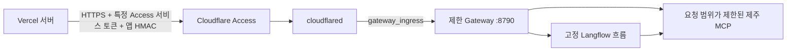

# 제한 Agent Gateway와 Cloudflare Access·Tunnel 연결

2026-11-19 최신 변경은 **[요청 큐와 동시 처리 업데이트](#요청-큐와-동시-처리-업데이트)**다. 기존 PR #19의 후보 복구를 포함해 MCP·Gateway를 함께 갱신한다. 이미 연결된 AWS에서는 아래 최초 설치·Langflow bootstrap을 반복하지 않는다. 기본 동시 2건은 설정·코드 상한이며, 사용자 AWS 8GB에서 실제 모델 2건을 동시에 실행해 성능을 확인한 결과는 아니다.

사용자 AWS에서 **981곳 MCP → Langflow → Vertex 단건 응답·최종 검증 성공**에 이어 **Gateway·Cloudflare HTTPS·Access 서비스 인증·앱 HMAC/JWT의 공개 준비 검사(`scope:public`)까지 통과**했다. PR #16은 `main@2b44228`에 병합됐고 공개 연결 수정은 PR #17의 `7890060`으로 적용됐다. 다음은 Vercel 서버 어댑터·서버 비밀 설정·Preview 연결이다. 공개 준비 검사는 모델을 실행하지 않으며 기존 성공한 Vertex 단건 실행이나 96문항 평가를 반복하지 않는다.



공개 대상은 **`agent.oreumit.com` 한 호스트의 Gateway**다. Langflow 관리 화면·MCP·PostgreSQL은 공개 경로가 아니다. `oreumit.com`, `www.oreumit.com`의 기존 DNS나 Vercel 연결은 수정하지 않는다. AWS 방화벽에 8790·7860·8788·5432의 인바운드 포트를 추가하지 않는다. Tunnel은 외부로 연결하며, Gateway 호스트 포트는 `127.0.0.1:8790`이다.

## 1. AWS에서 비공개 Gateway 준비

기존 저장소 `~/oreumit-agent`, Compose 프로젝트 `oreumit-bootstrap`을 사용한다. 아래 새 브랜치는 최초 전환용이다. 이미 같은 로컬 브랜치가 있으면 `git switch codex/lightsail-agent-gateway` 후 `git merge --ff-only origin/codex/lightsail-agent-gateway`를 사용한다. 수정 파일이 있으면 강제 덮어쓰지 않는다.

```bash
cd ~/oreumit-agent &&
git status --short &&
test -z "$(git status --porcelain)" &&
git fetch origin refs/heads/codex/lightsail-agent-gateway:refs/remotes/origin/codex/lightsail-agent-gateway &&
git switch --no-track -c codex/lightsail-agent-gateway origin/codex/lightsail-agent-gateway
```

같은 SSH 터미널에서 다음을 실행한다. Gateway용 요청 범위·키·별도 흐름을 추가하기 위해 **MCP와 Langflow만 한 번 재생성**한다. 기존 DB·볼륨·카탈로그와 기존 Vertex 자격증명은 보존한다. 마지막 검사는 모델을 호출하지 않는다.

```bash
gateway_compose=(sudo env COMPOSE_PROJECT_NAME=oreumit-bootstrap docker compose
  -f deploy/compose.yaml -f deploy/compose.catalog.yaml
  -f deploy/compose.langflow.yaml -f deploy/compose.gateway.yaml)

sudo python3 deploy/prepare-gateway.py --init &&
"${gateway_compose[@]}" config --quiet &&
"${gateway_compose[@]}" up -d --build --no-deps --force-recreate --wait --wait-timeout 180 jeju-mcp &&
"${gateway_compose[@]}" up -d --no-deps --force-recreate --wait --wait-timeout 300 langflow &&
sudo env COMPOSE_PROJECT_NAME=oreumit-bootstrap python3 deploy/prepare-gateway.py --provision &&
"${gateway_compose[@]}" up -d --build --no-deps --wait --wait-timeout 90 agent-gateway &&
"${gateway_compose[@]}" exec -T agent-gateway node check.mjs --internal
```

기대 결과는 Gateway `status:passed`, `mode:private`, `ready:true`, `catalogPlaces:981`, `modelExecuted:false`, `productionReady:false`다. `healthz`와 Docker의 Healthy는 프로세스 생존만 뜻한다. `check.mjs --internal`은 실제 고정 Langflow 흐름의 해시·실행 키, MCP 카탈로그·호출 제한과 비인증 경로 거부를 별도로 검사한다.

`--provision` 실패로 `.gateway-provisioning`이 남으면 자동 재시도하거나 키·파일을 삭제하지 않는다. 기존 Langflow의 전용 흐름/키와 설정을 확인해야 한다. 정상 완료 후 같은 준비 명령은 기존 키를 보존한다. 키·환경 파일·일반 `docker compose config` 출력은 공유하지 않고 마지막 집계 JSON·고정 오류 코드만 공유한다.

### 새 Gateway 경로의 실응답 한 건

내부 준비 검사가 통과하면 아래를 **한 번만** 실행한다. 기존 AWS 단건 실행과 달리 새 Gateway 인증·요청 범위 도구·최종 검증을 모두 거치는 요청이다. 기존 Vertex API 사용료가 발생할 수 있다. 실패하면 결과를 먼저 확인하고 자동 반복하지 않는다.

```bash
"${gateway_compose[@]}" exec -T agent-gateway node check.mjs --run-once
```

기대 결과는 `status:passed`, `finalValidationAccepted:true`, `action:cannot_confirm`이며 실내 근거가 없는 후보에 확인 안내가 유지된다. 모델 호출 횟수·비용을 실측한 출력은 아니다. 최초 Gateway의 한도는 동시 1개·주체당 시간당 6개·전체 시간당 30개였다. 요청 큐 적용 후의 한도는 [최신 업데이트 절](#요청-큐와-동시-처리-업데이트)을 따른다. 도구 8회, 모델 4회·출력 2048토큰, 요청 실행 예산 105초와 범위 폐기 최대 3초는 유지한다. 시간 초과나 불확실한 실행 뒤에는 해당 실행 슬롯의 보호 시간을 유지한다. Gateway readiness는 모델을 실행하지 않는다.

## 2. Cloudflare Zero Trust와 전용 서비스 토큰 만들기

이 절은 계정 소유자가 [Cloudflare 대시보드](https://dash.cloudflare.com/)에서 진행한다. 현재 계정은 도메인 관리만 설정돼 있으므로 **Zero Trust** 최초 설정이 필요하다. 팀 이름과 요금제를 선택한다. 공식 온보딩 안내는 Free 요금제도 결제정보 입력 단계가 있을 수 있다고 설명한다. 기존 도메인의 DNS 레코드는 건드리지 않는다.

1. **Zero Trust → Access controls → Service credentials → Service Tokens → Create Service Token**을 연다.
2. 이름 `jeju-vercel-gateway`, 운영에 맞는 만료 기간을 선택하고 **Generate token**을 누른다.
3. **Client ID와 Client Secret을 비밀 저장소에 보관**한다. Secret은 생성 시에만 표시된다. 채팅·GitHub·문서에는 붙이지 않는다.
4. AWS SSH 터미널에서 아래 두 입력에 각각 붙인다. 화면에 입력값이 표시되지 않는다. `sudo -v`로 먼저 인증한 뒤 stdin으로만 전달한다.

```bash
cd ~/oreumit-agent
set +x
sudo -v &&
read -rsp 'Access Client ID: ' access_client_id && printf '\n' &&
read -rsp 'Access Client Secret: ' access_client_secret && printf '\n' &&
printf '%s\n%s\n' "$access_client_id" "$access_client_secret" | sudo python3 deploy/tunnel/configure.py service-token
unset access_client_id access_client_secret
```

저장은 `deploy/.local/tunnel/service-token.env`, root 소유 0600이다. 파일이나 값은 컨테이너에 마운트하지 않으며 나중에 공개 `/readyz` 인증 검사에 사용한다. 새 `cfast_` 형식과 기존 64자리 hex Secret을 지원한다.

## 3. 공개 경로보다 먼저 Access 정책·앱 만들기

1. **Zero Trust → Access controls → Policies → Add a policy**에서 이름을 `jeju-vercel-service-only`로 지정한다.
2. Action은 **Service Auth**를 선택한다. Include 조건은 **Service Token → `jeju-vercel-gateway`** 하나로 지정한다. **Any Access Service Token, Everyone, Bypass**를 선택하지 않는다.
3. **Access controls → Applications → Create new application → Self-hosted and private → Add public hostname**으로 이동한다.
4. 앱 이름 `jeju-agent-gateway`, 공개 호스트 **`agent.oreumit.com`**을 설정하고 **Path는 비운다**. `/v1/recommend`에만 보호를 걸면 다른 경로가 남으므로 전체 호스트를 보호한다.
5. 앞서 만든 서비스 전용 정책만 연결하고 **Create**로 저장한다.
6. 앱 **Edit → Additional settings → Application Audience (AUD) Tag**에서 AUD를 복사한다.
7. **Zero Trust → Settings → Team name and domain → Team name**에서 팀 이름을 확인한다. issuer는 **`https://<팀이름>.cloudflareaccess.com`**이다.

issuer와 AUD는 공개 설정값이다. 아래 예시의 팀 이름과 AUD만 실제 값으로 바꾼다. 아직 Tunnel route를 만들지 않는다.

```bash
sudo python3 deploy/tunnel/configure.py access \
  --issuer 'https://YOUR-TEAM.cloudflareaccess.com' \
  --audience 'YOUR_APPLICATION_AUD_64_LOWERCASE_HEX' \
  --hostname 'agent.oreumit.com' &&
sudo python3 deploy/tunnel/check.py --scope config
```

설정 검사 `scope:config`는 파일 형식·권한만 검사하며 Gateway control token이나 Tunnel token이 없어도 가능하다. Gateway가 준비됐다는 뜻은 아니다. 별도 `gateway-access.env`만 생성하고 기존 `gateway.env`의 HMAC·MCP·Langflow 비밀값과 `GATEWAY_MODE=private`는 바꾸지 않는다. 최종 Tunnel overlay가 Access 설정을 마지막으로 읽고 `GATEWAY_MODE=access`를 강제한다.

다음은 **Gateway만** access 모드로 재생성한다. Tunnel 파일이 아직 없으므로 이 단계에 전체 `up`이나 `--wait` 대상 생략을 사용하지 않는다.

```bash
tunnel_compose=(sudo env COMPOSE_PROJECT_NAME=oreumit-bootstrap docker compose
  -f deploy/compose.yaml -f deploy/compose.catalog.yaml
  -f deploy/compose.langflow.yaml -f deploy/compose.gateway.yaml
  -f deploy/compose.tunnel.yaml)

"${tunnel_compose[@]}" config --quiet &&
"${tunnel_compose[@]}" up -d --no-deps --force-recreate --wait --wait-timeout 90 agent-gateway &&
sudo env COMPOSE_PROJECT_NAME=oreumit-bootstrap python3 deploy/tunnel/check.py --scope gateway
```

`scope:gateway`, `status:passed`가 나와야 다음으로 간다. 이 검사는 실행 중인 컨테이너의 issuer·AUD·host·mode가 파일과 일치하고 내부 준비 검사도 통과하는지 확인한다. Access JWT 없이 사용할 수 있는 HTTP 인증 우회 경로는 만들지 않는다.

## 4. Named Tunnel 만들고 connector만 시작

1. [Cloudflare 대시보드](https://dash.cloudflare.com/)에서 **Networking → Tunnels → Create a tunnel**을 연다. 계정 UI에 이전 메뉴가 보이면 Zero Trust의 **Networks → Connectors → Cloudflare Tunnels**에 해당한다.
2. 이름을 `jeju-agent-aws`로 지정하고 **Create Tunnel**을 누른다. connector 유형 선택 화면이 나오면 **Cloudflared**를 선택한다.
3. Docker 설치 화면에서 **Tunnel token 값만** 복사한다. 토큰이 포함된 전체 `docker run ... --token ...` 명령을 셸에 붙이지 않는다.
4. 다음 숨김 입력으로 저장한다. 아직 Published application route는 만들지 않는다.

```bash
cd ~/oreumit-agent
set +x
sudo -v &&
read -rsp 'Tunnel token: ' tunnel_token && printf '\n' &&
printf '%s' "$tunnel_token" | sudo python3 deploy/tunnel/configure.py token
unset tunnel_token
```

원본은 `deploy/.local/tunnel/token` root:root 0600, 실행용 복사본은 `token.runtime` UID:GID 65532:65532·0400이다. 부모 `tunnel/`은 root:root 0700이다. Docker에는 실행용 **단일 파일만 읽기 전용**으로 마운트한다. settings 디렉터리 전체·Access 서비스 Secret·Gateway 키는 cloudflared에 전달하지 않는다. 표준 Cloudflare 공용 endpoint의 remotely managed token을 지원하며 별도 endpoint가 지정된 token은 거부한다.

같은 SSH 세션의 `tunnel_compose` 배열을 사용한다. 새 터미널이면 3절에서 배열 정의만 다시 실행한다. 이 기동은 cloudflared만 대상으로 하며 다른 서비스나 DB를 재생성하지 않는다.

```bash
sudo python3 deploy/tunnel/configure.py check &&
sudo env COMPOSE_PROJECT_NAME=oreumit-bootstrap python3 deploy/tunnel/check.py --scope gateway &&
"${tunnel_compose[@]}" up -d --no-deps --wait --wait-timeout 120 cloudflared &&
sudo env COMPOSE_PROJECT_NAME=oreumit-bootstrap python3 deploy/tunnel/check.py --scope connector
```

`scope:connector`, `status:passed`는 Gateway 내부 준비와 cloudflared의 Cloudflare 연결을 확인한다. Published application route·Access 정책까지 확인한 결과는 아니다. 호스트 인바운드를 열지 않아도 동작한다. AWS 아웃바운드를 제한했다면 [Cloudflare Tunnel 방화벽 요건](https://developers.cloudflare.com/cloudflare-one/networks/connectors/cloudflare-tunnel/configure-tunnels/tunnel-with-firewall/)의 TCP/UDP 7844, DNS와 Gateway JWKS용 HTTPS 접근을 확인한다.

## 5. route 추가 후 공개 인증 검사

위 Gateway access 모드와 connector 검사가 통과한 다음 진행한다. Access 앱과 Service Auth 정책이 전체 호스트에 연결된 것을 먼저 다시 확인한다.

1. **Networking → Tunnels → `jeju-agent-aws` → Routes → Add route → Published application**을 연다.
2. **Subdomain `agent`**, **Domain `oreumit.com`**, **Path 빈칸**을 지정한다.
3. Service URL에 **`http://agent-gateway:8790`**을 입력한다. Type과 URL이 분리된 화면이면 Type **HTTP**, URL **`agent-gateway:8790`**이다.
4. HTTP 설정의 **HTTP Host Header**가 있으면 **`agent.oreumit.com`**으로 지정한다. 기본값으로도 원래 공개 Host가 유지돼야 하며 내부 서비스 이름으로 바꾸면 Gateway가 거부한다.
5. **Add route**를 누른다. `agent` 이름의 기존 DNS 레코드와 충돌한다면 덮어쓰지 말고 그 레코드 용도부터 확인한다. apex/root·www는 변경하지 않는다.
6. SSH에서 공개 검사를 실행한다.

```bash
sudo env COMPOSE_PROJECT_NAME=oreumit-bootstrap python3 deploy/tunnel/check.py --scope public
```

이 검사는 고정 URL `https://agent.oreumit.com/readyz`만 호출한다. **무인증 거부 → Access 서비스 인증만 있을 때 앱 인증 거부 → Access 서비스 인증+올바른 HMAC으로 준비 응답 성공**을 확인한다. 리다이렉트를 따라가지 않고 HTTPS 인증서 검증을 유지한다. 응답 원문·비밀값은 출력하지 않는다. `scope:public`, `status:passed`, `modelExecuted:false`가 완료 기준이다. 공개 추천 실행이나 실제 Vercel 호출의 성공을 의미하지 않으며 `productionReady:false`를 유지한다.

다음은 Vercel **서버 환경**에 Gateway URL·HMAC 키와 Cloudflare Client ID/Secret을 비밀값으로 연결하고, 설문 입력 변환과 실제 요청 주체를 결합한 서버 어댑터를 Preview에서 검사하는 단계다. `NEXT_PUBLIC_*`나 브라우저 번들에 이 인증값을 넣지 않는다. 여기서는 Vercel 환경변수나 배포를 변경하지 않는다.

### 공개 검사의 1010과 단계별 실패 확인

2026-11-19 사용자 AWS 출력에서 `/healthz`·`/readyz`는 각각 17바이트의 403을 반환했다. Tunnel 로그의 route는 `http://agent-gateway:8790`, 빈 Path, 올바른 Host였고 추가 Tunnel Access 검증은 꺼져 있었으며 해당 JWT 거부 로그도 0건이었다. 작성자가 같은 공개 주소에 무인증 요청을 보내 Python 기본 User-Agent의 `error code: 1010`을 확인했다. `User-Agent: oreumit-agent-check/1.0`을 사용하자 1010이 사라졌다. [Cloudflare 공식 1010 안내](https://developers.cloudflare.com/support/troubleshooting/http-status-codes/cloudflare-1xxx-errors/error-1010/)도 라이브러리 기본 User-Agent 대신 실제 앱 식별자를 보내도록 안내한다. 브라우저 식별자 사칭이나 보안 기능 비활성화가 필요하다는 근거는 없다.

검사기는 세 공개 요청 모두에 앱 식별자를 넣고, 실패 시 `TUNNEL_PUBLIC_CHECK_FAILED` JSON으로 `phase`, `httpStatus`, `bodyBytes`, `responseKind`와 확인 가능한 고정 오류 코드만 반환한다. 응답 원문·Cookie·JWT·Client ID/Secret·HMAC은 출력하지 않는다. `cloudflareCode`는 본문 전체가 알려진 짧은 오류 형식일 때만 숫자로 추출하고 `gatewayCode`는 Gateway 코드 허용 목록으로 제한한다.

| phase | 기대 결과 | 실패 시 확인할 범위 |
|---|---|---|
| `anonymous` | 무인증 거부(리다이렉트/401/403) | 공개 호스트 전체의 Access 보호, Cloudflare 오류 번호 |
| `access_only` | 앱 HMAC이 없으므로 401 | Access 서비스 인증과 Gateway의 헤더 거부 |
| `signed` | 두 인증을 통과한 200 | HMAC·Host·Access JWT·고정 흐름 준비 |
| `readiness_response` | `ready:true`, `mode:access`, 981곳 등 응답 계약 | 다른 서비스로 연결됐는지 또는 준비 상태 불일치 |

앱 식별자 추가 후 사용자 AWS 출력은 `anonymous:403`·61,599바이트와 `access_only:403`·36바이트·`ORIGIN_REJECTED`다. 이는 요청이 Gateway까지 도착한 근거이며 공개 검사 전체 성공은 아니다. `ORIGIN_REJECTED`에는 `gatewayHeaderContext`의 `originPresent`, `cookiePresent`, `cookieEmpty`, `singleCfAuthorizationCookie`, `cookieMatchesAssertion` boolean만 표시한다. 실제 사용자 진단은 `originPresent:false`, `cookiePresent:true`, `cookieEmpty:false`, `singleCfAuthorizationCookie:true`, `cookieMatchesAssertion:true`였다. Cloudflare의 서비스 인증을 거친 요청에 JWT 헤더와 같은 단일 `CF_Authorization` 쿠키가 도착했고, 기존 일괄 Cookie 거부가 이를 막았다.

Gateway는 Access 모드의 보호 경로에서만 JWT 헤더와 정확히 같은 단일 `CF_Authorization` 쿠키를 수용한다. 최초 경로는 `GET /readyz`·`POST /v1/recommend`이며 큐 적용 후에는 `POST /v1/jobs`·`GET/DELETE /v1/jobs/<jobId>`에도 같은 검증을 적용한다. 쿠키는 인증 근거로 사용하지 않으며 기존 앱 HMAC·공개 Host·JWT 서명/issuer/AUD/만료 검증을 모두 통과해야 한다. Origin 헤더, 일반·추가·중복·불일치 쿠키, 빈 쿠키, private 모드와 healthz의 쿠키는 계속 거부한다. Cloudflare 보안 기능이나 Access 정책을 끄지 않는다.

업데이트는 호스트 검사기와 Gateway의 한정된 쿠키 호환 처리·오류 진단을 바꾼다. 수정 브랜치를 적용한 뒤 3절의 `tunnel_compose` 배열을 정의하고 Gateway만 갱신한다. DB·MCP·Langflow·cloudflared 재설치는 필요하지 않다.

```bash
"${tunnel_compose[@]}" up -d --build --no-deps --wait --wait-timeout 90 agent-gateway &&
sudo env COMPOSE_PROJECT_NAME=oreumit-bootstrap python3 deploy/tunnel/check.py --scope public
```

`scope:public`, `status:passed`가 확인되기 전에는 Vercel 연결 완료나 운영 준비 완료로 기록하지 않는다.

### AWS 공개 인증 검사 성공

2026-11-19 사용자가 수정 커밋 `7890060`을 적용하고 Gateway만 다시 빌드한 뒤 아래 결과를 제공했다. 작성자가 AWS에 직접 SSH 접속한 결과는 아니다.

```json
{"status":"passed","scope":"public","tokenConfigured":true,"runtimeChecked":true,"modelExecuted":false,"productionReady":false}
```

이 검사는 무인증 거부, Access 서비스 인증만 있을 때 앱 HMAC 거부, 두 인증이 모두 있을 때 HTTP 200 및 Access 모드·고정 흐름·981곳 준비 응답을 확인한다. 실제 공개 추천 POST나 Vercel 서버 호출·웹 사용자 흐름을 검증한 결과는 아니다. 다음은 Vercel 서버 어댑터와 서버 비밀 설정·Preview 연결이며, `productionReady:false`를 유지한다.

## 6. 보존·중단·검증 범위

설정 helper는 같은 값이면 기존 파일을 보존하고, 다른 값·잘못된 소유권/권한·symlink·hardlink·일부만 남은 token 쌍을 거부한다. 실패했다고 파일을 지우거나 key를 자동 교체하지 않는다. 저장 중 실패하면 이번 호출에서 만든 링크만 되돌리고, 중단으로 partial pair가 남으면 일치하는 백업/현재 connector 설정부터 확인한다. 기존 DB·Langflow 암호나 암호화 키를 재생성할 이유는 없다.

공개 연결만 중단하려면 3절의 `tunnel_compose` 배열을 정의한 동일한 SSH 세션에서 아래를 사용한다. Gateway는 access 모드를 유지하고 다른 컨테이너·볼륨은 보존한다.

```bash
"${tunnel_compose[@]}" stop cloudflared
```

공식 이미지 확인일은 2026-11-19다. `cloudflare/cloudflared:2026.11.1`의 registry manifest-list digest는 **`sha256:e613aadbc2d9511785d2e67a86b0c8ac18dd63a3f9af0d06faf04cbfdcb35f2d`**이며 amd64/arm64를 제공한다. 실행 사용자 `65532:65532`, `--token-file`, 셸 없는 `cloudflared tunnel --metrics 127.0.0.1:2000 ready`를 공식 이미지 metadata와 릴리스 소스에서 확인했다. metrics는 컨테이너 loopback에만 바인딩한다.

로컬 단위 검사는 비밀값 보존, 권한·소유자·링크 거부, 토큰 쌍의 부분 실패, 잘못된 issuer/host/AUD, 서비스 Secret 형식과 공개 인증 응답 계약을 다룬다. Docker CI의 가상 카탈로그·모의 모델 검사는 실제 Cloudflare 계정·DNS·AWS·Vertex 실행 검증을 대신하지 않는다. 실제 계정 설정·Tunnel 연결·공개 인증 결과는 위 사용자 AWS 성공 기록과 구분해 읽는다.

```bash
python3 -m unittest discover -s deploy/tunnel -p 'test_*.py'
```

## 후보 표시 완화 적용

이 절은 **후보 복구만 적용하던 이전 절차**다. 요청 큐까지 포함한 현재 브랜치는 아래 [요청 큐 업데이트](#요청-큐와-동시-처리-업데이트)의 helper를 사용한다.

2026-11-19 사용자가 운영 웹에서 AI 결과가 차단됐다고 보고했다. 모델 응답 원문과 차단 사유를 확보하지 않았으므로 **그 요청의 정확한 원인은 아직 확정하지 않았다.** 아래 수정은 등록된 Gateway 요청의 후보 ID·조건 근거를 기준으로, 복구 가능한 구조화 응답을 좁게 정리한다. AWS 적용 및 수정 이후 실제 웹 추천 결과는 별도 확인이 필요하다.

`/gateway/validate-response`의 요청 범위 안에서만 모델이 이미 선택한 ID를 사용한다. 원래 필터·제외 목록 밖 ID와 확인된 필수 조건 실패 후보를 제거하고, 중복 제거 후 최대 5곳을 남긴다. 조건별 판정과 확인 안내는 카탈로그의 실제 근거로 다시 만들며 미검증 값은 `unknown`·`cannot_confirm`으로 유지한다. 새 장소를 대체 삽입하지 않고, 남길 후보가 없거나 엄격한 최종 검증을 통과하지 못하면 계속 차단한다. 요청 범위 밖의 기존 엄격 검증과 Langflow 그래프·프로토콜은 변경하지 않는다.

아래는 AWS SSH에서 실행할 적용 명령이다. 이미지 빌드 중에는 기존 MCP가 계속 실행된다. **웹 추천 요청이 없는 때 실행한다.** helper는 재시작 직전 기존 MCP의 인증된 `/gateway/readyz`를 확인하고 `activeScopes`가 0이 아니면 재시작 없이 중단한다. `ACTIVE_REQUEST_PRESENT`이면 현재 요청이 끝난 뒤 같은 helper를 직접 실행한다. 자동 재시도나 활성 요청 취소는 하지 않는다.

```bash
cd ~/oreumit-agent &&
git diff --quiet && git diff --cached --quiet &&
git fetch origin refs/heads/codex/gateway-candidate-recovery:refs/remotes/origin/codex/gateway-candidate-recovery &&
git merge --ff-only origin/codex/gateway-candidate-recovery &&
sudo env COMPOSE_PROJECT_NAME=oreumit-bootstrap bash deploy/apply-candidate-recovery.sh
```

helper는 다섯 Compose 파일을 모두 사용하고 **`jeju-mcp`만** `--no-deps --wait`로 갱신한다. Gateway·Langflow·DB·Tunnel 컨테이너와 기존 자격증명·볼륨은 갱신하지 않는다. 다만 상태 확인과 재시작 사이 신규 요청을 원자적으로 막는 maintenance gate는 없으므로 무중단 적용을 보장하지 않는다. 이미지 갱신 중 새로 들어온 요청은 실패할 수 있다.

재기동 후에는 새 MCP 이미지와 현재 981곳 카탈로그를 별도 프로세스에서 불러와 합성 요청으로 후보 정리를 확인한다. 이 검사에 쓰는 scope는 **프로세스 메모리 안에만** 존재하며 실행 중 서비스에 등록하지 않는다. 이어 기존 공개 인증 준비 검사를 실행한다. 최종 성공 표시는 다음과 같으며 모델은 실행하지 않는다.

```json
{"status":"passed","scope":"candidate-recovery-applied","service":"jeju-mcp","modelExecuted":false,"productionReady":false}
```

## 요청 큐와 동시 처리 업데이트

사용자 요청으로 기존 PR #19·`codex/gateway-candidate-recovery`에 후보 복구와 함께 요청 큐를 추가한다. 기본값은 **전체 실행 2건·대기 최대 8건·사용자별 실행과 대기 합계 1건**이다. AWS 메모리 8GB라는 정보만으로 실제 모델 처리량이나 지연을 보장하지 않는다. 실제 2건 동시 추론·비용·메모리 사용량과 수정 이후 웹 추천 결과는 아직 검증하지 않았다. 기존 Langflow·Vertex 공급자 설정을 유지한다.

| Compose 설정 | 기본값 | 허용 범위 |
|---|---:|---|
| `GATEWAY_MAX_CONCURRENT` | 2 | 정수 1~4, Gateway와 MCP가 같은 값을 사용 |
| `GATEWAY_MAX_QUEUE` | 8 | 정수 0~8, 0이면 대기 접수 안 함 |
| `GATEWAY_GLOBAL_HOURLY_LIMIT` | 60 | 시간당 전체 1~240건 |
| `GATEWAY_SUBJECT_HOURLY_LIMIT` | 12 | 시간당 사용자 1~48건, 전체 한도 이하 |

위 값은 Compose를 실행하는 환경 또는 `deploy/.env`에서 지정하는 **비밀이 아닌 설정**이다. 두 서비스의 동시 처리 값을 따로 바꾸지 않는다. `deploy/.local/gateway.env`에만 적으면 Compose의 `environment` 기본값이 우선하므로 적용되지 않는다. 기본값을 쓸 때 새 파일이나 키를 만들 필요가 없다. 기존 시간당 사용량·재전송 방지 기록을 지워 한도를 초기화하지 않는다.

### AWS에 적용할 명령

웹에서 새 추천을 제출하지 않는 때 AWS SSH에서 실행한다. 두 이미지를 모두 빌드한 뒤 **인증된 Gateway 준비 응답의 queued/running/uncertain가 모두 0이고 MCP activeScopes가 0인지** 확인한다. 큐가 없는 구버전은 `/app/jobs.mjs` 부재와 SQLite `user_version=1`을 확인한 경우에만 기존 DB를 읽기 전용으로 열어 살아 있는 inflight/uncertain lease 수를 확인한다. DB가 없거나 스키마·읽기·인증 검사에 실패하면 재시작 전에 중단한다. 새 상태 저장소를 만들거나 마이그레이션해서 유휴 상태를 추정하지 않는다.

```bash
cd ~/oreumit-agent &&
git diff --quiet && git diff --cached --quiet &&
git fetch origin refs/heads/codex/gateway-candidate-recovery:refs/remotes/origin/codex/gateway-candidate-recovery &&
git merge --ff-only origin/codex/gateway-candidate-recovery &&
sudo env COMPOSE_PROJECT_NAME=oreumit-bootstrap bash deploy/apply-agent-queue.sh
```

`ACTIVE_REQUEST_PRESENT` 또는 종료 코드 75는 요청·대기 작업·불확실 실행 보호 시간이 남았다는 뜻이다. 모두 끝난 뒤 같은 helper를 직접 다시 실행한다. 다른 실패도 원인을 확인한 뒤 재개하며 자동 반복하지 않는다. 상태 확인과 재기동 사이 신규 요청을 원자적으로 막는 maintenance gate는 없으므로 무중단 적용을 보장하지 않는다. 이 사이 새 요청이 접수되면 영향을 받을 수 있다.

helper는 Compose 파일 5개를 모두 사용해 **`jeju-mcp`와 `agent-gateway`만** `--no-deps --wait`로 갱신한다. Langflow·DB·cloudflared를 재생성하지 않고 자격증명·SQLite·볼륨을 삭제하거나 작업을 취소하지 않는다. MCP 후보 복구의 오프라인 검사, 새 Gateway 이미지의 임시 SQLite·모의 작업 기반 큐/상태 검사, 기존 공개 인증 준비 검사 순으로 확인한다. 테스트 파일은 이미지에서 제외하므로 호스트의 파일 두 개를 각각 stdin으로 전달해 `/app`의 설치된 모듈을 검증한다. 마지막으로 인증된 준비 응답의 `asyncJobs:true`와 Gateway `maxConcurrent`·MCP `maxConcurrentScopes` 일치를 확인한다. 이 준비 검사는 새 사용자의 활성 작업을 취소하지 않는다.

이미 컨테이너 갱신과 후보 오프라인 검사가 통과했으나 `queue_offline_check`에서 `Could not find 'state.test.mjs, jobs.test.mjs'`로 멈췄다면 이전 검사 스크립트의 이미지 파일 경로 오류다. 수정본을 받은 뒤 아래 명령으로 검사만 재개한다. 빌드·유휴 검사·서비스 재시작은 하지 않는다. 성공 출력은 `scope:agent-queue-verified`, `servicesRestarted:false`다.

```bash
sudo env COMPOSE_PROJECT_NAME=oreumit-bootstrap bash deploy/apply-agent-queue.sh --verify-only
```

최종 완료 출력은 다음과 같다. **실제 모델을 호출하거나 Langflow bootstrap·기존 성공한 단건 모델 검사를 반복하지 않는다.**

```json
{"status":"passed","scope":"agent-queue-applied","services":["jeju-mcp","agent-gateway"],"modelExecuted":false,"productionReady":false}
```

### 대기·실패·재시작의 의미

- 서명된 `POST /v1/jobs`는 요청을 한 번 접수한다. 같은 사용자만 서명된 `GET /v1/jobs/<jobId>`로 상태·결과를 조회하며 조회는 모델 실행·시간당 한도를 추가 소비하지 않는다. 기존 동기식 `/v1/recommend`도 호환한다.
- 실행 슬롯이 비면 대기열의 다음 작업이 실행된다. 대기 순서는 예상 완료 시간이 아니다. 대기 만료는 10분, 전체 작업 수명은 최대 12분이며 실행 예산은 실제 작업이 시작할 때 적용한다.
- 접수 전의 `BUSY`·`QUEUE_FULL`·`RATE_LIMITED`와 접수 후 `queued`·`running`을 구분한다. 웹은 먼저 기존 `/readyz`의 `asyncJobs:true`를 확인한 뒤 큐를 사용하고, 이 기능 표시가 없는 구버전은 기존 동기 경로를 사용한다. 큐 기능을 확인한 뒤에도 경로가 명확한 404 `NOT_FOUND`를 반환하는 경우에만 동기 경로를 한 번 사용한다. 다른 오류나 사라진 개별 작업은 자동 재제출하지 않는다.
- Langflow 종료 응답이 확인된 뒤 최종 검증에서 실패한 작업은 슬롯을 해제한다. 시간 초과·중단·전송 실패처럼 종료 여부를 확인하지 못한 작업은 기존 120초 보호 lease를 유지한다. 실패를 완료로 임의 처리하거나 곧바로 반복 실행하지 않는다.
- 대기 요청·결과 원문은 RAM에만 있고 완료 결과는 최대 5분·128건으로 제한한다. 재시작 후 대기 작업을 복원·자동 실행하지 않는다. SQLite에는 해시와 사용량·재전송·lease 상태만 남기며, 재시작 전 실행 결과가 불확실하면 그 보호 시간을 유지한다. 사라진 작업의 404는 재전송 승인이 아니다.
- 취소 API는 **아직 대기 중인 작업만** 취소한다. 이미 실행 중인 모델은 취소 API로 중단하거나 재실행하지 않는다. 적용 helper는 취소 API를 호출하지 않는다.

AWS 적용 출력과 이후 실제 사용자 응답을 따로 확인한다. 오프라인 검사·공개 준비 검사 통과만으로 병렬 모델 성공·운영 품질 완료를 기록하지 않고 `productionReady:false`를 유지한다.

### 선택: AWS에서 실제 모델 요청 2건 확인

위 적용이 성공한 뒤 기본 동시 처리 2건 설정·유휴 상태에서만 실행한다. **합성 추천 요청 2건을 실제 Langflow/Vertex로 전송하므로 API 사용료가 발생할 수 있다.** 요청 하나 안에서 모델이 여러 차례 호출될 수 있으므로 모델 API를 정확히 두 번 부른다는 뜻은 아니다. 기존 성공한 단건 검사를 반복하는 절차가 아니며 적용 helper가 자동으로 실행하지 않는다.

```bash
cd ~/oreumit-agent &&
sudo env COMPOSE_PROJECT_NAME=oreumit-bootstrap python3 -I deploy/check-agent-queue-model.py --execute-model
```

검사기는 기존 AWS 비밀 파일을 내부에서 읽어 서명하며 키를 새로 만들거나 채팅 입력을 요구하지 않는다. 서로 다른 합성 주체의 `/v1/jobs` 제출을 각각 한 번만 하고 이후에는 상태 GET만 조회한다. 요청 전송 결과가 불확실해도 POST를 다시 보내지 않는다. 마지막의 정제된 JSON 집계만 공유하며 비밀 파일·응답 원문·컨테이너 환경 전체를 출력하지 않는다.

`scope:aws-two-job-model-check`, `recommendationPostAttempts:2`, `acceptedResults:2`, `twoRunningObserved:true`이면 두 작업의 Gateway 실행 상태와 최종 응답 수락을 관측한 것이다. 경과 시간과 메모리 표본을 함께 남기지만 비용·최대 처리량·모델 공급자 내부의 정확한 병렬 구간은 측정하지 않는다(`providerModelSpanOverlapVerified:false`). 두 결과가 수락돼도 두 running 상태를 관측하지 못하면 `inconclusive`다. 실패·불확실 결과가 나오면 같은 명령을 반복하기 전에 집계와 기존 작업 상태를 확인한다. 이 문서 작성 환경에서는 실제 요청을 실행하지 않았다.

실패하면 표시된 단계와 고정 오류 코드만 공유한다. 환경 파일·키·서비스 응답 원문을 출력하거나 새로 발급할 필요가 없다. 적용 성공은 소스·카탈로그·공개 준비 확인이며 실제 추천 품질이나 운영 준비 완료를 뜻하지 않는다. 이후 웹에서 사용자가 직접 요청한 실제 결과를 확인하되, 이 확인을 위해 기존 모델 평가를 반복하지 않는다.

## 공식 참고 링크

- [Named remotely managed Tunnel 생성·Published application route](https://developers.cloudflare.com/cloudflare-one/networks/connectors/cloudflare-tunnel/get-started/create-remote-tunnel/)
- [공개 self-hosted Access 앱—route보다 먼저 보호 설정](https://developers.cloudflare.com/cloudflare-one/access-controls/applications/http-apps/self-hosted-public-app/)
- [서비스 토큰 생성·만료·요청 헤더](https://developers.cloudflare.com/cloudflare-one/access-controls/service-credentials/service-tokens/)
- [Access 정책 관리](https://developers.cloudflare.com/cloudflare-one/access-controls/policies/policy-management/)
- [Service Auth 정책과 Service Token 조건](https://developers.cloudflare.com/cloudflare-one/access-controls/policies/)
- [Access AUD·origin JWT 검증](https://developers.cloudflare.com/cloudflare-one/access-controls/applications/http-apps/authorization-cookie/validating-json/)
- [cloudflared token-file 옵션](https://developers.cloudflare.com/cloudflare-one/networks/connectors/cloudflare-tunnel/configure-tunnels/run-parameters/#token-file)
- [cloudflared 2026.11.1 릴리스](https://github.com/cloudflare/cloudflared/releases/tag/2026.11.1)
- [실제 ready 명령 구현](https://github.com/cloudflare/cloudflared/blob/2026.11.1/cmd/cloudflared/tunnel/subcommands.go#L467)

메뉴명은 2026-11-19 공식 `cloudflare/cloudflare-docs` production 소스 `71887c4dd651ecb8718833af10feb53ac7433cf6`를 확인한 것이며 사용자의 실제 계정 화면을 열어 본 결과는 아니다. 계정 UI에 따라 일부 명칭·배치가 다를 수 있다. 이전 AWS 성공 근거는 [31 문서](31-lightsail-langflow.md)를 따른다.
