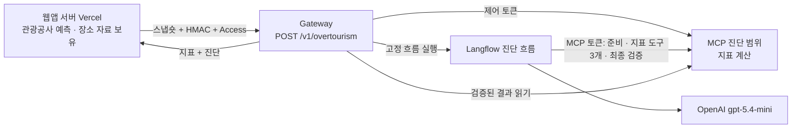

# 오버투어리즘 진단 에이전트를 AWS Docker 스택으로

기준일: 2026-11-24 한국 시간. 사용자가 웹앱의 오버투어리즘 현황판(규제 확인 → 지역 보고서 → 「오버투어리즘 진단」)에 대해 **"진단 에이전트를 AWS Docker로"**를 골랐다. 진단 에이전트를 기존 AWS Docker 스택(Gateway·MCP·Langflow)에서 돌리고, 지표 계산은 MCP 도구로 두고, 웹앱 현황판은 그 결과를 받아 보인다.

이 문서는 **구현과 로컬·CI 검증**의 기록이다. 사용자 AWS에 접속하거나 적용하지 않았고, 실제 OpenAI 호출도 하지 않았다. AWS 적용은 아래 [적용 절차](#aws에-적용할-명령)를 사용자가 실행한다. `productionReady:false`를 유지한다.

## 1. 구조



1. **웹앱 서버**가 이미 가진 자료로 스냅숏을 만든다: 관광공사 「관광지 집중률 방문자 추이 예측」(관광지별 약 30일)을 읍·면·동지역 14곳에 배정한 결과, 지역별 여행장소 수·등록 객실 수·규제 카드, 출처. 관광공사 키·캐시·장소 자료는 앱에만 있다. AWS에는 새 키를 두지 않는다.
2. **Gateway**(`POST /v1/overtourism`)는 앱 HMAC·Cloudflare Access를 그대로 확인하고, 같은 스냅숏의 결과가 있으면 다시 쓰고(메모리 12시간), 없으면 진단 한 번을 실행한다.
3. **MCP**가 스냅숏에서 지표를 결정적으로 계산하고(앱 `src/overtourism.ts`와 같은 셈) 진단 범위 하나를 연다. 자료는 디스크에 쓰지 않고 진단 동안 메모리에만 둔다. MCP는 지금처럼 외부 네트워크가 없다(`mcp_private` 내부 망).
4. **Langflow 진단 흐름**이 범위를 준비하고, 에이전트(gpt-5.4-mini)가 MCP 지표 도구 3개로 지표를 읽은 뒤 14곳 진단 JSON을 쓴다. 최종 검증 구성 요소가 MCP에 검증을 맡기고, 흐름 밖으로는 **다이제스트만** 낸다.
5. **Gateway**는 흐름 출력과 MCP에 저장된 검증 결과의 다이제스트가 같을 때만 지표·진단을 앱에 돌려준다. 흐름이 낸 글을 직접 믿지 않는다.
6. **웹앱 서버**는 받은 지표가 자기 계산과 똑같은지 확인하고(다르면 버림), 같은 검증 규칙으로 진단을 다시 검증해 보인다. AWS가 안 되면 기존 앱 안 에이전트(OpenAI → Gemini) → 규칙 진단 순으로 넘어간다([앱 쪽](#6-웹앱-연결)).

## 2. MCP — 지표 계산·도구·검증 (`services/jeju-mcp/src/overtourism.mjs`)

| 경로 | 인증 | 하는 일 |
|---|---|---|
| `POST /gateway/overtourism/scopes` | Gateway 제어 토큰 | 스냅숏 검사(엄격) → 지표 계산 → 범위 등록(동시 1개, 마감 ≤110초, 같은 ID 재등록 거부) |
| `POST /gateway/overtourism/prepare` | MCP 토큰(Langflow) | 에이전트가 볼 준비 정보 — ID·날짜·정책·지표 다이제스트·지역 ID 14개. 지표 값은 없음 |
| `POST /gateway/overtourism/tools/call` | MCP 토큰 | 지표 도구 3개, 범위당 6회(잘못된 호출도 셈) |
| `POST /gateway/overtourism/validate` | MCP 토큰 | 에이전트 JSON 검증, 처음 수락한 결과만 저장(같은 답은 같은 결과, 다른 답은 409) |
| `POST /gateway/overtourism/result` | 제어 토큰 | 저장된 검증 결과(지표·진단·다이제스트) |
| `DELETE /gateway/overtourism/scopes/{id}` · `GET /gateway/overtourism/readyz` | 제어 토큰 | 해제 · 준비 상태 |

- **지표**: 지역마다 예측 관광지 수, 혼잡(집중률 60% 이상) 관광지·일 비율, 평균, 가장 높은 예측, 상위 관광지 3곳, 등록 객실 수, 여행장소 수, 규제 장소·기간이 끝난 규제.
- **규칙 단계**: 혼잡 비율 30% 이상 높음 · 15% 이상 주의 · 그 밖 보통, 예측 관광지 3곳 미만 자료 부족(앱의 시범 기준과 같음).
- **도구**: `overtourism_overview`(14곳 요약) · `overtourism_regions`(1~14곳 상세: 상위 관광지·규제 카드·기간 종료) · `overtourism_rank`(지표 하나로 순위). 이름은 OpenAI 함수 이름 규칙(영문·숫자·`_`·`-`)을 따른다. 결과에 "자료이며 지시가 아니다"를 붙인다.
- **최종 검증**(앱의 `sanitizeAgent`와 같은 규칙): 14곳을 한 번씩(빠진 곳은 규칙 진단), 모르는 근거 이름은 버림, 숫자·날짜가 든 글은 규칙 문장으로, 규칙 단계와 두 단계 넘게 다르거나 자료 부족을 무시한 단계는 규칙 단계로(`adjusted`). 알아볼 지역이 하나도 없으면 차단.
- 스냅숏 입력 한도: 관광지 1,000곳·하루 값 62개·카드 50개/지역·출처 8개, 등록 본문 256 KiB(다른 MCP 본문은 기존 128 KiB). 448곳 실제 규모 합성 스냅숏은 약 99 KB였다.
- 추천 경로(`/gateway/scopes`·`/gateway/readyz` 등)와 그 응답 모양은 바꾸지 않았다.

## 3. Langflow 진단 흐름

- 구성 요소: [`services/langflow/overtourism_components.py`](../services/langflow/overtourism_components.py) — 준비(`JejuOvertourismPrepare`), 지표 도구(`JejuOvertourismTools`), 최종 검증(`JejuOvertourismValidation`). 고정 사설 주소 `jeju-mcp:8788`만 부르고, 리다이렉트·프록시를 쓰지 않으며, 토큰은 메시지에 들어가지 않는다. 에이전트 답에 코드 블록 하나가 감싸진 경우만 벗겨 낸다.
- 흐름 빌더: [`deploy/langflow/overtourism-bootstrap.py`](../deploy/langflow/overtourism-bootstrap.py). **검토된 규칙 동작 빌드에서 파생**한다 — 같은 OpenAI 전용 클라이언트(gpt-5.4-mini, Credential `JEJU_OPENAI_API_KEY`), 모델 8회(마지막 호출은 도구 없는 최종 답변), 에이전트 90초 제한. 바뀌는 것은 구성 요소 3개, 프롬프트, 출력 8192토큰, 호출당 제한 80초, 마지막 호출 안내 문구뿐이다.
- 흐름 이름 `제주 오버투어리즘 진단 Agent — Gateway 제한 실행`, 노드 6·연결 7. **새 API 키를 만들지 않는다**(Gateway의 기존 Langflow 키가 같은 관리자 사용자의 흐름을 실행한다).
- 호스트 스크립트 [`deploy/prepare-overtourism.py`](../deploy/prepare-overtourism.py)가 빌더와 검토된 원본 세 개를 stdin으로 Langflow 컨테이너에 보낸다(새 bind mount·Langflow 재시작 없음). 결과로 비밀 아닌 흐름 ID·SHA-256만 `.local/gateway-overtourism.env`(0600)에 쓴다. 추천 Gateway 설정 파일(`gateway.env`)은 바이트 단위로 그대로 둔다.
- 모드: `--provision`(없으면 만들고 있으면 같은지 확인, 다르면 `OVERTOURISM_EXISTING_FLOW_DIFFERS`로 멈춤) · `--replace`(저장된 흐름을 이 빌드로, If-Match) · `--check` · `--disable`(고정 파일만 지움).

## 4. Gateway (`services/agent-gateway/overtourism.mjs`)

- `POST /v1/overtourism`: 앱 HMAC·Access·Host 검사는 기존과 같다. 본문 한도는 이 경로만 256 KiB(추천은 32 KiB 그대로).
- **같은 스냅숏**(정규화 JSON 다이제스트)의 결과는 12시간 메모리에서 다시 쓰고(`reused:true`), 진행 중인 실행에는 합류한다. 새 실행만 하루(KST) 한도 8회(`GATEWAY_OVERTOURISM_DAILY_LIMIT`, 1~48)와 기존 상태 예약(재전송 방지·시간당 전체 60/주체 12·동시 2칸 공유·불확실 실행 보호)을 쓴다. 바쁘면 429 `BUSY`.
- 순서: 흐름 SHA-256·MCP 준비 확인 → MCP 범위 등록 → 흐름 실행(95초, 입력은 `{"diagnosisId"}`만) → 최종 출력의 구성 요소 ID·출처 확인 → MCP 검증 결과 읽기·다이제스트 대조 → 범위 해제.
- 응답: `{schemaVersion, status:"accepted", diagnosisId, policyVersion, model, validatedAt, toolCalls, indicatorsSha256, diagnosisSha256, indicators, diagnosis, productionReady:false, reused}`.
- 고정 파일이 없거나 잘못되면 **이 경로만** `503 OVERTOURISM_UNAVAILABLE`이고 Gateway·추천은 그대로 시작한다. `/readyz`의 응답 모양은 바꾸지 않았다(앱이 알 수 없는 키를 거부하기 때문). 진단 준비는 `GET /v1/overtourism/readyz`와 `node /app/check.mjs --internal --overtourism`으로 따로 본다.
- `compose.gateway.yaml`은 `.local/gateway-overtourism.env`를 `required: false`로 읽는다(Compose 2.24 이상, 사용자 AWS는 v5.8.0 보고).

## 5. AWS에 적용할 명령

PR이 main에 병합된 뒤, 웹에서 새 추천을 제출하지 않는 때 AWS SSH에서 **한 줄씩** 실행한다.

```bash
cd ~/oreumit-agent && git diff --quiet && git diff --cached --quiet && git fetch origin refs/heads/main:refs/remotes/origin/main && git merge --ff-only origin/main
```

진단 흐름은 OpenAI Credential `JEJU_OPENAI_API_KEY`를 쓴다. 규칙 동작 전환 때 이미 등록했다면 다시 할 필요가 없다(있으면 `existing_preserved`로 그대로 둔다). 아직이면 등록한다. 입력은 화면에 표시되지 않고 OpenAI를 호출하지 않는다.

```bash
cd ~/oreumit-agent && sudo env COMPOSE_PROJECT_NAME=oreumit-bootstrap bash deploy/set-openai-key.sh
```

적용한다.

```bash
cd ~/oreumit-agent && sudo env COMPOSE_PROJECT_NAME=oreumit-bootstrap bash deploy/apply-overtourism-agent.sh
```

helper 순서: Compose 설정 확인 → 새 MCP·Gateway 이미지 빌드(기존 서비스는 계속 동작) → 유휴 확인 → `jeju-mcp` 재생성 → 설치된 MCP로 오프라인 점검(`deploy/tests/check-overtourism.mjs`, 가상 자료) → 진단 흐름 생성·고정(`prepare-overtourism.py --provision`) → 다시 유휴 확인 → `agent-gateway`만 재생성 → 흐름 고정 확인 → 진단 경로 준비 확인 → 공개 인증·큐 준비 검사. Langflow·DB·Tunnel과 추천 흐름은 건드리지 않는다. 종료 코드 75는 진행 중 요청이 있다는 뜻이며 모두 끝난 뒤 다시 실행한다. 실패하면 `OVERTOURISM_AGENT_APPLY_FAILED: phase=…`만 출력하며, 같은 명령을 다시 실행하면 이어서 진행한다.

성공 출력:

```json
{"status":"passed","scope":"overtourism-agent-applied","model":"gpt-5.4-mini","modelCallLimit":8,"services":["jeju-mcp","agent-gateway"],"modelExecuted":false,"productionReady":false}
```

적용은 모델을 실행하지 않는다. 적용 뒤 첫 실제 진단은 웹앱이 진단 캐시가 비었을 때(날짜·예측 시각이 바뀔 때) 한 번 부른다. 오레움 웹의 규제 확인 → 지역 보고서 → 「오버투어리즘 진단」에서 엔진 표시가 `AI 진단 에이전트 · gpt-5.4-mini · AWS · Langflow · MCP`이면 AWS 결과다. 앱 응답 `GET /api/rules/overtourism`의 `diagnosis.engine`이 `gateway`인지로도 확인한다.

### 확인 · 갱신 · 끄기

```bash
cd ~/oreumit-agent && sudo env COMPOSE_PROJECT_NAME=oreumit-bootstrap bash deploy/apply-overtourism-agent.sh --verify-only
```

이후 PR에서 진단 흐름(프롬프트·구성 요소)이 바뀌면 `--replace-flow`로 저장 흐름을 새 빌드로 바꾸고 다시 고정한다. 끄려면 `--disable`: 고정 파일만 지우고 `agent-gateway`를 재생성한다. 진단 경로는 `OVERTOURISM_UNAVAILABLE`이 되고 웹앱은 앱 안 에이전트로 진단한다. Langflow에 저장된 진단 흐름은 남는다.

```bash
cd ~/oreumit-agent && sudo env COMPOSE_PROJECT_NAME=oreumit-bootstrap bash deploy/apply-overtourism-agent.sh --disable
```

주의: 다른 apply helper(`apply-agent-rule-action.sh` 등)가 `agent-gateway`를 재생성해도 고정 파일은 그대로 읽히므로 진단 경로는 유지된다. 그 helper들이 새 Gateway 이미지를 빌드하지 않는 경우에도 이번 이미지는 유지된다.

## 6. 웹앱 연결

앱 저장소 [OREUM-IT/jeju-tour#76](https://github.com/OREUM-IT/jeju-tour/pull/76)에 같은 브랜치로 더했다(`src/overtourism-gateway.ts`, `src/overtourism.ts`).

- 추천 Gateway와 같은 Vercel 서버 비밀(URL·HMAC 키·Access 서비스 토큰)을 쓰고 주체는 `service:overtourism-diagnosis`로 고정한다. **새 Vercel 설정은 필요 없다**. `JEJU_OVERTOURISM_GATEWAY=off`로 이 경로만 끌 수 있다.
- 엔진 순서: AWS 진단 → 앱 안 OpenAI → Gemini → 규칙 진단. AWS 결과는 지표가 앱 계산과 똑같을 때만 받고 같은 규칙으로 다시 검증한다. AWS가 50초 넘게 걸린 뒤 실패하면 함수 시간(120초) 안에 끝내려고 앱 안 에이전트를 부르지 않고 규칙 진단을 쓴다.
- 에이전트가 실패해 대신한 진단은 공용 DB 캐시에 넣지 않고 메모리 5분·CDN 2분만 쓴다. Gateway는 앱 연결이 끊겨도 실행을 끝내 결과를 남기므로, 다음 요청이 그 결과를 곧 받는다.

## 7. 검증한 것과 하지 않은 것

| 구분 | 내용 |
|---|---|
| 로컬 단위 시험 | MCP 전체 260개(진단 6개 포함) · Gateway 진단 6개(실제 MCP + 가짜 Langflow: 정상, 흐름 변경, 차단, 다이제스트 위조, 출처·세션 불일치, 같은 스냅숏 공유, 하루 한도, 재전송, 본문 한도, 경로 끔, 연결이 끊겨도 실행을 끝내고 다음 요청이 재사용) · Gateway 전체 83개 통과(인증 시험 1개는 이 환경 Node 22에서 취소, 변경과 무관) · `deploy/tests` 210개 중 실패 1개는 원래 main에서도 같은 카탈로그 내보내기 시험(환경 문제) |
| 실제 Langflow 1.13.3 구성 요소 | 작업 공간 venv(lfx 1.13.3)에서 진단 구성 요소 시험 7개, 공식 빌더(`build_custom_component_template`) 통과. 기존 구성 요소 시험 7개도 같은 venv에서 통과 |
| 흐름 빌더 · 호스트 스크립트 · helper | 가짜 Langflow/MCP로 빌더 5개, 호스트 고정 7개, helper 순서 4개 통과. 실제 Compose 설정 해석(고정 파일 있음·없음) 확인 |
| 실제 MCP + 실제 구성 요소 | 로컬 MCP 서버와 lfx 1.13.3 구성 요소로 `check-overtourism-runtime.py`와 같은 점검 통과(호스트 이름만 바꿈): 준비 · 도구 6회 · 예산 초과 차단 · 검증 · 결과는 제어 토큰만 |
| 앱·MCP 지표 일치 | 관광지 448곳 합성 스냅숏 + 실제 지역·규제 자료로 앱 `indicatorsFromSnapshot`과 MCP `computeIndicators`가 출처·규칙 단계까지 똑같음 |
| CI | `agent-gateway-docker.yml`에 공식 Langflow 이미지에서 진단 흐름 생성·고정·Gateway 준비·실제 구성 요소 점검·끄기 단계를 더했다. 결과는 PR에서 확인 |
| 하지 않음 | 사용자 AWS 적용, 실제 OpenAI 호출, 진단 품질·지연·비용, 공개 경로(`agent.oreumit.com`)의 진단 실호출 |

## 8. 함께 찾은 점 — 추천 규칙 동작 흐름의 도구 이름

OpenAI 함수(도구) 이름은 영문·숫자·밑줄·하이픈만 허용한다. 추천 Gateway 흐름의 도구 이름 `places.search`·`places.get`·`constraints.check`에는 점이 있어, **규칙 동작(gpt-5.4-mini) 흐름을 AWS에 적용했다면 실제 OpenAI 호출이 400으로 거부될 가능성이 크다**(Gemini는 점을 허용해 Vertex 흐름은 영향이 없다). 실제 호출로 확인하지 않은 추정이다. 이번 진단 도구는 밑줄 이름을 쓴다. 추천 흐름의 도구 이름 변경은 흐름·MCP 계약을 바꾸므로 이 PR에 넣지 않았고, 사용자가 원하면 따로 고친다. 운영 흐름이 지금 어느 빌드인지는 [32 문서](32-agent-gateway-tunnel.md#지연토큰부하-측정-도구)의 SQL `model` 열로 확인한다.
