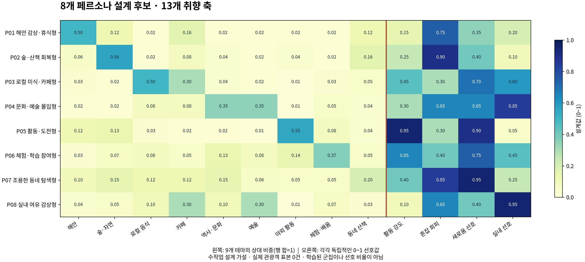
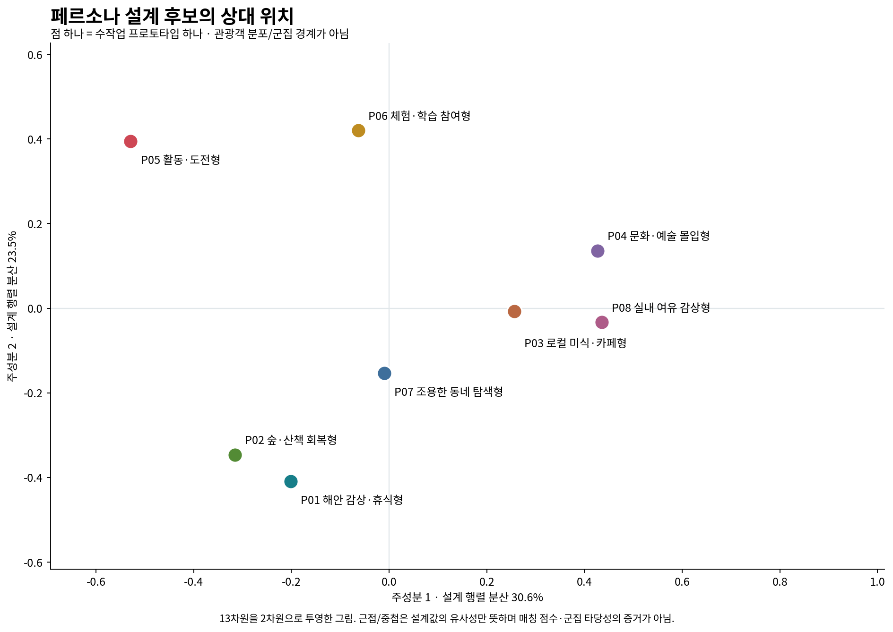
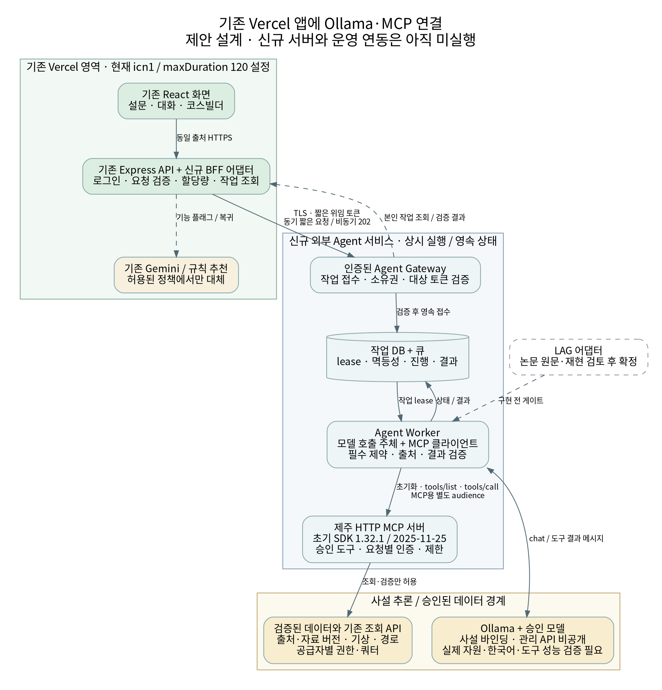
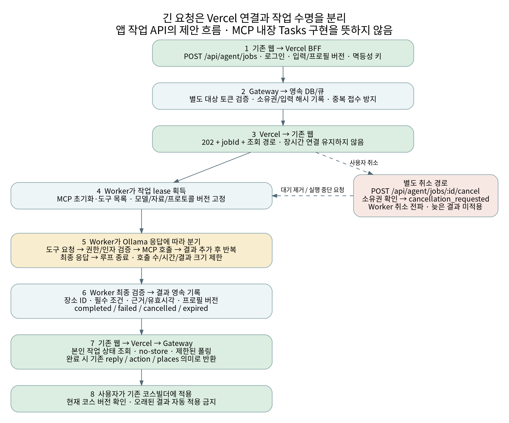
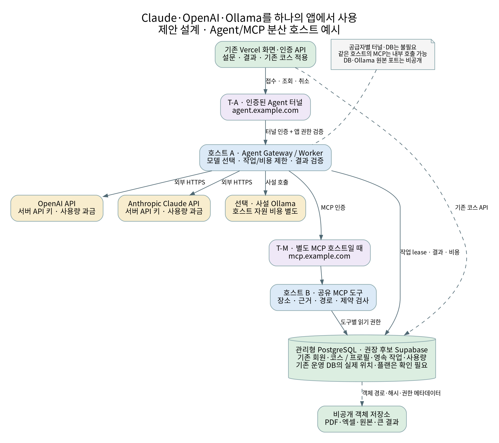
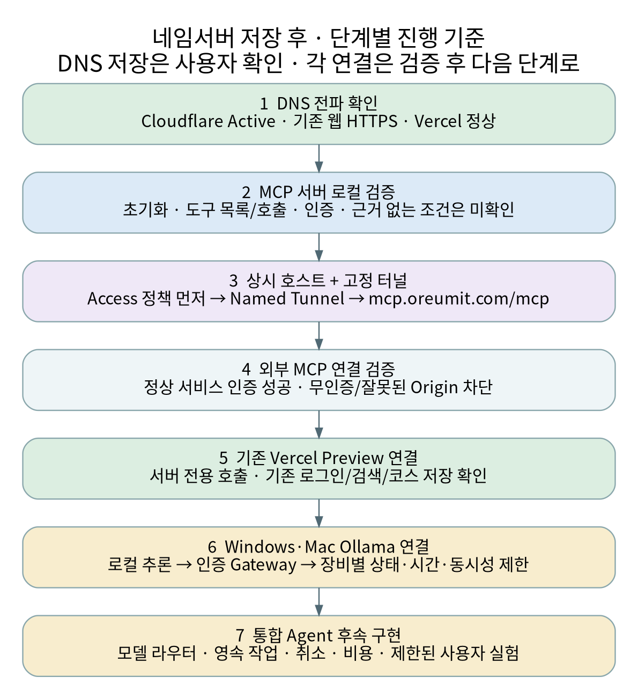
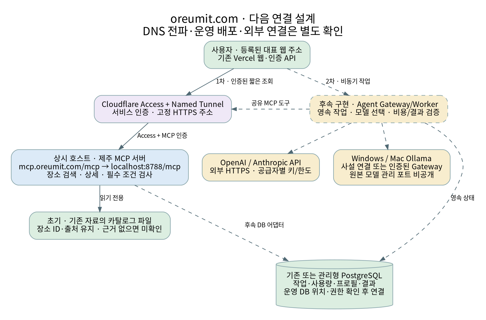

**작성 목적**

기존 제주 관광 서비스의 실제 소스와 데이터 자산을 출발점으로, 사용자의 문항 응답이 여행 프로필·테마·장소·일정으로 이어지는 구조와 구현·검증 절차를 제안한다.

**핵심 권고**

기존 Vercel 앱의 4문항·코스빌더·Gemini 비서를 재사용하되 공통 여행 프로필, 필수 제약 검사, 근거 추적과 추천 평가를 추가한다. 외부 Agent Worker·사설 Ollama·HTTP MCP 서버로 모델 실행과 도구를 연결한다. LAG는 지정 논문의 방법으로 검토하며 Llama는 모델 후보, Ollama는 실행 계층, MCP는 도구 연결 규약이다. LAG와 RAG를 동일시하지 않는다.

**확인 범위**

원본 웹·Flutter와 공식 Ollama·MCP 고정 소스 문서를 읽었다. 기존 저장소의 CSV 55개를 실제 검사해 카탈로그·컬럼 사전·로컬 묶음을 만들었다. 원본 ZIP은 재배포 조건 검토 전이므로 공개 Git에서 제외한다. 배포 사이트는 네트워크 차단으로 직접 확인하지 못했다. 읽기 전용 MCP 3개 도구와 기존 자료 7,561건을 이용한 로컬 연결을 검증했다. 서비스·HF 클라이언트 32개와 Gateway 10개 검사가 통과했고 기반 커밋 ad3c363의 main GitHub Actions 성공을 확인했다. HF 실연결·조직 생성은 미완료다. 도메인·네임서버 저장은 사용자 보고이며 DNS 활성화·공개 연결은 미검증이다. 논문 원문 및 별도 PDF·Excel 원본은 미확인이다. Ollama 모델·LAG·운영 앱 통합은 아직 실행하지 않았다. 신규 문항·점수·목표는 검증 전 제안이다.

**이번 산출물**

기존 서비스 분석, 문항·8개 페르소나 설계 후보·13개 취향 축·시각화, 추천·데이터 계획, Ollama 기능·Cloud 차이, MCP 버전·도구·인증·작업 큐, Claude·OpenAI 동시 지원·다중 터널·DB 위치·계정/비용, 도메인·관리 MCP·장비 연결 안내, oreumit.com 다음 단계·배치도·MCP 초기 구현, 기존 Vercel 앱의 호환·단계별 전환·롤백 설계, LAG 재현·모델 비교·평가 계획, 확정 CSV 목록, Hugging Face MCP·조직·CI 안내, 전체 AI AGENT MODEL 레지스트리와 Claude Code 인수인계. 페르소나 시각화에는 실제 관광객 표본이나 학습된 군집을 사용하지 않았다.


# 보고서 구성

- 1. 기존 서비스와 소스 분석
- 2. 제품 목표와 시스템 설계
- 3. 실제 문항·페르소나·추천 점수
- 4. 페르소나 유형·군집 설계와 시각화
- 5. 제주 데이터 확보와 검증
- 6. Ollama·LAG 가능성과 Vercel 배포 설계
- 7. MCP 서버 구축과 기존 앱 통합
- 8. Claude·OpenAI·다중 터널·DB와 비용
- 9. 도메인·관리 MCP·Windows와 macOS 연결
- 10. 네임서버 저장 후 단계와 MCP 구현 결과
- 11. 구현 절차와 API 계약
- 12. 평가와 개발 로드맵
- 13. 참고 근거와 남은 확인
- 14. CSV 55개 확정 목록과 품질·권리 검토
- 15. Hugging Face MCP 연결과 모델 검증
- 16. Hugging Face 조직·계정·CI 운영
- 17. AI AGENT MODEL 전체 목록과 선정 기준
- 18. Claude Code 작업 인수인계와 재개 절차
- 19. 설문 개정: 기본정보·선택 통화·활동 선호

문항과 추천 계산은 3장, 페르소나 설계·시각화는 4장, Ollama·Vercel 구성은 6장, MCP 서버 구축은 7장에 정리했다. Claude·OpenAI·터널·DB·계정/비용은 8장, 도메인·관리 MCP·장비 연결은 9장, 네임서버 저장 후 단계·MCP 구현 결과는 10장, 구현 공통 절차는 11장, 연구·데이터 미확인 항목은 13장을 기준으로 관리한다.

확정 CSV의 출처·품질·재생성은 14장, HF MCP와 계정·CI는 15~16장, 전체 모델의 역할·검증 단계는 17장, 다른 Claude Code 세션의 시작 순서와 다음 구현은 18장을 따른다.


# 1. 기존 서비스와 소스 분석

## 1. 검토 대상과 확인 수준

사용자가 지정한 서비스는 `https://jeju-tour-six.vercel.app/`이다. GitHub 조직의 공개 목록에서 관련 Flutter 클라이언트를 찾았고, 해당 README가 원본을 `OREUM-IT/jeju-tour`로 명시했다. 이후 환경에 이미 제공된 Git 인증으로 원본 저장소 읽기와 복제에 성공했다.

| 대상 | 검토한 고정 버전 | 이번 작업의 확인 범위 |
| --- | --- | --- |
| 원본 웹·서버 | [`OREUM-IT/jeju-tour`, `b0602a175c1d08959b7187da2b29ac450b52e0ba`](https://github.com/OREUM-IT/jeju-tour/tree/b0602a175c1d08959b7187da2b29ac450b52e0ba) | 파일·코드·커밋된 데이터의 정적 검토 |
| 관련 Flutter 클라이언트 | [`OREUM-IT/jeju-tour-flutter`, `81e5f2acc1b5fd947b183fe1d74b6707717518e7`](https://github.com/OREUM-IT/jeju-tour-flutter/tree/81e5f2acc1b5fd947b183fe1d74b6707717518e7) | 원본 서비스 연결 관계와 구현 범위 문서 확인 |
| 운영 사이트 | 사용자가 지정한 Vercel 주소 | HTTPS 접속이 프록시의 `Tunnel connection failed: 403 Forbidden`으로 차단되어 현재 화면·API·배포 커밋은 확인하지 못함 |

검토 날짜는 2026-11-18 한국 시간 기준이다. 소스 체크아웃은 `/workspace/scratch/reference-repos/` 아래에 참고용으로 보관했으며 기존 서비스의 코드·설정·운영 데이터는 수정하지 않았다. 이번 검토에서는 기존 서비스 설치·빌드·테스트·유료 모델 호출·운영 API 쓰기를 수행하지 않았다. 저장소에 기록된 과거 검증 결과를 이번 실행 결과로 간주하지 않는다.

Flutter README의 “원본 소스에 접근하지 못했다”는 설명은 해당 클라이언트를 작성하던 당시의 기록이다. 이번 작업에서는 원본 Git 접근이 확인됐으므로, 설문과 추천 로직의 근거는 Flutter 재구현이 아닌 위 원본 커밋을 우선한다.

## 2. 실제 설문 문항과 응답 값

근거: [`prototype/client/features/home/ThemeQuiz.tsx:20`](https://github.com/OREUM-IT/jeju-tour/blob/b0602a175c1d08959b7187da2b29ac450b52e0ba/prototype/client/features/home/ThemeQuiz.tsx#L20).

| 순서·키 | 실제 문항 | 실제 선택지와 내부 값 |
| --- | --- | --- |
| 1 · `style` | 이번 제주 여행, 어떤 분위기가 끌리나요? | 레저·스포츠 `leisure`; 바다·해안 경관 `sea`; 오름·숲 힐링 `heal`; 문화·역사·전통 `herit`; 예술·전시 `art`; 테마파크·체험 `activity` |
| 2 · `must` | 빠질 수 없는 건? | 맛집·시장 `food`; 카페·디저트 `cafe`; 상관없어요 `none` |
| 3 · `walk` | 걷기나 등산은 얼마나? | 올레길 한 코스쯤 `olle`; 한라산에 도전 `hike`; 거의 안 걸어요 `none` |
| 4 · `local` | 제주에서는 어떻게 다니나요? | 렌트카 `driving`; 버스·택시 `transit` |

선택하면 다음 문항으로 이동하는 4단계 모달이며 이전·닫기 기능이 있다. 결과에서 추천 테마, 장소 목록, 코스빌더에 넣기, 테마 장소 보기, 다시 고르기를 제공한다. 한라산 선택에는 등반 플래너 이동 안내가 추가된다. 홈과 테마 화면에서 같은 설문을 연다.

이 설문에는 현재 예산, 동행 인원, 접근성의 필수 조건, 여행 날짜, 권역, 총 활동 가능 시간, 알레르기 등을 직접 받는 문항이 없다. 다른 화면에 존재하는 조건 입력과 “이 4문항 설문에서 받는 정보”를 구분해야 한다.

## 3. 현재 설문 추천은 규칙 기반

근거: [`ThemeQuiz.tsx:35`](https://github.com/OREUM-IT/jeju-tour/blob/b0602a175c1d08959b7187da2b29ac450b52e0ba/prototype/client/features/home/ThemeQuiz.tsx#L35), [`ThemeQuiz.tsx:58`](https://github.com/OREUM-IT/jeju-tour/blob/b0602a175c1d08959b7187da2b29ac450b52e0ba/prototype/client/features/home/ThemeQuiz.tsx#L58), [`nearest-order.ts`](https://github.com/OREUM-IT/jeju-tour/blob/b0602a175c1d08959b7187da2b29ac450b52e0ba/prototype/client/features/home/nearest-order.ts).

1. 첫 응답 `style`을 추천 테마 분류로 그대로 사용한다. 별도의 잠재 페르소나 추론이나 학습 모델 분류는 이 함수에 없다.
2. 해당 분류이며 `auto === true`인 장소를 후보로 고른다. 장소 점수는 `(popRank ?? 200) - 20 × badges.length`이고 **낮은 점수가 우선**이다.
3. `must`가 맛집 또는 카페이면 주 테마 3곳과 해당 분류 1곳을 고른다. 상관없어요이면 주 테마 4곳을 고른다. 후보 수가 부족하면 요청 수보다 적을 수 있다.
4. `walk === 'olle'`이면 현재 선택 장소 좌표의 평균점에서 직선거리가 가장 가까운 올레 장소 하나를 추가한다. 올레 후보는 `cat === 'hike'`와 `id.startsWith('olle-')`로 찾는다.
5. `walk === 'hike'`이면 한라산 플래너 안내를 표시한다. 이 분기 자체가 일반 추천 코스에 한라산을 삽입하거나 등반 가능성을 판정하지는 않는다.
6. 첫 장소를 고정하고 나머지를 직선거리 기준 최근접 이웃 순서로 정렬한다. 도로·대중교통 이동시간이나 전체 동선의 전역 최적해를 계산하는 단계는 아니다.
7. 이동수단은 코스빌더에 넘기는 `CourseDraft.local`에 반영한다. 이 설문 함수에서 장소 후보 점수나 올레 추가 여부를 계산할 때 이동수단을 사용하지는 않는다.

따라서 현재 설문을 AI 성격 진단, 학습된 개인 행동 예측 또는 제약 충족이 검증된 일정 생성으로 설명하지 않는다. `popRank`의 기반이 되는 집계 방문량도 개인 사용자의 선호 정답이 아니다.

## 4. 별도로 존재하는 AI 여행 비서와 검색

기존 서비스에는 설문 외에 **이미 대화형 AI 여행 비서와 자연어 장소 검색이 구현돼 있다.** 새 기획은 이 흐름을 출발점으로 삼는다.

- API 연결: [`server.ts:4554`](https://github.com/OREUM-IT/jeju-tour/blob/b0602a175c1d08959b7187da2b29ac450b52e0ba/prototype/src/server.ts#L4554)의 `/api/course/search`, `/api/assistant` 및 상태 조회 경로.
- 대화 해석: [`assistant.ts:90`](https://github.com/OREUM-IT/jeju-tour/blob/b0602a175c1d08959b7187da2b29ac450b52e0ba/prototype/src/assistant.ts#L90)에서 날짜·박수·장소 요구 묶음·제외 장소·응답 상세도를 구조화한다.
- 서버 후보 산정: [`assistant.ts:198`](https://github.com/OREUM-IT/jeju-tour/blob/b0602a175c1d08959b7187da2b29ac450b52e0ba/prototype/src/assistant.ts#L198)에서 요구별로 기존 장소를 `rank()`로 평가한다.
- 답변 구성: [`assistant.ts:109`](https://github.com/OREUM-IT/jeju-tour/blob/b0602a175c1d08959b7187da2b29ac450b52e0ba/prototype/src/assistant.ts#L109)의 프롬프트는 후보·현재 코스에 존재하는 장소만 선택하고 목록에 없는 가격·메뉴·영업 여부를 만들지 않도록 지시한다.
- 반환 검증: [`assistant.ts:229`](https://github.com/OREUM-IT/jeju-tour/blob/b0602a175c1d08959b7187da2b29ac450b52e0ba/prototype/src/assistant.ts#L229)에서 동작과 추천 항목의 ID를 후보·현재 코스 집합으로 제한한다. 코스 동작은 `none`, `replace`, `add`, `remove`다.
- 모델 미설정·오류·한도 초과 시 [`assistant.ts:174`](https://github.com/OREUM-IT/jeju-tour/blob/b0602a175c1d08959b7187da2b29ac450b52e0ba/prototype/src/assistant.ts#L174)의 키워드 후보 목록으로 대체한다.

코드에는 Gemini/Vertex AI 호출, 모델 선택 환경변수, 타임아웃과 대체 모델 경로가 있다. 이는 구현 존재의 확인이며 해당 모델명·계정·인증·현재 공급자 제공 여부나 품질을 이번 작업에서 검증한 것은 아니다. 비밀값을 조회하거나 이 저장소로 복사하지 않았다.

자연어 검색의 점수는 설문 점수와 다르다. [`placesearch.ts:35`](https://github.com/OREUM-IT/jeju-tour/blob/b0602a175c1d08959b7187da2b29ac450b52e0ba/prototype/src/placesearch.ts#L35)는 분류·제외어를 필터링하고, 권역·키워드·실내 여부·자연·배지·접근성·영업시간·인기도를 가감점한다. 접근성은 확인된 표식이 있으면 가점, 없으면 감점이며 필수 배제 조건이 아니다. 영업시간이 없으면 해당 시간 점수를 적용하지 않는다. [`rank():55`](https://github.com/OREUM-IT/jeju-tour/blob/b0602a175c1d08959b7187da2b29ac450b52e0ba/prototype/src/placesearch.ts#L55)는 권역 내 후보가 3개 미만일 때 권역 조건을 풀어 다시 점수를 계산한다.

확장 시에는 **선호 점수와 반드시 지켜야 할 제약을 분리**해야 한다. 특히 접근성·특정 지역·시간 조건을 필수로 요청한 경우에는 기존 감점·자동 완화만으로 조건 충족을 주장할 수 없다. ID 필터는 존재하지 않는 장소 참조를 줄이지만 자유 서술의 모든 사실을 검증하는 장치는 아니므로 근거 문장·유효시각 검사도 필요하다.

## 5. 재사용할 수 있는 데이터와 계약

[`CoursePlace` 스키마](https://github.com/OREUM-IT/jeju-tour/blob/b0602a175c1d08959b7187da2b29ac450b52e0ba/prototype/src/shared/types.ts#L434)는 `id`, `name`, `cat`, `kind`, 위·경도, `zone`, 권장 체류시간 `stay`, `hours/open/close`, `indoor/nature`, `pop/popRank`, `badges`, `auto`, 연락·웹 정보, 선택적 `bf`·`drama`·`hub` 정보를 포함한다. 이를 새 장소 식별 체계와 무관하게 복제하기보다 기존 ID를 연결 키로 보존하는 것이 적절하다.

고정 커밋의 [`prototype/data/jeju_tour_data.json`](https://github.com/OREUM-IT/jeju-tour/blob/b0602a175c1d08959b7187da2b29ac450b52e0ba/prototype/data/jeju_tour_data.json)을 실제 JSON으로 읽어 확인한 수는 다음과 같다.

| 원본 배열 | 레코드 수 | 해석 범위 |
| --- | --- | --- |
| `pois` | 7,561 | 원본 POI 수. 중복 제거·품질·라이선스·영업상태 검사 완료 수가 아님 |
| `olle` | 29 | 원본 올레 레코드 수 |
| `trails` | 6 | 원본 탐방로 레코드 수 |

이 숫자는 코스빌더의 최종 추천 가능 장소 수가 아니다. [`course.ts:112`](https://github.com/OREUM-IT/jeju-tour/blob/b0602a175c1d08959b7187da2b29ac450b52e0ba/prototype/src/course.ts#L112)에 포함 필터가 있고, [`buildCoursePlaces():177`](https://github.com/OREUM-IT/jeju-tour/blob/b0602a175c1d08959b7187da2b29ac450b52e0ba/prototype/src/course.ts#L177)에서 정규화·추가 자료 연결이 이루어진다. 실제 API 반환 수는 런타임에서 별도 확인해야 한다.

JSON의 `sources`는 관광객 차량 도착 집계, 카카오맵 수집, OpenStreetMap, 제주올레 공식 자료, Halla-GeoData/Copernicus 자료를 출처로 기록한다. **출처 메타데이터가 있다는 것과 신규 연구·재배포·모델 학습 이용권이 확인됐다는 것은 별개**다. 원본 수집 방식과 제공자의 조건을 재검토해야 한다.

추가로 원본 저장소의 [`docs/data-downloads-and-api-keys.md`](https://github.com/OREUM-IT/jeju-tour/blob/b0602a175c1d08959b7187da2b29ac450b52e0ba/docs/data-downloads-and-api-keys.md), `prototype/data/public-csv/`, `prototype/data/hub-source/`, `prototype/data/hub-extra/`에는 CSV/API 연동과 기준일·해시에 대한 자료가 있다. 새 데이터 계획에서는 이들 자료의 실제 파일과 품질을 먼저 조사해 중복 수집을 줄인다. 현재 첨부 Excel의 행 목록과 일치한다고 간주하지 않으며, 카탈로그 템플릿에는 임의로 복사하지 않는다.

## 6. 기존 흐름과 신규 기획의 연결

| 현재 구현 | 확장할 내용 | 호환성·평가 기준 |
| --- | --- | --- |
| 4문항 설문 | 기존 답변 키를 보존하면서 목표 테마, 필수 조건, 불확실성을 구조화 | 기존 4문항 결과를 규칙 기준선으로 고정하고 변경 효과 비교 |
| 테마 단일 선택 | 복수 테마 가중치와 사용자 확인을 거친 이번 여행의 취향 표현 | 보호 특성이나 집계 인구통계로 개인 성향을 단정하지 않음 |
| `topOf()` 후보 선정 | 근거 기반 후보 검색·다양성·권역·시간 조건 검증 | 같은 장소 ID·후보 풀·평가 질의로 기준선과 비교 |
| `CoursePlace`·코스빌더 | 필드별 출처·기준일·제약 검증 결과를 덧붙이는 어댑터 | 기존 저장 코스와 ID를 유지하고 필요한 새 필드만 버전 관리 |
| AI 비서의 해석→후보→답변 | 논문 검토 후 LAG 적용 지점과 필요한 자료 확정 | LAG를 구현됐다고 표시하지 않으며 기존 Gemini 경로·RAG 비교 경로와 분리 |
| 후보 ID 허용 목록 | 근거 문장, 운영시간 유효성, 필수 조건 위반 검사 추가 | 목록에 있는 장소라도 근거 없는 상세 설명은 허용하지 않음 |
| 코스 변경 동작 | 추천 근거·대안 제시 후 기존 빌더에서 확인·수정 | 사용자 코스를 바꾸는 시점과 자동 제안 시점을 구분 |
| 키워드 대체 경로 | 실패 원인·축소된 기능·근거 시점을 명시 | 오류를 정상 AI 추천처럼 표시하지 않음 |

LAG는 사용자가 지정한 논문에서 정의한 방법이다. 현재 검토한 소스·문서에서 논문 식별자 `2504.09277` 또는 `LAG`를 찾지 못했으며 논문 본문도 열람하지 못했다. 따라서 기존 AI 비서를 LAG 구현이라고 부르거나 LAG를 RAG의 오타로 해석하지 않는다. Llama 계열 모델을 대체 후보로 검토하는 경우도 모델 라이선스·한국어 품질·구조화 출력·자원·지연·비용을 별도로 평가해야 한다.

## 7. 배포·검증 상태와 남은 확인

[`prototype/vercel.json`](https://github.com/OREUM-IT/jeju-tour/blob/b0602a175c1d08959b7187da2b29ac450b52e0ba/prototype/vercel.json)은 서울 `icn1`, `npm run build`, `dist/public`, API 함수 제한 120초와 라우팅을 설정한다. [`prototype/package.json`](https://github.com/OREUM-IT/jeju-tour/blob/b0602a175c1d08959b7187da2b29ac450b52e0ba/prototype/package.json)에는 React/TypeScript/Express 기반 빌드·타입 검사·Playwright 검사 명령이 있다. [`leisure-theme.spec.cjs`](https://github.com/OREUM-IT/jeju-tour/blob/b0602a175c1d08959b7187da2b29ac450b52e0ba/prototype/tests/leisure-theme.spec.cjs)에는 4문항 응답 후 4곳이 나타나는 시나리오 등의 테스트가 존재한다. 이 파일들의 존재를 이번 실행에서 통과한 테스트 수로 보고하지 않는다.

남은 확인은 다음과 같다.

1. `jeju-tour-six.vercel.app`에 대한 환경 네트워크 접근이 허용되면 현재 화면과 읽기 전용 API 응답을 확인한다. 현재 차단은 서비스 자체 장애의 증거가 아니다.
2. 배포된 커밋과 검토한 커밋의 일치 여부, 현재 API·모델·외부 데이터 가용성을 별도로 확인한다. 저장소의 과거 배포 기록이나 변수 등록 기록만으로 현재 사용 가능을 주장하지 않는다.
3. 사용자가 언급한 PDF·Excel 원본을 확보한다. 두 참고 체크아웃에서 `.pdf`, `.xls`, `.xlsx` 파일은 발견하지 못했다.
4. 논문 원문을 확인해 LAG 정의·입력·절차·평가 조건을 페이지와 함께 정리한다.
5. 기준선 테스트를 실제 실행할 별도 개발 단계에서 기존 저장소의 의존성과 잠금파일을 존중하고, 설문·검색·대화 비서·일정 제약을 각각 검증한다.

현재 확인한 결론은 **기존 서비스의 설문·장소 데이터·코스빌더·AI 비서를 재사용할 구체적인 출발점이 있다**는 것이다. 운영 상태, 논문 재현, 첨부 자료 분석 또는 신규 AI 추천 성능이 검증됐다는 결론은 아니다.

# 2. 제품 목표와 시스템 설계

작성 기준: 2026-11-18 (한국 시간). 이 문서는 **구현 전 제안**이다. LAG는 사용자가 지정한 논문 2504.09277의 방법을 뜻하며, 원문을 확보하기 전에는 약어의 풀이나 내부 메커니즘을 정의하지 않는다. RAG는 독립된 비교 대안이다.

## 1. 만들 제품과 성공의 의미

사용자가 짧은 문항에 응답하면 이번 여행에 맞는 테마 2~3개와 장소 후보를 받고, 필요하면 날짜·위치·이동수단에 맞는 일정을 만드는 서비스다. 핵심 가치는 그럴듯한 여행 문장이 아니라 **선호 반영, 실행 가능성, 근거, 수정 가능성**이다.

페르소나는 사람을 영구 분류하는 성격 검사나 연령·성별 예측이 아니다. 이번 여행의 관심, 활동 강도, 동행 요구, 비용·시간 제약을 표현하는 편집 가능한 여행 프로필이다. 예를 들어 ‘조용한 해안 산책’과 ‘로컬 음식 탐방’은 설명용 테마 제안이며, 실제 분류나 장소 적합성은 데이터와 사용자 평가로 검증한다.

| 범위 | MVP에서 제공할 것 | 후속 검토 |
|---|---|---|
| 입력 | 핵심 설문, 상황별 추가 질문, 답변 확인·수정 | 동의 기반 장기 선호 기억 |
| 추천 | 테마, 제약을 만족하는 후보, 이유·출처·정보 기준일 | 사용 로그가 충분할 때 학습 랭커 |
| 일정 | 당일/짧은 여행의 시간창·이동 고려 일정과 대안 | 다일 최적화·예약 연계 |
| 대화 | ‘덜 걷기’, ‘실내로 바꾸기’ 등을 구조화된 수정으로 반영 | 음성·다국어 |
| 실행 | 조회·계산·계획 | 예약·결제·외부 전송은 별도 사용자 승인 설계 후 |

## 2. 사용자에게 보이는 절차

1. **시작**: 예상 문항 수와 소요시간은 파일럿으로 측정해 표시한다. 비회원 추천을 기본으로 하고 저장·분석 동의는 분리한다.
2. **필수 여행 조건**: 날짜/시간, 출발·종료 위치, 이동수단, 동행·접근성, 예산을 받는다. 정하지 않은 값에는 ‘미정’을 허용한다.
3. **취향 문항**: 관심 테마, 활동 강도, 혼잡 선호, 날씨 대안을 받는다. 후속 질문은 답변과 관련된 경우에만 노출한다.
4. **프로필 확인**: ‘렌터카 없음 / 실내 선호 / 걷기 적게 / 1인 예산 상한’처럼 사용자가 읽을 수 있는 요약을 보여준다. 민감 특성을 추정하지 않는다.
5. **테마 제안**: 상위 테마와 이유, 적용된 응답, 근거의 충분함을 표시한다. 점수를 성격 진단 확률처럼 제시하지 않는다.
6. **후보 비교**: 좋아요/제외/필수 방문을 받아 순위를 재계산한다. 카드에 확인된 사실과 미확인 정보를 구분한다.
7. **일정 구성**: 선택한 후보로 실제 이동시간·체류시간·운영시간을 확인한다. 자료가 부족하면 ‘후보 목록’까지만 제공하고 확정 일정처럼 표현하지 않는다.
8. **설명·수정**: ‘왜 추천했는지’, ‘무슨 조건 때문에 제외했는지’, ‘무엇을 바꾸면 가능한지’를 설명한다. 특정 필수 조건을 사용자 모르게 완화하지 않는다.
9. **저장·피드백**: 저장 범위·보존기간을 안내한다. 실제 방문 여부와 만족도는 동의받아 수집하고 클릭과 구분한다.

상세 문항과 계산은 `04-questionnaire-and-scoring.md`를 단일 기준으로 삼는다.

## 3. 구성과 책임

배포 대상은 기존 `https://jeju-tour-six.vercel.app/`이다. [Ollama·Vercel 설계](../docs/09-ollama-lag-feasibility.md)와 [MCP 서버 구축·통합 계획](../docs/10-mcp-server-and-vercel-integration.md)을 적용 상세 기준으로 추가했다. 기존 Vercel 화면·Express API는 유지하고 외부 Agent Worker·사설 Ollama·HTTP MCP 서비스를 연결한다. 현재 로컬 stdio 교통 MCP는 Vercel에서 비활성화되는 코드 경로이므로 별도 원격 전송·권한·작업 관리가 필요하다. 설계 반영은 운영 배포 완료를 뜻하지 않는다.

기존 `OREUM-IT/jeju-tour`의 `prototype/`에는 React·TypeScript 웹과 Express 서버가 있고, `ThemeQuiz.tsx`의 4문항 추천 및 `src/assistant.ts`의 Gemini 요청 해석→서버 랭킹→설명 흐름이 이미 있다. 현재 분석 저장소가 비어 있었다는 사실과 기존 서비스에 기능이 없다는 판단은 다르다. 기존의 장소 ID 제한, 실패 시 규칙 검색, 코스빌더 연계를 재사용하고 공통 프로필·제약 검증·추천 근거 계약을 추가하는 방향을 우선한다. 이는 소스 검토 결과이며 배포 서비스 작동을 검증한 것은 아니다.

**공통 처리 흐름**

설문·대화 → 프로필 검증 → 후보 생성 → 필수 제약 검사 → 선호 랭킹·다양성 → 이동·일정 계산 → 출처·제약 최종 검증 → 설명·수정

데이터 인덱스는 후보 생성에 근거를 공급하고, 동의 기반 피드백은 다음 추천 개선에 사용한다. LAG 모듈의 연결 위치는 원문 검토 후 확정한다.


위 도식은 제품의 공통 처리 계층이며 **LAG 논문의 구조를 재현한 그림이 아니다**. 점선은 통합 위치 후보다. 논문에서 LAG가 요구하는 입력·상태·학습/추론 절차를 확인한 뒤 연결 지점을 확정한다. RAG 실험은 별도 후보 생성·근거 검색 대안으로 비교한다.

| 구성 요소 | 책임 | 허용하지 않을 동작 |
|---|---|---|
| 설문/프로필 서비스 | 타입·범위·모순 검사, 수정 이력 | 생략한 선호나 민감 정보를 임의 추정 |
| 데이터 서비스 | 장소 ID, 문서 근거, 시간/공간 단위, 갱신 이력 | 원본 통계의 집계 수준을 개인 수준으로 바꾸기 |
| 후보 생성기 | 구조화 조건 및 텍스트/의미 검색 | 검색 점수를 곧바로 여행 적합 확률로 표현 |
| 제약 검사기 | 확인된 필수 조건의 통과/탈락/미확인 판정 | 미확인을 통과로 간주 |
| 랭커 | 선호 적합도, 다양성, 이동 부담, 근거 수준 | 높은 취향 점수로 필수 제약 위반 상쇄 |
| 일정 엔진 | 이동시간·시간창·체류·여유시간 계산 | 직선거리를 검증된 대중교통 시간으로 대체 |
| Agent/LLM | 질문, 도구 호출, 근거에 맞는 설명 | 없는 장소·요금·영업시간 생성 |
| 최종 검증기 | 입력 조건·출처·출력 스키마 재검사 | 실패 결과를 정상 일정으로 노출 |

MVP는 한 Agent가 도구를 호출하는 구조로 시작한다. 역할별 다중 Agent는 병렬 전문가가 실제 품질 개선을 보이는 경우에만 실험한다. 다중 Agent 자체를 정확성 보장이나 LAG 필수 조건으로 가정하지 않는다.

## 4. 데이터 계약과 추천 한 건의 처리

아래 필드 목록은 책임을 설명하는 개념 목록이다. 설문 프로필의 실제 JSON 경로·단위·결측 의미는 `04-questionnaire-and-scoring.md` 5절을 기준으로 통일하고 API 명세로 확정한다.

프로필에는 `profile_id`, `schema_version`, `trip_window`, `origin`, `destination`, `transport_mode`, `budget_scope`, `budget_limit`, `party_requirements`, `hard_constraints`, `preferences`, `answered_question_ids`, `consents`가 필요하다. 미응답은 `null`로 유지한다. 나이·성별은 기본 추천 필수 항목이 아니다.

장소에는 `place_id`, `source_dataset_id`, 좌표·좌표계, 카테고리·태그, 운영시간과 예외일, 가격의 적용 범위, 접근성 상태, 근거 문서 ID, `observed_at`, `retrieved_at`, `valid_until`, `license`가 필요하다. 없는 필드는 미확인으로 둔다.

추천 응답은 `request_id`, `profile_version`, `data_snapshot_id`, `model_id`, `prompt_version`, `scoring_version`, `themes`, `candidates`, `constraint_checks`, `evidence`, `uncertainties`를 기록한다. 로그에 전체 자유서술 응답이나 정확한 위치를 무조건 남기지 않는다.

처리 순서는 다음과 같다.

1. 응답을 타입이 있는 프로필로 변환한다. 대화로 받은 값도 동일 스키마를 거친다.
2. 예산 범위(인당/동행 전체, 음식·교통 포함 여부), 날짜, 이동수단 등의 모순을 확인한다. 필요한 항목만 다시 묻는다.
3. 데이터 스냅샷과 해당 날짜에 유효한 조건으로 후보를 찾는다. 검색 후보 수는 부하·재현율 실험으로 정한다.
4. 필수 조건을 먼저 판정한다. 접근성 필수 정보가 없는 곳은 확인이 필요한 후보로 분리한다.
5. 응답으로 산출한 선호 벡터와 장소 특성을 비교한다. 동일 장소 중복을 제거하고 테마·지역 다양성을 조절한다.
6. 상위 후보의 운영시간·가격·이동정보를 필요 시 재조회한다. 실시간 접근 권한이나 자료가 없으면 그 제한을 드러낸다.
7. 일정 요청인 경우 시간창과 체류시간, 식사/휴식, 복귀 시각을 만족하는 경로를 계산한다.
8. LLM은 검증된 구조화 결과와 근거만 받아 설명한다. 도구 응답의 문서 내용은 명령이 아니라 데이터로 취급한다.
9. 최종 검사 실패 시 해당 결과를 제거하거나 재계산한다. 제한된 재시도 이후에는 불충분한 항목과 가능한 대안을 반환한다.
10. 동의된 피드백과 비식별 운영 지표를 수집한다. 클릭·저장·실제 방문·만족도는 서로 다른 신호다.

## 5. LAG·Llama·RAG의 구분과 모델 결정

| 항목 | 이 프로젝트에서의 의미 | 현재 결정 |
|---|---|---|
| LAG | 지정 논문에서 정의한 방법 | 주 연구 방향. 원문 검토 전 구현/성능 주장 보류 |
| Llama | 비교할 공개 가중치 모델 계열 | LAG 또는 비교 시스템의 모델 후보. 방법과 모델을 동일시하지 않음 |
| 다른 공개 모델 | 한국어·도구 호출·운영비 비교 후보 | 예: Qwen 계열 등. 정확한 버전·라이선스·배포 조건 확인 필요 |
| API 모델 | 외부 서비스로 호출하는 모델 후보 | 빠른 실험 후보. 데이터 전송 범위와 실제 가격 확인 필요 |
| RAG | 검색 결과로 답변 근거를 보강하는 비교 구조 | LAG와 구분하여 기준선/보조 실험으로 사용 |
| 비LLM 추천 | 규칙·필터·랭킹과 템플릿 설명 | 반드시 유지할 기준선 및 장애 시 대안 |

현재 특정 모델을 ‘최적’이라고 선정할 근거는 없다. 동일 설문·데이터·평가셋에서 한국어 이해, 스키마/도구 성공률, 근거 준수, 추천 적합도, 지연, 총비용을 비교한다. 공개 모델은 가중치 라이선스·재배포 조건·모델 크기·양자화 영향을 확인한다. API는 인증·보존정책·단가·속도 제한을 확인한다. 체크포인트나 GPU 사양은 이 검증 이후 확정한다.

초기 파인튜닝은 필수로 두지 않는다. 근거가 부족한 답변이 검색·데이터 문제인지, 질문 이해·출력 일관성 문제인지 먼저 분리한다. LAG가 학습을 요구한다면 논문의 데이터 요구량·학습 자원·재현 조건을 별도 예산으로 검토한다.

## 6. 기술 구성 제안과 단계별 비용 통제

- **프런트엔드**: 기존 웹/Flutter 흐름을 확인해 재사용한다. 설문 정의와 점수 매핑은 버전 관리되는 공통 계약으로 분리해 플랫폼 간 결과가 달라지지 않도록 한다.
- **백엔드**: 기존 TypeScript/Express의 `prototype/src/assistant.ts`, `placesearch.ts`, 공유 타입 및 API 경로를 우선 확장 대상으로 검토한다. 기존 Gemini 경로를 비교 기준으로 보존하고 모델 공급자 인터페이스 뒤에서 Llama/API 대안을 비교한다. Python은 LAG 재현·추천 실험에서 필요성이 확인될 때 연결하며 전면 재작성을 전제하지 않는다.
- **저장소**: 원천 파일과 정제 테이블을 분리한다. 공간·시간 필터가 필요해지면 PostgreSQL/PostGIS를 후보로 평가한다. 벡터 인덱스는 검색 기준선으로 필요성을 확인한 후 선택한다.
- **최적화**: 소규모 탐욕 일정 기준선과 OR-Tools 같은 제약 최적화 대안을 비교한다. API 이동시간 조회 결과는 수단·조회시각·유효기간과 함께 캐시한다.
- **실험**: 작은 샘플·캐시된 근거·고정 모델 버전으로 시작한다. 요청별 토큰·호출·지연·비용과 실패 유형을 기록한다.
- **배포**: 문항 버전, 프로필 스키마, 추천 API를 먼저 호환되게 설계한다. GPU 서버·벡터 DB·다중 Agent는 근거 없이 동시에 도입하지 않는다.

## 7. 운영 프로세스와 책임

| 과정 | 책임 역할 | 산출물 | 완료 조건 |
|---|---|---|---|
| 자료 수령·논문 읽기 | 기획/리서치 | 출처 목록, LAG 재현 명세, 데이터 행별 목록 | 출처·권리·원문 위치 확인 |
| 문항 설계·파일럿 | UX/추천 담당 | 문항 버전, 응답 매핑, 혼동 사례 | 응답자가 문항 뜻과 예산 범위를 이해 |
| 데이터 처리 | 데이터 담당 | 스냅샷·품질 리포트·장소 연결표 | 필수 데이터의 실제 확보와 결측 정책 |
| 기준선 구현 | 백엔드/추천 담당 | 재현 가능한 후보·점수·설명 | 고정 사례에서 응답→점수 추적 가능 |
| LAG 재현·통합 | ML 담당 | 재현 결과·차이·비용·제주 적응안 | 논문 재현 조건과 제품 목표 구분 |
| 사용자 평가 | UX/품질 담당 | 비교 실험·오류 유형·사용성 결과 | 사전 수용 기준 충족 또는 제한 명시 |
| 출시·관측 | 운영/개발 담당 | 버전 배포·모니터링·되돌리기 절차 | 실패 시 검증된 기준선으로 복귀 가능 |

## 8. 실패 시 사용자에게 제공할 결과

- 데이터가 없으면 해당 사실을 ‘정보 없음’으로 표시하고 정보 확인을 요청하거나 확인된 후보로 범위를 줄인다.
- 요청이 불가능하면 필수 조건을 유지한 채 불가능 원인을 제시한다. 예산/지역/방문 수 변경은 사용자가 선택한다.
- 외부 모델이 실패하면 구조화 추천과 템플릿 설명을 제공할 수 있다. 검증되지 않은 내용을 생성해 빈칸을 채우지 않는다.
- 악천후·통제·운영시간 변경을 확증할 자료가 없으면 안전을 보장하지 않는다. 관련 공식 확인이 필요한 후보를 명시한다.
- 데이터 문서에 삽입된 명령, 사용자 입력의 경로/도구 조작, 무한 도구 재호출은 도구 허용 목록·스키마 검증·호출 예산으로 제한한다.

구체적인 점수식·평가 목표·일정은 각각 문항 설계 및 평가 문서에 있으며, 실제 측정 결과와 구분한다.

# 3. 실제 문항·페르소나·추천 점수

설문 개정 v0.3: 기본정보 B01~B04를 추가해 기존 23문항에서 총 27문항으로 확장한다. 구성은 기본정보 4 + 핵심 Q01~Q10 10 + 조건부 F01~F10 10 + [직접 선호 PREF 3문항](../docs/08-persona-clustering.md)이다. 조건부·선택 문항을 모두 답해야 한다는 뜻은 아니다. [개정 상태와 구현 계약](../docs/19-survey-revision-v03.md)을 함께 따른다.

> 구현 전 설계안. 1~13절의 질문·가중치·기준값은 사용자 검증을 거치지 않은 제안이며, 14절은 별도로 확인한 기존 저장소 코드와 연결한 이행 계획이다. 실제 웹사이트의 전체 사용자 흐름을 검증했거나 엑셀의 필드를 확인했다는 뜻은 아니다. 아래 장소 예시는 모두 허구다. 사용자가 지정한 LAG는 연결된 논문의 방법이며, 그 내부 절차는 원문 확인 후 연결한다. 이 문서의 결정론적 점수는 공통 제품 로직의 제안이자 비교 기준이며 LAG 구현이라고 부르지 않는다.

## 1. 사용자 흐름

`설명·동의 → 가입 기본정보 확인·수정 또는 미보유 항목 선택 응답 → 핵심 설문 → 필요한 후속 질문 → 입력 요약·수정 → 후보 확보 → 필수 제약 검증 → 추천 순위 → 테마·장소 선택 → 일정 검증 → 결과·대안 → 피드백`

- 질문은 한 화면씩 제공하되 이전 응답을 쉽게 수정할 수 있게 한다. 완료 시간을 검증 없이 약속하지 않는다.
- 필수 정보는 여행 기간 또는 기간 길이, 이동수단, 관심 테마다. 나머지는 ‘아직 모름’ 또는 ‘상관없음’을 허용하고 결과의 검증 수준에 반영한다.
- 모든 질문을 채우지 않아도 테마와 탐색용 후보를 볼 수 있다. 날짜·출발점·운영시간·이동시간이 부족하면 ‘실행이 확인된 일정’으로 표시하지 않는다.
- 필수 제약끼리 충돌하면 결과를 만들기 전에 사용자에게 충돌과 선택지를 보여준다. 선택적 취향 때문에 불필요한 추가 질문을 반복하지 않는다.
- 추천 결과에서 각 항목의 이유·근거·확인 시점·미확인 정보를 보고 선호와 조건을 수정할 수 있게 한다.

### 1.1 기본정보 4문항과 가입정보 분기

가입정보가 있으면 그 값을 확인·수정하는 화면을 먼저 제공하고 같은 항목을 다시 입력시키지 않는다. 없거나 사용자가 제공하지 않은 항목만 선택 설문으로 제시한다. 여행용 수정값을 계정 원본에 자동 저장하지 않으며, 저장하려면 별도 선택을 제공한다.

| ID | 질문·입력 | 처리·저장 |
|---|---|---|
| B01 | **연령대를 알려주세요.** 20세 미만 / 20대 / 30대 / 40대 / 50대 / 60대 / 70세 이상 / 응답 안 함 | 선택 항목 `demographics.age_band`; 생년월일 수집 불필요. 가입정보에서 제시한 값도 수정·삭제 가능 |
| B02 | **성별을 알려주세요.** 여성 / 남성 / 직접 표현 / 응답 안 함 | 선택 항목 `demographics.gender`; 자유 표현은 필수가 아니며 목적 외 모델 전송·추천 추론에 사용하지 않음 |
| B03 | **국적을 알려주세요.** 국가 선택(복수 선택 가능) / 응답 안 함 | 선택 항목 `demographics.nationalities`; 국적과 거주국·언어·통화를 동일시하지 않음 |
| B04 | **원화와 함께 표시할 통화를 선택해주세요.** KRW / USD / JPY / CNY / 지원 통화 검색 / 원화만 보기 / 응답 안 함 | `display.currency`; 확인된 가입 통화 우선, 없으면 국적 정보는 변경 가능한 통화 제안에만 사용. 복수 국적·미지원·불명확이면 선택 안내 또는 원화 기본. 국적과 별도 수정 가능 |

B01~B03의 미응답 때문에 추천을 막지 않는다. B04 미응답은 원화 표시로 진행하며, 응답 거부 사실과 기본 표시값은 구분한다. 기본정보는 13축 선호·페르소나·활동 능력·예산을 자동 추론하는 입력으로 사용하지 않는다. 동일한 명시 선호와 여행 조건에서 연령·성별·국적만 바꿔도 선호 점수가 바뀌지 않아야 한다.

### 1.2 원화와 선택 통화의 병기 계약

Q05·F02·F06의 금액과 요약·결과는 `50,000원 (선택 통화 환산액)` 형태로 표시한다. 저장·예산 비교의 기준은 KRW이며 `amount_krw`, 1인/일행 범위, 하루/여행 전체 기간, 포함 비용을 보존한다. 표시 통화를 바꿔도 원화 상한을 바꾸지 않는다. 외화 직접 입력을 지원하면 원입력 금액·통화, 변환 근거와 확인된 KRW 금액을 함께 저장하고 환율이 없으면 원화 상한 확정을 보류한다.

환산값에는 `quote_currency`, `rate_krw_per_unit`, 환율 제공처·원문 URL, `rate_as_of`, 조회 시각, 반올림 규칙, `status`를 둔다. 공식 기준 시각과 조회 시각을 구분하고 환전·카드 수수료/스프레드는 환율에 숨겨 합치지 않는다. 수수료를 모르면 포함됐다고 표시하지 않는다. 조회 실패·미지원·허용 기한 경과 시 `status=unavailable`, 외화 값은 비워 두고 `50,000원 (USD 환산 불가)`처럼 표시한다. 0원이나 근거 없는 마지막 환율로 대체하지 않는다. KRW를 고르면 중복 괄호 환산은 생략한다.

이번 개정에서는 실제 환율 조회를 하지 않았다. Word는 정적 서식이므로 외화 칸을 빈칸으로 제공하며 자동 환산 기능으로 설명하지 않는다. 운영 안내의 별도 계산 예시는 **가정 환율: 1 USD=1,400원, 1 JPY=10원, 1 CNY=200원**만 사용하고 실시간·공식 시세로 표시하지 않는다.

## 2. 핵심 설문 10문항

각 질문은 화면 문구, 입력 형식, 검증 규칙, 저장 필드를 함께 정의한다. 다중 선택의 ‘상관없음·아직 모름·없음’은 다른 선택지와 동시에 고를 수 없다.

| ID | 화면에 표시할 질문 | 응답 옵션·형식 | 검증과 후속 처리 | 프로필 매핑 |
|---|---|---|---|---|
| Q01 | **언제, 며칠 동안 제주를 여행하시나요?** | 날짜 확정: 시작일·종료일 / 날짜 미정: 1일·2일·3일·4일 이상 직접 입력 | 종료일은 시작일 이후 또는 당일. 날짜 미정이면 미래 운영·행사·날씨 확인 불가 표시. 날짜는 제주 현지 시간 기준 | `trip.start_date`, `end_date`, `duration_days`, `date_status` |
| Q02 | **누구와 함께 여행하시나요?** | 혼자 / 성인 일행 / 아동 동반 / 반려동물 동반; 인원 입력 | 혼자는 인원 1. 다른 선택은 복수 가능. 이름·생년월일은 수집하지 않음. 아동·반려동물 조건은 F01로 확인 | `party.total_count`, `party.flags` |
| Q03 | **어디에서 출발하고, 주로 어느 지역에 머무르시나요?** | 출발: 제주공항·제주시 권역·서귀포시 권역·동부 권역·서부 권역·지도에서 지정·아직 모름; 숙소 위치도 선택 가능 | 권역과 장소 좌표를 구분. 대략적 위치로 계산한 이동은 추정으로 표시. 숙소 이름·상세 주소는 필수 아님. 시작점이 없으면 경로 미검증 | `locations.start`, `locations.stay`, `location_precision` |
| Q04 | **주로 어떻게 이동하시나요?** | 자가용·렌터카 / 버스·도보 / 택시·도보 / 자전거·도보 / 이동수단 미정 | 렌터카 예약·운전 자격을 보유했다고 추정하지 않음. 미정이면 이동수단별 시나리오를 분리. 택시 비용 제한은 F02 | `mobility.allowed_modes`, `mobility.status` |
| Q05 | **항공·숙박을 제외하고, 하루 1인당 얼마 정도를 쓰고 싶으신가요?** | 3만 원 이하 / 3만 원 초과~5만 원 이하 / 5만 원 초과~8만 원 이하 / 8만 원 초과~12만 원 이하 / 직접 입력 / 아직 모름; 각 금액에 B04 통화 괄호 병기. ‘이 금액은 꼭 지켜야 해요’ 선택 | 식사·입장료·현지 이동비 포함. 구간은 희망 범위이며 소비 하한 아님. 엄격한 상한은 정확한 KRW 금액 확인. 공동 차량비는 별도 계산. 환율 실패는 외화 unavailable | `budget.per_person_day_preference`, `per_person_day_max_krw`, `strict_cap`, `included_categories`, `display.currency` |
| Q06 | **하루 활동은 어느 정도가 편하신가요?** | 여유롭게 쉬기 / 걷기와 휴식을 적당히 / 많이 움직이며 둘러보기 / 상관없음 / 아직 모름 | 활동 강도 선호만 받으며 걷기 분·km 숫자를 요구하지 않음. 건강·나이·체력을 추론하지 않음. 필요한 시설 조건은 F03 | `preferences.pace` |
| Q07 | **가장 끌리는 여행 테마를 순서대로 최대 3개 골라주세요.** | 바다·해안 풍경 / 숲·자연 휴식 / 제주 로컬 음식 / 카페·디저트 / 역사·생활문화 / 미술·전시 / 야외 활동 / 체험·배움 / 동네 산책; 잘 모르겠어요 | 같은 항목 중복 불가. ‘잘 모르겠어요’는 F04의 카드 비교로 연결. 카페·디저트·야외 활동 또는 기존 관련 선택은 F09로 세분화. 테마 분류와 문구는 실제 데이터·사용자 조사 후 조정 | `preferences.theme_ranking`, `theme_weights`, `theme_source` |
| Q08 | **이번 여행에서 피하고 싶은 것, 꼭 필요한 조건이 있나요?** | 긴 걷기·등산 / 사람이 많은 곳 / 물놀이·수상활동 / 동물 접촉 / 긴 대기 / 특정 장소 직접 선택 / 음식 관련 조건 / 이동·시설 접근성 / 꼭 포함할 경험 선택 / 없음; 피할 항목은 ‘가능하면 피하기’ 또는 ‘꼭 제외하기’ | 선호와 필수 제약을 명확히 구분. 자유 입력은 요약해 재확인. 음식·접근성은 F03/F05, 긍정적 포함 조건은 F09. 혼잡·대기 자료가 없으면 회피를 보장하지 않음 | `preferences.avoid_soft`, `constraints.exclusions`, `requirements.pending` |
| Q09 | **매일 몇 시부터 몇 시까지 여행할 수 있나요?** | 보통 시작·종료 시각 / 날짜별 설정 / 아직 모름; 확정 일정·휴식 시간 추가 가능 | 종료는 시작 이후. 날짜를 넘는 활동은 별도 확인. 도착·출발 항공편 번호는 받지 않고 필요한 시간만 입력. 미정일 때 ‘예시 시간표’로 표시 | `availability.daily_windows`, `fixed_events`, `rest_windows` |
| Q10 | **비가 오거나 날씨가 좋지 않으면 어떻게 하고 싶으신가요?** | 실내 중심으로 바꾸기 / 안전한 범위에서 야외 유지 / 실내·야외 대안 모두 보기 / 나중에 정하기 | 이는 선호이며 현재 예보가 아님. 안전·운영 중단 여부는 출처 확인. 예보가 없는 날짜에는 맑음·우천 시나리오를 분리 | `preferences.weather_policy`, `plan.scenario_mode` |

Q05의 금액 구간은 초기 UI 제안이며 제주 평균 여행비나 물가 조사 결과가 아니다. Q06의 문구도 검증된 심리 척도가 아니다. 첫 사용자 평가에서 이해도·응답 부담·추천 구분력을 확인한다.

## 3. 조건부 후속 질문 10문항

필요한 정보가 없으면 해당 기능의 신뢰도를 낮추거나 보류한다. 민감한 건강·종교 정보를 직접 묻지 않고 사용자가 요청한 기능적 조건만 받는다.

| ID·발동 조건 | 질문과 옵션 | 처리 규칙 |
|---|---|---|
| F01: 아동·반려동물 동반 | **방문 가능 여부를 확인할 조건을 골라주세요.** 아동 연령대 선택 / 유모차 사용 / 반려동물 동반 가능 필요 / 해당 없음 | 시설의 연령·동반 정책과 매칭. 보호자 관계·생년월일·반려동물 식별 정보는 불필요 |
| F02: 택시·도보 선택 | **이동 시간이나 택시비에 꼭 지켜야 할 한도가 있나요?** 편도 이동 분 / 하루 택시비 원화(선택 통화 환산) / 한도 없음 / 아직 모름 | 편도 교통 이동시간 질문은 유지하되 도보 능력·걷기 분 입력으로 사용하지 않음. 금액의 1인·일행 범위와 KRW 기준 보존. 요금 근거 없음은 추정·미검증, 환율 없음은 외화 unavailable |
| F03: 접근성·걷기 조건 선택 | **장소를 고를 때 확인해야 할 시설 조건은 무엇인가요?** 계단 없는 동선 / 휠체어 접근 가능한 출입구 / 접근 가능한 화장실 / 자주 앉아 쉴 곳 / 그 밖의 시설 조건 / 해당 없음 / 아직 모름 | 장애·질병명과 걷기 분·km 숫자는 묻지 않음. 시설별 ‘필수’ 여부 확인. 정보 없음은 충족으로 처리하지 않음 |
| F04: 테마를 모름 또는 응답 충돌 | **이번 여행에서는 어느 쪽이 더 마음에 드나요?** 예: 조용한 자연에서 쉬기 ↔ 새로운 활동 체험하기; 둘 다·둘 다 아님 허용 | 실제 방문 사실을 주장하지 않는 설명 카드 사용. 최대 두 번의 비교 후 선택 가능한 탐색 결과 제공. 응답으로 고정 성격 유형을 진단하지 않음 |
| F05: 음식 조건 | **음식점 추천에 꼭 반영할 조건만 골라주세요.** 특정 재료 제외 / 채식 선택 / 식사 형태 직접 입력 / 음식점 추천 제외 | 알레르기 등 사용자가 입력한 제약은 높은 주의가 필요한 조건으로 취급. 메뉴 문구만으로 교차 접촉이나 안전을 보장하지 않음. 확인되지 않으면 적합 인증 대신 확인 필요 안내 |
| F06: 엄격한 예산·공동비용 | **상한과 공동 지출을 확인해주세요.** 1인 하루 상한 / 일행 전체 상한 / 차량 등 고정비 / 제외할 지출; 모든 금액 원화(선택 통화 환산) 병기 | KRW 기준·적용 기간·비용 포함/별도 여부를 보존하고 Q05와 상충 시 확인. 중복 합산 방지. 비용 미확인은 예산 검증 보류, 환율 미확인은 외화 unavailable. 수수료는 별도 |
| F07: 비슷한 후보가 많음 | **많이 알려진 장소와 덜 알려진 장소 중 어느 쪽을 더 원하시나요?** 많이 알려진 곳 / 덜 알려진 곳 / 섞어서 / 상관없음 / 아직 모름 | v0.2 정적 설문처럼 장소 인지도만 질문. 자료 정의·시점을 확인하며 낮은 방문 통계만으로 덜 알려짐을 확정하지 않음. 개인에게 새로운 경험인지는 PREF-N01로 별도 측정하며 F07을 novelty 수치로 변환하지 않음 |
| F08: 만족하는 후보가 없음 | **현재 조건을 함께 만족하는 후보가 부족합니다. 무엇을 바꿔볼까요?** 이동 범위 / 희망 예산 / 테마 / 일정 길이 / 현재 조건 유지 | 변경 전 영향 설명과 선택을 받음. 안전·접근성·사용자가 고정한 필수 조건을 임의로 완화하지 않음 |
| F09: Q07/Q08의 관련 선택 또는 기존 음식·카페·걷기·레저 선택 | **이번 일정에 넣고 싶은 경험을 골라주세요.** 음식 한 끼 / 카페·디저트 / 올레 걷기 / 한라산 탐방 / 레저·스포츠 활동 / 특정 장소·경험 직접 입력 / 없음. 각 선택에 ‘가능하면 포함’ 또는 ‘반드시 포함’ | `preferences.include_soft`와 사용자 확인을 받은 `constraints.required_experiences`로 분리. 기존 `must-have`라는 필드 이름만으로 필수 제약을 만들지 않음. 카페·디저트는 식사와 별개 범주. ‘반드시 포함’은 전체 일정에서 해당 경험을 최소 한 번 충족해야 함 |
| F10: 올레·한라산·레저 선택 | **원하는 활동·탐방 조건을 알려주세요.** 구체적 활동 또는 희망 코스 / 편안한 활동 강도 / 필요한 휴식·시설 / 출발·도착 방식 / 예약 확인 여부 / 아직 모름 | 걷기 분·km·보행 상한 숫자를 요구하지 않음. 올레 구간·한라산 탐방 구간과 운영·예약·통제는 별도 확인. 활동 가능 시각은 Q09와 예약 시각으로 확인하며 숫자 보행 질문으로 되돌리지 않음. 선택만으로 체력·접근성·정상 등정 의향 추정 금지 |

## 4. 입력 요약과 편집 가능한 페르소나

추천 전에 다음을 한 화면에서 확인한다.

- **여행 조건:** 날짜·일행·이동수단·활동 시간·예산.
- **기본정보·표시 설정:** 제공한 연령대·성별·국적과 별도 표시 통화. 수정·미응답을 허용하며 선호 점수에 사용하지 않음.
- **좋아하는 것:** 선택한 테마 순서·활동 강도·날씨 대응.
- **꼭 지킬 것:** 사용자 확인을 받은 필수 조건만 표시.
- **아직 모르는 것:** 미정 응답과 외부 데이터가 없는 항목을 구분.
- **이번 여행의 테마 이름:** 예: ‘천천히 즐기는 바다와 로컬 음식’. 사용자가 수정·삭제할 수 있고 이름 없이도 추천을 이용할 수 있음.

페르소나는 이 여행의 선택을 설명하는 가변 프로필이다. 인구통계나 건강 정보를 바탕으로 성격·사회적 특성·소비 성향을 추정하지 않는다. 가족 동반이라는 이유만으로 모든 취향을 가족용 체험으로 바꾸지 않는다.

## 5. 공통 사용자 프로필 계약

서버는 화면별 문자열을 그대로 추천 로직에 넘기지 않고 타입·단위·출처가 있는 프로필로 변환한다. 다음은 데이터 구조의 예시이며 특정 라이브러리 구현은 아니다.

```json
{
  "profile_version": "survey-v0.3",
  "demographics": {"age_band": null, "gender": null, "nationalities": []},
  "display": {"currency": "KRW", "source": "default", "confirmed": false},
  "fx": {"status": "not_required", "quote_currency": "KRW", "rate_krw_per_unit": null, "provider": null, "source_url": null, "rate_as_of": null, "retrieved_at": null, "fees_included": false},
  "trip": {"start_date": null, "duration_days": 2, "timezone": "Asia/Seoul"},
  "party": {"total_count": 2, "flags": ["adults"]},
  "locations": {"start": null, "stay": null, "precision": "unknown"},
  "mobility": {"allowed_modes": ["bus", "walk"], "status": "declared"},
  "budget": {"strict_cap": false, "per_person_day_max_krw": 50000},
  "availability": {"daily_windows": null},
  "preferences": {
    "theme_ranking": ["coast", "local_food", "art"],
    "pace": "relaxed",
    "weather_policy": "indoor_alternative",
    "avoid_soft": ["crowded"],
    "include_soft": ["cafe_dessert"]
  },
  "constraints": {"required_facilities": [], "excluded_place_ids": [], "required_experiences": []},
  "uncertainty": ["dates_unknown", "start_unknown", "hours_unknown"],
  "provenance": {"source": "user_survey", "confirmed": true}
}
```

실제 계약에는 응답 시각, 문항 버전, 수정 버전, 값별 `source`·`confirmed`·`unknown_reason`을 둔다. 응답 없음, 선호 없음, 외부 데이터 없음, 상충 정보, 유효기간 경과를 같은 `null` 하나로만 처리하지 않는다. 개인을 식별하는 세션 키는 프로필 내용과 분리한다.

자유 입력을 LLM으로 구조화한 값은 `source=llm_extracted`로 표시하고 필수 제약·일정에 영향을 주면 사용자에게 확인받는다. 명시적 응답을 모델의 추정으로 덮어쓰지 않는다.

## 6. 후보의 최소 데이터 계약

| 항목 | 필요한 이유 | 미확인 처리 |
|---|---|---|
| `place_id`, 이름, 원천 ID | 중복 제거·출처 추적 | 내부 ID 없는 데이터는 정규화 전 추천 풀에 포함하지 않음 |
| 좌표·주소·지역·정확도 | 이동·지역 제약 | 권역 수준 탐색은 가능하나 정확 경로 검증은 보류 |
| 테마 태그·근거 | 사용자 취향과 매칭 | 테마 적합도를 임의 생성하지 않고 분류 검토 대상으로 분리 |
| 운영·휴무·예약 정보와 유효 시각 | 방문 가능성 | 날짜별 일정은 미검증. 과거 정보만 있으면 현재 운영으로 확정하지 않음 |
| 비용 범위·단위·포함 항목 | 일행·기간별 예산 | 무료로 처리하지 않음. 엄격한 예산은 검증 보류 |
| 체류시간·활동 강도·실내외 구분 | 페이스와 날씨 대응 | 추정이면 추정 근거·범위를 표시 |
| 접근성·연령·반려동물·식이 관련 조건 | 필수 조건 매칭 | 시설 설명에 언급이 없다는 이유로 가능·불가능을 확정하지 않음 |
| 출처 URL/문서 ID·수집 시각·신뢰 상태 | 사실 설명·갱신 | 출처 추적이 되지 않는 주장은 확정 설명에서 제외 |

실제 제공 여부는 데이터 카탈로그에서 확인한다. 이 표는 제주데이터허브가 모든 항목을 제공한다는 뜻이 아니다.

## 7. 추천 절차와 필수 제약

1. 설문 값을 검증하고 원문 응답과 변환된 프로필의 차이를 확인한다.
2. 필요한 후속 질문을 최대한 묶어 제시하고, 수정된 프로필 버전을 고정한다.
3. 사용할 데이터 스냅샷과 기준 시각을 고정한다.
4. LAG 어댑터 또는 비교 기준 검색기로 후보와 근거를 확보한다. 존재하지 않는 장소 ID를 생성하지 못하게 한다.
5. 각 필수 조건을 `pass / fail / unknown / conflict`로 검증한다.
6. `fail`은 제외한다. 필수 조건이 `unknown` 또는 `conflict`이면 검증 필요 후보로 분리하며 조건 충족 추천과 섞지 않는다.
7. 사용 가능한 후보를 주 방식인 LAG와 비교 기준에서 각각 평가한다. 방식별 순위·비용·근거를 따로 기록한다.
8. 8.5절의 테마 카탈로그 적합도와 실제 후보 지원 여부로 상위 2~3개 테마를 만든다. 테마·장소의 중복을 조정하되 필수 조건 검증 결과를 유지한다.
9. 사용자가 고른 후보로 일정과 전체 비용을 계산하고, 이동·시간·예산을 다시 검증한다.
10. 설명은 검증된 사실과 선호 매칭 이유로 작성한다. 대안·미확인 정보·변경 가능한 조건을 함께 표시한다.

**비보상적 원칙:** 선호 점수가 아무리 높아도 폐업·휴무, 확정된 접근성 불충족, 사용자가 금지한 활동, 검증된 예산 초과를 상쇄하지 못한다. 필수 조건을 점수의 감점항으로만 처리하지 않는다.

일정 전체에서만 확인할 수 있는 조건도 있다. 개별 장소가 예산 이하라는 이유로 모든 장소를 합친 일정이 예산을 충족한다고 간주하지 않는다. 이동·체류·휴식·식사·예약 시간을 합산하고, 비용 범위가 있다면 사용자가 선택한 보수성 수준에 맞춰 상한을 검사한다. 필수 비용이 빠지면 검증 보류다.

포함 조건도 일정 전체에 적용한다. 사용자가 카페·디저트나 올레·한라산을 ‘반드시 포함’으로 확인했다면, 이를 충족하는 검증된 장소·경험이 최소 한 번 포함되어야 한다. 올레를 일반 산책으로, 한라산을 다른 산으로, 카페·디저트를 일반 식사로 임의 대체하지 않는다. 조건을 충족할 수 없으면 F08에서 범위·일정 변경을 요청하며 조용히 누락하지 않는다. ‘가능하면 포함’은 선호로 반영하고 누락 이유를 설명한다.

## 8. 결정론적 점수화 기준선

아래 점수는 설명·디버깅 가능한 초기 비교 기준이다. 성능이 검증된 개인화 모델이나 LAG 점수가 아니다. 가중치는 버전으로 관리하고 평가 자료로 조정한다.

### 8.1 선호 벡터

Q07의 1·2·3순위에 각각 3·2·1의 원점수를 부여하고 선택 항목의 합으로 나눈다. 한 항목만 선택하면 그 항목의 값은 1이다. 선택하지 않은 테마는 선호를 부정한 것으로 해석하지 않지만, 명시적으로 선호한 증거도 부여하지 않는다.

`u_k = rank_points_k / Σ rank_points`

장소 테마 벡터 `v_k`는 검토된 태그 근거에 따라 0~1 값을 가진다. 태그 생성 방식과 검수 상태를 기록한다. 테마 점수는 코사인 유사도를 사용한다.

`T = (u · v) / (||u||₂ × ||v||₂)`

두 벡터가 유효할 때 `T`는 0~1이다. 사용자가 테마를 선택하지 않았다면 이 차원은 비활성화하고 탐색 추천으로 표시한다. 장소의 테마 근거가 없으면 해당 값은 0점이 아니라 미확인이다. 전체 태그를 무분별하게 붙여 유사도를 높이지 않도록 다중 태그 품질도 점검한다.

### 8.2 다른 차원의 정규화

| 기호 | 정의·초기 계산식 | 조건 |
|---|---|---|
| `P` | 페이스 적합도 `1 − abs(user_pace − place_intensity)` | 세 선호를 0·0.5·1로 임시 매핑. 장소 강도는 동일 척도의 검토된 근거 필요. 사용자 ‘상관없음’이면 비활성화 |
| `M` | 이동 부담 `max(0, 1 − travel_minutes / reference_minutes)` | 출발점과 이동수단별 이동시간이 필요. `reference_minutes`는 사용자 허용 범위 또는 평가용 설정값으로 기록. 필수 이동 상한과 별도로 적용 |
| `W` | 현재 선택한 날씨 시나리오 적합도 0~1 | 실내·실외·운영 근거와 사용자의 날씨 정책 필요. 근거 없는 안전도 점수 생성 금지. 시나리오 미정이면 비활성화 |

비용은 우선 일정 전체의 필수/선호 조건으로 검사하고, 동일한 적합도에서 비교할 수 있을 때 보조 정보로 제시한다. 저렴할수록 취향에 더 맞는 것으로 자동 간주하지 않는다. 혼잡·새로움·인기도 역시 데이터 정의를 확인한 뒤 별도 실험으로 추가한다.

### 8.3 가중치와 결측

초기 가중치 제안은 `T=0.50, P=0.15, M=0.20, W=0.15`다. 사용자에게 적용되지 않는 차원은 제외하고 남은 가중치의 합이 1이 되도록 다시 정규화한다. 장소 데이터가 빠진 차원을 사용자에게 적용되지 않는 차원으로 취급해서는 안 된다.

후보별로 값이 확인된 활성 차원 집합을 `K`, 정규화 가중치를 `w_j`라고 정의한다.

- 정보 충족률: `C = Σ(j∈K) w_j`
- 관측된 적합도: `S_observed = Σ(j∈K) w_j × s_j / C`, 단 `C > 0`
- 보수적 순위 점수: `S_rank = 100 × C × S_observed`

`C=0`이면 점수를 만들지 않는다. 결측을 적합성의 증거로 삼지 않기 위해 보수적 순위에서는 확인된 증거만 가산한다. 이는 정보가 적은 장소가 실제로 나쁘다는 뜻이 아니므로 `S_observed`와 `C`를 함께 보여주고 데이터 보강 대상에 넣는다. 데이터가 풍부한 지역만 반복 노출되는지 별도 평가한다.

초기에는 주요 테마 근거가 있고 `C ≥ 0.7`인 후보를 추천 순위에 사용하며, 그 미만은 탐색·확인 필요 후보로 분리하는 정책을 제안한다. 0.7은 검증 전 설정이다. 어떠한 점수·정보 충족률도 필수 제약의 `unknown`을 `pass`로 바꾸지 못한다.

### 8.4 다양성 조정과 동점

필수 조건과 최소 관련도를 충족하는 후보 안에서만 중복 제거·다양성 조정을 수행한다. 서로 비슷한 후보의 반복을 줄이는 단순 기준선은 다음과 같다.

`marginal(candidate) = S_rank / 100 − λ × max_similarity_to_selected`

`λ=0.1`은 초기 제안이며 테마 적합도를 희생하지 않도록 검증한다. 첫 후보는 유사도 패널티가 없다. 동점에서는 근거의 최신성·정보 충족률을 우선하고, 동일 조건에서는 고정된 장소 ID 등 안정된 규칙으로 정렬해 재현성을 유지한다. 무작위 노출을 실험하면 시드와 목적을 기록한다.

### 8.5 상위 2~3개 테마·페르소나 생성

이 절은 실제 후보를 뒷받침하는 **여행 테마 묶음**의 계산이다. 이를 여행자 군집으로 해석하지 않는다. 개인의 취향을 요약하는 8개 설계형 프로토타입과 실제 응답 군집 연구는 [별도 페르소나 설계](../docs/08-persona-clustering.md)로 분리한다. 프로토타입 매칭 점수를 이 절의 테마 점수나 장소 점수에 다시 더하지 않는다.

장소 순위와 여행 테마 순위를 별도로 계산한다. 먼저 버전이 있는 테마 카탈로그를 만들고, 각 항목에 `theme_id`, 사용자에게 보여줄 기본 이름, Q07과 같은 공간의 프로토타입 벡터 `p_t`, 연결 가능한 장소·경험 태그, 필요한 검증 항목, 이름 생성 규칙을 둔다. 초기 카탈로그의 예는 다음과 같으며 확정 분류체계가 아니다.

| 제안 테마 | 프로토타입의 비영 성분 예시 | 후보를 뒷받침할 근거 |
|---|---|---|
| 해안에서 천천히 쉬기 | 해안 0.6, 동네 산책 0.2, 카페·디저트 0.2 | 해안·산책·카페 근거가 있는 후보와 이동·체류 조건 |
| 제주 음식과 디저트 즐기기 | 로컬 음식 0.6, 카페·디저트 0.4 | 음식·카페를 구분한 실제 후보. 식이 필수 조건은 별도 검증 |
| 실내 문화와 전시 | 미술·전시 0.6, 역사·생활문화 0.3, 카페·디저트 0.1 | 실내 여부·운영시간·전시 또는 문화 정보 |
| 숲과 동네에서 휴식 | 숲·자연 휴식 0.7, 동네 산책 0.3 | 숲·산책 장소와 사용자가 허용한 활동 강도 |
| 올레 구간 걷기 | 야외 활동 0.5, 해안 0.3, 동네 산책 0.2 | `olle`로 확인된 실제 코스·구간 ID와 연속 동선. 일반 해안 장소만으로 충족하지 않음 |
| 한라산 탐방 중심 | 야외 활동 0.7, 숲·자연 휴식 0.3 | `hallasan`으로 확인된 요청 구간과 운영·예약·접근 조건. 활동 강도와 시설 요구는 명시 응답으로 확인 |
| 체험과 생활문화 | 체험·배움 0.6, 역사·생활문화 0.4 | 실제 체험·문화 후보와 연령·예약 조건 |

다음 순서로 생성한다.

1. **프로필 적합도:** 사용자 테마 벡터 `u`와 카탈로그 벡터 `p_t`의 코사인 유사도 `F_t`를 계산한다. 사용자가 해당 경험을 명시적으로 선호했다는 증거와 F09 응답도 기록한다. 올레·한라산은 단순히 ‘야외 활동’ 선호가 높다는 이유로 필수 일정으로 만들지 않는다.
2. **실제 후보 지원:** 필수 제약을 통과한 후보 중 해당 테마의 근거 태그·경험 정의를 만족하는 집합 `E_t`를 만든다. 서로 다른 이름의 중복 장소는 한 번만 센다. 일반 테마의 초기 지원 목표 `n_t=2`, 하나의 완결된 코스가 핵심인 테마는 `n_t=1`을 제안하되, 이 수는 추천 장소 수나 방문 횟수가 아니라 테마를 뒷받침할 자료의 최소 목표다. `R_t=min(1, |E_t|/n_t)`를 계산한다.
3. **후보 품질:** `E_t`의 상위 최대 3개 후보에 대한 `S_rank/100`의 평균을 `Q_t`로 둔다. 후보가 없으면 `Q_t=0`이다. 이는 위 기준선용 계산이며 LAG 점수와 섞지 않는다. LAG 테마 산출 결과는 동일한 후보 지원·제약 검사를 거치되 별도 실험으로 비교한다.
4. **긍정적 포함 조건:** 필수 경험은 테마 후보 묶음의 보완 후보까지 포함해 충족 가능한지 확인한다. 예를 들어 카페를 반드시 포함하더라도 모든 테마 이름을 카페형으로 바꿀 필요는 없지만 실제 테마별 제안 묶음에 검증된 카페가 있어야 한다. 올레·한라산처럼 큰 시간창을 차지하는 경험은 미니 일정 검사 없이 충족으로 표시하지 않는다. 선호 경험은 포함 여부와 누락 이유를 보여준다.
5. **테마 점수:** 초기 기준선은 `ThemeScore_t = 100 × (0.55 F_t + 0.30 Q_t + 0.15 R_t)`로 제안한다. 테마 선호가 아직 없으면 `F_t` 항을 제외하고 남은 가중치를 정규화하되 ‘개인화 확정’이 아닌 ‘탐색할 테마’로 표시한다. 가중치는 실험으로 조정하며 심리 진단 확률로 해석하지 않는다.
6. **가능성 상태:** `|E_t|=0`이거나 필수 경험이 불가능하면 실행 가능한 테마에서 제외한다. 조건 정보가 부족하면 `needs_verification`으로 분리한다. 날짜·이동시간이 미정인 상태의 자료 지원은 ‘탐색 후보가 있음’만 뜻하며 실행 검증을 대신하지 않는다. 일정 가능으로 표시하려면 테마별 짧은 묶음에 대해 이동·시간·예산·필수 경험을 실제 검사한다.
7. **다양한 상위 테마:** 첫 항목은 테마 점수 최대값을 선택한다. 이후 `ThemeScore_t/100 − 0.15 × max cosine(p_t, p_selected)`가 큰 항목을 고른다. 같은 후보를 거의 전부 공유하는 두 테마는 하나로 합치거나 차이를 명시한다. 0.15는 제안값이다. 기본은 두 개, 세 번째가 다른 경험·후보를 충분히 제공할 때 최대 세 개까지 보여준다. 조건을 충족하는 테마가 하나뿐이면 억지로 세 개를 채우지 않는다.
8. **이름과 설명:** 기본 이름에 사용자가 직접 고른 페이스·포함 경험을 조합해 ‘여유롭게 즐기는 해안과 카페’처럼 표현한다. 각 이름 아래에 사용한 응답 ID, 후보 지원 수, 필수 조건 검증 상태, 대표 후보를 연결한다. ‘당신은 내향형일 확률 82%’ 같은 심리·성격 판단은 만들지 않는다. 사용자는 이름과 선택 테마를 수정·거부할 수 있다.

최종 테마 결과는 `theme_id`, `catalog_version`, `profile_version`, `supporting_candidate_ids`, `required_experience_coverage`, `feasibility_status`, `score_components`, `reason_question_ids`, `editable_display_name`을 포함한다. 이 계약으로 단순 문장 생성만 하는 페르소나와 실제 후보·제약에 근거한 여행 테마를 구분한다.

## 9. 허구 데이터로 보는 계산 예제

**다음 후보와 수치는 설명을 위해 만든 것이며 실제 제주 장소·운영 정보가 아니다.** 사용자는 바다·로컬 음식·미술을 1~3순위로 선택했다. 선호 벡터는 `(0.5, 0.3333, 0.1667)`이다. 다른 테마 성분은 여기서 생략한다.

| 허구 후보 | 테마 벡터 | `T` 근삿값 | `P` | `M` | `W` | 방문 시간 조건 |
|---|---|---:|---:|---:|---:|---|
| A: 가상 해안 체험공간 | `(1, 0.2, 0)` | 0.891 | 0.8 | 0.9 | 0.9 | 요청 시각 휴무가 확인됨: `fail` |
| B: 가상 음식·문화 체험관 | `(0.2, 1, 0.5)` | 0.729 | 0.8 | 0.8 | 1.0 | `pass` |
| C: 가상 실내 전시공간 | `(0.1, 0.2, 1)` | 0.443 | 1.0 | 0.9 | 0.9 | `pass` |

모든 점수 차원이 활성이고 B/C의 필수 조건이 모두 확인되었다고 가정하면 `C=1`이다.

- B: `100 × (0.50×0.729 + 0.15×0.8 + 0.20×0.8 + 0.15×1.0) ≈ 79.5`
- C: `100 × (0.50×0.443 + 0.15×1.0 + 0.20×0.9 + 0.15×0.9) ≈ 68.7`
- A는 테마가 잘 맞아도 휴무 조건 위반으로 제외한다. 높은 점수로 복귀시키지 않는다.

B의 이동시간이 미확인이면 `M`을 0.8로 추정하지 않는다. 정보 충족률은 0.8, 확인된 항목의 보수적 순위 점수는 약 63.5가 된다. 또한 정해진 일정의 이동시간 검증이 필수인 상황에서는 B를 검증 필요 후보로 분리한다. 탐색용 추천 점수와 실행 가능한 일정 판정은 다른 결과다.

이 예제에서 B와 C의 순위가 정해져도 두 장소를 실제 하루에 함께 방문할 수 있다는 뜻은 아니다. 장소 사이 이동과 전체 시간·예산 검증이 별도로 필요하다.

## 10. LAG 연결 계약과 비교 기준의 경계

주 개발 방향인 논문 LAG를 연결하기 전, 원문에서 LAG가 담당하는 과업과 입력·출력을 확인해야 한다. LAG가 아래 계약을 그대로 지원한다고 가정하지 않는다. 원문 방법과 제품 요구를 잇는 어댑터를 설계한다.

- 제품 측 제공 정보: 사용자가 확인한 선호·제약 프로필, 이용 가능한 장소·문서, 데이터 기준일, 도구 접근 범위.
- 제품 측 필요한 결과: 참조 가능한 후보 ID 또는 논문 과업에 맞는 중간 결과, 사용 근거, 수행 상태·오류, 비용·지연 기록.
- 어댑터의 검증: 후보 ID 실재 여부, 근거 추적성, 필수 제약, 결과 스키마, 데이터 범위 준수.
- 논문에 없는 값을 요구할 경우 별도 제품 모듈로 보완하고 원래 LAG 절차와 구분한다.
- LAG 원점수와 위 기준선 점수는 척도·의미를 확인하기 전 합산하지 않는다. 같은 평가 집합에서 각각 비교하거나 검증된 결합 실험을 별도로 수행한다.
- LAG 결과가 필수 조건과 충돌하면 공통 검증 계층이 차단한다. 오류를 RAG 성공으로 숨기지 않고 요청별 실제 실행 경로를 기록한다.

LAG 원문·구현·필수 데이터 확인이 완료되지 않으면 LAG 부분을 구현 완료로 표시하지 않는다. RAG는 독립된 비교 실험이며 용어 대체가 아니다.

## 11. 추천 결과 화면 계약

1. **이번 여행의 테마:** 선택 이유와 사용자가 수정할 수 있는 선호 항목.
2. **장소 카드:** 장소 이름, 맞는 이유, 확인된 사실, 출처·확인 시점, 예상 비용·시간의 범위, 필수 조건 검증 상태.
3. **대안:** 날씨·예산·활동 강도에 맞는 대체 후보와 무엇이 달라지는지.
4. **일정:** 방문·이동·휴식 시간과 전체 비용 범위. 검증되지 않은 정보가 있으면 일정의 상태를 표시.
5. **수정 동작:** 이 장소 제외, 이 테마 더 보기, 걷기 줄이기, 예산 조정, 조건 다시 보기.

‘추천 점수 79.5’가 만족도 79.5%를 의미하지 않는다. 내부 점수를 사용자에게 보여줄 필요가 있다면 ‘선택한 조건과 데이터에 따른 상대 비교’임을 설명한다. 기본 화면에서는 근거와 선택 이유를 우선한다.

## 12. 콜드 스타트, 피드백, 동의

### 첫 이용

- 명시적 응답과 현재 여행 조건만 사용한다. 이전 기록이 없다는 이유로 가상의 성격·소비 성향을 만들지 않는다.
- 테마를 고르기 어려우면 서로 다른 후보 묶음을 보여주고 선택하게 한다. 선택을 강요하는 고정 성격 유형 검사는 사용하지 않는다.
- 데이터가 부족하면 탐색형 결과와 부족한 정보를 설명한다. 정보가 없는 장소를 조회수 높은 것으로 가장하지 않는다.

### 피드백 반영

- ‘좋아요’는 해당 세션에서의 긍정 신호, ‘제외’는 해당 장소의 세션 제외로 우선 처리한다.
- 제외 이유는 선택적으로 묻는다: 이미 방문 / 너무 멂 / 취향 아님 / 가격 / 시간·운영 / 기타. 하나의 장소 제외를 해당 테마 전체 혐오로 일반화하지 않는다.
- 명시적으로 ‘이번 여행에서 이 테마를 줄여줘’라고 선택하면 새 프로필 버전을 만들고 재계산한다.
- 클릭·체류시간 같은 간접 행동은 동의와 로그 품질이 확보된 후 실험적으로 사용한다. 피드백 가중치가 명시적 필수 조건을 바꾸지 못하게 한다.
- 장기 선호 저장은 별도 선택 기능이며, 현재 여행 조건과 분리한다. 사용자는 저장 내용 보기·수정·삭제를 할 수 있어야 한다.

### 동의와 데이터 최소화

서비스 제공에 필요한 현재 세션의 입력 처리와 선택적 기록 저장·추천 개선 목적 이용을 구분한다. ‘동의해야 추천을 받을 수 있음’으로 선택적 로그 수집을 묶지 않는다. 실제 수집 항목·보관 기간·삭제 방법·외부 모델로 전송되는 내용을 서비스 출시 전에 구체화한다.

정확한 숙소 주소·연락처·이름·생년월일은 기본 설문에서 필요하지 않다. 알레르기·접근성 등 사용자가 제공한 조건은 필요한 기능에만 쓰고 전체 자유 입력을 분석 로그에 복제하지 않는다. 모델 호출에는 필요한 구조화 항목만 전달하고, 저장·전송 동의 범위와 일치하는지 확인한다.

## 13. 구현 인수 기준

- 문항 ID·버전·옵션·단위가 프런트엔드와 서버에서 일치하고 잘못된 값이 거부된다.
- B01~B04를 더한 27문항에서 기존 ID를 유지하고, 가입정보 확인/수정·미보유 분기·미응답을 지원한다. 기본정보만 바꿔 13축 점수가 바뀌지 않는다.
- Q06/F03/F10에 걷기 분·km 입력이 없고 교통 이동시간·일정 시각은 유지한다. 원화 상한은 표시 통화 변경에도 불변이며 환산 실패는 unavailable이다.
- ‘아직 모름’·‘상관없음’·‘없음’이 서로 다른 의미로 유지된다.
- 필수/선호 제약이 분리되고 충돌·미확인 상태를 사용자가 볼 수 있다.
- 카페·디저트, 올레, 한라산의 긍정적 포함 선택이 저장·추천·일정 검증까지 유지되고 엄격성은 사용자 확인값을 따른다.
- 상위 테마의 프로토타입·사용자 응답·실제 지원 후보·가능성 상태를 추적할 수 있고 두세 개를 억지로 채우지 않는다.
- 같은 데이터·프로필·설정 버전으로 결정론적 기준선 결과를 재현할 수 있다.
- 허구 예제의 점수 계산과 필수 조건 제외가 실제 구현에서 일치한다.
- 날짜·출발점·경로·비용이 부족하면 완전 검증 일정으로 표시되지 않는다.
- 수정 후 이전 프로필의 결과를 최신 결과처럼 보여주지 않는다.
- LAG 실험과 비교 기준의 실행 경로·버전·미실행 상태가 구분된다.
- 실제 데이터·기존 웹사이트·논문 검토 후 이 문서와의 차이를 결정 기록으로 남긴다.

## 14. 기존 `jeju-tour` 설문·추천과의 연결

기준 소스는 [`OREUM-IT/jeju-tour`의 확인된 커밋](https://github.com/OREUM-IT/jeju-tour/tree/b0602a175c1d08959b7187da2b29ac450b52e0ba)이다. 이 절은 코드에서 확인한 사실과 새 설계 제안을 구분한다. 해당 커밋의 동작이 현재 배포 사이트와 완전히 일치한다는 의미는 아니다.

### 14.1 확인된 기존 구조

- `ThemeQuiz.tsx`에는 분위기, 꼭 포함할 것, 걷기 유형, 현지 이동수단의 네 문항이 있다.
- 분위기 옵션 값은 `leisure / sea / heal / herit / art / activity`, 필수 포함 옵션은 `food / cafe / none`, 걷기 옵션은 `olle / hike / none`, 이동수단은 `driving / transit`이다.
- 기존 `leisure`의 화면 의미는 ‘레저·스포츠’, `heal`은 ‘오름·숲 힐링’이다. 걷기 `none`은 ‘거의 안 걸어요’라는 낮은 걷기 선호다. 영문 변수명만 보고 `leisure`를 휴식, 걷기 `none`을 무응답으로 바꾸지 않는다.
- 기존 후보 순위는 `score = (popRank ?? 200) − 20 × badges.length`이며 작은 값이 먼저다. 새 문서의 0~100점과 방향·의미가 다르므로 그대로 합산하지 않는다.
- 선택 방식은 테마 후보 3개와 음식/카페 1개, 또는 테마 후보 4개다. 올레는 중심 좌표 기준 가까운 후보를 선택하고, 일정 순서는 첫 지점을 고정한 최근접 순서 방식이다.
- 이동수단은 일정 빌더로 전달되지만 후보 랭킹에는 반영되지 않는다.
- 별도의 Gemini 보조 흐름은 의도 파싱 → 서버 랭킹 → 허용된 장소 ID를 이용한 답변 구성과 실패 시 대체 응답 구조를 갖는다.

이 기존 점수는 인기도와 배지 수에 기반한 정렬이지, 설문 전체의 취향·이동 제약을 반영한 검증된 개인화 점수는 아니다. 중심 좌표와 최근접 순서는 실제 버스·도로 이동시간 및 시간창 검증을 대신하지 않는다.

### 14.2 버전 간 필드 대응

| 기존 입력 | 새 프로필에서 보존할 의미 | 추가 확인이 필요한 내용 |
|---|---|---|
| `sea`, `herit`, `art`, `activity` | 해당 테마를 선택한 기존 응답과 원래 옵션 값을 보존 | 새 다중 테마 순위를 임의로 채우지 않음. 필요하면 Q07에서 우선순위 확인 |
| `leisure` | 화면의 ‘레저·스포츠’ 선택을 야외·스포츠 활동 관심과 원본 필드로 보존 | 여유·휴식으로 번역하지 않음. F09/F10에서 원하는 구체적 활동과 조건을 확인하며 체력·참여 가능 여부를 추론하지 않음 |
| `heal` | 화면의 ‘오름·숲 힐링’ 선택을 해당 자연·휴식 관심과 원본 필드로 보존 | 산행 능력·오름 정상 등반 의향을 추론하지 않음. Q06/F10에서 활동 강도·시설 요구를 확인하며 보행 숫자 상한을 묻지 않음 |
| `food`, `cafe` | 음식 또는 카페·디저트를 포함하고 싶은 명시적 선택을 `include_soft`와 원본에 보존 | ‘음식’이 반드시 ‘제주 로컬 음식’인 것은 아님. 카페·디저트를 식사로 대체하지 않음. F09에서 ‘반드시 포함’ 확인 시에만 `required_experiences`로 승격 |
| 포함 옵션 `none` | 음식/카페 추가 선택이 없었다는 사실 | 해당 범주를 싫어하거나 반드시 제외한다는 뜻으로 변환하지 않음 |
| `olle`, `hike` | 기존 올레·한라산 선택을 원본과 긍정적 경험 선호로 보존. `olle`는 올레 구간, `hike`는 기존 한라산 선택이라는 의미를 유지 | 일반 산책·다른 등산으로 임의 대체하지 않음. F09로 엄격성, F10으로 코스·강도·시설·예약 등을, Q09로 일정 가능 시각을 확인. 선택만으로 체력·접근성·정상 등정 의향을 추론하지 않음 |
| 걷기 옵션 `none` | ‘거의 안 걸어요’의 낮은 걷기 선호를 `mobility.walking_preference=low`와 원본에 보존 | 무응답으로 버리지 않음. Q06에서 활동 강도, F03에서 시설 요구만 확인. 걷기 분·km를 다시 묻거나 절대 도보 금지·접근성 요구로 자동 변환하지 않음 |
| `driving`, `transit` | 선택한 이동수단의 원본 값과 응답 시점 | 정확한 이용 가능 수단·출발점·이동 한도는 Q03/Q04/F02에서 확인 |

새 프로필에는 `legacy_quiz_version`, 원본 응답, 변환 규칙 버전, 확인이 필요한 필드를 남긴다. 기존 응답을 버리지 않고 사용자가 선택한 의미가 유지되는 범위에서만 변환한다. 변환 시 새 답변을 지어내지 않는다.

### 14.3 기존 흐름을 확장하는 순서

1. 기존 네 문항으로 바로 시작하는 짧은 진입 경로를 유지한다. 날짜·출발점·예산·운영시간 정보가 없어도 탐색 추천은 가능하게 한다.
2. 사용자가 ‘일정까지 추천받기’를 선택하면 기존 응답을 미리 채우고, Q01/Q03/Q05/Q09 등 실행 가능성에 필요한 정보만 추가로 묻는다. 기존 음식·카페·올레·한라산 선택은 F09/F10에 보존하되 필수 여부를 확인한다. 기존 문항을 처음부터 다시 답하게 하지 않는다.
3. 기존 랭킹을 `legacy_baseline_v1`로 보존해 새 점수·LAG와 비교할 기준선으로 사용한다. 결과에 실제 사용한 방식과 버전을 내부 기록한다.
4. 후보 선별 전 필수 제약 검증을 도입하고, 이동수단이 후보의 접근 가능성·이동 부담에도 반영되도록 확장한다.
5. 중심 좌표·최근접 순서 결과와 도로/대중교통 이동시간 기반 결과를 분리한다. 후자 데이터가 없으면 전자를 검증된 경로로 표시하지 않는다.
6. 기존 허용 ID 검사와 대체 응답 구조를 보존하면서 프로필 스키마·근거·필수 제약·데이터 기준일을 강화한다. 기존 Gemini 흐름을 LAG와 동일한 방법으로 명명하지 않는다.
7. 논문 원문 검토 후 LAG 어댑터를 별도 버전으로 추가하고 동일 설문·평가 집합에서 기존 방식과 비교한다.

권장 이행 결과는 ‘기존 짧은 테마 탐색을 유지하면서, 필요한 추가 설문과 검증을 통해 실행 가능한 개인화 일정으로 발전시키는 흐름’이다. 실제 수정 범위는 기존 저장소의 데이터 계약·API·화면 상태와 대조한 뒤 확정한다.

# 4. 페르소나 유형·군집 설계와 시각화

> 구현·검증 상태 구분: 아래 8개 유형은 기획자가 정의한 초기 프로토타입이다. 실제 제주 관광객 응답을 군집화한 결과가 아니며, 집단 비율·성능·통계적 타당성을 나타내지 않는다. 초기 매칭 규칙과 향후 데이터 기반 군집 연구를 분리한다. LAG의 방법론적 정의·기여는 원문 검토 전 확정하지 않으며, 이 문서의 거리 기반 매칭을 LAG라고 부르지 않는다.

관련 문서는 [설문·점수화](../docs/04-questionnaire-and-scoring.md), [평가·로드맵](../docs/03-evaluation-and-roadmap.md)다. 본 문서는 개인화 설명을 더 정교하게 만드는 제안이며 해당 문서의 필수 제약을 약화하지 않는다.

## 1. 분류 단위와 제품 역할

분류 단위는 **한 사람의 고정된 정체성이 아니라 이번 여행 세션에서 표현한 선호**다. 같은 사람이 이번에는 가족과 쉬고 다음에는 혼자 걷고 싶을 수 있다. 다른 날짜·동행·목적의 응답을 모순이나 잘못된 데이터로 취급하지 않는다.

- `user_id`: 동의가 있는 경우에만 반복 사용을 구분하는 별도 식별자.
- `trip_session_id`: 한 번의 여행 계획을 묶는 단위.
- `profile_version`: 동일 여행에서 답변을 수정할 때 증가하는 버전.
- `prototype_version` 또는 `cluster_model_version`: 매칭 기준을 재현하는 버전.

페르소나는 사용자에게 선택 이유를 설명하고 테마를 탐색하도록 돕는 도구다. 성격·건강·소득·가치관을 진단하는 지표가 아니며, ‘회복형’이라는 이름도 의학적 회복 효과를 뜻하지 않는다. 사용자에게는 ‘이번 여행에 가까운 테마’로 표현하고 수정·거부·이름 숨김을 허용한다.

원래 선호 벡터와 제약이 추천의 기준이다. 페르소나 이름을 붙였다는 이유로 관심 없는 활동을 추가하거나 필수 조건을 바꾸지 않는다.

## 2. 선호 공간과 설문 연결

초기 표현은 테마 9차원과 보조 선호 4차원의 총 13차원이다. 테마 9개를 하나의 블록으로 취급해 축이 많다는 이유만으로 다른 선호를 압도하지 않게 한다.

| 축 ID | 의미 | 입력·변환 | 주의점 |
|---|---|---|---|
| `coast` | 바다·해안 풍경 | Q07 순위 | 해안 선호가 수상활동 의향은 아님 |
| `nature` | 숲·자연 휴식 | Q07 순위 | 자연 선호로 산행 능력을 추정하지 않음 |
| `local_food` | 제주 로컬 음식 | Q07 순위 | 일반 음식 포함 선택과 구분 |
| `cafe` | 카페·디저트 | Q07 순위 | 식사와 독립된 관심 |
| `culture` | 역사·생활문화 | Q07 순위 | 실제 문화 장소 근거와 연결 |
| `art` | 미술·전시 | Q07 순위 | 모든 전시가 실내라는 가정 금지 |
| `outdoor` | 야외 활동 | Q07 순위 | 올레·한라산·스포츠의 구체적 선택은 F09/F10에 별도 보존 |
| `learning` | 체험·배움 | Q07 순위 | 아동 동반 여부와 별개 |
| `neighborhood` | 동네 산책 | Q07 순위 | 낮은 걷기 선호·걷기 상한과 함께 검증 |
| `pace` | 희망 활동 강도 | Q06의 여유·보통·활발을 임시로 0·0.5·1에 매핑 | 체력·장애·접근성의 대리변수로 사용하지 않음 |
| `crowd_avoidance` | 혼잡을 피하려는 선호 | 아래 PREF-C01 | 혼잡 데이터의 실제 가용성은 별도 문제 |
| `novelty` | 자신에게 새로운 경험을 원하는 정도 | 아래 PREF-N01 | 장소의 대중적 인기도와 동일하지 않음 |
| `indoor_preference` | 날씨와 별개인 실내 선호 | 아래 PREF-I01 | 우천 대응 정책 Q10과 구분 |

Q07의 1·2·3순위에 3·2·1을 부여한 뒤 합으로 나눠 테마 벡터를 만든다. 선택한 축만 양수이고 나머지는 선호를 표현하지 않은 축이다. 0은 ‘싫어함’이 아니다. 테마를 전혀 고르지 않은 응답은 영벡터를 유효한 선호로 사용하지 않고 테마 블록 미확인으로 처리한다.

합이 1인 테마 값은 표현된 관심의 상대적 비중이다. 코사인 매칭은 벡터의 크기보다 방향을 비교하므로, 전체 점수를 같은 비율로 높인다고 더 강한 확신이나 더 높은 정보 충족률을 얻지 않는다. 선택되지 않은 테마는 이번 상위 순위에 포함되지 않았다는 뜻이며 부정적 선호로 해석하지 않는다.

보조 선호는 0~1이다. 명시적으로 중간 선택을 한 0.5와 ‘아직 모름’의 결측을 구분한다. ‘상관없음’은 어느 특정 유형에 맞는 증거가 아니므로 매칭 거리에서 해당 차원을 제외한다. 무응답을 0.5로 채워 확실한 응답처럼 표시하지 않는다.

### 선택적 선호 보충 3문항

기존 핵심 10문항을 모두 늘려야 한다는 의미는 아니다. 기존 답으로 축을 알 수 없고 구분에 도움이 될 때만 다음을 묻는다. 기존 조건부 F01~F10과 별도 ID를 사용한다.

| ID | 정확한 질문 문구 | 선택값 |
|---|---|---|
| PREF-C01 | **가고 싶은 곳이 붐빌 때, 얼마나 피하고 싶으신가요?** | 붐벼도 괜찮아요 0 / 조금만 피하고 싶어요 0.25 / 어느 정도 피하고 싶어요 0.5 / 가급적 조용한 곳이 좋아요 0.75 / 혼잡한 곳을 매우 피하고 싶어요 1 / 선호 없음·아직 모름은 결측 |
| PREF-N01 | **이번 여행에서는 자신에게 새로운 장소·경험을 얼마나 원하시나요?** | 익숙한 경험 위주 0 / 익숙한 경험이 조금 더 좋아요 0.25 / 반반 0.5 / 새로운 경험이 조금 더 좋아요 0.75 / 새로운 경험 위주 1 / 선호 없음·아직 모름은 결측 |
| PREF-I01 | **날씨가 좋아도 실내와 야외 중 어느 쪽이 더 끌리시나요?** | 야외 위주 0 / 야외가 조금 더 좋아요 0.25 / 반반 0.5 / 실내가 조금 더 좋아요 0.75 / 실내 위주 1 / 선호 없음·아직 모름은 결측 |

이 문구와 간격은 검증 전 제안이다. 0.25 간격이 사람의 실제 선호 강도에서 동일 간격이라는 보장은 없으므로, 후속 분석에서 순서형 처리와 연속형 처리의 민감도를 비교한다.

Q08에서 ‘사람이 많은 곳’을 고르지 않았다는 사실만으로 혼잡을 좋아한다고 판단하지 않는다. 선택했다면 보충 질문을 생략할 근거가 아니라 해당 선호를 더 정확히 확인할 신호로 삼는다. 사용자가 ‘꼭 제외’한 경우에는 별도의 필수 조건도 유지한다.

기존 F07의 ‘익숙한 인기 장소/덜 알려진 장소’는 개인적 새로움과 대중적 인기도가 섞여 있다. 그 응답을 `novelty`의 정확한 숫자로 변환하지 않는다. 신규 분석에서는 PREF-N01을 사용하거나 문항을 분리해 검증한다.

Q10의 ‘비가 오면 실내로 변경’은 조건부 날씨 대응이다. 평소에는 야외 활동을 선호하는 사람도 같은 답을 할 수 있으므로 `indoor_preference=1`로 복사하지 않는다.

## 3. 변경할 수 없는 필수 제약의 분리

페르소나 매칭 함수에는 필수 제약을 취향 점수로 넣지 않는다. 다음은 별도 제약 객체와 검증 계층이 관리한다.

- 사용자가 필수로 확인한 예산·시간·이동 상한.
- 접근성·식이 관련 필수 조건, 운영·예약·연령·동반 제한.
- ‘반드시 포함’으로 확인한 카페·디저트·올레·한라산 등 경험.
- 제외한 장소·활동, 확정 일정.

여기서 ‘변경할 수 없음’은 매칭·군집·LLM이 임의 변경할 수 없다는 뜻이다. 사용자는 요약 화면에서 직접 수정할 수 있고 변경 시 새 프로필 버전으로 재계산한다. 유형의 전형적 활동이나 높은 점수가 필수 제약을 상쇄하지 못한다.

예를 들어 P05에 가깝더라도 한라산 정상 등정·장거리 걷기가 가능하다고 판단하지 않는다. P08에 가깝더라도 사용자가 반드시 넣고 싶다고 한 올레 경험을 삭제하지 않는다. 두 조건이 함께 불가능하면 이유와 선택지를 제공한다.

## 4. 8개 초기 프로토타입

프로토타입은 실제 응답이 없는 초기 단계에서 설명 가능한 탐색을 제공하기 위한 설계값이다. 유형 수 8은 현재 기획의 편의적 선택이며 제주 관광객이 정확히 8개 집단이라는 주장이 아니다. 세부 벡터 값은 시각화·데모와 같은 버전의 원본 데이터에서 관리하고, 본문 표현과 다른 값이 생기지 않게 한다.

| ID | 이름 | 중심 관심과 해석 | 금지할 추론 |
|---|---|---|---|
| P01 | 해안 감상·휴식형 | 해안 풍경을 보며 여유 있게 머무르는 여행 선호 | 해수욕·수상 스포츠 또는 장거리 산책을 자동 추가 |
| P02 | 숲·산책 회복형 | 숲·자연에서 쉬고 자신의 조건에 맞게 걷는 선호 | 건강 상태나 치료 효과, 오름 등반 능력 추정 |
| P03 | 로컬 미식·카페형 | 지역 음식과 카페·디저트를 즐기는 선호 | 높은 소비 여력 또는 모든 음식 섭취 가능성 추정 |
| P04 | 문화·예술 몰입형 | 역사·생활문화·전시를 자세히 경험하는 선호 | 특정 학력·교양·정체성 부여 |
| P05 | 활동·도전형 | 야외 활동과 적극적 체험을 원하는 선호 | 체력·자격·예약·안전 조건이 충족된 것으로 간주 |
| P06 | 체험·학습 참여형 | 직접 참여하고 배우는 경험을 원하는 선호 | 아동·학생·가족 여행자로 자동 분류 |
| P07 | 조용한 동네 탐색형 | 비교적 조용한 동네에서 새로운 경험을 찾아보는 선호 | 내향성·거주 성향·정확한 위치 정보 추정 |
| P08 | 실내 여유 감상형 | 실내 전시·카페 등에서 여유롭게 머무르는 선호 | 건강·이동 능력의 한계나 야외 활동 거부로 해석 |

모든 이용자를 하나에 고정 배정하지 않는다. 상위 유형 두 개가 비슷하면 혼합 선호로 보여주고, 어느 유형과도 가깝지 않으면 직접 선택한 축을 그대로 설명한다. ‘모든 여행자의 완전한 분류’보다 사용자 선택을 잘 설명하는지가 중요하다.

## 5. 초기 프로토타입 매칭 규칙

### 5.1 거리와 점수

블록 가중치의 초기 제안은 다음과 같다. 이 가중치는 학습된 결과가 아니다.

| 블록 | 기본 가중치 |
|---|---:|
| 테마 9차원 전체 | 0.60 |
| 활동 강도 `pace` | 0.15 |
| 혼잡 회피 `crowd_avoidance` | 0.10 |
| 새로움 `novelty` | 0.10 |
| 실내 선호 `indoor_preference` | 0.05 |

사용자 테마 벡터를 `u`, 프로토타입 테마 벡터를 `p`라 하면 테마 거리는 `d_theme = 1 − cosine(u,p)`다. 유효한 비음수·비영 벡터일 때 0~1 범위다. 보조 축의 거리는 `d_j = abs(u_j − p_j)`로 계산한다.

사용자가 실제 답한 활성 블록 집합을 `O`, 기본 가중치를 `w_b`라 하면 다음과 같다.

```text
coverage = Σ(b∈O) w_b
D(user, prototype) = Σ(b∈O) w_b × d_b / coverage
match_score = 100 × (1 − D)
```

`coverage=0`이거나 테마 벡터가 유효하지 않으면 일반적인 매칭을 확정하지 않는다. 누락된 보조 축은 거리에서 제외하되 정보 충족률은 낮게 유지한다. 어떤 유형에는 결측을 채우고 다른 유형에는 제외하는 식으로 후보별 정보량을 바꾸지 않는다.

**매칭을 제시하는 초기 조건은 유효한 테마 응답과 `coverage ≥ 0.70`이다.** 테마와 활동 강도만 있으면 0.75, 테마와 혼잡 회피만 있으면 0.70이다. 테마와 실내 선호만 있으면 0.65이므로 탐색 결과로 표시한다. 임계값은 검증 전 정책이다.

이 점수는 확률이 아니다. ‘P03과의 거리 기반 적합도 82점’은 ‘P03일 확률 82%’나 ‘추천에 만족할 확률 82%’가 아니다. 유형 점수를 소프트맥스 등으로 합이 100%가 되게 변환한 뒤 성격 비율처럼 표시하지 않는다.

### 5.2 혼합 선호와 정보 부족

- 상위 1·2위 점수 차이가 **5점 미만**이면 `mixed=true`로 표시하는 것을 초기 정책으로 제안한다.
- 혼합 상태는 상위 두 테마가 모두 설명에 도움이 된다는 뜻이며 혼합 비율을 측정한 것은 아니다.
- 점수 차이가 커도 정보 충족률이 낮으면 강한 확신으로 표현하지 않는다.
- 유효한 테마 응답과 `coverage ≥ 0.70`을 만족하더라도 **최상위 점수가 65점 미만**이면 ‘기존 프로토타입과 거리가 있는 탐색 결과’로 표시한다. 65점은 설계자가 정한 휴리스틱이며 검증된 OOD 탐지 기준이 아니다. 사용자를 이상 사례나 잘못된 응답자로 분류하지 않는다.
- 현재 카탈로그로 설명하기 어렵거나 사용자가 결과를 거부하면 ‘직접 고른 취향’ 설명으로 돌아간다. 그 응답을 새 유형 후보 검토에 사용할지는 별도 동의와 연구 절차를 따른다.

판정은 정보 충족 여부 → 기존 프로토타입과의 거리 → 상위 점수 차이 순서로 해석한다. 정보가 부족한 경우에는 65점 미만인지로 판단하지 않고 우선 정보 부족 탐색 상태다. 충분히 응답했어도 65점 미만이면 혼합 차이가 작더라도 ‘잘 맞는 두 유형’으로 확정하지 않는다.

0.70·65점·5점은 모두 조정 가능한 초안 임계값이며 신뢰수준이나 유의확률이 아니다. 실제 응답·사용자 판정에 대한 보정은 아직 수행하지 않았다. 초기 데모의 규칙과 향후 관측 결과를 구분해 기록한다.

### 5.3 불확실성 표시

정보 충족률, 상위 점수 차이, 사용자가 미정으로 둔 축, 어떤 응답이 순위에 영향을 주었는지를 함께 보여준다. 입력 한 단계 변화로 1위가 쉽게 바뀌는지 민감도 분석할 수 있지만, 그 변화 범위를 통계적 신뢰구간이라고 부르지 않는다.

초기 매칭 점수의 재현성 검사는 같은 입력·원본 프로토타입·가중치로 같은 결과가 나오는지를 확인한다. 실제 만족도와의 관계를 측정하기 전에는 예측 확률 보정이나 추천 효과가 검증되었다고 주장하지 않는다.

## 6. 기존 테마·장소 추천과의 관계

세 종류의 값을 혼동하지 않는다.

| 값 | 질문 | 사용처 |
|---|---|---|
| 프로토타입 매칭 점수 | 이번 응답은 어떤 설명용 유형과 가까운가? | 설문 결과 설명·탐색 |
| 테마 점수 | 실제 후보·제약 아래에서 어떤 여행 묶음을 제안할 수 있는가? | 상위 2~3개 실행 가능한 테마 선택 |
| 장소·일정 점수 | 이 후보나 일정이 선호·제약을 얼마나 잘 충족하는가? | 최종 추천·일정 검증 |

[설문·점수화 문서](../docs/04-questionnaire-and-scoring.md)의 테마 카탈로그와 본 문서의 8개 페르소나는 동일한 테이블이 아니다. 페르소나는 설명 계층이며 테마 카탈로그는 실제 장소·경험과 연결하는 제품 계층이다. 여러 페르소나가 같은 테마를 공유하거나 한 페르소나가 여러 테마와 연결될 수 있다. 연결표를 별도 버전으로 관리한다.

페르소나를 거쳐 다시 동일한 선호를 장소 점수에 가산하면 선호가 이중 반영된다. 기본안에서는 **원래 선호 벡터로 추천하고 페르소나는 설명에만 사용**한다. 페르소나를 모델 특징으로 추가하고 싶다면 원래 선호와의 중복·증분 효과를 제거 실험으로 확인한다. 서로 다른 점수 척도를 그대로 더하지 않는다.

군집과 만족도의 상관관계가 발견되어도 유형이 만족도를 일으킨다는 인과 효과는 입증되지 않는다. ‘페르소나 설명을 보여주는 UI’의 효과는 가능하면 동일한 추천 결과 아래에서 표시 유무를 무작위 비교한다. 추천 알고리즘까지 함께 바꾸면 두 효과를 구분해서 분석한다.

## 7. 실제 응답이 모인 뒤의 군집 연구

초기 프로토타입을 학습된 군집으로 부르지 않는다. 실제 연구는 동의·버전이 있는 응답 데이터로 별도 수행한다.

### 7.1 학습 단위와 누출 방지

1. 같은 여행의 연속 수정은 최종 확인본과 수정 이력을 구분한다. 수십 번 수정한 한 사람이 전체 구조를 지배하지 않게 한다.
2. 같은 사람의 여러 여행 세션을 연결할 수 있는 동의가 있다면 반복 사용자를 묶는다. 식별이 불가능하면 반복 사용자의 영향을 통제했다고 주장하지 않는다.
3. 사용자 단위로 개발·평가 데이터를 분리하고, 미래 시점의 세션은 별도 시간 검증에 사용한다.
4. 스케일링·대치·임베딩 설정·군집 수 선택은 개발 자료에서 결정하고 최종 평가 자료로 조정하지 않는다.
5. 부적절한 자동 입력, 반복 클릭, 문항 버전 차이를 분리한다. 단순히 기존 프로토타입에 맞지 않는다는 이유로 응답을 제거하지 않는다.
6. 표본의 모집 경로·계절·언어·동행 형태와 결측률을 보고한다. 편의 표본을 제주 관광객 전체의 분포로 일반화하지 않는다.

### 7.2 방법 비교

| 방법 | 장점·적용 목적 | 주의점 |
|---|---|---|
| 가중 Gower 거리 + PAM | 숫자·순서형·범주형 응답을 설명 가능한 거리로 비교. 대표 실제 응답인 medoid를 해석하기 쉬움 | 축·블록 가중치와 결측 처리에 민감. 9개 테마 축의 총 가중치를 제한해 변수 수 효과를 통제 |
| 테마 코사인 + 보조 축 거리의 혼합 거리 + PAM | 초기 매칭과 가까운 선호 방향을 유지하는 비교안 | 표준 Gower와 다른 거리이므로 이름과 계산식을 구분. 두 결과의 안정성을 비교 |
| 응답 임베딩 + HDBSCAN | 충분한 텍스트 응답에서 비선형 의미 구조·잡음 집합 탐색 | 임베딩 모델·문장화 방식·밀도 설정이 결과를 바꿈. 잡음은 잘못된 사용자라는 뜻이 아니며 군집이 없을 수도 있음 |
| 원래 13차원 표현의 밀도 기반 비교 | 텍스트 모델의 효과를 분리하는 대조 실험 | 차원별 의미·거리·결측을 처리한 뒤 적용. 시각화용 2차원 좌표를 그대로 군집 입력으로 사용하지 않음 |

Gower 비교에서는 각 축의 범위와 순서형 변환을 고정한다. 테마 9축의 기본 가중치 합을 0.60으로 두는 등의 블록 가중을 적용하되, 개별 축별 절대차 기반 Gower와 블록 코사인 기반 혼합 거리를 같은 방법으로 보고하지 않는다.

쌍별 결측에 따라 비교하는 차원이 달라지면 거리가 서로 비교하기 어려울 수 있다. 충분한 공통 응답이 있는 분석 집합과 결측 처리 민감도 분석을 우선한다. 부족한 쌍의 거리를 임의로 0으로 채워 유사한 사용자로 만들지 않는다. 완전 응답만 분석하면 어떤 응답자가 빠졌는지도 보고한다.

HDBSCAN은 사용자가 선택한 정보만 정형화해 입력한다. 텍스트에 ‘P05 활동형’ 같은 기존 유형명을 추가하면 설계한 라벨을 다시 발견하는 순환 평가가 되므로 피한다. 언어 모델이 생성한 가상의 취향 설명을 실제 응답처럼 학습시키지 않는다. 군집별 membership 값도 검증 없이 실제 페르소나 확률로 표시하지 않는다.

### 7.3 군집 수와 이름

PAM의 `K`는 8로 고정하지 않는다. 데이터 크기·해석 가능성에 맞는 후보 범위를 사전 정의하고 거리 기반 지표, 재표집 안정성, 최소 집단의 실질 표본 수, 제품 활용성을 함께 비교한다. K=1 또는 분리하지 않는 기준도 검토해 유형을 나누는 이득 자체를 확인한다.

HDBSCAN의 `min_cluster_size`·`min_samples` 등은 개발 자료에서 비교하고 잡음 비율·소수 집단의 일관성을 함께 보고한다. 군집이 적거나 많이 나왔다는 사실만으로 우수성을 판단하지 않는다.

학습된 군집은 처음에 `C01` 등의 중립 ID를 사용한다. medoid·응답 분포·문항별 차이·실제 참가자의 해석을 검토한 뒤 이름을 정한다. 초기 P01~P08과의 대응은 사후 비교표로 만들며 억지로 1:1 대응시키지 않는다. 이름보다 원본 분포와 군집 불확실성을 보존한다.

## 8. 안정성·유용성 검증 계획

아래는 예정된 실험이며 완료한 검증이나 관측값이 아니다. 표본 수는 모집 분포·결측·기대 차이를 관찰한 뒤 연구 목적에 맞게 결정한다.

| 검증 | 방법 | 판정 시 주의점 |
|---|---|---|
| 반복 사용자 영향 | 사용자 단위로 재표집하고, 한 반복에서 사용자별 한 세션을 뽑는 분석과 모든 세션을 사용자 균등 가중하는 분석 비교 | 같은 사람의 세션을 독립 사용자로 세지 않음. 알고리즘이 표본 가중을 지원하지 않으면 지원한다고 가정하지 않음 |
| 재표집 안정성 | 초기 제안으로 200회 사용자 단위 부트스트랩. 공통 평가 세션 또는 각 군집의 대응을 정한 뒤 ARI·집단별 Jaccard 보고 | 임의 군집 번호를 직접 비교하지 않음. 모든 표본을 매회 다시 학습하고 변환 단계도 포함 |
| 최소 집단 검토 | 집단별 고유 사용자 수·세션 수·대표성·재현성 | 아주 작은 집단의 높은 점수를 일반화하지 않음 |
| 시간·계절 변화 | 미래 시점·다른 모집 구간에서 구조와 매칭 분포 비교 | 진짜 여행 맥락 변화와 데이터 오류를 구분 |
| 민감도 | 가중치, 순서형 간격, 결측 처리, Q07 최대 선택 수, 알고리즘·모델 버전 변경 | 한 설정에서만 나타나는 분리를 강한 유형으로 해석하지 않음 |
| 사용자 해석 | 유형 설명의 납득도·누락된 선호·거부 이유 조사 | 그럴듯한 이름만으로 수학적 군집 타당성이 확보되지 않음 |
| 추천 기여 | 원래 선호만 사용하는 기준 대비 페르소나 추가의 증분 성능·비용 | 자기 생성 유형을 정답으로 삼아 정확도를 측정하지 않음 |

탐색 단계의 사전등록 후보로 **대응 군집의 중앙 Jaccard 0.75 이상**, **동일 평가 집합 배정의 중앙 ARI 0.70 이상**을 안정성 검토 기준으로 제안할 수 있다. 이는 보편적 합격선이나 실제 결과가 아니며, 비교 방식·표본 크기·잡음 처리에 따라 해석이 달라진다. 표본이 충분하지 않거나 재표집 간 동일 대상을 비교할 수 없으면 해당 지표를 미산출로 남긴다. 지표 기준만 충족했다고 제품 유형을 자동 승인하지 않는다.

HDBSCAN의 잡음·집단 수가 반복마다 달라질 수 있으므로 잡음 처리 규칙을 먼저 정하고 전체 결과와 비잡음 결과를 구분한다. 군집 내부 분리 지표와 시간·사용자 외부 검증을 모두 보며, 다수 집단의 안정성이 소수 집단의 붕괴를 가리지 않도록 집단별 결과를 남긴다.

## 9. 시각화와 인터랙티브 데모의 해석

### 프로토타입 히트맵

행은 P01~P08, 열은 9개 테마와 4개 보조 선호다. 색은 설계자가 정한 프로토타입 값이며 실제 관광객 평균·분포가 아니다. 테마와 보조 축의 경계·블록 가중치·값의 방향을 표시한다. 색만으로 구분하지 않도록 숫자·축 설명도 제공한다.

{width=17cm}

### 2차원 PCA 프로토타입 지도

각 점은 **설계된 프로토타입 하나**다. 사용자 응답을 만들어 뿌리거나 인공 군집 구름을 추가하지 않는다. PCA는 같은 원본 13차원 프로토타입 행렬을 중심화해 계산하고 입력 변환·스케일링·설명 분산을 기록한다. 실제 행렬에서 계산한 값만 표시한다.

시각화 변환은 테마 벡터를 L2 정규화한 뒤 `sqrt(0.60)`을 곱하고 보조 축에 각각 블록 가중치의 제곱근을 곱하는 방식이다. 변환된 8×13 설계 행렬을 평균 중심화해 PCA를 계산한다. 보조 축의 제곱 거리를 사용하는 그림과 절대 차이를 사용하는 실제 매칭은 같은 거리 함수가 아니다. 설명분산은 이 8개 설계점에 대한 값이지 관광객 선호를 설명하는 비율이 아니다.

{width=17cm}

PCA는 구조를 보는 보조 그림이다. 두 점이 화면에서 가깝거나 멀다는 사실이 실제 매칭 거리와 정확히 일치하지 않는다. 매칭은 5절의 원래 차원과 결측 규칙으로 수행하며 **2차원 PCA 좌표로 유형을 결정하지 않는다**. 축 방향·부호는 임의이며 ‘고급 여행자’처럼 의미를 부여하지 않는다.

정적 지도에는 프로토타입만 표시한다. 인터랙티브 데모에서 사용자 입력점을 겹쳐 보여주는 기능을 제공한다면 테마와 네 보조 축이 모두 실제로 입력된 경우에만 같은 변환으로 투영한다. 부분 응답을 임의로 채워 지도에 점을 만들지 않는다. 이 사용자 점도 연구 표본이 아니라 사용자가 조작한 데모 입력이다.

보고서용 자산 경로는 `reports/assets/persona-prototypes-heatmap.png`, `reports/assets/persona-prototypes-map.png`로 통일한다. 파일의 존재와 실제 내용은 보고서 생성 단계에서 검증하고, 이미지를 만들었다는 사실을 군집 연구 완료로 해석하지 않는다.

### 입력 슬라이더 데모

[독립 HTML 탐색기](persona-explorer.html)를 브라우저에서 열면 입력에 따른 순위와 정보 충족률을 확인할 수 있다. 인터넷 연결·별도 서버가 필요하지 않으며 입력을 저장하거나 전송하지 않는다. 설정 원본은 `data/persona-prototypes.json`, 비교 계산은 `scripts/persona_model.py`에 있다. 실제 추천 API나 LAG 연결은 구현하지 않았다.

- 사용자가 9개 테마와 4개 보조 선호를 바꾸면 원래 차원의 매칭 점수·정보 충족률·혼합 여부를 갱신한다.
- 미응답 토글을 두어 결측을 0으로만 표현하지 않게 한다. 테마 합이 0이면 선택되지 않은 블록이다.
- 슬라이더가 표현하는 촘촘한 연속 값은 실제 Q07의 최대 3개 순위 응답과 다르다. ‘전체 선호를 탐색하는 데모’임을 표시하고 실제 설문 입력 모드와 구분한다.
- 데모 프로필은 사용자가 만든 가상 입력이며 연구용 실제 응답 데이터가 아니다. 자동 저장·외부 전송을 하려면 별도 명시와 동의가 필요하다.
- 결과에 ‘설계된 유형과의 거리 기반 비교’, 상위 유형, 점수, coverage, 응답 영향 요약을 표시한다. 현재 관광객 집단의 비율·예측 확률로 표현하지 않는다.
- 히트맵·PCA·데모·문서가 같은 프로토타입 버전을 읽도록 하고, 캡처에는 데이터·계산 버전을 남긴다.

실제 응답이 수집되면 시각화에 세션 점을 추가할 수 있으나 개인정보·반복 사용자·표본 편향·축소 왜곡을 별도로 검토한다. 작은 집단의 식별 가능성을 고려하고 동의 범위를 벗어난 위치·건강 정보를 시각화하지 않는다.

## 10. 단계별 적용과 종료 조건

| 단계 | 수행 내용 | 종료 조건 |
|---|---|---|
| A. 설계 프로토타입 | 8개 프로토타입·13축·매칭 규칙·입력 문항을 버전 관리 | 값·수식·그림·데모가 일치하고 학습된 군집으로 표시되지 않음 |
| B. 응답 이해도 확인 | 소규모 사용자와 축·유형 설명·보충 질문의 이해도 확인 | 날씨/실내, 인기/새로움, 강도/능력의 혼동을 수정하고 질문 버전 고정 |
| C. 실제 자료 수집 | 동의·여행 세션·반복 사용자·결측을 관리하며 자료 수집 | 분석 가능한 표본과 모집·버전 기록 확보. 표본 규모·한계를 보고 |
| D. 군집 비교 연구 | Gower/PAM·혼합거리/PAM·임베딩/HDBSCAN 비교 | 학습·평가 분리, 반복 사용자 안정성·시간 검증·민감도 결과 확보 |
| E. 제품 채택 | 학습 군집과 초기 프로토타입의 사용성·추천 기여 비교 | 명확한 추가 이득이 있는 구조만 채택. 이득이 없으면 설명 가능한 프로토타입 유지 |

초기 시각화와 데모가 동작해도 C~E가 완료된 것은 아니다. 자료와 결과가 확보되기 전에는 ‘군집 분석 완료’, ‘8개 관광객 유형 검증’, ‘개인화 효과 입증’이라고 보고하지 않는다.

## 11. 인수 체크

- Q07의 9개 테마 코드가 설문·프로토타입 원본·시각화에서 일치한다.
- 보조 선호의 미응답·선호 없음·중간 응답을 구분하고 coverage를 정확히 계산한다.
- 동일 입력·버전에서 동일한 원래 차원의 매칭 결과가 재현된다.
- 테마가 없거나 coverage 0.70 미만이면 탐색 상태이며, 상위 점수 차이 5점 미만의 혼합 표시를 별도로 검증한다.
- 충분한 응답이 있어도 최상위 65점 미만이면 기존 프로토타입과의 거리로 인한 탐색 상태이며, 이 기준을 검증된 OOD 탐지로 표시하지 않는다.
- 필수 제약·특정 경험의 포함 여부가 유형 선택으로 변경되지 않는다.
- PCA 좌표를 바꿔도 추천에 사용하는 매칭 점수는 달라지지 않는다.
- 인터랙티브 PCA 사용자 점은 모든 블록에 실제 응답이 있을 때만 표시된다.
- 데모 입력을 실제 사용자 표본으로, 설계값을 관측 평균으로 혼동하는 문구가 없다.
- 실제 군집 연구를 수행하지 않은 단계의 지표·표본 수·검증 결과는 미실행으로 남는다.

# 5. 제주 데이터 확보와 검증

## 1. 현재 확인 범위

이 문서는 **분석용 데이터의 확보 결과와 후속 검증 계획**이다. 초기 점검 당시 이 분석 저장소에는 데이터가 없었으나, 이후 기존 서비스 저장소의 CSV 55개를 실제로 검사해 카탈로그와 다운로드 묶음을 만들었다. 사용자 언급 PDF·Excel 원본은 이 작업에서 열람하지 못했으므로, CSV 확보와 원 Excel 전체 대조는 구분한다.

읽기 전용으로 확보한 `OREUM-IT/jeju-tour` 커밋 `b0602a175c1d08959b7187da2b29ac450b52e0ba`의 `prototype/data/jeju_tour_data.json`에서 기존 POI 7,561건, 올레 29건, 탐방로 6건을 확인했다. 이 파일은 여러 출처를 가공한 기존 서비스 자료이며 공공기관 단일 원본이나 검증된 최종 장소 목록은 아니다.

**CSV 확인 결과:** 55개 파일, 논리 데이터 행 합계 210,532행, 컬럼 기록 675개. 모든 파일의 파싱과 Git 원본 일치를 확인했다. 원본 파일 스냅샷 37개·제주 부분 추출본 17개·파생 집계 1개를 구분하고 원래 바이트를 로컬 CSV 묶음에 보존했다. 재배포 조건이 미확정인 원본 ZIP은 공개 Git에서 제외한다. [확정 카탈로그](../data/confirmed-data-catalog.csv), [컬럼 사전](../data/raw-data-columns.csv), [항목별 활용과 재생성 절차](../docs/14-confirmed-data-catalog.md)를 기준으로 구현한다. 합계 행 수를 고유 관광지 수로 해석하지 않는다.

기존 문서가 언급하는 Excel 1,259개 항목의 원본 파일은 저장소에 없다. 이번 55개 파일을 그 목록 전체로 대체하거나 전체 커버리지로 보고하지 않는다. 라이선스·실제 장소 연결·중복·좌표·최신성 검증은 다음 단계다. 출처·기준일·이용조건 문구는 고정 저장소의 기록이며, 현재 원격 사이트를 다시 확인한 결과와 구분했다.

참고 논문 `https://www.alphaxiv.org/ko/abs/2504.09277`은 현재 환경의 네트워크 제한으로 본문을 확인하지 못했다. 아래 설계는 해당 논문의 방법이나 실험 결과를 재현한다고 주장하지 않는다. 첨부파일과 논문을 확보하면 근거와 설계의 차이를 별도로 기록한다.

사용자가 지정한 **LAG는 위 논문에서 정의한 방법**을 뜻한다. RAG의 오타로 해석하지 않는다. LAG가 요구하는 입력 데이터·그래프·학습 자료·평가 기준은 원문 검토 후 확정하며, 현재 단계에서는 구조나 요구사항을 추정하지 않는다. RAG를 검토하더라도 독립적인 비교 기준으로만 취급한다. LAG 방식의 최종 데이터 매핑은 논문 원문 확인이 필수 선행 조건이다.

아래의 P0/P1/P2 표는 **데이터 요건과 우선순위**다. 실제 확보된 55개 파일은 별도 확정 카탈로그에 기록했다. `data/catalog-template.csv`는 원 Excel의 시트·행 추적용 빈 양식으로 유지하며, 확보한 CSV에 원 Excel 행 번호를 임의 부여하지 않는다.

## 2. Excel의 모든 행을 검토하는 절차

1. 원본 파일명, 수신 시각, SHA-256, 시트 이름, 시트별 사용 범위, 헤더 위치, 숨김 행·시트, 병합 셀과 수식 유무를 기록한다. 원본 파일은 읽기 전용으로 보관하며 외부 연결·매크로를 실행하지 않는다.
2. 각 시트의 사용 범위에 포함된 모든 원본 행에 `source_file`, `source_file_sha256`, `source_sheet`, `source_row`를 부여한다. `source_row`는 Excel 화면 기준 1부터 시작하는 행 번호다. 숨김 행도 확인하고, 빈 행·제목·주석·합계·중복 행은 삭제하기 전에 분류와 제외 이유를 남긴다.
3. 원본 행이 데이터셋 설명이라면 그 행의 제목·기관·URL을 그대로 추출한 뒤 정규화한다. 파일명이 달라도 동일 자료일 수 있으므로 원본 행 식별자와 논리적 `dataset_id`를 구분한다. 중복은 같은 `dataset_id`로 연결하되 원본 행 기록을 합쳐 없애지 않는다.
4. 한 행에 여러 데이터셋이나 URL이 있으면 `source_item_index`를 증가시켜 여러 카탈로그 행으로 분리한다. 출처가 모호하면 임의 분리·확정을 하지 않고 `needs_review`로 둔다. Excel이 데이터셋 목록이 아니라 개별 관광지 관측 자료라면 행별 추적표를 만들고, 카탈로그에는 해당 시트/테이블 단위 항목을 등록한다.
5. 각 실제 항목을 추천 작업과 연결한다. `feature_uses`에는 후보 생성, 테마 태깅, 제약 필터링, 순위 산정, 설명 근거, 일정 검증 또는 평가 중 해당 용도를 기록한다. `feature_mapping`에는 원본 필드 → 정규화 필드 → 파생 피처 → 사용 작업 → 변환 규칙의 연결을 기록한다. 매핑이 불가능한 행도 `not_applicable` 또는 `needs_review`와 이유를 남긴다.
6. 라이선스·접근 방법·갱신 상태를 먼저 확인하고 허용된 방식으로 표본을 확보한다. 인증이 필요하면 비밀값은 환경 설정에만 보관하며 카탈로그에는 필요한 변수명과 접근 상태만 기록한다. 공개 URL이라는 이유만으로 수집·재배포·상업적 이용이 허용된다고 판단하지 않는다.
7. 행별 결과와 제외 근거를 합산해 원본 행 수와 대조한다. `전체 검토 대상 행 = 연결 완료 + 검토 대기 + 제외 근거가 있는 행`이어야 한다. 복수 항목 분리는 별도 항목 수로 집계해 원본 행 수와 혼동하지 않는다.

원 Excel이 제공되면 `data/catalog-template.csv`를 복사해 행별 추적표를 만들고, 이미 확정한 CSV 목록과 데이터 ID·출처 URL을 대조한다. 현재 파일 인벤토리는 완료했으며 Excel 전체 대조는 남아 있다.

## 3. 확보 후보 유형과 우선순위

우선순위는 MVP의 핵심인 “사용자가 선택한 테마와 제약을 근거 있는 장소 후보로 연결”하는 데 필요한 정도다. 특정 제공기관의 데이터가 실제로 존재하거나 이용 가능하다는 보장은 아니다.

| 우선순위 | 확보 후보 유형 | 예상 필드·단위 | 연결할 기능 | 확보 가능성 확인 및 미확보 시 처리 |
| --- | --- | --- | --- | --- |
| P0 | 관광지·체험·문화시설의 기본 정보 | 장소 ID, 명칭, 분류, 주소, 소개, 출처 URL; 장소 단위 | 후보 생성, 테마 태깅, 추천 설명 | API·파일 공개 여부, 이용 조건, 중복 장소, 폐업 표기 확인. 근거가 없는 장소는 추천 후보에 넣지 않음 |
| P0 | 위치 및 행정구역 기준 | 위·경도, 좌표계, 주소, 행정구역 코드; 장소/경계 단위 | 지역 필터, 인근 장소 묶기 | 좌표계·경계 버전·좌표 유효성 확인. 좌표 없는 장소는 지도·거리 기능에서 제외하고 위치 확인 필요로 표시 |
| P0 | 사용자가 직접 입력하는 여행 선호·제약 | 선택한 테마, 날짜, 여행 구역, 이동수단, 시간/예산 범위, 동행 조건; 현재 요청 단위 | 개인화, 조건 필터, 질문 생성 | 입력 스키마와 보관 정책 정의. 미입력 값은 추론해 사실로 저장하지 않고 추가 질문 또는 명시한 기본값 적용 |
| P0 | 테마 분류 기준과 출처 증거 | 테마 정의, 장소별 태그, 근거 문장·URL, 검토 상태 | 일관된 테마 추천, 근거 제시 | 분류 규칙과 사람이 검토한 작은 평가 집합을 먼저 작성. 출처 없는 자동 태그는 잠정 상태 유지 |
| P1 | 운영시간·휴무·예약·요금 | 요일/기간별 시간, 임시휴무, 가격 조건, 확인 시각; 장소·날짜 단위 | 실행 가능한 일정과 예산 확인 | 갱신 주기와 유효기간 확인. 최신성이 확인되지 않으면 '확인 필요'로 표시하고 예약 가능을 단정하지 않음 |
| P1 | 대중교통·도로 이동 및 경로 조회 | 정류장, 노선, 시간표, 경로, 예상 이동시간, 조회 시각 | 일정 순서·이동 가능성 검증 | 제공 범위·쿼터·인증·재사용 조건 확인. 경로 서비스가 없으면 장소 목록과 대략적인 지역 묶음만 제공 |
| P1 | 접근성·편의시설 | 보행 조건, 계단, 휠체어 접근, 주차, 화장실, 유아 편의; 장소 단위 | 동행 조건 필터 | 정의·현장 확인일·대상 구역 확인. 결측을 '지원함'으로 처리하지 않으며 필수 접근성 조건은 확인된 장소만 통과 |
| P1 | 날씨·기상 특보 및 계절 운영 | 예보 시각·유효기간, 지역, 실내/실외 운영 조건 | 날씨 대응 후보와 대체안 | 예보와 관측을 구분하고 해당 여행 날짜를 포괄하는지 확인. 최신 정보를 못 받으면 조건부 제안만 제공 |
| P2 | 지역·기간별 관광 통계 및 집계 인구통계 | 방문 규모, 연령대·거주지 구성, 기간·지역 구분 | 수요 패턴 탐색, 데이터 편향 점검 | 집계 단위·표본·비식별 기준 확인. 특정 사용자의 성향이나 개인 이동 이력을 추정하는 근거로 사용하지 않음 |
| P2 | 행사·축제·지역 이야기 | 행사 기간, 장소, 취소 여부, 콘텐츠 이용 조건 | 시기별 테마 확장 | 종료·취소 여부와 저작권 확인. 불확실한 행사는 확정 일정에 배치하지 않음 |
| P2 | 허용된 이용자 피드백·평가 | 명시적 만족도, 선택 이유, 동의·수집 시각 | 추천 개선, 오프라인 평가 | 수집 동의·보관 기간·삭제 방식과 표본 편향 확인. 검증되지 않은 리뷰 수집이나 개인 프로파일 결합은 전제하지 않음 |

운영시간·임시휴무·예약 가능 여부·실제 경로와 소요시간은 기본 관광지 목록과 별개의 검증 대상이다. 정적인 소개문 또는 언어모델의 지식만으로 현재 운영 중이거나 방문 가능하다고 판정하지 않는다. P1 자료가 없는 상태에서는 장소·테마 추천 MVP까지로 범위를 제한하고 실행 가능한 일정을 보장하지 않는다.

## 4. 카탈로그 작성 기준

`data/catalog-template.csv`의 각 항목은 다음 기준으로 채운다. 확인할 수 없는 값은 빈칸으로 두고 `availability_status`, `quality_notes`, `status`에 이유를 기록한다. 빈칸을 정상값 또는 부정값으로 해석하지 않는다.

| 열 묶음 | 작성 규칙 |
| --- | --- |
| `source_file`, `source_file_sha256`, `source_sheet`, `source_row`, `source_item_index` | 원본 파일과 실제 행·항목을 다시 찾을 수 있는 추적 정보. 원본과 해시는 보존하고 민감한 내부 경로는 공유본에서 제거 |
| `dataset_id`, `title`, `provider`, `url` | 논리적 데이터셋 식별자와 원문에 근거한 제목·제공기관·출처. URL의 토큰·서명·자격증명은 저장하지 않음 |
| `access_method`, `auth_requirement`, `availability_status` | API/파일/수동 등 접근 방식, 필요한 인증의 종류, 미검증/접근 가능/인증 대기/차단/제공 종료 등 실측 상태 |
| `granularity`, `spatial_coverage`, `time_coverage`, `update_frequency` | 장소/행정구역/격자/집계 등 단위와 공간·시간 범위. 제공자가 명시한 갱신 주기와 실제 관측 주기를 구분 |
| `license`, `license_url`, `license_review_status`, `contains_personal_data` | 출처표시·변경·재배포·상업적 이용 조건 검토. 개인정보 여부는 yes/no/unknown; unknown을 no로 바꾸지 않음 |
| `key_fields`, `coordinates`, `crs`, `join_keys` | 원본 열 이름, 좌표 열, 좌표계, 결합 키와 그 유일성. 주소만 있으면 좌표가 있다고 기록하지 않음 |
| `quality_status`, `quality_notes`, `missingness_summary`, `freshness_checked_at` | 표본 크기·검사일·결측률·중복률·범위 오류와 결과. 원본 갱신 시각과 확인 시각은 별도 관리 |
| `feature_uses`, `feature_mapping`, `priority` | 기능 사용처, 필드별 변환과 근거, P0/P1/P2. 복수 값은 CSV 내부의 JSON 배열/객체 등 한 가지 직렬화 규칙을 정해 일관되게 사용 |
| `status`, `exclusion_reason`, `owner`, `next_action` | 전체 검토 상태, 제외 근거, 검토 담당, 다음 행동. 권장 상태는 discovered / needs_review / validated / usable / excluded |
| `raw_sha256`, `processed_sha256`, `transformation_version`, `retrieved_at`, `notes` | 확보한 원본·가공 산출물의 SHA-256, 변환 코드/설정 버전, UTC 수집 시각. 여러 파일이면 별도 매니페스트에 연결 |

`validated`는 품질 검사가 완료됐다는 뜻이고, `usable`은 해당 기능에 필요한 라이선스·가용성·품질 조건까지 충족했다는 뜻이다. 전체 데이터셋에 대한 단일 상태만으로 모든 필드나 기능의 적합성을 보장하지 않는다.

## 5. 정규화·공간 결합·품질 검사

- **식별과 중복:** 제공자 고유 ID를 우선 보존한다. 이름만으로 장소를 합치지 않으며 주소·좌표·전화번호 등의 사용 가능 범위 내에서 대조한다. 자동 병합은 규칙과 신뢰도를 기록하고 모호한 후보는 검토 대기 상태로 둔다.
- **문자와 시간:** 한글 인코딩, 공백, 분류 코드, 단위와 통화, 시간대 `Asia/Seoul`을 명시한다. 수집·처리 로그는 UTC로 저장하고 표시 시 변환한다. 운영시간의 자정 넘김, 휴게시간, 요일별 차이, 기간 한정 운영을 보존한다.
- **좌표:** 원본 좌표계와 축 순서를 확인한 후 명시적으로 변환한다. 서비스용 좌표는 WGS84 등 합의한 기준으로 통일하되 원본을 유지한다. 0,0, 위·경도 뒤바뀜, 제주 권역 밖 좌표, 동일 좌표에 과도하게 몰린 기록을 점검한다. 경계 밖 좌표는 자동 삭제하지 않고 부속도서·외부 교통 거점 등 정상 사례를 구분한다.
- **공간 결합:** 경계 데이터의 기준연도와 행정구역 코드 변경을 기록한다. 점-다각형 결합의 경계선 포함 규칙, 중복 매칭, 미매칭을 집계한다. 거리 계산에는 미터 단위의 적절한 투영좌표계 또는 지오데식 계산을 사용한다. 직선거리를 도로거리나 이동시간으로 표시하지 않는다.
- **시간 결합:** 관측 시점·유효기간·집계 기간이 맞는 데이터끼리 결합한다. 미래 예보와 과거 실측을 혼용하지 않고, 추천 시각 이후에 수집된 정보를 과거 평가에 사용하지 않는다.
- **결측과 오류:** null, 빈 문자열, 0, '정보 없음', '해당 없음'을 구분한다. `unknown`/`not_applicable`/`temporarily_unavailable` 등의 사유를 보존한다. 요금 결측은 무료, 운영시간 결측은 상시 개방, 접근성 결측은 접근 가능으로 대체하지 않는다.
- **표본 검수:** 지역·테마·제공기관별로 표본을 나눠 원문과 대조한다. 변환 실패·불일치와 확인된 오류 사례를 기록하며, 검증 전후 행 수 및 제외 이유를 비교한다.

## 6. 데이터 커버리지와 확보 순서의 결정

다음 지표는 데이터 확보 후 실제 수치로 계산한다. **현재 측정 결과나 달성 실적은 없다.** 우선 P0 표본을 검증해 아래 잠정 기준을 조정하고, 고정한 기준으로 이후 결과를 비교한다.

| 지표 | 계산·판정 방법 | 잠정 운영 기준과 활용 |
| --- | --- | --- |
| 원본 행 검토율 | 검토 완료한 원본 행 수 / 전체 검토 대상 원본 행 수 | 최종 인수 시 100%. 미확인·제외 행도 사유와 연결 정보가 있어야 완료로 계산 |
| 추천 노출 항목의 출처·라이선스 확인율 | 출처와 해당 사용권 검토가 완료된 노출 항목 수 / 전체 노출 항목 수 | 100%. 권리 미확인 자료는 내부 검토 상태로 유지 |
| 핵심 필드 완전성 | 안정적인 ID, 이름, 분류, 출처를 모두 갖춘 후보 수 / 검토 후보 수 | 전체 비율을 보고하고, 핵심 필드가 부족한 항목은 노출 대상에서 제외 |
| 유효 좌표율 | 좌표계·범위·위치 검사를 통과한 항목 수 / 좌표 기능 대상 후보 수 | 파일럿 목표 95% 이상. 미달이면 지도/지역 커버리지 범위를 축소하고 실제 비율 공개 |
| 테마×지역 커버리지 | 지원 테마와 지원 지역 조합별 사용 가능한 후보 수 | 파일럿의 공개 지원 조합마다 후보 3개 이상을 잠정 목표로 설정. 미달 조합을 지도·표로 표시하고 지원 범위 조정 |
| 시간 정보 신선도 | 기능별 유효기간 내 확인된 항목 수 / 해당 정보가 필요한 추천 항목 수 | 영업·휴무를 확정적으로 말하는 항목은 100% 확인 필요. 허용 유효기간은 제공자의 갱신 체계 검토 후 정함 |
| 필수 제약 확인율 | 사용자 필수 조건을 근거로 확인한 추천 항목 수 / 추천 항목 수 | 100%. 확인 불가 조건은 별도로 알리고 확정 충족으로 표시하지 않음 |
| 결합 실패·중복률 | 미매칭/복수 매칭/중복 항목 수와 대상 분모를 함께 보고 | 원인을 분류해 변환 오류와 실제 데이터 공백을 구분. 무조건 0으로 만들기 위한 삭제 금지 |
| 기능별 가용률 | 요청한 조회 중 정상 응답·유효 데이터 반환 횟수 / 전체 조회 시도 횟수 | 실패·쿼터 초과·빈 응답을 분리하고 수집 기간과 시도 수 표시. P1 기능 활성화 판단에 사용 |

확보 순서는 “P0 기능을 막는 공백 → 사용자가 많이 요청하는 지원 테마·지역의 공백 → 검증 가능한 제약 정보 → 추가 개인화 자료”로 정한다. 추가 자료마다 예상 커버리지 증가, 기능 가치, 수집·정제 비용, 갱신 비용, 권리 검토 난도를 1~5점으로 기록해 비교하되 수치를 실제 사용량처럼 표현하지 않는다. 라이선스와 필수 제약은 점수로 상쇄할 수 없는 통과 조건이다.

집계 관광 통계나 인구통계는 지역·기간 수준의 탐색과 편향 점검에 사용한다. 집단 평균을 개인의 선호·소득·나이·동선으로 간주하거나, 연령·성별만으로 페르소나를 고정하지 않는다. 개인화의 우선 근거는 사용자가 현재 요청에서 직접 선택한 테마와 제약이다.

## 7. 원본 보존과 재현성

확보 후에는 아래 구조를 참고해 저장 위치와 접근 권한을 정한다. 대용량 원본과 개인정보는 Git에 자동 추가하지 않으며, 카탈로그를 공개하기 전에도 민감한 URL·경로·메모를 점검한다.

```text
<데이터 저장 위치>/
  raw/<dataset_id>/<retrieval_id>/        # 수집 원본: 덮어쓰지 않음
  processed/<dataset_id>/<build_id>/     # 정규화·품질검사 산출물
  manifests/<build_id>.json             # 원본/산출물 해시와 처리 이력
  reports/<build_id>/                   # 행 수·결측·결합·커버리지 보고서
```

매니페스트에는 원본 URL의 안전한 형태, 수집 시각, HTTP ETag/Last-Modified가 있으면 해당 값, 원본 해시, 스키마 버전, 변환 코드 커밋·설정, 산출물 해시, 레코드 수, 제외 사유별 수, 라이선스 검토 결과를 담는다. 새 수집은 새 버전으로 저장한다. 필터·변환은 가공 단계에서 수행하며 원본을 수정하지 않는다. 같은 원본·코드·설정으로 재실행한 결과의 해시 또는 정규화한 내용이 일치하는지 확인한다.

개인정보가 확인되면 수집 목적·접근 권한·보관 기한·삭제 절차를 먼저 정한다. 원본 보존 원칙은 법적 삭제 의무나 사용자의 삭제 요청을 무시하는 무기한 보관을 뜻하지 않는다.

## 8. 결손·장애 시 추천 동작

| 상황 | 추천 시스템의 동작 |
| --- | --- |
| 장소 기본 정보나 출처가 없음 | 해당 후보를 제외하고 확인 가능한 대체 장소를 탐색 |
| 테마별 후보가 부족함 | 부족한 조건을 알리고 사용자 동의 없이 필수 조건을 완화하지 않음. 선택 가능한 인접 지역·유사 테마를 제시 |
| 좌표가 없거나 신뢰할 수 없음 | 지도·거리 순위·공간 일정 배치에서 제외; 주소와 위치 확인 필요를 명시 |
| 운영시간·휴무·예약 정보가 오래됐거나 없음 | 방문 가능·예약 가능을 확정하지 않고 공식 확인 경로와 확인 시각을 제시 |
| 경로 서비스 또는 시간표를 사용할 수 없음 | 이동시간을 만들어내지 않고 지역별 장소 묶음 또는 순서 미확정 후보 목록으로 축소 |
| 필수 접근성·예산 조건을 검증할 수 없음 | 검증된 대체 후보를 우선하고, 없으면 조건을 충족하는 추천을 확인할 수 없다고 알림 |
| 최신 날씨·특보 조회 실패 | 날씨에 종속되는 활동을 확정하지 않고 실내 대안과 재확인 필요를 제시 |
| 외부 API 장애·쿼터 초과 | 이용 조건과 유효기간이 허용하는 캐시만 사용하고 시점을 표시. 그렇지 않으면 해당 기능을 축소 |

## 9. 실제 자료 확보 후 완료 조건

1. PDF·Excel을 실제로 읽고 파일·시트·행별 인벤토리와 해시를 기록한다.
   참고 논문의 LAG 정의·입력·처리 절차·실험 조건을 절/페이지와 함께 확인한 뒤, 이 계획의 데이터 요건과 대응시킨다.
2. 모든 원본 행을 추적하고 실제 데이터셋마다 기능 매핑 또는 제외·검토 대기 이유를 남긴다.
3. P0 자료의 접근·권리·표본 품질을 검증하고, 지원할 테마·지역과 미지원 범위를 확정한다.
4. 원본을 보존한 상태로 정규화·공간 결합을 재현하고 커버리지·결측·제약 확인 지표를 산출한다.
5. 미확보 자료와 실시간 기능을 구분해 MVP의 실제 지원 범위를 문서에 반영한다.

이 조건을 충족하기 전에는 “데이터 확보 완료”, “전체 Excel 분석 완료”, “실시간 일정 추천 가능”으로 보고하지 않는다.

# 6. Ollama·LAG 가능성과 Vercel 배포 설계

기준일: 2026-11-18 한국 시간. **Ollama를 모델 실행 계층으로 사용하는 Agent 구조는 공식 기능상 구성할 수 있다. 지정 논문 2504.09277의 LAG를 그대로 재현할 수 있는지는 원문·필수 모델·학습 조건 확인 후 확정한다.** 이 문서는 실제 설치·GPU 추론·운영 배포 결과가 아닌 호환성 조사와 구현 계획이다.

## 1. 이번 조사로 확인한 범위

사용자가 제시한 `https://ollama.com/library`와 `docs.ollama.com`은 현재 클라우드의 HTTPS 프록시에서 403으로 차단됐다. 대신 공식 `ollama/ollama` 저장소의 **고정 커밋 `b8db8d5b5c8daedbbef7bb9ace2221a38bc384c2`**에 있는 API·도구 호출·구조화 출력·인증·운영 문서를 읽었다. 라이브러리의 최신 모델 목록을 직접 열람하거나 모든 모델을 시험했다는 의미는 아니다.

현재 계획 대상은 `jeju-tour-six.vercel.app`과 원본 `OREUM-IT/jeju-tour`다. 분석한 커밋은 `b0602a175c1d08959b7187da2b29ac450b52e0ba`다. 운영 도메인은 네트워크 차단으로 직접 확인하지 못했고, Vercel 프로젝트의 현재 설정·배포 커밋·계정 한도를 조회하지 않았다. 기존 소스를 확장할 설계를 작성했으며 운영 앱 파일은 수정하지 않았다.

현재 클라우드에는 Ollama 실행 파일과 노출된 GPU 장치가 없었다. 모델 다운로드·추론·학습·부하 검증은 수행하지 않았다. 연구 환경의 CPU/RAM 존재만으로 운영 성능을 보장하지 않는다.

## 2. Ollama, LAG, MCP의 역할 구분

| 구성 | 담당 역할 | 별도 구현·검증이 필요한 부분 |
|---|---|---|
| Ollama | 지원하는 모델의 추론·대화·도구 요청·임베딩 API | Agent 실행 루프, 데이터 권한, 실제 도구 실행, 일정 검증, 서비스 운영 |
| LAG | 사용자가 지정한 논문의 방법 | 정의·알고리즘·필수 입력·학습/추론 조건을 원문에서 확인 후 재현 |
| MCP | 애플리케이션과 도구 서버 간 도구·리소스 호출 계약 | 추천 알고리즘·모델·데이터베이스·잡 스케줄러를 자동 제공하지 않음 |
| Agent Worker | 모델 호출과 허용 도구 실행을 조정하고 작업 결과를 검증 | 호출 예산·취소·재시도·근거·LAG 어댑터를 구현 |
| 기존 Vercel 앱 | 사용자 화면·로그인·요청 접수·결과 표시·코스빌더 | 외부 서버 인증·작업 조회·새 응답 버전·제한된 공개 전환 |

**모델이 도구를 요청하면 Worker가 MCP 클라이언트로서 실행한다. Ollama가 자동으로 MCP 서버를 연결하거나 LAG를 구성하는 것은 아니다.** 페르소나 프로토타입·필수 제약·장소 ID 검증은 모델과 독립된 공통 계층으로 유지한다.

## 3. 공식 기능과 LAG 적용 조건

| 필요 기능 | 공식 문서 확인 | 설계에서의 사용과 조건 |
|---|---|---|
| 한국어 요청 해석·설명 | `POST /api/chat` 대화 API | 실제 모델의 한국어·제주 지명·오류 복구 성능은 평가해야 함 |
| 구조화 프로필·응답 | 로컬 요청 `format`에 JSON Schema 전달 가능 | `message.content` 파싱 후 서버에서 스키마 검증. 형식 준수가 사실성·제약 충족을 보장하지 않음 |
| 도구 요청 | 지원 모델에 `tools`를 전달하면 `tool_calls` 반환 | 배포 모델의 지원 여부 확인. 허용 목록·인자·권한을 검증한 뒤 Worker가 실행 |
| 여러 단계 추론 | 도구 결과를 `role:tool` 메시지로 추가해 다시 모델 호출 | 종료 조건·루프/시간/토큰 상한을 애플리케이션이 관리 |
| 검색용 임베딩 | `POST /api/embed`, 배치 입력 | 검색이 LAG의 구성인지 원문에서 확인. 별도 RAG 실험에도 사용 가능. 한국어 품질·차원·모델 버전 고정 |
| 스트리밍 | 기본 NDJSON, `stream:false`로 일반 JSON | 초기 프로필 추출은 non-streaming 사용. 스트림의 부분 JSON을 최종 결과로 검증하지 않음 |
| 모델 정보 조회 | `/api/show`, `/api/tags`, `/api/ps`, `/api/version` | capabilities·license·digest·실제 적재·서버 버전으로 배포 명세 작성 |
| LAG 전용 학습·그래프·메모리 | Ollama 기능만으로 요구 충족 여부를 알 수 없음 | 논문에서 요구하면 별도 학습/데이터/알고리즘 계층을 추가하고 Ollama가 해당 모델을 실행 가능한지 확인 |

판정은 다음과 같이 나눈다.

1. **일반 모델 호출과 도구 루프로 구현 가능한 부분**: Ollama를 추론 공급자로 사용하는 설계가 가능하다. 실제 모델별 구조화 출력·도구 능력은 검증한다.
2. **논문이 특정 체크포인트·가중치 접근·로그 확률·특수 디코딩·학습을 요구하는 부분**: Ollama의 해당 버전/API가 노출하는 기능과 대조한다. 지원하지 않으면 별도 런타임이 필요할 수 있다.
3. **LAG 재현 성립**: 원문 핵심 요소와 실험을 재현한 결과가 있어야 판정한다. 일반 Agent 루프를 만든 것을 논문 재현으로 대체하지 않는다.

### 로컬 실행과 Ollama Cloud는 같은 조건이 아니다

조사 커밋의 공식 문서는 **Ollama Cloud가 structured outputs를 지원하지 않는다**고 명시한다. 따라서 로컬의 JSON Schema 기능을 Cloud에서도 사용할 수 있다고 가정하지 않는다. 향후 Cloud를 평가하면 당시 실제 API·모델 지원을 다시 확인한다.

Cloud 추론은 외부 인프라로 데이터를 보낸다. 로컬 API 주소로 호출하더라도 원격 Cloud 모델이면 외부 전송이 발생할 수 있다. 로컬 전용 운영은 `OLLAMA_NO_CLOUD=1` 설정과 실제 모델의 원격 호스트 여부를 확인한다. 로컬 API는 기본 무인증이므로 사설 연결과 인증 게이트웨이가 필요하다.

## 4. 권장 배포 구조

OpenAI·Claude를 함께 사용하는 공급자 라우터, 다중 터널과 DB 위치·계정·비용은 [확장 설계](../docs/11-multi-provider-tunnels-database-and-cost.md)에 정리했다. 아래 그림은 Ollama·MCP 연결의 기본 구조이며 모델을 Ollama 하나로 제한하는 계약은 아니다.

{width=17cm}

그림의 외부 서비스는 아직 구축되지 않은 제안이다. [Mermaid 설계 원본](../design/ollama-mcp-vercel-architecture.mmd)도 함께 관리한다.

| 위치 | 배치할 구성 | 이유 |
|---|---|---|
| 기존 Vercel | React 화면, Express API/BFF, 로그인 확인, 요청·결과 어댑터, 기존 코스빌더 | 기존 도메인·사용 흐름 유지. 브라우저에 모델/MCP 비밀값을 주지 않음 |
| 외부 상시 실행 서비스 | 인증된 Agent Gateway, 작업 큐·Worker, MCP 클라이언트 | 긴 모델 로딩·여러 도구 호출·작업 재개·취소를 요청 함수의 수명과 분리 |
| GPU 또는 검증된 추론 호스트 | Ollama 데몬, 선택 모델·영속 모델 저장소 | 실제 적재 자원과 warm/cold 지연을 측정해 운영. Vercel 함수 안에 상주 데몬을 넣지 않음 |
| 외부 MCP 서비스 | 제주 데이터·근거·경로·검증 도구의 HTTP 서버 | 기존 로컬 stdio 경로를 원격 호출 가능한 계약으로 전환 |
| 영속 데이터 계층 | 작업 상태·출처 스냅샷·권한·공유 할당량·캐시 | 프로세스 메모리를 작업/권한/일일 한도의 유일한 저장소로 쓰지 않음 |

외부 서비스는 MVP에서 한 운영 호스트의 격리된 서비스로 시작할 수 있다. 인증 Gateway만 필요한 HTTPS 경로를 공개하고 Ollama·DB·관리 API는 사설망/로컬 주소에 둔다. 부하와 장애 분리 요구가 생기면 Worker·MCP·추론 호스트를 나눈다. 운영 리전은 기존 `icn1`과의 종단 지연·비용·데이터 제공자 접근을 측정해 정한다.

`Vercel 함수의 localhost`는 개발 PC나 GPU 서버가 아니다. `OLLAMA_HOST=0.0.0.0`만 설정하거나 11434 포트를 인터넷에 노출하는 방식을 배포 연결로 삼지 않는다. CORS는 서버 간 인증을 대신하지 않는다.

## 5. Vercel과의 호환성 및 요청 시간

기존 `prototype/vercel.json`은 `api/index.js`의 `maxDuration:120`, 서울 `icn1`, `dist/public`과 Express catch-all 경로를 설정한다. `assistant.ts`는 한 대화에 110초 예산을 둔다. 이는 **확인한 소스 설정**이며 모든 Vercel 요금제·런타임의 최대치라는 주장이 아니다.

새 기능의 동기 경로는 예열된 간단한 요청에 한정하고 **우선 25초 이내** 종료하는 목표를 제안한다. 복잡한 일정·콜드 스타트·여러 단계 LAG는 접수 후 `202`와 작업 ID를 반환하는 비동기 경로를 기본으로 한다. 25초는 측정 결과가 아니며 실제 계정 한도와 종단 측정에 맞춰 조정한다.

스트리밍 응답도 함수 실행 한도를 없애지 않는다. 연결을 계속 열어 두는 방식으로 장기 작업을 유지하지 않는다. 화면은 진행 상태를 폴링하는 경로부터 구현하고, SSE를 추가하더라도 재접속과 권한을 검증하며 영속 작업 상태를 기준으로 삼는다. MCP 전송의 SSE와 브라우저 진행 이벤트는 서로 다른 계약이다.

기존 `AssistantReply.engine`은 `gemini | keyword | none`으로 고정되어 있다. Ollama 결과를 `gemini`로 거짓 표기하지 않는다. 웹 공유 타입과 Flutter 파싱·표시를 확인해 `ollama` 및 방법/모델 버전 메타데이터를 추가하거나 명시적인 v2 응답을 도입한다. 기존 `/api/assistant`를 무조건 비동기 `202`로 바꾸면 기존 화면이 깨질 수 있으므로 신규 작업 경로와 기능 플래그를 먼저 사용한다.

## 6. 모델 후보 선정과 자원 검증

| 후보군 | 공식 자료에서 확인한 범위 | 프로젝트의 다음 확인 |
|---|---|---|
| Llama 계열 | API 예제에 `llama3.1`·`llama3.2` 등장 | 정확한 태그·크기·라이선스·한국어·도구·스키마 지원 |
| Qwen 계열 | 도구 호출 예제에 `qwen3` 등장 | 동일 과제의 도구 정확성·한국어·지연·메모리 |
| 다른 모델 | 구조화 출력 예제에 `gpt-oss` 등장 | 실제 로컬 제공 형태·자원·스키마 지원·라이선스 |
| 임베딩 모델 | 예제에 `embeddinggemma` 등장 | 제주 지명·별칭·테마 검색의 Recall·한국어 성능·인덱스 버전 |

위 이름은 공식 예시의 존재를 확인한 것이며 현재 라이브러리의 전체 태그나 한국어 최적 모델을 보증하지 않는다. 대화 모델과 임베딩 모델은 역할·버전·평가를 분리한다. Ollama 프로그램의 MIT 라이선스와 각 모델 가중치의 라이선스는 별개다.

배포 명세에는 Ollama 버전, 모델 태그·digest, 양자화, context 크기, 하드웨어, 동시 요청 수, 프롬프트/스키마 버전을 기록한다. 움직이는 `latest` 별칭만으로 실험을 재현하지 않는다. 가중치 다운로드 크기를 필요한 VRAM과 동일시하지 않는다. KV cache, context, 동시 요청, 모델 여러 개 상주가 추가 자원을 사용한다.

첫 검증은 한 개 모델·동시 추론 1개로 시작해 warm/cold 지연·메모리·큐 대기를 측정한다. 이후 부하를 단계적으로 올리고 실패율·p95·비용에 맞춰 병렬 처리와 큐 상한을 정한다. CPU 추론을 운영 대안으로 삼으려면 같은 목표 지연을 실제 측정해야 한다. GPU·모델 크기를 자료 없이 확정하지 않는다.

## 7. Worker에서 실행할 처리 루프

1. Gateway가 검증한 요청·사용자 컨텍스트·프로필 버전·데이터 스냅샷을 Worker가 읽는다.
2. 논문 원문 검토 전에는 기존 규칙/설명 경로와 공급자 비교 실험만 실행하고 `method=lag`로 표시하지 않는다.
3. 구조화가 필요한 입력은 Ollama `format`에 제한된 JSON Schema를 전달하고 `stream:false`로 받는다. 파싱·스키마 실패는 제한된 재시도 후 명시적 오류/대체 경로로 처리한다.
4. 모델에 제공하는 도구 목록은 Worker가 승인한 MCP 도구만 포함한다. MCP `inputSchema`를 모델의 함수 스키마로 변환할 때 지원하지 않는 JSON Schema 요소를 확인한다. 도구 출력은 외부 데이터이며 지시 권한이 없다.
5. `tool_calls`를 받으면 도구명·인자·사용자 범위·비용·남은 시간을 검사한다. 임의 URL·파일·명령·모델 다운로드를 실행하는 범용 도구를 제공하지 않는다.
6. Worker가 MCP 클라이언트로 `tools/call`을 실행하고, 검증된 출력·근거 ID·시각·오류 상태를 도구 결과 메시지로 돌려준다. 원문 전체·비밀값을 모델 컨텍스트에 무조건 넣지 않는다.
7. 모델을 다시 호출하되 반복 횟수·호출 수·시간·출력 크기를 제한한다. 초기 루프 상한 4회 등은 제안 설정이며 논문 요구 및 품질·지연 실험으로 조정한다.
8. 최종 결과를 장소 ID·응답 스키마·필수 조건·운영 정보·프로필 버전으로 다시 검증한다. 미확인은 미확인으로 남긴다.
9. 결과·근거·실행한 방법/모델·시간/비용을 영속 저장하고 작업 완료를 알린다. 원시 자유서술·정확 위치의 로그 보존은 최소화한다.

Ollama는 도구를 대신 실행하지 않는다. 병렬 도구 요청은 권한·총호출 한도·의존성을 검사한 뒤 독립된 조회에만 허용한다. 모델 출력이 반복되거나 후보가 부족하면 정해진 종료·사용자 확인 절차로 돌아간다.

## 8. 비동기 요청·취소·복구

{width=17cm}

작업의 정확한 API·상태·인증은 [MCP·Vercel 통합 계획](../docs/10-mcp-server-and-vercel-integration.md)을 기준으로 한다. 작업 상태는 최소 `queued/running/completed/failed/cancellation_requested/cancelled/expired`를 구분한다. 큐 ACK와 DB 상태 사이의 실패, Worker 종료, 중복 실행을 고려해 lease·heartbeat·idempotency·재시도 기록을 둔다.

브라우저가 닫혀도 실행 중인 작업이 자동으로 안전하게 종료된다고 가정하지 않는다. 명시적 취소는 Worker와 모델/도구 요청에 전달하고, 종료 보장이 없는 업스트림 결과는 늦게 도착하더라도 적용하지 않는다. 사용자가 프로필을 수정하면 구버전 작업의 결과를 새 추천으로 표시하지 않는다.

외부 추론이 실패한 경우 기존 규칙 추천을 제한된 기능으로 제공할 수 있다. Gemini 대체는 기존 인증·비용·전송 조건이 실제로 사용 가능하고 해당 사용 범위가 허용된 경우에만 사용한다. 자체 호스팅을 선택한 이유가 외부 전송 제한이라면 자동 Cloud/Gemini 대체를 허용하지 않는다.

## 9. 운영 설정과 구축 순서

| 위치 | 필요한 설정 이름 예시 | 관리 원칙 |
|---|---|---|
| Vercel 서버 | `AGENT_V2_ENABLED`, `AGENT_GATEWAY_URL`, Gateway 서비스 인증 설정 | 현재 예시이며 아직 등록하지 않음. 브라우저 번들에 포함하지 않음 |
| Agent 서비스 | `OLLAMA_BASE_URL`, `OLLAMA_CHAT_MODEL`, `OLLAMA_EMBED_MODEL`, `MCP_SERVER_URL`, 인증 검증·DB/큐 설정 | 운영자가 고정. 사용자/LLM이 목적지 URL·모델 ID·인증 범위를 변경하지 못함 |
| Ollama 호스트 | `OLLAMA_HOST`, `OLLAMA_NO_CLOUD`, context·상주·병렬 처리 설정 | 로컬/사설 바인딩. 공개 pull/create/delete 관리 경로 금지 |
| MCP 서버 | 데이터 제공자·경로 API 인증, 허용 도구·쿼터·캐시·권한 설정 | 도구별 비밀값 분리. 원본 토큰·서명 URL을 반환하거나 로그에 남기지 않음 |

구축은 다음 순서로 진행한다. 현재 실행한 명령이 아닌 **후속 구현 계획**이다.

1. LAG 원문·자료·모델 라이선스와 운영 예산을 확인한다. 논문 요구와 제품 공통 계층의 대응표를 확정한다.
2. 전용 호스트·영속 모델 저장소·TLS Gateway·사설 네트워크를 준비한다. 서명/체크섬을 검증하는 공식 설치 경로로 고정 버전 Ollama를 배포한다.
3. 관리 단계에서 승인된 모델만 받아 digest·license·capabilities를 기록한다. 사용자 요청에서 모델을 자동 다운로드하지 않는다.
4. 호스트 내부에서 `/api/version`, `/api/tags`, `/api/show`, `/api/ps`와 실제 JSON·도구·임베딩 요청을 확인한다. health 응답과 기능 readiness를 구분한다.
5. MCP 도구를 fixture→실제 허용 데이터 순서로 검증하고, Worker에서 모델 요청과 MCP 도구 호출을 연결한다.
6. 영속 작업·취소·중복 방지·사용자 격리를 검증한다. 추론 큐가 가득 차면 제한·재시도 가능 상태를 반환한다.
7. Vercel Preview에서 새 API·화면 상태와 구형 클라이언트 호환성을 확인한다. 현재 Production의 환경변수를 덮어쓰지 않고 환경별로 분리한다.
8. 기준선 비교 후 제한된 사용자의 opt-in 실험으로 공개한다. 기존 경로로 복귀 가능한 기능 플래그와 데이터 호환성을 유지한다.

## 10. 채택 전 필수 검증

- **모델 기능**: 한국어 프로필 스키마, 도구명/인자, 없는 장소, 상충 요구, JSON 파싱 실패, 여러 단계 종료를 실제 모델로 검증.
- **데이터·추천**: 출처·시각·접근성·예산·이동 조건을 기존 결정론적 검증으로 확인. 페르소나 점수를 확률이나 LAG 성능으로 표시하지 않음.
- **MCP**: 합의한 프로토콜 버전에서 초기화·도구 발견·호출·오류·취소·인증을 검증. SDK v1과 v2의 수명주기를 혼용하지 않음.
- **Vercel**: Preview와 Production의 실제 함수 설정, 인증·캐시·본문/응답 한도·시간·네트워크·클라이언트 파싱을 확인.
- **운영**: 콜드 스타트·메모리 부족·Worker 재시작·외부 API 실패·공유 할당량·늦은 결과·동일 작업 중복·비용을 검증.

운영 채택의 결론은 위 결과와 LAG 재현 근거를 확보한 뒤 내린다. 현재 확인한 결론은 **Ollama 기반 모델 실행과 MCP 도구 연결을 기존 Vercel 앱에 추가할 구체적인 설계 경로가 있다**는 것이다.

## 11. 고정 출처

- [Ollama API](https://github.com/ollama/ollama/blob/b8db8d5b5c8daedbbef7bb9ace2221a38bc384c2/docs/api.md): chat/embed/show/tags/ps/version.
- [도구 호출과 Agent 루프](https://github.com/ollama/ollama/blob/b8db8d5b5c8daedbbef7bb9ace2221a38bc384c2/docs/capabilities/tool-calling.mdx).
- [구조화 출력](https://github.com/ollama/ollama/blob/b8db8d5b5c8daedbbef7bb9ace2221a38bc384c2/docs/capabilities/structured-outputs.mdx) 및 [Cloud](https://github.com/ollama/ollama/blob/b8db8d5b5c8daedbbef7bb9ace2221a38bc384c2/docs/cloud.mdx): 로컬/Cloud 지원 구분.
- [인증](https://github.com/ollama/ollama/blob/b8db8d5b5c8daedbbef7bb9ace2221a38bc384c2/docs/api/authentication.mdx), [FAQ](https://github.com/ollama/ollama/blob/b8db8d5b5c8daedbbef7bb9ace2221a38bc384c2/docs/faq.mdx), [컨텍스트](https://github.com/ollama/ollama/blob/b8db8d5b5c8daedbbef7bb9ace2221a38bc384c2/docs/context-length.mdx), [GPU](https://github.com/ollama/ollama/blob/b8db8d5b5c8daedbbef7bb9ace2221a38bc384c2/docs/gpu.mdx).
- [임베딩](https://github.com/ollama/ollama/blob/b8db8d5b5c8daedbbef7bb9ace2221a38bc384c2/docs/capabilities/embeddings.mdx), [NDJSON 스트리밍](https://github.com/ollama/ollama/blob/b8db8d5b5c8daedbbef7bb9ace2221a38bc384c2/docs/api/streaming.mdx), [Ollama 소프트웨어 라이선스](https://github.com/ollama/ollama/blob/b8db8d5b5c8daedbbef7bb9ace2221a38bc384c2/LICENSE).
- [현재 앱 Vercel 설정](https://github.com/OREUM-IT/jeju-tour/blob/b0602a175c1d08959b7187da2b29ac450b52e0ba/prototype/vercel.json), [현재 응답 타입](https://github.com/OREUM-IT/jeju-tour/blob/b0602a175c1d08959b7187da2b29ac450b52e0ba/prototype/src/shared/types.ts#L598).

공식 문서 기본값에도 버전별·문서별 차이가 있을 수 있으므로 실제 배포 설정을 명시하고 관측한다. 라이브 사이트의 최신 동작·요금·모델 지원은 이 조사만으로 확정하지 않는다.

# 7. MCP 서버 구축과 기존 앱 통합

## 1. 목표와 현재 확인 범위

통합 대상은 사용자가 지정한 **`https://jeju-tour-six.vercel.app/`**이다. 기존 화면·장소 ID·코스 저장·회원 인증을 재사용하면서 Ollama 기반 추론과 논문 LAG 검토 결과를 연결한다. 별도의 데모 사이트를 만드는 것으로 기존 서비스 통합을 대신하지 않는다.

이 문서는 전체 구현·배포 계획이다. 이 중 읽기 전용 3개 도구와 HTTP MCP를 분석 저장소에 구현해 로컬 검증했으며, 완료 범위는 [13 문서](../docs/13-next-steps-and-mcp-implementation.md)에 기록했다. 운영 사이트 변경, 외부 상시 서버 생성, 모델 설치, 운영 인증 설정 변경 또는 유료 API 호출은 수행하지 않았다. 현재 사이트 접속은 환경 프록시의 403으로 차단돼 런타임 상태와 배포 커밋이 확인되지 않았다. 소스 근거는 `OREUM-IT/jeju-tour`의 고정 커밋 **`b0602a175c1d08959b7187da2b29ac450b52e0ba`**다.

LAG는 사용자가 지정한 논문에서 정의한 방법이다. 본문을 확보하지 못했으므로 LAG의 내부 처리·학습 요구·검색 구조를 가정하지 않는다. MCP는 도구 연결 규약이고 Ollama는 모델 실행 수단이며, 둘을 도입하는 것만으로 LAG가 구현되는 것은 아니다. 논문 검토와 모델 실행 계획은 [09 문서](../docs/09-ollama-lag-feasibility.md)와 함께 확정한다.

## 2. 소스에서 확인한 현재 구조

| 영역 | 현재 소스 근거 | 통합에 미치는 영향 |
| --- | --- | --- |
| 기존 MCP | [`server.ts:2770`](https://github.com/OREUM-IT/jeju-tour/blob/b0602a175c1d08959b7187da2b29ac450b52e0ba/prototype/src/server.ts#L2770)의 `McpClient` + `StdioClientTransport` | 앱 서버가 ODsay MCP의 **클라이언트**다. 공개 HTTP MCP 서버가 이미 있다고 볼 수 없음 |
| MCP 실행 파일 | `../tools/odsay-mcp/dist/index.js`를 Node 자식 프로세스로 실행 | 현재 체크아웃에 `tools/`가 없어 서버 소스·도구 스키마를 확인하지 못함. 주석의 경로만으로 재사용 완료를 주장하지 않음 |
| MCP 도구 호출 | [`server.ts:3632`](https://github.com/OREUM-IT/jeju-tour/blob/b0602a175c1d08959b7187da2b29ac450b52e0ba/prototype/src/server.ts#L3632)의 `key_status`, [`server.ts:3770`](https://github.com/OREUM-IT/jeju-tour/blob/b0602a175c1d08959b7187da2b29ac450b52e0ba/prototype/src/server.ts#L3770)의 `transit_route` | `transit_route`에는 출발/도착 좌표, 날짜·시간, `max_paths:3`, `bus_only:true`, 시간표 포함 여부를 전달. 현재 응답은 실시간 도착이 아니라고 명시 |
| Vercel에서 MCP | [`transitTool():2795`](https://github.com/OREUM-IT/jeju-tour/blob/b0602a175c1d08959b7187da2b29ac450b52e0ba/prototype/src/server.ts#L2795)는 `VERCEL` 환경 또는 실행 파일 부재 시 503 | 현재 stdio 경로를 그대로 Vercel에서 활성화할 수 없음. 기존 ODsay 중지·미지원 상태를 새 설계가 자동 해제하지 않음 |
| AI 비서 | [`assistant.ts`](https://github.com/OREUM-IT/jeju-tour/blob/b0602a175c1d08959b7187da2b29ac450b52e0ba/prototype/src/assistant.ts)의 요청 해석 → 규칙 후보 평가 → 답변 구성 | 새 추론 엔진을 넣을 구체적인 연결점. 후보 ID 검증과 키워드 대체 경로 보존 |
| 공급자 결합 | [`placesearch.ts:161`](https://github.com/OREUM-IT/jeju-tour/blob/b0602a175c1d08959b7187da2b29ac450b52e0ba/prototype/src/placesearch.ts#L161)의 Vertex 요청과 `gemini<T>()`를 비서가 직접 호출 | 현재 공급자 공통 인터페이스가 완성돼 있지 않음. Ollama 응답을 기존 Gemini 함수로 오인해서 연결하지 않음 |
| 인증 | [`member-auth.ts`](https://github.com/OREUM-IT/jeju-tour/blob/b0602a175c1d08959b7187da2b29ac450b52e0ba/prototype/src/member-auth.ts)의 Bearer 토큰 → Supabase `/auth/v1/user` → `res.locals.userId` | 클라이언트가 보낸 `userId`를 신뢰하지 않는 기존 원칙 재사용 |
| 보호 경로 | [`course-plans.ts`](https://github.com/OREUM-IT/jeju-tour/blob/b0602a175c1d08959b7187da2b29ac450b52e0ba/prototype/src/course-plans.ts)의 `requireMember`, 사용자별 SQL 조건, `no-store` | 코스 저장·조회는 회원 소유권을 유지. DB 직접 연결에 RLS만 있다고 안심하지 않고 쿼리의 소유자 조건도 유지 |
| 현재 비서 인증 | [`server.ts:4557`](https://github.com/OREUM-IT/jeju-tour/blob/b0602a175c1d08959b7187da2b29ac450b52e0ba/prototype/src/server.ts#L4557)의 `/api/assistant`와 `/api/course/search`에는 `requireMember`가 연결돼 있지 않음 | 기존 API가 인증된 작업 큐나 개인별 사용량 통제를 제공한다고 가정하지 않음. 신규 경로에 명시적 정책 필요 |
| Vercel 진입·제한 | [`api/index.js`](https://github.com/OREUM-IT/jeju-tour/blob/b0602a175c1d08959b7187da2b29ac450b52e0ba/prototype/api/index.js)는 Express 앱을 내보냄. [`vercel.json`](https://github.com/OREUM-IT/jeju-tour/blob/b0602a175c1d08959b7187da2b29ac450b52e0ba/prototype/vercel.json)은 `icn1`, 함수 `maxDuration:120` 설정 | 120초는 이 저장소의 현재 설정이며 모든 Vercel 제품의 보편적 제한이라는 뜻이 아님. 배포 플랜·실제 제한 재확인 필요 |
| 프런트엔드 적용 | [`Assistant.tsx:126`](https://github.com/OREUM-IT/jeju-tour/blob/b0602a175c1d08959b7187da2b29ac450b52e0ba/prototype/client/features/course/Assistant.tsx#L126)는 사용자가 버튼을 눌러 코스 동작 적용 | 새 엔진도 추천 생성과 실제 코스 변경 시점을 분리하고 기존 적용 UX 유지 |

잠금파일에서 실제 해석된 버전은 `@modelcontextprotocol/sdk 1.32.1`, `zod 4.6.7`이다. SDK 1.32.1 배포 아티팩트의 SHA-512를 검증하고 소스를 정적으로 확인한 결과 `LATEST_PROTOCOL_VERSION`은 `2025-11-25`이며 해당 버전이 지원 목록에 포함된다. 아티팩트를 설치하거나 실행한 검증은 아니다. 출처의 npm `gitHead`는 `ff07b001194fe60ee9deb2121cf119057565796d`다.

현재 stdio 어댑터는 부모 프로세스의 환경변수를 자식에 전달한다. 새 MCP 서비스에서는 필요한 변수만 명시적으로 전달하도록 설계하며 이 방식을 그대로 복제하지 않는다. 기존 SDK 의존성의 존재는 원격 MCP 인증·서버·도구 정의가 구현됐다는 증거가 아니다.

## 3. 권장 배치: 기존 앱은 유지하고 추론 실행을 분리

공유 MCP는 OpenAI·Claude·Ollama 어댑터에서 함께 사용한다. 공급자별 터널을 필수로 두지 않으며 [다중 모델·터널·DB·비용 설계](../docs/11-multi-provider-tunnels-database-and-cost.md)의 실행 모드와 영속 작업 구성을 함께 적용한다.

`기존 웹 → Vercel 인증 API → 외부 Agent API·영속 작업 큐 → Worker → 사설 Ollama / HTTP MCP 도구 서버 → 검증 결과 → 기존 코스빌더`

배포 경계와 작업 흐름의 시각 설계도는 [09 문서](../docs/09-ollama-lag-feasibility.md)의 두 그림을 따른다. 각 호스트·포트·비밀값은 후속 구축 단계에서 정한다.

- **Vercel BFF:** 기존 앱의 동일 출처 API로 인증·입력 검증·사용량 제한·응답 호환을 담당한다. 동기 경로는 우선 전체 25초 이하를 설계 예산으로 두고, 그 안에 완료되지 않을 작업은 외부 큐에 넘긴다. 이는 측정 전 제안값이다. GPU 모델 실행·장시간 작업·로컬 자식 프로세스 생존에 의존하지 않는다.
- **외부 에이전트 API와 워커:** 작업을 영속 큐에 넣고 재시작·중복 실행·취소를 다룬다. 워커는 MCP 클라이언트이자 모델 호출 주체다. 사용자별 상태는 외부 저장소에 두며 메모리 Map만으로 작업 생명주기를 관리하지 않는다.
- **Ollama:** 추론 실행에 집중한다. 브라우저에서 직접 접근하지 않으며 공개 무인증 포트를 열지 않는다. GPU·모델 메모리·동시 실행 수는 측정 결과로 정하고 세부 LAG 처리는 원문 확인 후 배치한다.
- **MCP 서버:** 허용한 도구·리소스의 스키마, 권한, 최신성, 실패 형식을 제공한다. 모든 REST API를 자동으로 도구화하거나 임의 URL·SQL·셸 실행 도구를 제공하지 않는다.
- **기존 도메인 서비스 재사용:** 처음에는 검증된 기존 조회 API에 서버 어댑터를 연결할 수 있다. 앱 비서가 도구를 호출하고 도구가 다시 `/api/assistant`를 호출하는 순환은 만들지 않는다. 이후 순수 조회·검증 모듈을 공유 패키지로 분리하되 기존 ID·분류·날짜 규칙을 유지한다.

ODsay 서버 원본을 확보하면 도구 스키마와 쿼터 정책을 감사한 뒤 외부 워커에서 기존 stdio 서버를 관리하거나 원격 HTTP 어댑터로 감쌀 수 있다. 현재는 파일 부재·기존 사용 중지 기록·공급자 접근 검증이 해소되지 않았으므로 `transit.route`를 활성화할 전제로 계획하지 않는다.

## 4. MCP 전송·세션 설계

**초기 통합 기준은 기존 SDK `1.32.1` + 지원 프로토콜 `2025-11-25`로 고정한다.** [해당 버전의 전송 사양](https://modelcontextprotocol.io/specification/2025-11-25/basic/transports)에 맞춘 외부 HTTPS Streamable HTTP를 사용하고, 우선 세션 없는 짧은 JSON POST 도구 호출로 구성한다. 모델이 아닌 **워커가 MCP 클라이언트**다. Ollama에는 모델 메시지와 허용된 도구 결과만 제공한다. 브라우저는 초기 배치에서 MCP 서버에 직접 연결하지 않는다.

“서버리스이므로 상태나 스트리밍이 불가능하다”고 단정하지 않는다. 짧은 요청을 위한 stateless HTTP 구성이 가능하고, 세션·이벤트 재개가 필요하면 외부 상태 저장소와 연결 라우팅을 함께 설계할 수 있다. 다만 특정 함수 인스턴스의 메모리, stdio 자식, 열린 소켓이 다음 요청까지 유지된다고 가정하지 않는다. Vercel에서 짧은 MCP 프록시를 구현할 경우에도 인증·타임아웃·헤더 전달·응답 크기를 검증하며 장시간 추론 완료를 그 연결에 종속시키지 않는다.

아래 전송·세션 항목은 모두 **2025-11-25 규격 범위**다. 현재 최신 MCP/SDK v2의 수명 규칙과 혼합하지 않는다. 잠금파일은 그대로 유지하며 새 서버와 기존 클라이언트의 실제 협상·응답으로 다음을 검증한다.

1. `initialize`, 버전 협상, `notifications/initialized`, `tools/list`, `tools/call`의 스키마와 콘텐츠 형식. 세션 없는 서버에서도 정상 v1 클라이언트의 초기화 순서를 생략하지 않는다.
2. `POST /mcp`의 JSON 응답을 기본으로 한다. 후속 단계에서 이 규격의 SSE·선택적 `GET` 이벤트 연결·세션을 구현할 경우에만 종료와 재개 동작을 추가한다. 첫 버전에 모두 필요하다고 간주하지 않는다.
3. `Mcp-Session-Id`는 인증 정보가 아니다. 모든 HTTP 요청에서 액세스 토큰과 소유권을 검사하고 세션 ID 탈취만으로 접근할 수 없게 한다.
4. 지원 버전의 프로토콜 헤더, `Accept`, 콘텐츠 유형, 허용 메서드를 검사한다. 일반 HTTP 프록시가 이벤트 스트림을 임의 버퍼링하거나 자르는지 실제 배포에서 확인한다.
5. 세션 만료·재초기화·네트워크 단절 시 **도구 쓰기 요청을 자동 재실행하지 않는다**. 필요한 요청은 별도 멱등성 키와 작업 조회로 복구한다. 해당 규격의 요청 취소 알림과 애플리케이션의 영속 작업 취소 API는 별개로 구현한다.

초기 서버는 고정 v1 예제처럼 POST마다 서버·transport를 생성하고 `sessionIdGenerator:undefined`를 사용한다. stateless transport 한 개를 여러 요청에서 재사용하지 않는다. 읽기용 데이터 캐시는 별도 계층에서 재사용할 수 있지만 사용자 인증 컨텍스트는 요청마다 검증한다. 초기 구현은 선택적 GET 이벤트 연결과 세션 삭제를 제공하지 않고 해당 메서드에 405를 반환하는 범위로 시험한다.

현재 최신 2026-07-28 규격/SDK v2는 프로토콜 세션·독립 GET 스트림·연결 단절과 취소·재개 규칙이 기존 규격과 달라 별도의 마이그레이션 작업으로 다룬다. 최신 예제의 동작을 위 설계에 일부만 끼워 넣지 않는다. 현재 v2를 대상으로 하는 Vercel `mcp-handler`도 기존 v1 프로젝트에 바로 추가하지 않는다. 업그레이드 시 Node 요구 버전·인증·전송·취소 계약을 함께 시험한다. 고정 출처는 11절에 정리했다.

## 5. 도구 계약: 작은 조회 단위부터 시작

아래 도구명·입출력은 **제안**이다. 현재 운영 MCP 도구 목록이 아니다. JSON Schema에 `additionalProperties:false`, 길이·개수·좌표·날짜·enum 범위를 적용하고 날짜는 `Asia/Seoul` 기준을 명시한다. 모든 도구는 요청별 제한 시간과 결과 크기 한도를 갖는다.

| 제안 도구 / 권한 | 주요 입력 | 구조화 출력·검증 | 재사용 근거·제한 |
| --- | --- | --- | --- |
| `places.search` / `places:read` | 테마·권역·키워드·후보 수 ≤50, 명시적 필수 조건 | 기존 `placeId`, 후보 점수, 필드 근거, `unknownConstraints`, 자료 버전 | `CoursePlace`와 `rank()` 재사용. 기존 가감점으로 필수 제약 통과를 대신하지 않음 |
| `places.get` / `places:read` | 유효한 ID 최대20개 | 이름·좌표·분류·영업·접근성의 값/출처/기준일/미확인 상태 | `/api/course/places`, `/api/course/bf/:id` 등 어댑터. 새 ID 임의 생성 금지 |
| `evidence.get` / `evidence:read` | 허용된 `evidenceId`, 필드 목록 | 인용 가능한 구절, 출처 URL, 수집일·유효기간·이용권 범위 | 새 출처 카탈로그 필요. 임의 외부 URL fetch 기능으로 바꾸지 않음 |
| `weather.get` / `weather:read` | 제주 범위 좌표·여행 날짜 | 관측/예보 구분, 유효시각, 출처, 범위 밖·조회 불가 상태 | `/api/weather`, `/api/kma/*` 검토 후 연결. 먼 미래 날짜의 실시간 예보를 만들어내지 않음 |
| `routes.estimate` / `routes:read` | 출발/도착 ID 또는 검증 좌표, 이동수단, 출발 시각 | 거리·시간·공급자·조회 시각·예측 여부·대체 이유 | `/api/course/leg`, `/api/route/plan` 재사용. 도로/직선·실시간/추정 구분 |
| `constraints.check` / `constraints:read` | 후보 ID, 날짜·시간, 이동·접근성·예산 등 명시 조건 | 조건별 `pass/fail/unknown/conflict`, 근거와 재확인 필요 | 새 검증 계층. 미확인·상충을 통과로 처리하지 않고 상충한 근거·조건을 보존 |
| `itinerary.propose` / `plans:propose` | 검증된 후보 ID, 일정 범위, 제약, 기준 초안 버전 | 저장하지 않은 코스 제안, 근거·검증 결과·계산기 버전 | 제한 시간 안의 일정 계산기만 호출. 전체 Agent 루프를 재호출하거나 소유 코스를 덮어쓰지 않음 |
| `plans.read` / `plans:read:self` | 본인 `planId` | 소유권 확인된 초안과 버전 | 기존 회원 코스 저장 모듈 재사용. 도구 인자로 `userId`를 받지 않음 |
| `plans.save` / `plans:write:self` | 승인된 제안 ID, 기대 버전, 멱등성 키 | 새 저장 버전 또는 충돌 결과 | 후속 단계에서만 노출. 초기에는 기존 앱 저장 버튼이 수행하며 모델에 쓰기 권한을 주지 않음 |

`readOnlyHint`·`idempotentHint` 등 MCP 주석은 클라이언트에 주는 힌트이며 권한 검사를 대체하지 않는다. 읽기 도구도 유료 조회·쿼터를 사용할 수 있어 사용자별·공급자별 호출 예산을 검사한다. 입력·출력 검증은 모델 프롬프트의 문구가 아니라 서버 코드에서 수행한다.

`itinerary.propose`의 계산이 도구 호출 예산을 넘으면 제한 사유를 반환하고 Worker가 앱 작업의 다음 단계로 분리한다. MCP 도구가 같은 Agent를 재귀 호출하여 작업을 중첩 생성하지 않도록 실행 책임을 Worker 한 곳에 둔다.

공통 `structuredContent`에는 `schemaVersion`, `requestId`, `status`, `data`, `evidence`, `warnings`, `retrievedAt`, `validUntil`, `dataVersion`을 둔다. `status`는 `ok/partial/unavailable/requires_confirmation` 등 실제 상태를 표현한다. 도구 실행 실패는 적절한 MCP 도구 오류와 안전한 오류 코드를 반환하고, JSON-RPC 형식 오류와 구분한다. 비밀값·서명 URL·공급자 원문 인증 오류는 그대로 응답하지 않는다.

검색 결과·외부 설명문·모델 출력은 비신뢰 데이터로 처리한다. 근거 문장에 포함된 명령이 권한·도구 선택 정책을 바꾸지 못하도록 시스템 지시와 분리하고, URL·호스트는 서버 허용 목록으로 제한한다.

## 6. 인증·위임·소유권

### 기존 웹에서 시작하는 권장 경로

1. 브라우저는 기존 Supabase 세션으로 동일 출처 `/api/agent/*`를 호출한다. [`client/lib/api.ts`](https://github.com/OREUM-IT/jeju-tour/blob/b0602a175c1d08959b7187da2b29ac450b52e0ba/prototype/client/lib/api.ts)의 토큰 부착 흐름을 재사용한다.
2. Vercel은 `requireMember` 또는 동등하게 검증된 인증 계층을 거쳐 사용자 ID를 결정한다. 현재 코드처럼 Supabase 사용자 조회로 확인하거나, 이후 JWT 로컬 검증을 택하면 프로젝트의 신뢰된 JWKS·알고리즘·issuer·기대한 audience·만료를 모두 검증한다. 단순 디코딩으로 대체하지 않는다.
3. Vercel은 검증된 주체·작업 범위로 **짧은 수명의 내부 위임 토큰**을 발급한다. `sub`, `iss`, 대상 서비스에 고정된 `aud`, `exp`, `jti`, 허용 scope, 필요하면 `jobId`·자료 접근 범위를 포함한다. 수명은 작업 제출에 필요한 분 단위로 설계하고 장시간 작업 권한은 워커의 서버 자격과 저장된 작업 소유권으로 관리한다.
4. 외부 에이전트 API는 내부 issuer·audience·서명·만료·scope를 검증한다. 브라우저가 보낸 `X-User-Id`나 본문 `ownerId`로 권한을 부여하지 않는다.
5. 워커가 MCP 도구를 호출할 때는 **그 MCP 서버를 audience로 하는 별도 토큰**을 사용한다. 앱·에이전트 API·MCP·외부 공급자 간에 토큰을 그대로 통과시키지 않는다. Supabase 프로젝트 토큰을 임의 MCP 서버용 토큰처럼 취급하지 않는다.

작업 조회·취소·코스 읽기·저장은 매번 `tenant/user/job` 소유권과 scope를 확인한다. 임의의 `jobId`를 안다는 이유로 결과를 볼 수 없게 한다. RLS가 있는 테이블도 서버 DB 역할이 우회할 수 있으므로 서버 쿼리의 소유자 조건과 테스트를 유지한다. 관리자 서비스 자격은 모델·브라우저·도구 인자로 전달하지 않는다.

초기 신규 장시간 추론·개인 코스 도구는 로그인 사용자 대상으로 제공한다. 기존 비로그인 설문·공개 장소 조회·기존 비서 경로는 그대로 유지한다. 추후 비로그인 작업이 필요하면 서명된 짧은 수명의 익명 세션과 별도 낮은 한도·결과 접근 권한을 설계하며 공개 `jobId`만으로 결과를 노출하지 않는다.

### Origin·CSRF·외부 MCP 클라이언트

- 동일 출처 웹 요청은 실제 Production 출처 `https://jeju-tour-six.vercel.app`를 허용한다. Preview는 명시적으로 승인한 호스트만 별도 환경에서 허용하며 `*.vercel.app` 전체를 신뢰하지 않는다. 자격증명 포함 요청에 CORS `*`를 사용하지 않는다.
- 쿠키 인증을 추가하면 `Secure`, `HttpOnly`, 적절한 `SameSite`와 CSRF 토큰·Origin 검증을 적용한다. 현재처럼 Authorization 헤더 토큰을 사용하는 경우에도 출처 검증과 XSS 방어가 필요하며, CSRF 토큰만으로 XSS나 토큰 탈취를 해결할 수는 없다.
- 원격 MCP 서버는 브라우저 Origin이 있으면 정확한 허용 출처를 검사한다. Origin이 없는 서버 간 클라이언트는 유효한 인증·scope와 필요 시 네트워크 정책으로 허용한다. Origin이 없다는 사실 자체는 인증이 아니다.
- 향후 제삼자 MCP 클라이언트에 공개할 경우 현재 내부 토큰 방식과 별도로 공식 MCP 인증 규격의 보호 리소스 메타데이터·발급자·resource/audience 검증·OAuth 클라이언트 정책을 설계한다. 구현하지 않은 OAuth 지원을 문서만으로 완료 처리하지 않는다.

## 7. 기존 API 호환과 긴 작업의 수명

현재 `/api/assistant`는 한 요청 안에서 완료되는 `AssistantReply`를 반환한다. `assistant.ts`는 전체 110초, 대체 모델을 위한 8초 여유, 해석/답변의 별도 제한 시간을 둔다. 이 값을 새 Ollama 실행의 성능 보장으로 쓰지 않는다. 모델 적재·대기열·추론 시간이 현재 함수 예산을 넘을 수 있어 신규 경로는 작업 형태로 설계한다.

| 제안 앱 API | 동작 |
| --- | --- |
| `POST /api/agent/jobs` | 스키마·인증·한도·멱등성 검사 후 외부 큐에 제출. `202`와 `jobId`, 상태 조회 경로, 스키마 버전 반환 |
| `GET /api/agent/jobs/:id` | 본인 작업 상태·진행 단계·마지막 이벤트 순번·완료 결과 조회. 민감 응답은 `Cache-Control:no-store` |
| `GET /api/agent/jobs/:id/events` | 선택 기능. 지원 환경에서 진행 이벤트 SSE 제공; 폴링과 같은 작업 상태를 기반으로 함 |
| `POST /api/agent/jobs/:id/cancel` | 본인 작업의 취소 요청 기록. 완료·취소된 작업에 중복 호출해도 같은 최종 상태 반환 |
| 기존 `/api/assistant` | 초기에는 기존 엔진 유지. 새 UI가 기능 플래그에 따라 신규 경로를 사용하며 롤백 시 기존 응답으로 복귀 |

제안 작업 상태는 `queued → running → completed/failed/cancelled/expired`다. 취소 요청과 실행 종료 사이에는 `cancellation_requested`를 표시한다. **이 작업 API는 MCP 프로토콜의 내장 작업 기능이 아닌 별도 애플리케이션 REST 계약이다.** 앱의 상태 조회 연결 종료는 영속 작업 취소와 동일하지 않게 설계한다. 앱 SSE 연결이 끊기거나 사용자가 페이지를 새로고침해도 저장된 작업 ID로 권한 확인 후 폴링·이벤트 재개가 가능하게 한다. 실제 이벤트 재생을 구현할 때에만 애플리케이션 이벤트 ID와 재개 커서를 제공하며, 이를 최신 MCP의 세션·재개 지원이라고 부르지 않는다.

작업은 입력 해시, 사용자, 엔진·모델 digest, 데이터 버전, 설정 버전, lease/heartbeat, 단계 체크포인트, 결과·오류, 만료 시각을 저장한다. 큐가 최소 한 번 전달할 수 있음을 전제로 동일 단계 재실행을 안전하게 만든다. 취소는 대기열 제거 또는 실행 워커의 `AbortSignal` 전파로 협력 처리하며, 이미 끝난 외부 호출·확정된 저장을 되돌렸다고 표시하지 않는다.

최초 UX는 폴링을 기본으로 하고 짧은 간격에서 시작해 상한 있는 지수 간격과 jitter를 적용한다. 폴링·재개·취소 요청도 인증과 속도 제한을 받는다. Vercel이 장시간 SSE를 지원하더라도 연결 수명과 작업 수명을 분리한다.

동기/비동기 경로는 접수 시 결정하며 무거운 요청은 바로 작업으로 접수한다. 이미 실행한 동기 요청이 시간 초과됐다고 같은 요청을 새 작업으로 무조건 중복 실행하지 않는다. 같은 멱등성 키·작업 기록으로 기존 실행을 조회하거나 확인된 중단 지점에서 재개한다. DB 기록과 큐 발행 사이에는 트랜잭션 outbox 또는 동일한 내구성 보장을 설계하고, 202는 복구 가능한 접수가 기록된 뒤 반환한다. `(owner, endpoint, idempotency_key)`에 대한 유일성 제약과 입력 해시 대조로 동시 중복 제출도 막는다.

완료 결과는 기존 `reply`, `action`, `places` 의미를 유지하는 호환 어댑터로 전달한다. [`types.ts:605`](https://github.com/OREUM-IT/jeju-tour/blob/b0602a175c1d08959b7187da2b29ac450b52e0ba/prototype/src/shared/types.ts#L605)의 현재 `engine`은 `'gemini' | 'keyword' | 'none'`이다. Ollama를 `gemini`로 위장하거나 새 문자열을 기존 클라이언트에 무조건 보내지 않고 API 버전·공유 타입·새 UI를 함께 배포한다. `action`은 기존처럼 사용자가 적용 버튼을 누르기 전에는 초안을 변경하지 않는다. 생성 시점과 현재 코스 버전이 달라지면 충돌을 알리고 재검토한다.

## 8. 멱등성·실패·사용량 처리

- **작업 제출:** `Idempotency-Key`를 사용자·엔드포인트·정규화한 입력 해시로 묶는다. 같은 키·같은 입력은 기존 작업을 반환하고 다른 입력이면 `409`다. 키 저장 기간과 작업 보관 기간을 문서화한다.
- **쓰기:** `plans.save`는 사용자·제안 ID·기대 버전·멱등성 키를 원자적 트랜잭션으로 검사한다. 낡은 제안은 `409`, 이미 적용한 같은 요청은 기존 결과를 반환한다. 모델이 만든 `approved:true`로 사용자 승인을 대체하지 않는다.
- **조회 재시도:** 전송 오류·일시적 429/5xx에 한해 작은 횟수 제한과 backoff/jitter·`Retry-After`·남은 전체 예산을 적용한다. 인증·권한·스키마 오류는 무작정 재시도하지 않는다.
- **모델 재시도:** Ollama 네트워크 실패, 구조화 출력 오류, GPU 자원 부족을 구분한다. 제한된 재시도 후 제약을 완화하지 않은 규칙 기반 대체 결과 또는 실패를 반환한다. 제공자 변경·사용량·외부 전송 범위를 사전에 설정하고 응답에 사용 엔진과 축소된 기능을 표시한다.
- **공유 한도:** 기존 `usage`·모델 차단 Map은 인스턴스 로컬 상태다. 새 경로에서는 사용자별·전체·공급자별 한도와 동시 실행 제한을 외부 저장소/큐로 집계한다. 로그는 request/job/tool ID와 지연·오류 코드 중심으로 남기고 토큰·원문 개인 대화·연락처를 기본 수집하지 않는다.

기존 Gemini 구현은 `thinking` 설정 관련 400일 때 설정을 뺀 한 번의 재시도, 모델별 또는 기본 모델의 10분 차단, 비서의 대체 모델 경로를 갖는다. 이를 범용 재시도 라이브러리로 간주하지 않는다. 제안 `ModelProvider.generateStructured()`에는 입력 스키마·모델 버전·최대 토큰·전체 deadline·취소 신호를 전달하고, 반환 JSON을 런타임 스키마로 검증한다. Ollama의 구조화 출력·도구 호출 지원 여부는 선택 모델별로 실제 시험한다.

## 9. 단계별 적용과 롤백

1. **기준선 고정:** 현재 설문·Gemini 비서·검색·코스 적용·저장 계약과 테스트를 보존한다. 원본 LAG 검토 전에는 `method=lag`로 표시하지 않는다. `engine`은 Gemini/Ollama 등 실행 공급자, `method`는 추천 방법을 구분한다.
2. **오프라인 어댑터:** 공개·허용된 고정 데이터로 `places.search/get`, `constraints.check`부터 구현한다. 악성 도구 입력, 다른 사용자 ID, 누락 근거, 중복 제출, 취소를 검증한다.
3. **개발 환경 연결:** Vercel Preview와 별도 에이전트 개발 서버를 연결한다. Production 사용자 토큰·개인 자료·운영 쓰기를 복제하지 않는다. TLS·audience·정확한 Origin·시간 제한을 확인한다.
4. **읽기 전용 shadow:** 허용한 평가 요청을 기존 경로와 비교하되 결과를 코스에 적용하지 않는다. 어떤 입력이 새 서버·모델로 전달되는지와 보관 정책을 먼저 정한다. 실제 사용자 자료를 무단 복제하지 않는다.
5. **소규모 명시적 사용:** `AGENT_V2_ENABLED`, 엔진 선택·트래픽 비율·MCP 도구 허용 목록 같은 서버 플래그로 제한한다. 브라우저만으로 권한 플래그를 켤 수 없게 한다. 기존 버튼·일정·저장 형식은 유지한다.
6. **점진적 확대:** 품질·제약 위반·오류·p95 지연·GPU 대기·비용·취소 완료율·인증 실패가 합의한 기준을 통과한 뒤 확대한다. 기준값은 부하·품질 측정 후 고정하며 현재 달성했다고 주장하지 않는다.
7. **롤백:** 신규 작업 접수 플래그를 끄고 기존 `/api/assistant`로 복귀한다. 진행 중 작업은 정책에 따라 완료 또는 취소하며 상태 조회는 보관 기간 동안 유지한다. DB 변경은 추가형으로 하고 기존 저장 초안을 손상시키지 않는다.

## 10. 구현 완료를 판정할 검사

### MCP 서비스를 실제로 구성하는 작업 단위

아래는 기존 앱 저장소에 추가할 **예정 구조**다. 현재 초기 MCP는 분석 저장소의 `services/jeju-mcp`에서 별도로 구현·검증했으며, 아래 전체 구조를 기존 앱에 생성·배포한 것은 아니다. 기존 `prototype/`의 배포 루트를 이동하지 않는다. 외부 서비스는 별도 빌드·배포 파이프라인을 둔다.

```text
jeju-tour/
  prototype/                    # 기존 Vercel 앱; 현재 빌드·라우팅 유지
  services/agent/
    gateway/                    # 작업 REST API·서비스 인증·권한
    worker/                     # 모델 공급자·LAG 어댑터·MCP client
    jobs/                       # 영속 상태·lease·취소·멱등성
  services/jeju-mcp/
    server/                     # POST /mcp, 요청별 server/transport
    tools/                      # 승인된 도구별 input/output schema
    adapters/                   # 장소·기상·경로·출처 공급자
    auth/                       # issuer/audience/scope/소유권 검증
    health/                     # liveness·도구별 readiness
  contracts/agent-v2/            # 기존 클라이언트와 새 서비스의 응답 계약
```

1. **의존성 고정:** 별도 서비스에 SDK 1.32.1과 호환 검증한 스키마 라이브러리·운영 Node 버전을 고정하고 잠금파일로 설치한다. 기존 앱 잠금파일을 무조건 최신 SDK로 올리지 않는다. 현재 SDK 요구는 Node 18 이상이지만 운영 LTS 버전은 실제 지원·보안 정책에 맞춰 고정한다.
2. **핸들러:** 요청 본문 크기·Origin·인증을 먼저 검사한다. 검증된 주체·scope로 요청별 서버와 stateless transport를 만들고 허용 도구만 등록한다. POST 처리를 SDK에 위임하고 요청 종료 시 관련 자원을 정리한다.
3. **도구:** `places.search`, `places.get`, `constraints.check`를 먼저 구현한다. 결과에 원천 ID·근거·갱신/미확인 상태를 포함한다. 웹 API 전체를 범용 HTTP 도구로 노출하지 않는다.
4. **외부 어댑터:** 공급자별 타임아웃·쿼터·캐시 키·응답 검증·오류 변환을 분리한다. ODsay는 원본 서버 확보 또는 허용된 별도 구현·접근 검증 후 활성화한다.
5. **서버 검증:** 실제 v1 MCP 클라이언트로 초기화→목록→정상 호출→잘못된 인자→권한 거부→공급자 실패를 확인한다. 단순 `curl` HTTP 200이나 열린 포트만으로 MCP 호환을 판정하지 않는다.
6. **배포:** 컨테이너/서비스에 health와 graceful shutdown을 구현한다. 새 요청을 막고 처리 중 요청의 제한 시간을 지킨 뒤 종료한다. Worker의 lease 회수와 서버 종료 정책을 함께 검증한다. 인증 키 교체·프로토콜 호환·모델/자료 버전별 복귀 절차를 남긴다.
7. **운영 관측:** 도구별 p50/p95·성공/부분/실패·권한 거부·쿼터 소진·근거 최신성·응답 크기를 기록한다. `liveness`는 프로세스 생존, `readiness`는 승인 도구의 필수 의존성이 준비됐는지로 구분하며 외부 공급자 하나의 장애를 전체 도구의 성공으로 감추지 않는다.

### 통합 인수 기준

| 검사 | 합격 조건 |
| --- | --- |
| 기존 Vercel 앱 연결 | 실제 대상 앱에서 설문/대화 → 신규 작업 → 결과 → 기존 코스 적용까지 확인. 독립 탐색기만 동작한 것으로 대체하지 않음 |
| MCP 계약 | 지원 버전 협상, 도구 목록·스키마, 성공/부분/실패 응답, 취소·재연결 테스트 통과 |
| 인증·소유권 | 만료·위조·잘못된 issuer/audience/scope·다른 사용자 job/plan 접근 거부; 정상 사용자만 조회·취소·저장 가능 |
| Origin·CSRF | Production·승인 Preview·서버 간 호출 정책을 각각 검증. 쿠키 사용 시 CSRF 부정 테스트 포함 |
| 제약·근거 | 존재하는 장소 ID뿐 아니라 필수 제약의 `unknown/fail/conflict`와 신선도·상충 근거 표시가 유지됨 |
| 작업 수명 | 워커/함수 재시작, 중복 전달, 새로고침, 타임아웃, SSE 단절, 취소 후 재조회에서도 상태가 일관됨 |
| 모델 호환 | Ollama 모델별 구조화 출력·한국어·취소·한도·자원 사용을 실제 실행해 확인하고 기존 기준선과 비교 |
| 롤백 | 신규 경로를 끈 뒤 기존 비서·설문·코스 저장이 유지되고 기존 작업 결과를 정책대로 회수 가능 |

계획 중 초기 읽기 전용 MCP 3개 도구는 구현·로컬 검증을 완료했다. 전체 서비스에는 논문 원문, 배포 상태 확인, 모델·GPU 선택, 외부 서버·인증·데이터 사용권 확인과 후속 개발이 이어져야 한다. 비밀값은 환경 설정의 보안 입력 경로로 제공하며 이 문서·채팅·코드에 기록하지 않는다.

## 11. MCP 버전·배포 출처

- [SDK 1.32.1에 대응하는 버전 상수](https://github.com/modelcontextprotocol/typescript-sdk/blob/ff07b001194fe60ee9deb2121cf119057565796d/src/types.ts#L4): `2025-11-25`와 지원 버전 목록.
- [v1 클라이언트 초기화](https://github.com/modelcontextprotocol/typescript-sdk/blob/ff07b001194fe60ee9deb2121cf119057565796d/src/client/index.ts#L464): 초기화·버전 협상·initialized 알림.
- [v1 stateless HTTP 예제](https://github.com/modelcontextprotocol/typescript-sdk/blob/ff07b001194fe60ee9deb2121cf119057565796d/src/examples/server/simpleStatelessStreamableHttp.ts#L105) 및 [transport 구현](https://github.com/modelcontextprotocol/typescript-sdk/blob/ff07b001194fe60ee9deb2121cf119057565796d/src/server/webStandardStreamableHttp.ts#L386).
- [2026-07-28 Streamable HTTP 규약](https://github.com/modelcontextprotocol/modelcontextprotocol/blob/d4b317231161ee96d3eefb2448bda4230c76f4c6/docs/specification/2026-07-28/basic/transports/streamable-http.mdx), [SDK 버전별 차이](https://github.com/modelcontextprotocol/typescript-sdk/blob/919bb8ea88b6e10e72c2f8b6218fad4cfdc40b2c/docs/protocol-versions.md): 초기 v1 설계와 혼용하지 않을 변경사항.
- [공식 Vercel Labs MCP 어댑터](https://github.com/vercel/mcp-adapter/blob/57181555cbef0de65bdaa041db69f8434266ed66/README.md): 짧은 MCP HTTP 서비스를 Vercel에서 제공하는 선택지가 있으며, 조사 버전은 v2·Node 20 이상을 대상으로 함. 현재 앱에 그대로 설치한 상태가 아님.
- [MCP 토큰 보안 고려사항](https://github.com/modelcontextprotocol/modelcontextprotocol/blob/d4b317231161ee96d3eefb2448bda4230c76f4c6/docs/specification/2026-07-28/basic/authorization/security-considerations.mdx): audience·원본 토큰 전달 방지 원칙. 실제 구현의 전체 인증 계약은 선택한 프로토콜 버전에 맞춰 검증.

# 8. Claude·OpenAI·다중 터널·DB와 비용

기준일: 2026-11-18 한국 시간. 기존 Vercel 앱을 확장하는 **설계 제안**이다. 서버·터널·DB·계정을 새로 만들거나 결제·유료 모델 호출을 실행하지 않았다. 실제 운영 환경변수·계정 요금제·최신 단가를 조회한 결과가 아니다.

## 1. 권장 결론

**기존 Vercel 앱 + 공통 Agent Worker/모델 라우터 + OpenAI·Anthropic API + 선택적 사설 Ollama + 공유 MCP + 관리형 PostgreSQL**을 권장한다. 여행자는 기존 앱에서 로그인하고 추천을 받으며, 운영자가 공급자 계정과 사용료를 관리한다. 여행자마다 OpenAI·Claude 계정을 만들게 하지 않는다.

다중 터널은 서로 다른 위치의 Agent·MCP·추론 호스트를 연결하는 네트워크 구성이다. OpenAI와 Claude를 함께 사용할 수 있게 하는 구성은 **모델 라우터와 공급자별 어댑터**다. 두 API는 Worker가 외부 HTTPS로 호출하므로 공급자마다 인바운드 터널을 만들 필요가 없다. 터널 수를 늘려도 공급자의 요청 한도·토큰 한도·계정 크레딧이 늘어나지 않는다.

DB는 터널이나 Vercel 함수 안에 두지 않는다. **확인된 기존 운영 PostgreSQL을 우선 재사용**하고, 아직 DB 위치가 확정되지 않았다면 Supabase의 관리형 PostgreSQL을 권장한다. 모든 모델과 Worker가 하나의 논리적 작업 DB를 공유한다. 여러 모델을 쓴다는 이유로 사용자·코스 DB를 복제하지 않는다.

## 2. 기존 소스에서 재사용할 부분

원본 `OREUM-IT/jeju-tour` 커밋 `b0602a175c1d08959b7187da2b29ac450b52e0ba` 기준이다.

| 확인한 부분 | 의미와 후속 작업 |
|---|---|
| `server.ts:1148` 부근의 `openaiWebJson()` | 이미 OpenAI Responses API와 웹 검색을 호출하는 코드가 있다. OpenAI를 처음 추가하는 작업이 아니라 기존 호출을 공통 사용량·오류·모델 정책으로 통합하는 작업이다. 실제 운영 키·모델 사용 가능 여부는 미확인이다. |
| `server.ts:3114` 부근의 `explainWithOpenAI()` | 일정 설명용 OpenAI 경로도 있다. 모든 호출 위치를 조사해 라우터 적용 범위와 기존 동작 보존을 구분한다. |
| `assistant.ts`의 Gemini 비서 | 기존 비서의 기준선과 복귀 경로를 유지한다. 모델 라우터 확장이 기존 모든 호출을 자동 대체하지는 않는다. |
| `member-auth.ts`의 Supabase 인증 | 기존 회원 인증·사용자 ID를 유지한다. 새 AI 기능 때문에 별도 회원 체계를 만들지 않는다. |
| `server.ts:205`의 `SUPABASE_DB_URL` 또는 `DATABASE_URL` | PostgreSQL 연결은 확인되지만 실제 운영 DB 호스트·리전·요금제는 확정할 수 없다. Supabase Auth를 쓴다는 사실만으로 DB 호스팅 위치를 단정하지 않는다. |
| `course-plans.ts`의 소유자 조건과 기존 코스 저장 | 기존 테이블·ID·버전 충돌 처리를 유지한다. 새 추천은 검증된 제안으로 전달하고 사용자가 적용한다. |
| `prototype/supabase/README.md`의 운영 기록 | 과거 Supabase DB 설정과 공개 이메일 가입용 SMTP 필요가 기록되어 있다. 현재 계정·메일 발송 가능 상태는 별도 확인 대상이다. |

기존 DB 연결 예제의 `ssl.rejectUnauthorized:false`를 새 서비스에 복사하지 않는다. 선택한 DB 공급자가 안내하는 TLS·CA 검증 연결을 사용하고, 실제 Vercel·Worker 런타임에서 인증서와 풀러 연결을 확인한다. 이번 작업에서 원본 앱 코드를 변경한 것은 아니다.

## 3. 다중 터널 배치

{width=17cm}

그림은 Agent와 MCP가 서로 다른 호스트에 있는 경우다. 같은 호스트에서 운영하면 MCP를 사설 서비스로 호출할 수 있으며, 필요한 여러 공개 서비스는 하나의 named tunnel에 여러 호스트명을 연결할 수도 있다. `example.com` 주소는 모두 예시다.

| 연결 | 목적과 배치 | 공개 범위 |
|---|---|---|
| T-A: `agent.example.com` → Agent Gateway | Vercel이 작업 접수·조회·취소 API를 호출. Gateway·Worker는 상시 실행 호스트에 둔다. | 인증된 HTTPS API만 공개. 터널 접근 정책과 앱의 사용자·작업 권한 검사를 모두 적용한다. |
| T-M: `mcp.example.com` → 별도 MCP 호스트 | 데이터 도구를 별도 서버에서 운영할 때 Worker가 연결한다. 같은 호스트라면 내부 통신도 가능하다. | MCP 전용 인증·scope·허용 메서드. 일반 브라우저에 관리 엔드포인트를 노출하지 않는다. |
| 선택 T-I: `inference.example.com` → 추론 Gateway | Ollama GPU 호스트가 다른 네트워크에 있을 때 추가한다. 사설 네트워크 연결도 선택할 수 있다. | 인증 Gateway가 승인된 추론 경로·모델만 허용. 무인증 Ollama 11434와 pull/create/delete 관리 API를 직접 공개하지 않는다. |
| Worker → OpenAI·Anthropic | 각 공식 API로 나가는 HTTPS 호출 | 신규 라우터용 키는 Worker의 비밀 설정에 둔다. 기존 Vercel 호출용 서버 키는 해당 경로 이관 전까지 분리해 유지한다. 추가 인바운드 터널 불필요. |
| Vercel/Worker/MCP → DB | 공급자 관리 연결 또는 허용된 사설 연결 | DB 5432를 웹 공개 터널로 내보내지 않는다. TLS·최소 권한·사용자 격리를 적용한다. |

Cloudflare Tunnel을 후보로 삼되 세 개념을 구분한다. **여러 호스트명**은 한 터널의 라우팅 규칙이고, **별도 터널**은 서로 다른 origin·운영 경계를 연결하는 구성이다. **동일 터널의 replica**는 같은 논리 서비스의 가용성을 높이는 구성이다. 서로 다른 replica를 OpenAI 전용/Claude 전용 서버로 나누고 요청이 모델별로 알아서 전달될 것으로 가정하지 않는다. 모델 선택은 라우터가 수행한다.

로컬 실험에서는 개발 PC의 상시 실행·절전·인터넷 연결이 가용성을 결정한다. 24시간 서비스는 운영 호스트와 재시작 정책이 필요하다. 터널은 계산 자원·DB·백업을 제공하거나 Vercel 함수 실행 시간을 늘려 주지 않는다. 익명 임시 URL보다 운영자 계정·도메인/DNS·고정 호스트명을 사용하는 운영 구성을 계획한다.

별도 GPU 호스트에 Worker를 두고 그 Worker가 DB의 할당된 작업을 가져와 로컬 Ollama를 호출하는 방식도 가능하다. 이 경우 GPU 호스트에 추가 공개 터널이 필요하지 않으며, 작업별 요구 기능·모델을 확인해 해당 Worker만 점유하게 한다. 원격 HTTP 추론이 필요한 경우에 T-I를 선택한다.

공식 문서에서 Quick Tunnel은 개발용·임시 호스트명·SSE 미지원으로 설명되어 있어 운영 MCP 스트림의 기본 경로로 사용하지 않는다. Named Tunnel도 실제 egress·연결·타임아웃 검증이 필요하다. Cloudflare로 나가는 연결의 포트/프로토콜 정책을 확인하고, 별도 Load Balancing 상품이 일반 터널에 자동 포함된다고 가정하지 않는다.

Cloudflare Access를 추가한다면 Vercel→Agent와 Worker→MCP에 서버 간 서비스 인증을 적용한다. 이 인증은 네트워크 진입을 제어하며, 기존 위임 토큰의 사용자·audience·소유권 검사를 대신하지 않는다. 추후 Claude/ChatGPT 제품에서 MCP를 직접 연결하는 기능은 별도 OAuth·클라이언트 호환 검증으로 다룬다.

## 4. OpenAI·Claude·Ollama를 함께 사용하는 실행 계약

`ModelRouter → OpenAIAdapter / AnthropicAdapter / OllamaAdapter`를 Worker 내부에 둔다. 각 어댑터는 모델 ID·지원 기능·토큰/시간 한도·취소·오류·사용량을 공통 계약으로 변환한다. OpenAI Responses API, Anthropic Messages API, Ollama chat의 도구·메시지 형식이 동일하다고 가정하지 않는다. 지원하는 정확한 모델 ID와 스키마 기능을 배포 명세에 고정한다.

| 실행 모드 | 동작 | 비용·품질 관리 |
|---|---|---|
| 선택 실행 | 요청마다 OpenAI/Claude/Ollama 중 허용된 한 공급자를 선택 | 초기 기본 모드. 서버가 설정한 모델·권한·예산 안에서 선택한다. |
| 단계별 분담 | 구조화 입력, 일정 설명 등 단계별로 검증된 모델을 사용 | LAG 원문 요구를 바꾸는지 검토한다. 모델 이름만으로 특정 단계의 우수성을 단정하지 않는다. |
| 동시 비교 | 같은 프로필·데이터 스냅샷으로 OpenAI와 Claude의 읽기 전용 후보를 병렬 생성 | 두 호출의 비용이 모두 발생할 수 있다. 공통 필수 조건·근거 검증 후 비교하며, 두 결과가 코스를 각각 저장하지 못하게 한다. |
| 장애 시 대체 | 일시 장애·한도 등에 대해 허용된 대체 공급자 또는 규칙 추천 사용 | 데이터 외부 전송·비용 정책이 허용할 때만 수행. 중단·재시도·대체를 새 attempt로 기록한다. |

하나의 부모 작업 아래 공급자별 `attemptId`, 입력/프로필/자료 버전, 도구 결과 스냅샷, 모델 버전, deadline, 사용량을 기록한다. 비교 시 읽기 도구의 공통 결과를 재사용할 수 있지만 사용자·날짜·자료 버전과 최신성 조건이 같은 경우로 제한한다. 각 모델이 추가 요청한 도구의 비용도 합산한다. 선택된 최종 제안만 기존 코스 적용 버튼으로 전달한다.

브라우저 응답은 새 계약에서 `provider`, `model`, `method`, `attemptId`, `dataVersion`, `degraded` 등을 명시한다. 기존 `AssistantReply.engine`의 제한된 union을 그대로 두고 새 값을 보내지 않는다. 기존 웹·Flutter와 버전별 호환 어댑터를 함께 적용한다. OpenAI·Claude 지원은 논문 LAG 재현을 자동 증명하지 않는다.

## 5. DB는 실제로 어디에 두는가

**기본안: 관리형 PostgreSQL을 운영 데이터의 원본 저장소로 두고, Vercel·Agent·MCP가 역할별 권한으로 접속한다.** 기존 DB의 공급자·프로젝트·리전·소유권·복구 상태가 확인되면 그 DB를 확장한다. 신규 선택이 필요할 때 Supabase는 기존 Auth와 함께 관리하기 좋은 후보이며, 기존 운영 DB를 무조건 이전하라는 뜻은 아니다.

운영 리전은 현재 Vercel 소스의 `icn1`과 Worker의 위치, DB 공급자의 제공 리전을 함께 검토해 정한다. 서울 또는 가까운 제공 리전의 종단 지연을 측정한다. 기존 프로젝트가 다른 리전에 있다고 즉시 이동하지 않고 백업·복구·ID 연속성·이관 중 쓰기를 검증한다. 개발/Preview에는 운영 개인 데이터와 분리한 프로젝트 또는 적절한 격리 환경을 사용한다.

| 저장 대상 | 권장 위치 | 관리 원칙 |
|---|---|---|
| 기존 회원·로그인·코스 | 기존 Auth와 확인된 운영 DB | 기존 사용자 ID·테이블·코스 버전 유지. 새 회원 체계 중복 생성 금지. |
| 여행 프로필·응답·페르소나 버전 | PostgreSQL의 사용자 소유 테이블 | 최소 수집, 사용자별 조회·수정·삭제, 응답/프로토타입 버전 기록. |
| 장소·필드별 근거·데이터 목록 | 별도 catalog/evidence 스키마 | 원천 ID·출처·유효시각·라이선스·미확인/상충 상태 보존. |
| 작업·이벤트·시도·도구 호출·비용 | 비공개 `agent_private` 스키마 | `jobs`, `job_events`, `job_attempts`, `tool_runs`, `provider_usage`, 멱등성 기록을 예시로 설계. 브라우저에 원본 테이블을 직접 공개하지 않음. |
| PDF·엑셀·원본 스냅샷·큰 결과 | 비공개 객체 저장소, 예: Supabase Storage | DB에는 경로·해시·버전·권한·보존 기한. 원본 파일은 Git이나 Vercel 임시 파일시스템을 원본 저장소로 사용하지 않음. |
| 검색 임베딩 | 필요성이 확인되면 pgvector 등 | 모델·차원·정규화·청크 버전별 인덱스 분리. OpenAI/Ollama 벡터를 같은 공간으로 섞지 않음. LAG라는 이름 때문에 필수로 추가하지 않음. |
| API 키·DB 비밀번호·터널 토큰 | 각 플랫폼의 서버 비밀 설정 | 브라우저·프롬프트·MCP 출력·사용량 로그에 기록하지 않음. |

Supabase를 선택해도 새 스키마를 모두 `public`에 노출하지 않는다. RLS와 서버의 소유자 조건을 함께 적용하고, RLS 우회 가능한 관리자 역할을 Worker의 기본 역할로 사용하지 않는다. MCP는 업무에 필요한 읽기 역할, Worker는 작업 처리 역할, Vercel은 해당 API 역할을 사용한다. Auth와 DB가 서로 다른 서비스면 다른 DB의 `auth.users`에 직접 외래키를 걸 수 없으므로 신뢰된 Auth 주체 ID를 연계하는 계약을 별도로 둔다.

Vercel처럼 연결이 급증하는 경로는 공급자가 지원하는 transaction pooler를 검토한다. Worker는 작은 연결 풀을 사용하고 마이그레이션은 권장 직접/세션 연결로 수행한다. 풀러의 prepared statement·세션 상태·연결 수 제한은 선택 모드에 맞춰 검증한다.

## 6. 초기 작업 큐는 같은 PostgreSQL에서 시작

초기에는 Redis를 추가하지 않고 DB의 영속 작업 테이블을 큐로 사용할 수 있다. API는 작업·멱등성 기록을 트랜잭션으로 저장한 뒤 `202`를 반환한다. Worker는 짧은 트랜잭션에서 `FOR UPDATE SKIP LOCKED` 같은 방법으로 처리할 작업을 점유하고 **커밋한 뒤** 모델을 호출한다. 모델 응답을 기다리며 DB 트랜잭션·행 잠금을 유지하지 않는다.

lease·heartbeat·시도 횟수·재시도 예정 시각·취소 상태를 저장한다. 종료 시 lease/attempt 버전을 비교하는 조건부 갱신으로 늦은 Worker가 새 결과를 덮어쓰지 못하게 한다. 모델 요청은 외부 서비스이므로 DB 트랜잭션만으로 정확히 한 번 실행·과금을 보장할 수 없다. 네트워크 타임아웃 후 무조건 같은 유료 요청을 다시 보내지 않고 가능한 공급자 요청 ID·결과 조회·중단 상태를 확인한다.

상태 조회는 기존 작업 API를 사용한다. DB 연결 실패 시 개인 작업을 메모리 Map으로 성공 접수하지 않는다. 부하·잠금 경합·큐 지연이 실제로 문제가 되면 Redis/전용 큐를 추가하되 원본 상태·사용자 권한·outbox·중복 처리는 유지한다.

## 7. 필요한 계정과 결제

아래는 운영자의 준비 항목이다. 사용자의 현재 가입·결제 여부를 확인한 표가 아니며, 무료 제공량과 요금 조건은 신청 시 공식 화면에서 확인한다. OpenAI·Anthropic의 API 사용료는 일반적인 ChatGPT·Claude 채팅 구독과 별개다.

| 서비스 | 필요한 계정·권한 | 무료 시작과 결제 판단 |
|---|---|---|
| Vercel | 기존 프로젝트 접근 권한. 현재 프로젝트를 재사용 | 무료 플랜의 이용 목적·팀·사용량 조건 확인. 상업 운영/협업·자원 요구에 맞는 플랜을 선택하며 기존 플랜을 추정하지 않음. |
| 관리형 DB, 권장 후보 Supabase | 기존 프로젝트 권한 또는 새 조직·프로젝트 | 무료 개발 범위로 시작할 수 있으나 저장량·컴퓨트·백업/복구·비활성 정책·가용성에 따라 유료 선택. 여러 프로젝트의 비용·한도도 확인. |
| OpenAI API | API 플랫폼의 조직/프로젝트, 서버 API 키, 사용 가능한 크레딧·과금 설정 | 유료 API 사용 시 사용량 과금. 무료 체험 크레딧을 보장하지 않음. ChatGPT Plus/Pro 구독으로 대체하지 않음. |
| Anthropic API | Claude API Console 조직·키·크레딧/과금 설정 | 유료 API 사용 시 별도 과금. Claude Pro/Max 채팅 구독의 사용량을 서비스 API 예산으로 간주하지 않음. |
| Cloudflare named tunnel | Cloudflare 계정·도메인/DNS 제어·터널 구성 권한 | 일반 Tunnel은 무료 플랜에서도 사용 가능. 도메인 등록비·Access/Load Balancing·고급 기능·한도 조건은 별도 확인하며 터널 자체와 GPU 비용을 구분. |
| Agent/MCP 운영 호스트 | 보유 장비 또는 호스팅 사업자 계정 | 개발은 보유 PC 활용 가능. 24시간 가용성이 필요하면 서버·디스크·트래픽 비용 발생 가능. API 모델만 쓰는 Worker에는 GPU 필수 아님. |
| Ollama | 자체 실행 자체에 OpenAI/Claude 유료 구독 불필요 | 프로그램 비용과 별개로 장비·전기·GPU 임대·디스크 비용 검토. Ollama Cloud 선택 시 그 서비스 계정·조건 별도. |
| 인증 메일/외부 데이터 | 필요 시 SMTP·도메인, 지도·경로·데이터 제공자 계정 | 기존 Supabase 문서가 공개 이메일 가입에 별도 SMTP를 요구. 메일·경로·데이터 무료 한도와 사용권을 별도로 확인. |

OpenAI·Claude를 앱에서 모두 호출하려면 **두 공급자의 API 사용 권한과 과금 가능 상태를 각각 준비**해야 한다. 두 유료 채팅 구독을 구매할 필요가 있다는 뜻은 아니다. 통합 모델 중개 서비스를 선택하면 계정 구조가 달라질 수 있지만, 이 설계는 공급자 직접 연동을 기본으로 한다. 기존 로그인·Vercel·DB 계정을 새로 중복 구매할 이유는 없다.

Supabase 공식 소스에서 무료 프로젝트 한도와 조직 단위 과금, 유료 조직 내 프로젝트별 컴퓨트 비용을 확인했다. 개발/운영 프로젝트를 추가할 때 무료·유료 조건을 함께 확인한다. 특히 Compute Hours는 Spend Cap 적용 대상이 아니므로 이 설정을 모든 DB 비용의 절대 상한으로 취급하지 않는다.

## 8. 비용을 통제하는 방식

월 비용은 `호스팅 + DB/스토리지/백업 + 도메인·터널 관련 옵션 + GPU(선택) + 모델 API + 데이터 API/메일`로 나눈다. 모델 비용은 공급자·모델별 입력/출력 토큰 단가, 캐시·도구·검색 등 해당 기능의 과금 항목을 합산한다. 이번 문서는 최신 가격표를 직접 확인하지 못했으므로 월 정액이나 특정 모델의 현재 단가를 제시하지 않는다.

동시 비교를 모든 사용자 요청의 기본값으로 두면 두 모델과 도구의 비용이 함께 발생한다. 초기에는 한 모델 선택 실행을 기본으로 하고, 비교는 정해진 평가 표본·예산 안에서 수행한다. 비교 비용이 항상 정확히 두 배인 것은 아니며 토큰 길이·도구 수·재시도에 따라 달라진다.

작업 제출 전에 사용자·프로젝트·공급자별 예산을 원자적으로 예약하고, 완료 후 실제 usage로 정산한다. 출력 상한·동시 호출 수·하루 예산·최대 attempt를 서버가 제한한다. 실패·취소 응답도 이미 처리한 API 사용료가 발생할 수 있으므로 성공 작업만 비용에 포함하지 않는다. 공급자 대시보드의 예산 알림을 서비스의 강제 차단으로 간주하지 않는다. 미확정 비용은 추정치로 기록하고 정산 시 보정한다.

**초기 권장 조합:** 기존 Vercel/Auth/DB를 재사용하고, 소형 상시 Worker·MCP와 두 API의 제한된 사용량으로 시작한다. 보유 GPU가 있으면 Ollama를 비교 후보로 추가한다. GPU가 없다면 API 기능 검증을 위해 GPU 서버를 먼저 구매할 필요는 없다. 운영 규모와 자체 실행의 이점이 확인되면 GPU 비용과 API 비용을 비교한다.

## 9. 실제 적용 순서와 확인 기준

1. 기존 Vercel·Auth·DB의 소유 프로젝트·리전·플랜·백업/복구·메일 상태를 확인한다. 비밀값은 채팅·보고서에 붙이지 않고 플랫폼 보안 설정으로 관리한다.
2. 개발 DB에 새 스키마·권한·작업 lease·사용량 원장을 추가한다. 기존 회원·코스 데이터와 API의 호환을 확인한다.
3. 공통 모델 계약과 OpenAI/Anthropic 어댑터를 구현한다. 기존 OpenAI 검색·설명, Gemini 비서 각각의 연결 범위를 명시한다. 실제 모델로 스키마·도구·사용량·오류 처리를 검증한다.
4. 호스트 배치에 맞춰 T-A/T-M, 필요한 경우 T-I를 구성한다. 터널 자체와 앱 인증을 별도로 검증하고 URL이 열리는 것만으로 사용자 격리를 통과했다고 보지 않는다.
5. Vercel Preview에서 설문→프로필→모델 선택→공유 MCP→결과 검증→코스 적용을 확인한다. 공급자별 비용과 데이터 전송 범위도 표시/기록한다.
6. 제한된 비교 요청에서 모델별 제약 위반·근거 정확성·선호 일치·p95·비용을 측정한다. 두 모델의 동의가 사실성을 보장하지 않으므로 같은 결정론적 검증을 통과시킨다.
7. 터널 단절·모델 429/타임아웃·DB 재시작·lease 만료·중복 요청·취소·다른 사용자 job 접근을 검증한다. 예산을 넘는 신규 요청이 거절되고 이미 실행된 요청의 비용이 누락되지 않는지도 확인한다.
8. 기능 플래그로 제한 공개한 뒤 확대한다. 신규 경로를 끌 때 기존 Gemini/규칙 경로와 기존 코스 저장을 유지하고, 진행 중 작업의 조회·취소를 보존한다.

현재 단계의 산출물은 위 계약과 배치 계획이다. 실제 계정 생성·과금 활성화·유료 호출·터널 공개·DB 마이그레이션·운영 배포는 완료하지 않았다. LAG 원문·PDF·엑셀의 미확인 항목은 [근거 문서](../docs/06-evidence-and-open-items.md)를 따른다.

## 10. 근거와 공식 확인 경로

아래 고정 GitHub 문서는 실제로 읽은 근거다. 가격·구독 도움말·제품 사이트의 직접 접속은 환경 프록시에서 차단되어 최신 가격표와 사용자 계약은 확인하지 못했다. API 인증 방식의 확인과 실제 결제 상태의 확인을 구분한다.

- [OpenAI 공식 SDK의 API 키 사용](https://github.com/openai/openai-python/blob/f56a67f1f0c844135261ece304a90d2ec2571d4b/README.md), [Anthropic 공식 SDK의 API 키 사용](https://github.com/anthropics/anthropic-sdk-python/blob/10c82e8e8a968f624797df48d6115c4cc6b32551/README.md).
- [Cloudflare 다중 호스트 구성](https://github.com/cloudflare/cloudflare-docs/blob/70104effd4fc45829b2dbabf929eae4f9d44ea9b/src/content/docs/tunnel/features/locally-managed-tunnels/configuration-file.mdx), [replica와 라우팅](https://github.com/cloudflare/cloudflare-docs/blob/70104effd4fc45829b2dbabf929eae4f9d44ea9b/src/content/docs/tunnel/concepts/routing.mdx), [Quick Tunnel 제한](https://github.com/cloudflare/cloudflare-docs/blob/70104effd4fc45829b2dbabf929eae4f9d44ea9b/src/content/docs/tunnel/get-started/quick-tunnels/index.mdx), [계정·도메인·호스트 준비](https://github.com/cloudflare/cloudflare-docs/blob/70104effd4fc45829b2dbabf929eae4f9d44ea9b/src/content/docs/tunnel/get-started/index.mdx).
- [Supabase 과금 구조](https://github.com/supabase/supabase/blob/d7ead91b9fb4de21a077cc31323fe6e7f34caceb/apps/docs/content/guides/platform/billing-on-supabase.mdx), [컴퓨트와 Spend Cap](https://github.com/supabase/supabase/blob/d7ead91b9fb4de21a077cc31323fe6e7f34caceb/apps/docs/content/guides/platform/manage-your-usage/compute.mdx), [DB 연결·풀러](https://github.com/supabase/supabase/blob/d7ead91b9fb4de21a077cc31323fe6e7f34caceb/apps/docs/content/guides/database/connecting-to-postgres.mdx).

운영 전 최신 조건 확인 경로:

- [기존 DB와 OpenAI 호출 소스](https://github.com/OREUM-IT/jeju-tour/blob/b0602a175c1d08959b7187da2b29ac450b52e0ba/prototype/src/server.ts), [기존 Supabase 운영 문서](https://github.com/OREUM-IT/jeju-tour/blob/b0602a175c1d08959b7187da2b29ac450b52e0ba/prototype/supabase/README.md).
- [OpenAI API 가격](https://openai.com/api/pricing/)·[API 결제와 ChatGPT 결제 구분](https://help.openai.com/en/articles/9039756-billing-settings-in-chatgpt-vs-platform): 현재 환경에서 직접 조회는 차단되어 최신 단가를 인용하지 않음.
- [Anthropic API 가격](https://platform.claude.com/docs/en/about-claude/pricing)·[Claude 지원](https://support.claude.com/): API 사용권·결제와 채팅 구독의 적용 범위를 실제 계정에서 확인.
- [Supabase 요금제](https://supabase.com/pricing)·[DB 연결](https://supabase.com/docs/guides/database/connecting-to-postgres): DB/프로젝트·컴퓨트·풀러·백업 조건 확인 경로.
- [Cloudflare Tunnel](https://developers.cloudflare.com/cloudflare-one/networks/connectors/cloudflare-tunnel/)·[Vercel 요금제](https://vercel.com/pricing): 고정 터널·호스팅 조건 확인 경로. 최신 상업 조건과 한도는 신청 시 확인.

# 9. 도메인·관리 MCP·Windows와 macOS 연결

기준일: 2026-11-18 한국 시간. 사용자는 `oreumit.com`에 Vercel **Valid Configuration**이 표시되고 Cloudflare 지정 네임서버 저장을 마쳤다고 전달했다. 기존 웹 소스의 기본 주소는 `jeju-tour-six.vercel.app`이며 Ollama 호스트는 Windows·macOS 두 장비를 대상으로 한다. 이 문서는 **사용자 보고·직접 확인한 로컬 구현·아직 검증하지 못한 운영 상태를 구분한 실행 안내**다. 에이전트가 도메인 구매·DNS 변경·OAuth 연결·공개 터널 실행·사용자 장비 설치를 수행한 것은 아니다.

최신 구현 범위와 바로 이어갈 작업은 [다음 단계 및 MCP 구현 현황](../docs/13-next-steps-and-mcp-implementation.md)을 기준으로 확인한다.

## 1. 현재 자체 도메인이 있는가

**이제 기존 `oreumit.com`을 재사용하는 방향으로 진행한다.** 사용자가 전달한 Vercel Valid Configuration과 네임서버 저장은 설정 진행의 근거다. 다만 에이전트가 Vercel 계정의 등록 목록, Cloudflare DNS의 Active 상태, 실제 위임·레코드·TLS를 직접 조회해 검증한 것은 아니다. Vercel 표시만으로 Cloudflare 활성화나 새 하위 도메인의 연결까지 완료됐다고 보지 않는다.

| 확인 대상 | 확인한 사실 |
|---|---|
| 사용자 보고: Vercel | `oreumit.com`에 Valid Configuration 표시. 에이전트의 계정 직접 조회 결과는 아님 |
| 사용자 보고: Cloudflare 네임서버 | `dilbert.ns.cloudflare.com`, `irma.ns.cloudflare.com` 저장 완료. 등록기관 저장과 실제 DNS 위임·Cloudflare Active는 구분 |
| 웹 원본 README | `jeju-tour-six.vercel.app`을 운영 주소로 안내 |
| Supabase 문서 | 같은 주소를 Site URL·로그인 Redirect URL에 사용 |
| `naver-auth.ts` | 같은 기본 주소로 로그인 복귀하도록 작성된 부분이 있음 |
| 웹 `client/lib/api.ts` | 동일 출처 `/api`를 사용 |
| Flutter `vercel.json`, `lib/core/api.dart` | 같은 Vercel 기본 주소로 웹 프록시/네이티브 API 연결 |
| 원본 서비스의 터널·MCP | 조사한 원본 설정에 공개 HTTP MCP 도메인·cloudflared 라우팅은 없고 기존 stdio MCP는 Vercel에서 비활성화됨. 이 사실은 이후 사용자가 설정한 계정 상태를 부정하지 않음 |
| 새 로컬 MCP 구현 | `services/jeju-mcp`에 읽기 전용 3개 도구 구현, 테스트 24개 통과, 참고 POI 7,561건을 로컬 카탈로그로 가져옴. 공개 배포·운영 준비 완료는 아님 |
| 실제 계정/DNS | 이 세션에는 Vercel·Cloudflare 계정 조회 도구가 없음. 공개 RDAP 요청은 환경 프록시 403, `oreumit.com`·`www.oreumit.com` DNS 조회는 일시적 이름 해석 실패로 등록·위임·TLS 상태를 확인하지 못함. 조회 실패는 도메인 부재의 증거가 아님 |

남은 확인은 **Vercel → 해당 프로젝트 → Settings → Domains**에서 `oreumit.com`·`www.oreumit.com`의 실제 등록·리다이렉트 목록을 보고, Cloudflare에서 `oreumit.com` zone의 Active 상태와 DNS 레코드를 확인하는 것이다. 두 웹 주소가 모두 연결됐다고 가정하지 않는다. 기존 소스가 기본 Vercel 주소를 사용한다는 이유로 이미 확보한 도메인을 다시 구매할 필요는 없다.

`vercel.app`은 Vercel이 관리하는 도메인이다. 이 기본 주소를 사용자의 Cloudflare DNS zone으로 등록하거나 `ollama.jeju-tour-six.vercel.app`을 마음대로 만드는 방식은 사용할 수 없다.

## 2. 기존 도메인을 재사용하는 서비스 구성

**추천: `oreumit.com`의 기존 등록기관을 유지하고, Cloudflare DNS·Tunnel과 기존 Vercel 웹 프로젝트를 연결한다.** 새 도메인 구매나 Cloudflare Registrar로의 이전은 현재 작업의 선행 조건이 아니다.

| 구성 요소 | 이번 작업의 선택 | 확인할 점 |
|---|---|---|
| 도메인 등록 | 기존 `oreumit.com` 재사용 | 실제 등록기관·갱신 설정·관리 권한 확인. 이미 확보한 도메인을 중복 구매하지 않음 |
| 권한 DNS | 사용자 보고의 Cloudflare 지정 네임서버 사용 | `dilbert.ns.cloudflare.com`, `irma.ns.cloudflare.com` 저장 후 실제 위임과 zone Active 확인 |
| 웹 호스팅 | 기존 Vercel 프로젝트 유지 | apex·www의 등록 목록과 Vercel이 제시하는 정확한 DNS 값 확인 |
| 서버 연결 | 역할별 Cloudflare Named Tunnel | 먼저 인증 정책과 상시 실행 호스트를 정하고 MCP·선택적 Ollama Gateway만 연결 |

Cloudflare의 일반 무료/Pro DNS full setup은 소유한 apex 도메인의 nameserver를 지정값으로 바꾸는 구성이다. **기존 웹 A/CNAME, 메일 MX, SPF/DKIM/DMARC와 서비스 검증용 TXT, 필요한 CAA 등 중요 레코드를 확인해 보존한다.** Cloudflare가 자동으로 가져온 목록도 원본과 대조한다. DNS를 Cloudflare로 관리한다고 앱 호스팅까지 Vercel에서 옮기는 것은 아니다.

기존 도메인의 갱신비와 서버/GPU 비용은 기본 Tunnel 무료 제공과 별개다. 여기서는 구매·등록기관 이전·자동 갱신 결제 변경을 진행하지 않았다.

## 3. 권장 주소 구조

아래는 `oreumit.com`을 기준으로 한 **제안 라우팅**이다. 하위 도메인의 DNS·Tunnel·TLS가 이미 배포됐다는 뜻이 아니다.

| 주소 | 연결 대상 | 현재 상태·초기 적용 |
|---|---|---|
| `jeju-tour-six.vercel.app` | 현재 Vercel 앱 | 그대로 사용 가능. 백엔드 도메인부터 추가하면 로그인 도메인을 즉시 바꿀 필요가 없음 |
| `oreumit.com` / `www.oreumit.com` | 같은 Vercel 웹 프로젝트 | apex Valid Configuration은 사용자 보고. 두 주소의 등록 목록·리다이렉트·로그인 호환은 확인 필요 |
| `mcp.oreumit.com/mcp` | 제주 관광 읽기 전용 MCP 서버 | 로컬 구현 기본 주소 `127.0.0.1:8788`. 상시 실행 호스트에 옮겨 인증된 Named Tunnel로 연결할 예정; 공개 배포 전 |
| `agent.oreumit.com` | 향후 Agent Gateway/작업 API | 장시간 작업 접수·조회·취소는 아직 미구현. 모델 공급자 선택과 비용 제한을 Worker에 구현할 예정 |
| `ollama-win.oreumit.com` | Windows의 보호된 추론 Gateway | 선택 사항. 같은 장비의 `127.0.0.1:8787` Gateway로 연결하며 원시 Ollama 포트를 공개하지 않음 |
| `ollama-mac.oreumit.com` | macOS의 보호된 추론 Gateway | 선택 사항. 같은 장비의 `127.0.0.1:8787` Gateway로 연결; 사용자 장비에서 실제 추론 확인 필요 |

웹 도메인을 추가할 때 Vercel이 해당 프로젝트에 표시하는 최신 A/CNAME 값을 사용한다. 과거 예제의 고정 IP를 복사하지 않는다. Tunnel 호스트명은 cloudflared 설정이 관리하는 목적지로 연결하고 같은 이름에 충돌하는 Vercel 레코드를 만들지 않는다.

OpenAI·Claude 호출은 Worker의 outbound HTTPS다. 이 두 공급자를 위해 별도 터널·DB를 만들지 않는다. Windows·Mac의 Ollama는 자원·모델·가용성이 다를 수 있으므로 라우터/작업 스케줄러가 호스트를 선택한다. 서로 다른 모델 호스트를 같은 터널 replica로 등록하고 자동으로 올바른 모델에 전달될 것이라고 가정하지 않는다.

더 단순하게 각 GPU 호스트의 Worker가 DB에서 작업을 가져와 로컬 Ollama를 호출하면 두 Ollama 공개 호스트명도 필요 없다. 원격 HTTP 호출을 선택할 때만 위 보호된 주소를 사용한다.

## 4. MCP는 두 종류를 구분한다

### 계정·인프라 관리용 공식 MCP

공식 소스에서 아래 원격 서버 주소를 확인했다. 이 세션에 연결되어 있거나 OAuth 승인이 완료된 상태는 아니다.

| 서버 | 공식 MCP 주소 | 확인 범위 |
|---|---|---|
| Vercel 관리 MCP | `https://mcp.vercel.com` | 공식 CLI에서 endpoint·인증 안내 확인. 실제 계정에서 제공되는 도메인 조회 도구·권한은 연결 후 확인 필요 |
| Cloudflare API MCP | `https://mcp.cloudflare.com/mcp` | 공식 README에서 OAuth와 `docs`, `search`, `execute`, `whoami` 도구 확인. DNS API 지원을 확인했으며 Tunnel 작업은 실제 제공 operation을 검색해 확인 |

원격 MCP를 지원하는 클라이언트의 설정에서 공식 URL을 등록하고 본인 계정으로 OAuth를 승인한다. 이후 실제 노출된 도구로 계정·프로젝트·DNS를 **조회**해 현재 상태를 확정한다. API 토큰 대안을 쓰는 경우에도 필요한 계정/zone·최소 권한으로 제한하고 채팅에 값을 붙이지 않는다. 연결한 사실이 구매·DNS 변경·삭제를 자동 승인하는 것은 아니다.

현재 이 대화에는 두 MCP의 조회·변경 도구가 제공되지 않아 직접 계정 확인이나 변경을 할 수 없다. URL을 문서에 적는 것만으로 MCP가 연결되지는 않는다.

### 관광 서비스용 자체 MCP

`mcp.oreumit.com/mcp`는 우리가 구현한 첫 제주 관광 MCP 서버를 공개할 **예정 주소**다. Cloudflare/Vercel의 계정 관리 MCP와 역할이 다르다. [로컬 서비스](../services/jeju-mcp/README.md)에 `places.search`, `places.get`, `constraints.check` 3개 읽기 전용 도구를 구현했고 테스트 24개가 통과했다. 기본 수신 주소는 `127.0.0.1:8788`이며 공개 배포는 수행하지 않았다.

참고 저장소의 POI 7,561건을 출처 커밋과 함께 로컬 카탈로그로 가져왔다. 원본 ID·분류·좌표를 보존하지만 필드별 근거·제약은 새로 추정하지 않아 `evidence: []`, `constraints: {}`이며, 근거 없는 접근성·실내·비용 조건은 `unknown`이다. 이 수치를 운영 검증된 관광지 수나 데이터 이용권 확인 수로 해석하지 않는다.

초기 서비스에는 Bearer 인증과 읽기 도구 계약이 있다. [전체 MCP 구축 계획](../docs/10-mcp-server-and-vercel-integration.md)의 사용자 위임·개인별 소유권·쓰기 도구·작업 큐·모델 어댑터·기존 Vercel UI 통합은 아직 완료하지 않았다. 향후 OpenAI·Claude·Ollama를 호출하는 공통 Worker가 이 MCP를 사용한다. 일반 사용자에게 DNS·배포·계정 관리 도구를 제공하지 않는다. 상세 완료·미완료 구분은 [최신 구현 현황](../docs/13-next-steps-and-mcp-implementation.md)에 따른다.

## 5. Windows·macOS에서 지금 해볼 연결 시험

`oreumit.com`의 DNS 전환을 기다리는 동안 **인증 Gateway + Quick Tunnel**로 짧은 연결 시험을 할 수 있다. 이는 선택 사항이며 고정 Named Tunnel 구성에 앞서 반드시 거쳐야 하는 단계가 아니다. 임시 `trycloudflare.com` 주소는 운영 고정 주소를 대체하지 않으며, SSE 미지원이므로 non-streaming 요청으로 시험한다.

[Windows·macOS 단계별 안내](../examples/ollama-tunnel/README.md)와 [다운로드 ZIP](ollama-tunnel-starter.zip)에 필요한 예제를 제공한다. 계정·도메인 구매 없이 사용자 PC에서 직접 실행하는 순서다.

1. 각 PC에 네이티브 Ollama, 현재 지원되는 Node.js LTS, cloudflared를 준비한다.
2. 로컬 모델을 설치하고 짧은 응답을 확인한다. `llama3.2:3b`는 연결 시험 예시이며 제주 추천의 최적 모델이라는 주장이 아니다.
3. `node configure.mjs <정확한 설치 모델 태그>`로 장비별 `.env.local` 토큰을 만든다. 키는 출력·공유하지 않는다.
4. `node --env-file=.env.local gateway.mjs`로 `127.0.0.1:8787` Gateway를 실행한다.
5. `node --env-file=.env.local check.mjs`로 로컬 인증·차단 경로·짧은 추론을 확인한다.
6. 별도 터미널에서 `cloudflared tunnel --url http://127.0.0.1:8787`을 실행한다.
7. 출력된 본인의 임시 URL을 `check.mjs`에 전달해 원격 왕복을 확인한다. 두 장비에서 각각 실행한다.

이 Gateway는 정확한 `/api/chat` 요청, 고정 모델, 제한된 입력·출력·시간, 동시 요청 1개만 허용한다. 공개 무인증 Ollama API를 직접 전달하지 않는다. 사용자 PC·터널·모델이 실제로 연결됐는지는 위 명령 실행 결과로 확인해야 한다. 저장소 테스트는 모의 localhost 업스트림만 사용한다.

Vercel 환경변수 등록만으로 이 연결이 기존 추천 UI에 붙지는 않는다. 후속 Ollama 어댑터·호스트 라우팅·사용자 인증·작업 큐 구현이 필요하다. 긴 추천 작업은 기존 [비동기 작업 설계](../docs/10-mcp-server-and-vercel-integration.md)를 따른다.

## 6. DNS 위임 확인 후 고정 Named Tunnel과 MCP를 연결하는 순서

1. 사용자 보고의 `oreumit.com` 네임서버 저장 이후 실제 위임과 Cloudflare Active를 확인하고 기존 DNS 중요 레코드를 대조한다. 각 호스트 역할과 상시 실행 장비를 정한다. 기존 웹의 기본 주소는 병행 유지할 수 있다.
2. 이번에 Tunnel로 공개할 MCP·추론 Gateway의 정확한 hostname 전체에 Cloudflare Access 애플리케이션을 먼저 설정한다. 기존 공개 웹앱에 이 서버 간 인증 정책을 일괄 적용하지 않는다. 공식 문서의 UI는 `Access controls → Applications → Create new application → Self-hosted and private`다.
3. 서버 간 호출용 Service Token을 만들고 정책을 `Service Auth`, 대상은 지정한 토큰으로 설정한다. 일반 `Allow` 정책의 대화형 로그인 흐름과 혼동하지 않는다.
4. `Networking → Tunnels → Create Tunnel`에서 host별 이름을 정하고 OS·아키텍처를 선택한다. 화면의 설치·실행 명령을 **대상 사용자 PC/서버**에서 실행한다. Connector 토큰은 비밀값이다.
5. 연결 상태 확인 후 `Routes → Add route → Published application`에서 hostname과 같은 호스트의 로컬 서비스 주소를 등록한다. `mcp.oreumit.com`은 `http://127.0.0.1:8788`, 선택적 `ollama-win.oreumit.com`·`ollama-mac.oreumit.com`은 해당 장비의 `http://127.0.0.1:8787`로 연결한다. 호출 경로는 MCP의 `/mcp`와 Ollama Gateway의 `/api/chat`을 구분한다. 이 작업공간의 localhost를 사용자 PC에서 사용할 수 있는 주소로 오인하지 않는다.
6. `Protect with Access` 등 지원 설정으로 cloudflared의 Access JWT 검증을 적용하고 issuer/audience 등 해당 앱의 값을 확인한다. Windows/WSL·컨테이너 사이에서 서로 다른 localhost를 혼동하지 않는다.
7. 서버 호출자는 `CF-Access-Client-Id`, `CF-Access-Client-Secret`을 전송한다. 현재 MCP 서버와 Ollama Gateway의 자체 Bearer 토큰도 각각 필요하다. 향후 사용자 위임 토큰·scope·소유권 검사를 추가할 때는 네트워크 진입 인증과 별도로 적용한다. 초기 읽기 전용 서비스가 해당 전체 인증 체계를 이미 구현한 것은 아니다.
8. 무인증 차단, 정상 서비스 인증, 금지 경로 차단, 짧은 추론 또는 실제 MCP 초기화·도구 호출을 검증한다. 열린 URL이나 HTTP 200만으로 MCP가 구현됐다고 판단하지 않는다.
9. 첫 공개 단계에서는 읽기 도구의 동작과 재시작·네트워크 단절을 검증한다. 이후 작업 큐·모델 어댑터·절전 대응·호스트별 동시성·취소를 구현하고 검증한 뒤 기존 Vercel UI의 제한된 사용자에게 연결한다. DNS·Tunnel 준비만으로 전체 추천 기능이 연결됐다고 표시하지 않는다.

Tunnel 실행 토큰, Access 서비스 토큰, Cloudflare 관리 API 토큰은 서로 다르다. 서버 전용 비밀값은 브라우저 번들에 넣지 않는다. 이 순서는 현재 계정 화면을 직접 조작한 결과가 아니라 고정 공식 소스 기준 안내이며 UI 이름은 계정/제품 업데이트에 따라 달라질 수 있다.

웹 자체를 새 도메인으로 전환하는 단계에서는 Supabase Site/Redirect allowlist, Naver 로그인 복귀 주소, Flutter 프록시·API URL, 허용 Origin과 필요한 공급자 제한을 함께 확인한다. Supabase 공급자 callback 주소까지 무조건 새 웹 도메인으로 바꾸지 않고 실제 로그인 흐름을 기준으로 검증한다.

## 7. 근거

- 원본 웹 소스 커밋 `b0602a175c1d08959b7187da2b29ac450b52e0ba`, Flutter `81e5f2acc1b5fd947b183fe1d74b6707717518e7`. [웹 README](https://github.com/OREUM-IT/jeju-tour/blob/b0602a175c1d08959b7187da2b29ac450b52e0ba/README.md), [Supabase URL 설정](https://github.com/OREUM-IT/jeju-tour/blob/b0602a175c1d08959b7187da2b29ac450b52e0ba/prototype/supabase/README.md).
- [Cloudflare 도메인 등록 정책](https://github.com/cloudflare/cloudflare-docs/blob/70104effd4fc45829b2dbabf929eae4f9d44ea9b/src/content/docs/registrar/get-started/register-domain.mdx), [DNS full setup](https://github.com/cloudflare/cloudflare-docs/blob/70104effd4fc45829b2dbabf929eae4f9d44ea9b/src/content/docs/dns/zone-setups/full-setup/setup.mdx).
- [Vercel nameserver 변경 SDK](https://github.com/vercel/sdk/blob/c6ec66707ea3b2da9001609c7186d0c18b763ac4/docs/sdks/domainsregistrar/README.md#updatedomainnameservers), [도메인 권고 DNS 값](https://github.com/vercel/sdk/blob/c6ec66707ea3b2da9001609c7186d0c18b763ac4/docs/models/getdomainconfigresponsebody.md).
- [Cloudflare API MCP 공식 README](https://github.com/cloudflare/mcp/blob/b99e945ca62a518a794d4a0b4e6c453b30446fb1/README.md), [Vercel MCP 공식 CLI](https://github.com/vercel/vercel/blob/155eacfa16840e68ae54bc50ee72fc8e16733857/packages/cli/src/commands/mcp/mcp.ts).
- [Tunnel 생성·연결](https://github.com/cloudflare/cloudflare-docs/blob/70104effd4fc45829b2dbabf929eae4f9d44ea9b/src/content/docs/tunnel/get-started/index.mdx), [Quick Tunnel 제한](https://github.com/cloudflare/cloudflare-docs/blob/70104effd4fc45829b2dbabf929eae4f9d44ea9b/src/content/docs/tunnel/get-started/quick-tunnels/index.mdx).
- [Access 앱 설정](https://developers.cloudflare.com/cloudflare-one/access-controls/applications/http-apps/self-hosted-public-app/), [Service Token](https://developers.cloudflare.com/cloudflare-one/access-controls/service-credentials/service-tokens/), [Access origin 검증 고정 소스](https://github.com/cloudflare/cloudflare-docs/blob/70104effd4fc45829b2dbabf929eae4f9d44ea9b/src/content/partials/cloudflare-one/tunnel/origin-parameters.mdx).
- [Ollama 기본 바인딩·운영 FAQ](https://github.com/ollama/ollama/blob/b8db8d5b5c8daedbbef7bb9ace2221a38bc384c2/docs/faq.mdx), [로컬 API 인증 조건](https://github.com/ollama/ollama/blob/b8db8d5b5c8daedbbef7bb9ace2221a38bc384c2/docs/api/authentication.mdx).

# 10. 네임서버 저장 후 단계와 MCP 구현 결과

기준일: 2026-11-18 한국 시간. 사용자는 `oreumit.com`의 Vercel `Valid Configuration` 표시와 Cloudflare 지정 네임서버 **`dilbert.ns.cloudflare.com`, `irma.ns.cloudflare.com` 저장**을 확인했다. 이는 사용자 보고이며, 이 작업환경에서 DNS 전파·Cloudflare `Active`·현재 HTTPS 인증서·계정 설정을 직접 조회한 결과는 아니다.

## 1. 지금부터의 순서



[단계도 Mermaid 원본](../design/oreumit-next-steps.mmd) · [단계도 SVG](assets/oreumit-next-steps.svg)

**다음 목표는 `mcp.oreumit.com/mcp`를 인증된 실제 MCP 도구 서버에 연결하는 것이다.** 도메인 등록기관을 옮기거나 새 도메인을 구매할 필요는 없다. DNS는 주소를 연결하는 역할이며 서버 실행·모델 추론·DB 저장을 대신하지 않는다. 로컬 MCP 구현과 검증은 먼저 완료했고, 공개 연결은 아래 순서로 진행한다.

| 단계 | 작업 | 다음 단계로 넘어갈 기준 |
|---|---|---|
| 1. DNS·웹 | Cloudflare zone의 Active, 지정 NS, Vercel 도메인 등록·DNS 레코드·인증서를 확인 | 기존 웹과 로그인 유지. 저장한 NS와 실제 권한 NS가 일치 |
| 2. MCP 로컬 | 카탈로그·서버 실행, 실제 SDK 초기화와 3개 도구 호출 | 현재 클라우드에서 완료. 운영 호스트에서는 설치 후 다시 확인 |
| 3. 상시 호스트·터널 | Access Service Auth 정책을 먼저 만들고 Named Tunnel 연결 | Connector 정상, 정확한 hostname·로컬 서비스·Access audience 연결 |
| 4. 외부 검증 | MCP URL에서 정상 인증·인증 거부·잘못된 Origin 검사 | 실제 클라이언트 초기화·도구 호출 성공. 공개 URL의 HTTP 200만으로 완료 처리하지 않음 |
| 5. Vercel Preview | 서버 전용 어댑터·짧은 MCP 조회·장애 처리 추가 | 로그인·검색·코스 적용/저장 회귀 검사, 기존 응답 계약 유지 |
| 6. Ollama | Windows·Mac의 로컬 모델부터 검사한 뒤 보호된 연결 추가 | 장비별 모델·가용성·시간·동시성 제한 확인. 중단 장비 제외 |
| 7. Agent | 공급자 라우터·작업 큐·영속 DB·취소·비용 제한 구현 | 제한된 사용자 평가·제약 위반 검사·운영 복귀 절차 통과 |

## 2. 연결 구조와 주소



[배치도 Mermaid 원본](../design/oreumit-next-deployment.mmd) · [배치도 SVG](assets/oreumit-next-deployment.svg)

그림의 실선은 1차 연결 대상, 점선은 후속 구현 대상이다. 실선도 현재 인터넷에 배포·연결 완료되었다는 뜻은 아니다. 웹의 apex와 `www` 중 대표 주소·리디렉션은 실제 Vercel 등록 목록에 맞춰 확인한다.

| 주소·계층 | 역할 | 현재 상태 |
|---|---|---|
| `oreumit.com`, `www.oreumit.com` | 기존 Vercel 웹. 등록된 주소와 대표 주소를 확인 | 사용자 지정 도메인 설정 보고. 현재 화면·로그인 미검증 |
| `https://mcp.oreumit.com/mcp` | 공통 관광 MCP. Tunnel 목적지는 `http://127.0.0.1:8788` | 제안 주소. 로컬 서버만 구현·검증 |
| `agent.oreumit.com` | 향후 장시간 작업 접수·조회·취소 API | 필요할 때 추가. API·Worker 미구현 |
| `ollama-win.oreumit.com`, `ollama-mac.oreumit.com` | 원격 HTTP가 필요한 경우 각 장비의 보호 Gateway | 선택 사항. 목적지는 각 장비의 `127.0.0.1:8787`이며 Ollama 관리 포트 11434를 직접 공개하지 않음 |
| OpenAI·Anthropic API | Worker에서 공식 HTTPS API 호출 | 별도 공급자 터널 불필요. 키·사용량·결제는 공급자별 관리 |
| PostgreSQL | 향후 프로필·작업·결과·사용량의 공통 저장소 | 기존 DB 위치·역할·백업 상태 확인 후 재사용. 새로 선택하면 관리형 Supabase 우선 검토 |

MCP의 초기 장소 카탈로그는 서버의 로컬 JSON 파일이다. 이번 구현을 실행하는 데 별도 DB나 유료 LLM 계정은 필요 없다. 다만 상시 서버·도메인 갱신·향후 모델 API와 DB 자원은 각각의 이용 조건에 따른다. Codex 클라우드 작업공간을 24시간 운영 서버로 간주하지 않는다.

처음에는 상시 Linux 호스트 한 대에서 MCP와 cloudflared를 함께 실행하는 구성이 단순하다. 터널은 해당 호스트에서 바깥으로 연결하므로 외부에서 8788 포트를 개방할 필요가 없다. Windows·Mac의 Ollama는 별도 모델 호스트로 관리한다. 한 호스트에서 Worker가 로컬 Ollama를 호출하고 공통 큐에서 작업을 가져가는 구조라면 장비별 공개 터널도 생략할 수 있다.

## 3. 원격 작업으로 완료한 코드와 검증

코드는 [services/jeju-mcp](../services/jeju-mcp/README.md)에 있다. Node.js 22 이상, 고정 SDK `1.32.1`, Zod `4.6.7`과 잠금파일을 사용한다. SDK v1의 stateless Streamable HTTP를 제공하며 요청별 transport를 생성·정리한다.

| 도구 | 구현한 동작 | 남은 범위 |
|---|---|---|
| `places.search` | 문자열·원본 분류로 검색, 최대 50개 결과 | 개인화 랭킹·벡터 검색·실시간 영업 정보는 후속 |
| `places.get` | 최대 20개 장소 ID 조회, 누락 ID를 별도 반환 | 현장 최신성·외부 공급자 동기화는 후속 |
| `constraints.check` | 휠체어 접근·실내·최대 방문비 조건 검사 | 필드별 현재 유효한 근거가 있어야 pass/fail. 값·근거가 없으면 unknown |

원본 `OREUM-IT/jeju-tour`의 커밋 `b0602a175c1d08959b7187da2b29ac450b52e0ba`, `prototype/data/jeju_tour_data.json`을 확인해 **7,561행을 가져왔으며 제외 행은 0개**였다. Git 출처·커밋·파일 일치를 검사하고 장소 ID·이름·분류·좌표와 원천 추적 정보를 보존했다. 원본에는 해당 접근성·가격 조건의 검증 근거가 없어 이를 추정해서 채우지 않았다. 데이터 사용권·최신성 검증은 별도다.

검증 결과:

- 자동 검사 **24개 통과**: 가져오기 6개, 도구 11개, HTTP·실제 SDK 통합 7개.
- 실제 가져온 카탈로그로 로컬 서버를 실행하고 SDK 클라이언트의 초기화 → 도구 목록 → 검색 → 상세 → 조건 검사를 통과했다. 근거 없는 조건은 `unknown`, 전체 응답은 `partial`로 반환했다.
- readiness는 무인증 401, 정상 인증 200이었다. 7,561건과 `reference-import`, 읽기 전용, `productionReady:false` 상태를 확인했다.
- 잠금 의존성의 npm audit에서 보고된 취약점은 검사 시점 0건이었다. 이는 전체 애플리케이션 보안 검증을 대신하지 않는다.
- 비밀 설정·가져온 로컬 카탈로그·node_modules는 Git에서 제외했다. 검증 서버는 종료했으며 공개 터널·운영 Vercel 변경·실제 LLM 호출은 수행하지 않았다.

현재 서비스 토큰은 내부 읽기 전용 도구의 서버 인증이다. 사용자 OAuth, 개인정보 도구 권한, 코스 쓰기, LAG, 모델 라우터, 영속 작업 큐를 구현했다고 해석해서는 안 된다. 해당 기능은 [전체 MCP 설계](../docs/10-mcp-server-and-vercel-integration.md)의 별도 단계다.

## 4. Cloudflare와 상시 서버에서 수행할 설정

1. Cloudflare에서 `oreumit.com`이 Active인지 확인한다. NS가 저장됐어도 아직 이전 값이 조회될 수 있다. 기존 Vercel A/CNAME, MX, TXT, 로그인·검증 레코드가 보존되었는지 확인한다. Vercel 웹 레코드는 해당 프로젝트에 표시되는 최신 값을 사용한다. 전환 초기에는 웹 레코드에 DNS only를 적용해 Vercel 인증·HTTPS를 먼저 확인하는 구성이 단순하다.
2. 상시 호스트에서 서비스 잠금파일로 설치하고 카탈로그를 배치한다. `node scripts/configure-local.mjs --catalog .local/catalog.json`으로 서비스 설정을 생성한다. 설정이 이미 있으면 덮어쓰지 않고 운영자가 경로를 수정한다. 상세 명령은 서비스 README를 따른다.
3. 자동 재시작을 제공하는 호스트의 서비스 관리 기능에 `node --env-file=.env.local src/server.mjs`를 등록한다. 작업 디렉터리는 `services/jeju-mcp`로 지정한다. 비밀 파일은 해당 서비스 계정만 읽도록 하고 서버는 `127.0.0.1:8788`에 바인딩한다.
4. Cloudflare Zero Trust의 Access 애플리케이션에 **`mcp.oreumit.com` 전체 호스트**를 등록한다. 전용 Service Token을 만들고 정책 action을 `Service Auth`로 지정한다. 일반 사용자 로그인용 `Allow` 정책으로 대체하지 않는다.
5. Named Tunnel을 만들고 화면의 connector 설치 명령을 **같은 상시 호스트**에서 실행한다. Published application의 hostname은 `mcp.oreumit.com`, service는 `http://127.0.0.1:8788`이다. path를 잘라내지 않아 외부 `/mcp`가 로컬 `/mcp`로 전달되어야 한다.
6. 지원 설정에서 `Protect with Access` 및 해당 앱의 team/issuer·audience 검증을 적용한다. Connector 토큰, Access Service Token, MCP 자체 Bearer 토큰은 서로 다른 비밀값이다.
7. 외부 확인 클라이언트에 아래 서버 전용 설정을 전달하고 `node --env-file=.env.local scripts/check-client.mjs`로 검사한다. Access를 통과해도 MCP 토큰이 없으면 401이어야 한다. 이 단계의 실제 외부 실행은 아직 완료하지 않았다.

| 설정 이름 | 값·용도 |
|---|---|
| `MCP_SERVER_URL` | `https://mcp.oreumit.com/mcp` |
| `MCP_SERVICE_TOKEN` | MCP 호스트에 등록한 자체 서비스 토큰 |
| `CF_ACCESS_CLIENT_ID` | 허용한 Cloudflare Service Token의 ID |
| `CF_ACCESS_CLIENT_SECRET` | 같은 Service Token의 secret |

클라이언트는 `Authorization: Bearer …`, `CF-Access-Client-Id`, `CF-Access-Client-Secret`을 전송한다. 토큰 원문을 URL·로그·채팅·브라우저 번들에 기록하지 않는다. `GET /healthz`는 로컬 생존 확인용이고, 외부에서는 호스트 전체에 Access 정책이 적용된다. 실제 MCP 연결 여부는 `/mcp` 초기화·도구 호출로 판단한다.

## 5. 기존 Vercel 앱에 적용하는 절차

Vercel에 환경변수만 추가하면 현재 UI가 새 MCP를 호출하지는 않는다. 기존 앱의 별도 변경으로 다음을 구현하고 Preview에서 확인한다.

1. 기존 서버 인증으로 사용자를 확인한 뒤 고정 MCP 주소에 연결하는 서버 전용 클라이언트 모듈을 추가한다. 위 네 설정은 Vercel의 해당 Preview 서버 환경에만 넣고 `VITE_` 등 클라이언트 공개 접두사를 사용하지 않는다.
2. 초기 연결은 장소 검색·상세·조건 검사로 제한한다. 전체 요청 제한 시간, 재시도 횟수, 동시성·사용자별 호출 한도, 응답 스키마 검사를 둔다. 사용자 입력으로 MCP 주소·카탈로그 경로를 바꾸지 못하게 한다.
3. 새 경로에서 실제 장소 ID를 검증하고 조건 미확인은 UI에서도 미확인으로 표시한다. 현재 응답에 없는 공급자 문자열·개인화 점수를 임의로 기존 타입에 넣지 않는다.
4. 로그인, 기존 검색, 코스 초안 적용, 저장·다시 불러오기, MCP 중단 시 오류 안내를 확인한다. 도메인 전환으로 Supabase Site/Redirect URL·Naver 복귀 주소·Flutter URL이 영향을 받는지 함께 확인한다.
5. 서버 기능 플래그로 제한된 사용에 개방한다. 실패하면 새 MCP 경로를 비활성화해 검증된 기존 경로로 돌아간다. DB·기존 코스 저장 형식을 이 첫 연결과 함께 변경하지 않는다.

## 6. Ollama·다중 공급자·DB를 잇는 후속 작업

Windows와 Mac에서 각각 로컬 추론이 성공해야 한다. [인증 Gateway 예제](../examples/ollama-tunnel/README.md)는 설치 모델을 고정하고 요청 크기·출력·시간·동시성을 제한한다. 원격 호출이 필요하면 장비별 Named Tunnel과 Access 정책을 적용한다. 장비별 모델이 다를 때 같은 터널의 동등한 replica로 섞지 않는다.

공통 Worker는 OpenAI·Claude·Ollama 중 요청에 맞는 공급자를 선택한다. 병렬 비교는 명시적으로 제한한 평가 요청에서만 허용하고 두 API의 비용을 각각 집계한다. 긴 추론은 Vercel 요청을 붙잡지 않고 작업 ID를 반환하며, DB에 소유자·상태·기한·시도 횟수·모델/자료 버전·사용량을 저장한다. 모델 호출과 개인정보를 추가하기 전에 사용자 권한·보존 정책·취소와 재실행 계약을 구현한다.

현재 MCP는 DB를 쓰지 않지만, 통합 Agent는 기존 PostgreSQL의 실제 위치와 서버 역할·TLS·백업 조건을 확인해야 한다. 신규 관리형 Supabase를 고르면 계정과 프로젝트가 필요하며 무료 할당량·유료 전환 조건은 신청 시 확인한다. 모델 공급자마다 DB를 나누지 않고, 공통 데이터베이스에서 사용자별 접근을 통제한다.

논문 LAG의 정의·구성·실험 조건은 원문 확인 후 별도 모듈과 평가 기준으로 확정한다. 이번 도메인 연결이나 MCP 성공을 LAG 재현 성공으로 표시하지 않는다.

# 11. 구현 절차와 API 계약

이 문서는 신규 구현을 위한 제안이다. 아래 API·저장 구조·작업 항목은 현재 배포된 기능 목록이 아니다. 기존 TypeScript/React/Express 서비스에 단계적으로 적용하고, 이 분석 저장소는 연구·평가·설계 근거를 보관한다.

Ollama·MCP 배포 상세는 [09 문서](../docs/09-ollama-lag-feasibility.md)와 [10 문서](../docs/10-mcp-server-and-vercel-integration.md)를 따른다. 아래 추천·일정 API는 도메인 계약이며, 장시간 실행은 `/api/agent/jobs`의 영속 작업 계약으로 감싼다. 기존 `/api/assistant` 응답을 무조건 202로 바꾸지 않고 새 화면·타입·기능 플래그를 함께 적용한다.

## 1. 설문과 대화를 같은 프로필로 합치기

설문 결과와 대화형 비서가 서로 다른 추천 기준을 사용하면 사용자의 답변이 사라진 것처럼 느껴진다. `questionnaire_version`과 `profile_version`을 가진 공통 프로필을 정의하고, 설문·대화·코스빌더가 같은 최신 버전을 사용하도록 한다.

| 상태 | 입력/전환 | 사용자에게 보이는 결과 | 서버 동작 |
|---|---|---|---|
| `draft` | 문항 선택·미정·뒤로 이동 | 현재 응답과 진행률 | 부분 응답의 타입만 검증 |
| `needs_confirmation` | 필수 값 충돌·불확실한 대화 해석 | 충돌하는 항목만 확인 | 모델이 제약을 임의 보정하지 않음 |
| `profile_confirmed` | 사용자가 요약 확인 | 이번 여행의 조건 요약 | 새 프로필 버전 발급 |
| `candidates_ready` | 확인된 조건으로 검색·랭킹 | 테마·장소·근거·미확인 상태 | 데이터/점수 버전과 후보를 기록 |
| `plan_provisional` | 후보 선택·시간 요청 | 일정 초안과 확인이 필요한 조건 | 필수 사실·경로를 재조회 |
| `plan_validated` | 모든 필수 제약을 검증 가능하고 충족 | 검증 기준시점이 있는 일정 | 검사 내역과 유효기간 반환 |
| `needs_revision` | 데이터 부족·불가능한 조건·사용자 수정 | 원인과 변경 가능한 대안 | 이전 검증 상태를 무효화하고 재계산 |

상태명은 제안이다. 예를 들어 날짜가 미정이면 테마·장소 후보까지 가능하지만 특정 날짜의 운영시간 검증 완료 상태로 이동할 수 없다. 일정 생성 도중 이동수단이나 날짜가 바뀌면 늦게 도착한 이전 요청의 결과를 폐기한다.

## 2. 제안 API 계약

| 제안 경로/기존 경로 | 역할 | 핵심 요청 | 핵심 응답 |
|---|---|---|---|
| `GET /api/questionnaires/current` (신규) | 화면별 문항 정의 | 언어·클라이언트 버전 | 문항 ID, 옵션 ID, 표시 조건, 검증 규칙, 설문 버전 |
| `POST /api/trip-profiles/preview` (신규) | 저장 전 응답 변환 | 설문 버전·응답·기존 코스 조건 | 프로필 초안·충돌·미응답·확인 질문 |
| `POST /api/recommendations` (신규) | 후보·테마 생성 | 확인 프로필·제외/필수 장소 ID | 후보·설명 근거·제약 판정·점수 버전 |
| `POST /api/itineraries/validate` (신규) | 일정 계산·검증 | 프로필·선택 후보·날짜별 시간 | 일정·이동 근거·위반/미확인 항목·수정안 |
| `/api/assistant` (기존, 확장) | 자연어 수정 | 기존 대화와 공통 프로필 버전 | 제안 변경값·필요 확인·새 후보 또는 기존 동작 |
| `POST /api/recommendation-feedback` (신규) | 동의 기반 학습 신호 | 요청 ID·선택/제외/이유·동의 상태 | 수신 상태·삭제/보존 안내 |

새 경로 이름은 구현 단계에서 기존 라우팅·인증 구조와 맞춘다. 기존 `/api/course/search`, `/api/assistant`를 무조건 폐기하지 않는다. 모든 입력에 크기·타입·허용 값 검증을 적용하고, 사용자가 접근 가능한 프로필·코스만 조회·수정하도록 한다.

`POST /api/recommendations`는 예약·결제 또는 실제 일정 저장을 수행하지 않는다. 코스빌더에 반영하는 동작은 현재의 사용자 확인 흐름을 유지한다. 자유서술에서 요청을 추출한 경우에도 사용자가 입력하지 않은 예산·건강 상태를 사실로 저장하지 않는다.

## 3. 공통 도구 인터페이스

- `search_places(profile, filters, snapshot_id)`: 기존 장소 ID와 근거 ID를 반환한다. 빈 결과와 오류를 구분한다.
- `get_place_facts(place_ids, at_time)`: 사실별 값·출처·확인시점·유효기간·충돌 상태를 반환한다.
- `check_constraints(profile, candidates)`: 조건별 `pass/fail/unknown`과 이유를 반환한다.
- `rank_candidates(profile, eligible_candidates, score_version)`: 총점뿐 아니라 기여 항목·결측·응답 근거를 반환한다.
- `get_travel_times(points, mode, departure_time)`: 수단별 이동시간과 조회 근거를 반환한다. 다른 수단으로 조용히 대체하지 않는다.
- `solve_itinerary(profile, candidates, travel_times)`: 가능/불가능/자료 부족을 구분한다.
- `validate_output(result, profile, snapshot_id)`: 장소 ID, 출처, 사실, 제약, 최신 프로필 사용 여부를 검사한다.

LAG 어댑터의 함수 계약은 논문을 읽고 결정한다. 위 도구가 논문 LAG의 필수 도구라는 주장은 아니다. 공통 제품 계층을 먼저 정의해 비교 실험 간 데이터·제약·평가 조건을 일치시키는 목적이다.

## 4. 데이터 처리부터 추천까지의 운영 주기

1. **발견·대조**: 기존 데이터 자산과 엑셀의 원본 행을 대조한다. URL·데이터 ID·자료 버전으로 중복을 연결하고 출처·권리 상태를 기록한다.
2. **수집**: 공식 제공 방식과 호출 제한을 따르며 수집 결과를 새 스냅샷으로 저장한다. 실패나 빈 응답으로 기존 정상 데이터를 덮어쓰지 않는다.
3. **검증**: 스키마·필수 값·좌표·중복·갱신 범위를 확인한다. 검사 결과와 실패 행을 보존한다.
4. **변환**: 기존 `CoursePlace.id`와 원천 ID를 연결하고 테마 특성·검색 문서를 만든다. 자동 태그는 근거·검토 상태를 갖는다.
5. **승인된 데이터 게시**: 권리·품질 기준을 통과한 스냅샷만 추천 인덱스에 연결한다. 이전 버전으로 되돌릴 수 있도록 한다.
6. **서비스 사용**: 요청마다 프로필·데이터·모델·점수 버전을 묶어 재현 가능한 추천 기록을 만든다. 사용자의 개인정보는 최소화한다.
7. **검토·개선**: 품질 저하, 특정 지역 편중, 오류·이탈·미확인 증가를 검토한다. 데이터 변경과 모델 변경의 영향을 별도로 측정한다.

갱신 주기는 실제 공급자의 주기와 권리를 확인한 뒤 정한다. 영업시간·특보·버스 시간표처럼 민감한 정보와 연간 집계 관광 통계를 같은 주기로 취급하지 않는다.

## 5. 구현 작업 단위와 인수 기준

| 작업 | 실제 수정 대상 후보 | 인수 기준 |
|---|---|---|
| 설문 정의 분리 | `ThemeQuiz.tsx`, 공유 설문 스키마 | 문항 ID/옵션 ID/버전 유지, 뒤로 이동·미정·응답 수정 검증 |
| 기존 응답 변환 | `style/must/walk/local` → 새 프로필 어댑터 | 없는 날짜·예산·접근성 값을 추정하지 않음 |
| 필수 제약 분리 | 기존 `placesearch.ts`와 새 validator | 높은 점수로 필수 조건 위반을 상쇄하지 않음 |
| 공통 추천 계층 | 설문·`assistant.ts`·추천 API | 같은 프로필/스냅샷/점수 버전이면 같은 결정론적 후보 점수 |
| 설명 근거 | 공유 응답 타입·추천 카드 | 추천 이유에서 문항 ID와 장소 근거를 추적 가능 |
| 일정 검증 | 코스빌더·시간/경로 모듈 | 미확인·불가능과 검증 완료를 구분, 수정 시 재검증 |
| 모델 어댑터 | 기존 Gemini 호출 경계 | 같은 도구/출력 계약으로 모델 비교, 실패 시 규칙 기준선 |
| LAG 통합 | 논문 확인 후 확정 | 원문 요소와 제주 도메인 변경의 대응표·재현 결과 |
| 관측·되돌리기 | 요청 로그·기능 플래그 | 기능별 실패율·지연·비용 확인, 이전 버전 복귀 가능 |

기존 앱의 빌드·타입 검사·설문 테스트는 실제 구현 변경 단계에서 실행한다. 이 기획 작업은 기존 앱 코드를 바꾸지 않았으며 해당 검사를 실행했다고 기록하지 않는다.

## 6. 출시 순서

처음에는 새 문항을 내부 검증 화면에서 평가한다. 기존 4문항 경로를 기준선으로 남긴 상태에서 새 프로필과 점수를 병행 계산하되, 평가 동의와 데이터 최소화를 지킨다. 사용성 검토 후 제한된 범위에 공개하고 치명적인 제약 위반·근거 오류가 없음을 확인한다. LAG 원문 재현과 제주 적응 평가가 끝나면 별도의 실험군으로 비교한다. 개발이 끝났다는 이유만으로 LAG를 기본 추천기로 승격하지 않는다.

출시 판단에는 확인된 데이터 지원 범위, 알려진 제한, 사용자 평가, 지연·총비용, 복구 절차가 필요하다. 단계별 일정과 인력 추정은 논문·엑셀·예산을 확보한 후 갱신한다.

# 12. 평가와 개발 로드맵

> 상태: 구현 전 기획 초안. 아래 목표 수치·인원·일정은 제안이며 측정 결과가 아니다. 사용자는 `LAG`가 연결된 논문에서 정의한 방법을 의미한다고 확인했다. LAG를 주 개발 방향으로 두되, 원문을 확인하기 전에는 그 구조나 성능을 추정하지 않는다. RAG는 별도 비교 기준이다. 추가 PDF 및 제주데이터허브 엑셀도 확인 후 실험 범위와 데이터 가용성을 결정한다.

## 0. LAG 구현 전 필수 확인

연결된 논문의 정확한 LAG 정의를 읽기 전에는 일반적인 검색·추천 구조를 LAG라고 부르거나 대체 구현으로 선언하지 않는다. 아래는 원문 검토를 통과해야 진행할 항목이다.

- LAG의 정확한 명칭, 문제 정의, 입력·출력과 논문 내 정의 위치를 기록한다.
- 핵심 계산·학습·추론 절차, Agent의 역할, 사용하는 외부 정보·상태·메모리, 필수 구성 요소를 원문 근거와 연결한다. 논문에 없는 구성 요소를 덧붙여 원래 방법으로 설명하지 않는다.
- 실험 데이터, 분할, 비교 방법, 지표, 자원, 공개 구현 유무와 라이선스를 확인한다.
- 재현에 필요한 자료와 자원이 실제로 확보되는지 확인하고, 원문 재현·부분 재현·제주 도메인 변형을 구분한다.
- 원문에서 유지할 요소와 제주 관광에 맞춰 변경할 요소를 대응표로 남긴다. 개인화·추천·일정 기능을 논문의 입증된 성능으로 간주하지 않는다.

원문 접근이나 필수 자료가 막히면 LAG 구현·재현은 미실행으로 남긴다. 독립적으로 가능한 데이터 정리와 비교 기준 개발은 진행할 수 있지만, 이를 LAG 목표의 완료로 처리하지 않는다.

## 1. 평가할 핵심 가설

1. 명시적으로 수집한 여행 목적·선호·제약을 반영하면 인기순 추천보다 사용자에게 적합한 장소를 제시할 수 있다.
2. 구조화된 장소 정보와 검색 근거를 제공하면 LLM의 일반 지식에 의존한 설명보다 사실 오류를 줄일 수 있다.
3. 별도 제약 검증·일정 계산 모듈이 있으면 언어 모델이 직접 만든 일정보다 실행 가능한 계획을 제공할 수 있다.
4. 논문의 LAG를 제주 도메인에 적용했을 때 규칙 기반·RAG 비교 기준보다 어떤 조건에서 이득이 있는지 확인할 수 있다. 검증할 구체적 메커니즘과 지표는 원문 검토 후 확정한다.
5. 모델 규모나 Agent 수를 늘리지 않아도, 데이터 정합성과 검색·랭킹 개선으로 필요한 품질에 도달할 수 있다.

위 가설은 아직 입증되지 않았다. 관련도, 사실성, 실행 가능성, 비용을 각각 측정하고 한 지표의 개선을 다른 능력의 증거로 해석하지 않는다.

## 2. 비교 실험

제주 도메인 비교에는 같은 기준일의 데이터 스냅샷, 동일한 사용자 입력, 동일한 장소 후보 범위와 필수 제약을 사용한다. 모델만 비교하는 실험에서는 검색 결과와 도구 정의를 고정한다. LAG의 핵심 기법 때문에 구성 자체가 달라지는 경우에는 차이와 사용 자원을 기록하고 동일한 평가 집합으로 비교한다. 모델 이름·버전·추론 설정·프롬프트 버전·인덱스 버전·하드웨어를 기록한다.

| 실험 | 구성 | 확인할 내용 |
|---|---|---|
| E0: 기존 4문항 서비스 | 고정 커밋의 `ThemeQuiz.topOf()`와 `(popRank ?? 200) - 20 × badges.length`, 최근접 순서 | 실제 현행 규칙을 보존한 제품 기준선. 이동수단이 설문 후보 점수에 반영되지 않는 한계도 기록 |
| E1: 기존 Gemini 비서 | 고정 커밋의 해석→서버 `rank()`→후보 ID 제한·설명, 기존 실패 대체 경로 | 기존 AI 대비 새 프로필·근거·제약 계층의 효과. 계정·모델 가용성을 확인한 후 실행 |
| L0: 논문 LAG 재현 | 원문 정의·데이터·설정을 확인한 뒤 확정 | 원문에서 보고한 현상이 재현되는지. 일부만 재현하면 생략한 요소와 이유를 명시 |
| L1: LAG 제주 적용 | L0의 핵심 요소를 유지하되 제주 데이터·과업에 맞춘 변경을 기록 | 주 개발 방향. 관광 추천에서 유효한지와 비교 기준 대비 이득·한계 |
| B0: 비LLM 기준선 | 인기 또는 품질 순위 + 필수 제약 필터 + 템플릿 설명 | 기본 추천 대비 개선 여부. 인기 자료가 없으면 인기순 결과를 만들지 않고 사용 가능한 품질 기준을 명시 |
| B1: 규칙·키워드 | 명시적 선호 가중치 + BM25 + 동일 제약 필터 | 언어 모델 없이도 가능한 테마 검색·개인화 수준 |
| B2: 하이브리드 검색 | B1 + 임베딩 검색 + 결과 결합 | 동의어·자연어 테마 검색 개선과 잘못된 의미 매칭 |
| B3: RAG 비교 기준 | B2 + 도구형 LLM + 출처를 포함한 설명 | LAG와 별개인 검색 증강 접근의 의도 구조화·설명 품질과 비용 |
| M1: API 모델 | B3의 생성·도구 호출 모델만 교체 | 한국어 품질, 도구 호출 성공률, 지연, 사용량 비용 |
| M2: Llama 계열 자체 호스팅 | B3의 생성·도구 호출 모델만 교체 | API 대안의 품질·GPU 자원·운영 부담 |
| M3: 다른 공개 가중치 모델 | 배포 조건을 확인한 후보로 모델만 교체 | 한국어 처리·구조화 출력의 대안. 사용 가능성과 라이선스를 먼저 확인 |
| O1: 관계 검색 | 유용한 관계 데이터가 있을 때만 그래프 검색 추가 | 장소–행사–지역 등 다단계 질의의 실제 개선 |
| O2: 여러 Agent | 단일 Agent에서 병목이 확인될 때 역할 분리 | 품질 향상이 지연·비용·디버깅 부담을 정당화하는지 |

전체 조합을 한 번에 실행하지 않는다. 원문 검토 후 L0의 재현 범위를 확정하고 L1을 주 대상으로 개발한다. B0→B1→B2→B3는 동일 데이터에서 L1을 판단할 비교 기준으로 준비한다. 모델 비교 표의 M1~M3는 우선 고정된 B3에서 실행 가능하며, LAG 구조가 모델 교체를 허용하는지는 원문 검토 후 별도로 결정한다. O1·O2는 LAG의 구성 요소라고 가정하지 않는다. 원문에 필수 요소로 정의되면 선택 실험이 아니라 L0/L1의 구현 요구사항으로 옮기고, 그렇지 않으면 필요할 때만 평가한다.

### 구성 요소 제거 실험

기존 4문항과 새 10문항을 직접 비교할 때는 입력 정보량과 응답 부담도 달라진다. (a) 공통 4문항 정보만 사용해 랭커를 바꾸는 실험, (b) 같은 랭커에서 추가 응답의 효과를 비교하는 실험, (c) 같은 프로필·검색 결과에서 모델만 바꾸는 실험을 분리한다. 실제 서비스 효과를 보는 종합 비교는 별도로 수행한다. 원래 E0/E1에 없던 강제 제약 검증을 추가한 실험은 수정 기준선임을 표시한다.

LAG의 핵심 구성 요소 제거 실험은 원문의 메커니즘과 실험 설계를 읽은 뒤 추가한다. 아래 항목은 공통 제품 계층 또는 RAG 비교 기준에 대한 실험이며 LAG의 기법을 설명하지 않는다.

- 개인화 신호 제거: 같은 필터 아래에서 인기·품질만 사용하는 경우와 비교한다.
- 임베딩 검색 제거: BM25만으로 충분한 질의와 의미 검색이 필요한 질의를 구분한다.
- 재랭킹 제거: 검색 결과 결합 자체의 효과와 재랭킹 효과를 분리한다.
- 다양성 항 제거: 사용자 적합도와 비슷한 장소 반복 사이의 균형을 확인한다.
- 일정 최적화 제거: 동일 후보에 대한 간단한 탐욕법과 비교한다.
- 검색 근거 제거: 통제된 오프라인 실험에서만 사실성 차이를 측정한다.

필수 제약 검증을 제거한 구성이나 근거 없는 생성 결과는 사용자에게 제공하지 않는다.

## 3. 데이터셋과 정답 구성

### 개발·평가 분리

- 운영 로그가 확보되면 시간 순서로 학습·검증·최종 평가를 분리한다. 최종 평가 구간은 모델·가중치·프롬프트 선택에 사용하지 않는다.
- 개인별 일반화를 평가할 때는 사용자 단위로 분리한다. 동일 사용자의 반복 세션을 독립 표본으로 세지 않는다.
- 같은 장소의 다른 표기, 중복 문서, 번역 문서가 양쪽에 들어가 성능을 부풀리지 않도록 정규화된 장소 ID와 문서 중복 검사를 사용한다.
- 새 장소·새 지역에 대한 일반화가 필요하면 장소 또는 지역을 별도로 보류한다. 기존 장소 추천과 구분해서 결과를 보고한다.
- 평가 시점 이후의 행사·운영시간·인기도·피드백이 유입되지 않도록 원천 데이터의 유효 시각과 수집 시각을 기록한다.
- 제주데이터허브의 집계 방문·소비 통계는 개인의 클릭·선호 정답으로 간주하지 않는다.

### 운영 로그가 없는 초기 단계

초기 제안은 서로 다른 교통수단·일정 길이·예산·활동 강도·동행·날씨 조건을 포함한 평가 시나리오 50개 이상이다. 실제 모집 사용자에게서 얻은 시나리오와 합성 시나리오를 구분한다. 이 개수는 자료 확보 후 조정한다.

각 시나리오에서 여러 검색 방식의 상위 후보를 합친 평가 풀을 만들고, 평가자가 입력 요구에 대한 관련도를 0~3점으로 판정한다. 가능하면 후보마다 두 명 이상이 독립 평가하고, 큰 불일치는 이유를 기록해 조정한다. 평가자 간 일치도도 보고한다.

풀에 포함된 후보만 판정했다면 NDCG·Recall은 해당 평가 풀에 대한 값이다. 제주 전체 장소의 정답을 포괄하는 결과처럼 표현하지 않는다. 누락된 후보가 많으면 풀을 확장하거나 적합한 별도 표본을 추가한다.

합성 페르소나는 경계 조건·회귀·도구 실패 테스트에 사용한다. 합성 입력에서 높은 점수를 얻었다는 사실만으로 실제 관광객 만족도나 개인화 효과를 주장하지 않는다. LLM 평가자는 보조 도구이며, 같은 모델이 생성과 최종 판정을 독점하지 않도록 한다.

## 4. 지표와 판정 방법

| 영역 | 지표 | 정의와 해석 |
|---|---|---|
| 후보 검색 | Recall@K | 판정된 관련 후보 중 상위 K개에 회수된 비율. 평가 풀·관련도 기준을 함께 명시 |
| 추천 순위 | NDCG@10 | 0~3점 관련도를 사용한 순위 품질. 관련 후보가 없는 시나리오는 별도 보고 |
| 추천 다양성 | 테마·지역 포함 수, 반복 비율 | 유효한 사용자 선호를 반영하면서 비슷한 장소만 반복하는지 확인. 무조건 많은 테마를 좋은 것으로 보지 않음 |
| 제약 충족 | 필수 제약 위반 건수/검증 가능 건수 | 운영시간·예산·이동수단·일정 길이 등 검증 가능한 조건의 위반. 미확인 조건 비율은 별도 지표 |
| 일정 실행 가능성 | 유효 일정 비율 | 이동·체류·대기·휴식·예약 조건을 검증한 계획 중 충돌 없는 비율. 도로 이동시간이 없으면 완전 검증으로 집계하지 않음 |
| 사실성 | 근거 일치율 | 검증 가능한 주장 중 출처가 해당 주장을 뒷받침하는 비율. 인용이 존재하는 것만으로 정답 처리하지 않음 |
| 출처 추적 | 장소별 출처 표기율 | 추천 장소 중 원천 ID·확인 시점 등 추적 가능한 근거가 있는 장소 비율 |
| 대화·도구 | 스키마 유효율, 도구 성공률 | 구조화 입력·출력의 유효성, 올바른 도구·인자 사용, 실패 후 복구. 잘못된 성공 응답은 실패로 처리 |
| 사용자 가치 | 선호 반영도, 선택 만족도, 수정량 | 설문과 장소 제외·교체·순서 변경 등 행동을 함께 관찰. 클릭만으로 만족도를 대신하지 않음 |
| 설문 사용성 | 완주율, 문항별 이탈률, 소요시간, 수정률 | 시작/완료 이벤트 분모와 중복 세션 기준을 고정. 4문항·10문항·조건부 문항 노출 집단을 나누어 추가 정보의 이득과 부담을 비교 |
| 성능 | 종단 지연 p50/p95 | 사용자 요청부터 첫 유효 추천 및 최종 일정까지 각각 측정. 검색·외부 API·검증 시간을 포함 |
| 비용 | 세션당 비용, 월 총운영비 | 토큰·임베딩·검색·지도 API와 자체 호스팅 자원을 함께 산정 |

관련도 차이는 같은 시나리오에 대한 짝비교로 계산한다. 표본이 충분할 때 사용자 또는 시나리오 단위 부트스트랩 신뢰구간을 제시한다. 같은 사람의 여러 평가를 독립 사용자로 계산하지 않는다. 통계적 유의성만으로 채택하지 않고 실제 차이, 실패 유형, 비용을 함께 검토한다.

### 초기 수용 기준 제안

| 항목 | 제안 목표 | 보류·실패 처리 |
|---|---|---|
| 필수 제약 | 출시 검증 시 검증 가능한 필수 조건 위반 0건 | 한 건이라도 있으면 해당 경로를 수정하고 재검증. 값이 없으면 통과가 아닌 미확인 |
| 출처 | 추천 장소의 출처 표기율 100% | 출처 없는 후보는 사용자에게 확정 사실로 제시하지 않음 |
| 사실성 | 검증 가능한 주장 근거 일치율 95% 이상 | 비율과 함께 오류 심각도를 보고. 운영시간·접근성 등 일정 성립에 영향을 주는 오류는 별도 차단 |
| 추천 품질 | L1을 B1·B3과 비교해 개선 또는 동등한 품질에서 명확한 비용·사용성 이점 확인 | 개선 폭의 목표와 LAG 기법별 지표는 원문 검토 및 첫 기준선 측정 후 확정 |
| 첫 추천 지연 | 예상 동시 요청 수에서 p95 15초 이내 | 실제 측정 후 사용자 경험과 비용에 맞춰 조정 |
| 최종 일정 지연 | 같은 부하에서 p95 30초 이내 | 장거리 경로·외부 API 장애는 원인별로 별도 집계 |
| 비용 | 요청량과 사용자 예산을 바탕으로 상한 확정 | 예산 미정 상태에서 ‘저비용’ 또는 자체 호스팅의 경제성을 확정하지 않음 |

위 수치들은 현재 성능이 아니다. 측정 시 동시 요청 수, 캐시 상태, 요청 복잡도와 데이터 규모를 반드시 남긴다. 자체 호스팅은 콜드 스타트와 예열 이후 지연을 분리한다. API와 자체 호스팅은 같은 성공 세션 수·품질 조건에서 비교한다.

자체 호스팅 총비용에는 GPU의 가동·유휴 시간, 스토리지, 모니터링, 장애 대응과 유지보수 인력이 포함된다. API 비용에는 실패·재시도·긴 대화·외부 도구 비용도 포함한다. 현재 요금과 하드웨어를 확인하기 전에는 단가를 가정해 결론 내리지 않는다.

## 5. 사용자 평가

초기에는 8~12명 정도의 탐색적 사용성 평가를 제안한다. 실제 모집 가능성과 여행 경험을 확인해 조정하며, 이 규모의 결과를 전체 제주 관광객에게 일반화하지 않는다.

1. 사용자가 실제로 계획할 만한 여행 조건과 우선순위를 직접 입력한다.
2. 비교 대상 두 구성을 이름을 가린 상태로 제공하고, 제시 순서를 무작위로 바꾼다.
3. 장소 선택 이유, 제외 이유, 일정 수정, 이해되지 않는 추천 설명을 기록한다.
4. 선호 반영도·실행 가능성·설명 신뢰도·전체 만족도를 따로 질문한다.
5. 오류와 사용자 이탈 원인을 분류해 기능을 수정한다.

효과 검증용 후속 연구는 파일럿에서 얻은 분산과 기대 차이를 바탕으로 필요한 표본 수를 산정한다. 현장 방문 여부와 만족도를 수집하려면 별도의 동의·수집 기간·삭제 기준을 정한다. 식별 가능한 개인 이동 기록은 기본 수집 항목으로 두지 않는다.

## 6. 반드시 포함할 실패 시나리오

- 비 오는 날의 야외 중심 일정, 접근성 요구와 시설 정보 누락, 차량이 없는 여행자에게 자동차 경로만 있는 경우.
- 도로 이동시간과 직선거리의 혼동, 운영시간 경계·휴무·예약 마감·체류시간 누락, 예산과 활동량을 동시에 만족할 수 없는 요청.
- 동일 장소의 중복 후보, 취소된 행사, 오래된 데이터, 주소·좌표 충돌, 여러 출처의 상충 정보.
- 경로·날씨 API 시간 초과, 비정상 응답, 호출 한도 초과, 모델의 잘못된 도구 인자.
- 검색 문서에 포함된 명령 주입이나 출처 위조. 외부 문서를 도구 호출 권한이나 시스템 지시로 취급하지 않는지 검증.
- 근거가 없는 접근성·운영시간·비용을 확정적으로 설명하는 경우, 사용자가 제약을 변경했는데 이전 일정이 남는 경우.

결과는 통과·실패·예상 실패·건너뜀·미실행으로 구분한다. 테스트가 없거나 실행되지 않은 기능은 검증 완료로 표시하지 않는다.

## 7. 단계별 개발과 종료 조건

일정은 개발자 수·데이터 제공 방식·외부 API 접근 확인 후 산정한다. 아래는 순서와 종료 조건이며 납기를 약속하는 표가 아니다.

| 단계 | 산출물 | 종료 조건 |
|---|---|---|
| 0. 범위·자료 확인 | LAG 정의·메커니즘·재현 요구사항 검토표, 추가 PDF 검토, 엑셀 데이터 카탈로그, 사용 권한·갱신 주기 목록 | 원문 검토 게이트를 통과하고 기능별 자료 사용 가능 여부 확인. 없는 자료는 명시하고 대체 또는 범위 축소 결정 |
| 1. 데이터·기준선 | 장소 ID 정규화, 출처·유효시각 포함 스키마, 소규모 검증 데이터, B0/B1 결과 | 실제 데이터로 장소 조회·필터·규칙 추천을 실행하고 오류·중복·미확인 비율 보고 |
| 2. LAG 재현·RAG 비교 기준 | 원문 재현 또는 부분 재현 기록 L0, BM25/임베딩·근거 설명 비교 B2/B3 | 실제 실행 범위와 원문 결과의 차이를 기록. 재현 불가 사유가 남으면 LAG 검증 완료로 표시하지 않음 |
| 3. LAG 제주 적용 | 변경 대응표, 제주 과업용 L1, 같은 평가 집합의 B1/B3 결과 | LAG 핵심 요소와 도메인 변경을 분리하고 추천·사실성·비용 비교 완료 |
| 4. 개인화·일정 통합 | 편집 가능한 선호 프로필, 랭킹, 이동·체류·시간창 계산 | 조건 변경 후 재계산과 불가능 요청 설명 검증. 검증 가능한 필수 제약 위반 차단 |
| 5. 모델·운영 비교 | API·Llama 등 후보 비교표, 지연·비용·자원 측정, 배포 방식 결정 | 비교 가능한 조건에서 품질과 총비용을 측정하고 선택 근거 기록. 자체 호스팅이 불리하면 채택하지 않음 |
| 6. 사용자 파일럿 | 평가 기록, 수정 우선순위, 잔여 제한 사항 | 실제 사용자 평가를 수행하고 치명적 실패를 해결. 과장 없이 검증 범위 보고 |
| 7. 선택 확장 | 원문 필수 범위 밖의 관계 검색·장기 선호·학습 랭커·여러 Agent 중 필요한 항목 | 기준선 대비 이득이 확인된 항목만 채택. 사용 로그·동의·운영 자원이 없으면 보류 |

## 8. 주요 의사결정과 위험

| 위험·미확정 사항 | 대응 및 결정 시점 |
|---|---|
| 논문·첨부자료를 충분히 검토하지 않은 설계 | 자료별 확인 상태와 설계 근거를 분리하고 단계 0에서 재검토 |
| LAG를 일반 RAG·GraphRAG·LLM Agent로 임의 해석함 | 원문 정의를 필수 게이트로 두고 LAG 주 구현과 RAG 비교 기준을 구분 |
| 엑셀에 목록만 있고 실제 데이터 접근이 불가능함 | 내려받기/API·라이선스·인증을 확인한 데이터만 MVP 범위에 포함 |
| 개인 행동 로그 부재 | 명시적 선호·콘텐츠 기반 추천으로 시작. 협업 필터링이나 파인튜닝 효과를 약속하지 않음 |
| 최신 운영·교통 정보 부족 | 확인 시점과 미확인 상태 표시, 일정 확정 수준을 낮추고 검증되지 않은 주장을 차단 |
| 모델 선택이 데이터 품질 문제를 가림 | 비LLM 기준선과 데이터 품질 보고를 선행 |
| 한국어·제주 고유명사 처리 오류 | 실제 지명·방언·별칭 질의를 평가 풀에 포함하고 후보 모델을 직접 비교 |
| 복잡한 Agent 구조의 비용 증가 | 공통 제품 계층은 단순하게 유지. LAG 원문이 요구하는 구조는 재현 범위에 명시하고 비용을 실제 측정 |
| 환경 자원·API 예산 미확정 | 모델 가중치 다운로드나 GPU 배포 전에 자원·라이선스·예산을 확인 |

실험 결과가 쌓이면 이 문서의 제안 목표를 관측값과 결정 기록으로 갱신한다. 구현하지 않은 기능, 평가하지 않은 모델, 읽지 않은 자료는 완료 목록에 넣지 않는다.

# 13. 참고 근거와 남은 확인

기준일: 2026-11-18 (한국 시간). 본 문서는 확인된 사실, 사용자 요구, 설계 제안을 구분하기 위한 기록이다.

## 확인 상태

| 자료 | 상태 | 기획에 반영한 범위 |
|---|---|---|
| 사용자 요청 | 확인 | 제주 개인화 관광, 문항→추천, 논문 LAG, Llama 등 대안, 엑셀 활용, Word 보고서 |
| 현재 저장소 OREUM-IT/jeju-tour-data-analysis | 확인 | 초기 HEAD `9d9cb45c917907ece52ea52384ec600b7797a752`, 제목만 있는 README로 시작 |
| 기존 서비스 https://jeju-tour-six.vercel.app/ | 직접 화면 미확인 | HTTPS 연결이 네트워크 정책에서 403으로 차단. 정상 작동/실제 화면 검증을 주장하지 않음 |
| OREUM-IT의 관련 저장소 | 소스 검토 | 정확한 커밋·파일·발견 사항은 기존 서비스 검토 문서 참조 |
| https://www.alphaxiv.org/ko/abs/2504.09277 | 원문 미확인 | 사용자가 지정한 참고 논문으로만 기록. 제목·방법·수치 인용 없음 |
| https://arxiv.org/abs/2504.09277 | 원문 미확인 | HTTPS 연결이 네트워크 정책에서 403으로 차단 |
| 사용자 언급 별도 PDF | 파일 미수신 | 링크 논문과 같은 논문인지도 확인되지 않음 |
| 사용자 언급 제주데이터허브 목록 엑셀 | 파일 미수신 | 실제 행·컬럼·데이터셋 수·접근권한·갱신주기를 확정하지 않음 |
| 기존 저장소의 공공 CSV | 55개 실제 파일 검사·묶음 확보 | 210,532 논리행·675컬럼 기록, 전부 Git 바이트 일치. 원본/제주 추출/파생 구분. 원 Excel 1,259개 전체와의 대조는 미완료. 상세는 14 문서 |
| https://www.jejudatahub.net/ | 직접 내용 미확인 | 네트워크 차단. 데이터 계획은 후보 데이터 유형이지 실제 목록이 아님 |
| https://ollama.com/library 및 공식 문서 사이트 | 직접 사이트 차단, 공식 GitHub 소스 확인 | 고정 커밋의 chat·구조화 출력·tools·embed·인증·Cloud 차이를 검토. 모델 실행·카탈로그 전체 검증은 아님 |
| MCP SDK·프로토콜 | 고정 버전 소스·아티팩트·로컬 실행 확인 | SDK 1.32.1을 별도 서비스에 설치하고 실제 클라이언트로 초기화·3개 도구 호출 검증. 서비스 24개와 HF 클라이언트 8개, Gateway 10개 테스트 통과. v1/v2 규칙을 구분 |
| Vercel 배포 조건 | 기존 소스 설정·공식 어댑터 문서 확인 | 소스의 120초 설정과 HTTP MCP 어댑터 선택지를 확인. 실제 계정 한도·현재 배포·종단 호출은 미검증 |
| Claude·OpenAI·터널·DB | 기존 앱과 공식 SDK·Cloudflare·Supabase 고정 문서 확인 | 다중 모델·터널·DB·계정 설계는 11 문서 참조. 실제 과금 상태·최신 가격표·운영 DB 위치는 미확인. OpenAI 호출은 기존 소스에도 존재 |
| oreumit.com·네임서버 | 사용자 보고 | Vercel Valid Configuration, Cloudflare 지정 dilbert/irma 네임서버 저장 보고. 실제 DNS 전파·Active·HTTPS는 미검증 |
| 초기 관광 MCP 서비스 | 구현·로컬 검증 | 기존 소스 7,561행 가져오기·출처 유지·인증된 실제 SDK 호출 확인. 공개 배포·운영 Vercel 통합은 미완료. 상세 범위는 13 문서 |

## LAG 원문 검토 양식

원문을 받은 뒤 아래 항목을 페이지/절/표/그림 번호와 함께 채운다. 사용자 정의에 따라 LAG를 RAG로 대체하거나 약어를 임의로 풀지 않는다.

1. 서지: 제목, 저자, 버전, 게시일, 공식 코드/데이터, 라이선스.
2. 문제 정의: LAG의 정확한 정의, 해결 대상, 관련 기존 방법과 차이.
3. 메커니즘: 입력·출력, 구성 모듈, 학습/추론 단계, 메모리/검색/도구의 역할, 알고리즘.
4. 재현: 모델·체크포인트·파라미터·데이터 분할·하드웨어·실행 명령·비용.
5. 근거: 비교 기준선·실험 지표·절제 실험·통계적 불확실성·실패 사례.
6. 제주 적용: 관광 추천과 같은 문제인지, 개인 로그/그래프/텍스트 등 필요한 데이터가 확보되는지.
7. 보존과 변경: 원문 그대로 재현할 부분, 제주 데이터로 바꿀 부분, 변경으로 재검증할 가정.
8. 적용 판단: 직접 적용/부분 적용/별도 실험 중 하나와 이유. 원문의 성능을 제주 서비스 성능으로 재사용하지 않는다.

별도 PDF가 다른 논문이면 동일 양식으로 분석하고, 두 논문의 기여·전제·충돌을 비교한다. 원문 두 개의 내용을 혼합해 하나의 검증된 방법처럼 설명하지 않는다.

## 완료를 위해 필요한 자료

- 논문 원문 접근 또는 PDF 파일. 별도 첨부 논문과 링크 논문이 다르면 모두 필요하다.
- 제주데이터허브 목록 엑셀 원본. 시트와 행을 유지하고 실제 활용 가능성까지 확인해야 한다.
- 기존 배포 서비스의 화면·API 확인을 위한 해당 도메인 접근.
- 이후 모델 실험 단계에서 예상 이용량, GPU 또는 API 예산, 응답 지연 목표, 개인정보 보존 정책을 정한다. 현재 문서 작성 자체에는 API 비밀값이 필요하지 않다.

## 클라우드 검증과 설정

Git 객체 무결성, 현재 체크아웃 및 원격 `main`의 일치, 기존 GitHub 읽기 접근을 확인했다. 현재 로컬 작업 브랜치는 플랫폼이 제공한 `work`이며, `main`과 동일한 초기 커밋에서 시작했다. 임의 리셋·푸시·worktree 생성은 하지 않았다.

Python 3.12.14와 `python3 -m pip`가 동작한다. 기본 `pip3` 래퍼는 존재하지 않는 빌드 경로를 가리키므로 모듈 호출을 사용한다. `python-docx` 1.2.0 등 보고서 생성에 필요한 도구는 이미 제공된다. 이 확인은 모델 추론·추천 API·실사용 흐름의 성공을 뜻하지 않는다.

기존 체크아웃 사용, 보고서 재생성 명령, 검증 범위와 미확인 자료 처리 지침을 `start_skill` 초안으로 저장했다. 초기 문서 작업 때는 서버·추가 설치가 필요하지 않아 `install_script`를 작성하지 않았다. 이후 MCP 의존성과 실행 절차를 서비스 README에 추가하고 현재 작업환경에서 검증했다. 새 작업으로 복원된 환경에서의 검증이나 온보딩 초안 게시 완료를 주장하지 않는다.

기존 패키지 관리자 도메인 설정을 보존한 상태에서 `www.alphaxiv.org`, `arxiv.org`, `www.jejudatahub.net`, `jeju-tour-six.vercel.app`을 허용 도메인 초안에 추가해 저장했다. 초안 저장은 현재 런타임 적용이나 게시 완료를 뜻하지 않는다. 환경 설정에서 검토·저장한 뒤 게시해야 한다. 적용 후 원문·배포 사이트를 다시 확인한다.

추가 Ollama·MCP 조사에서 기존 초안을 보존하면서 `ollama.com`, `docs.ollama.com`, `modelcontextprotocol.io`, `vercel.com`을 추가 저장했다. 이 또한 현재 네트워크 적용·게시 완료와 다르다. 대신 읽을 수 있었던 공식 GitHub 고정 문서의 근거는 09·10 문서에 기록했다. 이후 로컬 MCP 시험에만 임의 서비스 토큰을 생성했으며 Git에서 제외했다. 외부 운영 비밀값·GPU를 등록하거나 운영 Vercel 프로젝트를 변경하지 않았다.

현재 보고서는 **기존 소스 분석 + CSV 55개 확보·카탈로그 + 검증 전 상세 설계 + 초기 MCP 로컬 구현 결과 + HF 연결 설정·CI + 전체 모델 레지스트리·Claude Code 인수인계**다. 기반 MCP·CI 커밋 `ad3c363`의 [main GitHub Actions 성공](https://github.com/OREUM-IT/jeju-tour-data-analysis/actions/runs/44226883163)을 확인했다. HF 실연결·조직 생성·Ollama 추론·운영 통합은 미완료다. 논문과 엑셀을 모두 반영한 최종 설계나 검증된 ‘최적 모델’이라는 결론은 아직 내리지 않는다.

# 14. CSV 55개 확정 목록과 품질·권리 검토

기준일: 2026-11-18 한국 시간. **기존 서비스 저장소의 CSV 55개를 실제 파일 기준으로 확정하고 로컬 묶음을 만들었다.** 이 작업은 이미 확보된 Git 자료의 검사·정리다. 제공기관에서 최신 파일을 다시 내려받은 결과는 아니다. 일부 자료의 재배포 조건 확인이 남아 있어 원본 CSV ZIP은 공개 Git에서 제외한다.

## 1. 바로 사용할 산출물

| 파일 | 내용 |
|---|---|
| [확정 데이터 목록 CSV](../data/confirmed-data-catalog.csv) | 55개 파일의 한글 제목, 종류, 행·열 수, 기준일, 공식 출처, Git 고정 다운로드 주소, 사용 목적·주의사항·다음 작업 |
| [실측 파일 인벤토리 CSV](../data/raw-data-inventory.csv) | 인코딩, 구분자, 논리행, 열 수, 파일 크기, SHA-256, Git 원본 일치 여부 |
| [컬럼 사전 CSV](../data/raw-data-columns.csv) | 파일별 원래 컬럼명, 빈 값·NaN·유효 입력 수. 총 675개 컬럼 기록 |
| [기계 판독용 인벤토리 JSON](../data/raw-data-inventory.json) | 검사 정책·시각·원본 커밋·요약·파일별 결과 |
| 로컬 생성물 `reports/jeju-data-snapshot-bundle.zip` | 원래 바이트·인코딩의 CSV, 위 카탈로그·사전, 원본 출처 기록. Git 미포함. 아래 `--bundle` 절차로 재생성 |

카탈로그·사전 CSV는 Excel에서 한글을 열기 쉬운 UTF-8 BOM으로 만들었다. ZIP 안 원본 파일은 CP949 35개, UTF-8 6개, UTF-8 BOM 14개다. 원본을 가져올 때 인벤토리의 인코딩을 지정한다. 서로 다른 표를 무조건 한 CSV로 합치지 않는다.

## 2. 무엇을 확정했는가

- 출처 저장소: `OREUM-IT/jeju-tour`, 고정 커밋 `b0602a175c1d08959b7187da2b29ac450b52e0ba`의 `prototype/data`.
- CSV **55개 / 17,734,978바이트 / 논리 데이터 행 합계 210,532행**. 이 합계는 중복 제거한 관광지 수가 아니다.
- **55개 모두** 파싱 성공, Git HEAD의 파일과 바이트 일치. 빈 파일·헤더만 있는 파일·행 너비 불일치·중복 헤더는 없었다.
- 수집 manifest에 해시가 기록된 **46개**는 실제 SHA-256과 일치했다. 행 수 기록이 있는 **42개**는 실제 행 수와 일치했다. 기록이 없는 항목은 일치로 표시하지 않았다.
- 파일 종류는 **원본 파일 스냅샷 37개 / 제주 부분 추출본 17개 / 파생 집계 1개**다. 원본·필터링·집계에 대한 분류는 저장소의 처리 코드와 메타데이터를 대조했다.
- 자료 최신성·영업 여부·전체 Excel 커버리지·권리 검토가 모두 완료되었다는 뜻은 아니다. 문법이 정상인 CSV도 잘못된 좌표·중복·오래된 값·테스트 자료를 포함할 수 있다.

| 저장소 폴더 | CSV 수 | 성격 |
|---|---:|---|
| `public-csv` 직속 | 34 | 공공데이터포털 원본 22개와 제주 부분 추출본 12개 |
| `hub-source` | 3 | 제주데이터허브 시장·해수욕장·관광안내소 과거 원본 |
| `hub-extra` | 5 | 여행장소·숙박 2종·위생등급·과거 행사 |
| `airlines/raw` | 7 | 항공사별 과거 관광 통계 원본 |
| `bike` | 5 | 제주 노선·시설·코드북·대여소·보관소 부분 자료 |
| `public-csv/temporal-demand` | 1 | 과거 관측을 변환한 상대 수요 프로필. 원천 관측 CSV 아님 |

## 3. Agent 입력으로 우선 사용할 실제 항목

아래는 55개 중 우선 후보다. 행 수는 헤더를 제외한 파일 내 레코드 수다. P0/P1/P2는 새 Agent에 연결할 개발 우선순위이며 자료 검증 완료 등급이 아니다.

| 우선 | 실제 파일 | 행 수 | 확인한 주요 입력 | 연결할 기능 |
|---|---|---:|---|---|
| P0 | `visitjeju-contents.csv` | 8,090 | 콘텐츠아이디·제목·분류·주소·위경도·공개/사용여부 | 장소 식별·연결의 기준 후보 |
| P0 | `tourist-spots-jeju.csv` | 1,046 | 관광지명·분야·좌표·소개·편익시설 | 테마 후보·설명 근거 |
| P0 | `visitjeju-attractions.csv` | 1,772 | 콘텐츠명·운영시간·난이도·접근성 항목 | 관광 상세 조건 |
| P0 | `visitjeju-restaurants.csv` | 2,884 | 콘텐츠명·메뉴·영업시간·노키즈존·예약 여부 | 미식·가족 조건 |
| P0 | `visitjeju-lodging.csv` | 1,424 | 콘텐츠명·체크인/아웃·반려동물·조식·장애인 객실 | 숙박 선호·조건 |
| P0 | `oreum-list.csv` / `oreum-summary-2021.csv` | 368 / 90 | 이름·표고·면적 / 좌표·설명 | 자연·활동 테마. 두 파일의 제공 필드가 다름 |
| P1 | `museums-jeju.csv` | 76 | 위치·운영시간·휴관·연령별 요금 | 문화·예술·예산 후보 |
| P1 | `good-price-shops-mois-jeju.csv` | 432 | 업소·주소·메뉴·가격 | 식비 조건의 과거 근거 |
| P1 | `markets-jeju.csv` | 23 | 시장·장날 규칙·위치·취급품목 | 로컬 경험·시장 방문 |
| P1 | `beaches-2026.csv` | 12 | 해수욕장·화장실·샤워장·주차 규모 | 해변 편의시설 안내 |
| P1 | `bus-stops.csv` / `parking-jeju.csv` | 4,352 / 1,657 | 정류장·좌표 / 주차장·운영·요금 | 접근·경유 후보 |
| P1 | `accessible-tourist-spots-2022.csv` / `nursing-rooms.csv` | 107 / 85 | 접근성 시설 / 수유시설·주소 | 추가 확인할 편의시설 근거 |
| P1 | `festivals-jeju.csv` / `performances-jeju.csv` / `visitjeju-festivals.csv` | 50 / 436 / 792 | 시작·종료일·장소·내용 | 여행 날짜와 일치하는 행사 후보 |
| P2 | `temporal-demand/profiles.csv` | 19,992 | 상대지수·표본 수·기간·계절·요일·시간 | 과거 수요 패턴 보조. 실시간 혼잡·페르소나 정답 아님 |

기존 MCP의 7,561개 장소 카탈로그는 별도 `jeju_tour_data.json`에서 필요한 필드를 가져온 것이다. 위 CSV 55개를 이미 MCP에 연결한 상태는 아니다. 기존 장소 파일도 OSM·지도 자료·수동 큐레이션 등이 결합된 결과이므로 공공기관 단일 원본으로 표시하지 않는다.

## 4. 파일 확인으로 드러난 중요한 연결 조건

### 장소 식별과 상세 속성

`visitjeju-contents.csv`에는 콘텐츠아이디가 있지만 음식점·관광·숙박 상세 세 파일에는 **콘텐츠명만 있고 공통 ID·주소·좌표가 없다**. 따라서 상세 자료를 콘텐츠아이디로 바로 조인할 수 없다. 원문 이름 일치 행도 양쪽 중복 때문에 각각 25·23·24행은 모호하다. 이름·분류·공식 근거로 확인한 연결표를 별도로 만들고 미연결·복수 후보를 보존해야 한다.

8,090개 콘텐츠 행 중 제주 범위 안 좌표는 6,803개이며 나머지에는 누락·(0,0)·제주 밖 좌표가 있다. 공개여부 `n`도 1,963행이다. 공개 여부·테스트 의심·좌표 품질을 검사한 뒤 후보로 사용한다. 제주 본섬만의 좌표 경계는 추자도 등 부속섬을 누락할 수 있어 지역 범위를 명시한다.

### 시설 사실과 결측

관광 상세 1,772행에서 장애인 주차는 138행, 장애인 화장실은 133행에만 값이 있다. 빈칸은 `false`가 아니다. 2022년 접근성 자료의 시설 **개수**와 2026년 상세 자료의 **y/n**도 같은 의미가 아니다. 수집 시각·포털 갱신일을 현장 조사일로 바꾸거나, 주차장 보유를 전체 동선의 휠체어 접근 가능으로 확장하지 않는다.

시장 장날처럼 구자료·신자료가 충돌하는 항목은 출처별 원값을 보존하고 해결 상태를 기록한다. 숙박 등록 객실 수는 잔여 객실이 아니며 가맹점 등록은 현재 영업 보장이 아니다. `00:00~00:00` 영업시간도 24시간 운영으로 자동 변환하지 않는다.

### 시점과 교통

2026-11-18 기준 항공 스케줄 6,259행은 모두 적용기간이 끝났다. 문화축제 50행 중 47행, 공연 436행 중 433행도 종료되었다. 해당 자료는 과거 분석용으로 보존하고, 현재 이동·행사 추천에는 여행일과 유효기간을 대조한다. 종료되지 않은 레코드가 있어도 취소·변경 여부는 별도 확인한다.

버스 정류장·일부 노선 CSV만으로 전 노선의 정확한 환승·시간표를 계산할 수 없다. 여객선 운항 실적도 현재 출항 API가 아니며 우도·비양도·추자 도선이 빠진 범위를 구분한다. 해수욕장 개장표는 전국 283행으로 제주 전용 파일이 아니다.

### 파생 수요 통계

`profiles.csv` 19,992행은 버스 672·외식 96·렌터카 19,224행의 **파생 상대지수**다. 버스는 제주 전체, 외식은 요일 없는 과거 집계, 렌터카는 238개 장소 주변 토요일 표본이다. 관광객의 실제 선호 응답·현재 방문자 수·대기시간으로 사용하지 않는다. manifest가 언급하는 26개 원천 CSV는 이 체크아웃과 ZIP에 없으며, 파생 결과와 원천 관측을 독립 대조한 것으로 표시하지 않는다.

## 5. 원래 엑셀과의 관계

기존 [통합 문서](https://github.com/OREUM-IT/jeju-tour/blob/b0602a175c1d08959b7187da2b29ac450b52e0ba/docs/jeju-datahub-integration.md)는 **2026-11-05 데이터 목록 1,259개 항목을 검토했으나 원본 목록은 배포하지 않는다**고 기록한다. 현재 접근 가능한 파일에서 그 Excel 원본은 찾지 못했다. 따라서 이번 카탈로그는 **파일 보유가 확인된 부분집합**이며 원 Excel의 1,259개 항목을 모두 확인한 결과가 아니다.

원본 Excel이 제공되면 파일 해시·시트·행 번호를 보존해 `catalog-template.csv` 규격으로 추적하고, 이번 목록과 제공기관·데이터 ID·URL을 기준으로 대조한다. 결과를 `파일 확보 / API 연결 대상 / 추가 다운로드 / 중복 / 제외 / 검토 필요`로 분류한다. 현재 확보한 CSV에서 원 Excel 행 번호를 역으로 만들어 채우지 않는다.

## 6. 재생성과 이후 확보 절차

분석 저장소 루트에서 실행한다. 원본 저장소는 읽기 전용으로 사용한다.

```sh
python3 scripts/build_raw_data_inventory.py --source-repo /workspace/scratch/reference-repos/jeju-tour
python3 scripts/build_data_source_catalog.py --source /workspace/scratch/reference-repos/jeju-tour
```

카탈로그 생성기는 인벤토리와 현재 파일의 해시, Git 원본 일치를 다시 검사한다. 위 명령은 네트워크나 API 키를 사용하지 않는다. 새 환경의 체크아웃 확보·고정 커밋 검증은 [인수인계 절차](../docs/18-claude-code-handoff.md)를 따른다.

원본을 묶은 로컬 ZIP도 필요하면 `python3 scripts/build_data_source_catalog.py --source <같은 체크아웃> --bundle`을 실행한다. 원래 바이트·인코딩을 보존하며 `.gitignore`로 공개 커밋에서 제외한다. 55개 모두 현재 이용조건 원문 재검토 전이고, 라이선스 기록 공란 8개·개별 조건 재확인 2개가 있다. 공개 Git에서 읽을 수 있다는 사실만으로 재배포 권리를 확정하지 않는다. 서비스 적용·공개 재배포 전에 개별 조건과 이미지 권리를 확인한다.

기존 원본 저장소에는 공공 CSV·허브 추가 파일·항공 통계의 다운로드 스크립트가 있다. 최신 파일을 받을 때는 분석 작업용 복사본에서 운영체제 의존성(`curl.exe`)을 보완하고 원본을 덮어쓰지 않는 새 수집 폴더를 사용한다. 고정된 수집일·라이선스 문구를 그대로 재사용하지 않고 HTTP 응답·실제 조회 시각·새 해시·변경된 스키마·이용 조건을 확인해야 한다. 이번 환경에서 제공 사이트 접속은 프록시 403으로 차단되어 최신 원격 파일 갱신은 하지 않았다.

다음 구현 순서는 **P0 장소 식별·좌표 정리 → 상세 연결표 → 필드별 근거·유효기간 → 필수 조건 판정 → MCP 데이터 어댑터 연결**이다. 원본 보존본과 정제 결과는 분리하고, 현재 `unknown`인 접근성·가격 조건을 값이 있다는 이유만으로 통과시키지 않는다.

# 15. Hugging Face MCP 연결과 모델 검증

기준일: 2026-11-18 한국 시간. 공식 서버의 모델·데이터셋·논문 검색을 개발 작업에 연결한다. **프로젝트 설정과 호출 도구를 준비했으며, 현재 환경의 Hugging Face 접속이 프록시에서 차단되어 운영 서버 연결 성공은 아직 확인하지 못했다.**

## 1. 저장한 설정

| 대상 | 파일·값 | 적용 범위 |
|---|---|---|
| Codex 프로젝트 | [`.codex/config.toml`](../.codex/config.toml) | `https://huggingface.co/mcp?gradio=none`, 허용 도구 3개, 시작·호출 제한 시간 30초 |
| Claude Code 프로젝트 | [`.mcp.json`](../.mcp.json) | `https://huggingface.co/mcp?bouquet=files&gradio=none`, 읽기 파일 도구 preset |
| 독립 MCP 호출 | [호출 스크립트](../services/jeju-mcp/scripts/huggingface-client.mjs) | 모델·데이터셋·논문 검색, 지정 논문 읽기. 기존 잠금 SDK 사용 |
| 클라우드 네트워크 | 환경 설정 초안에 `huggingface.co` 추가 | 기존 도메인을 보존. 초안 저장과 현재 런타임 적용은 별도 |

설정에는 토큰 값이 없다. 공식 소스가 지원하는 익명 공개 조회로 시작한다. 현재 대화의 도구 목록에 Hugging Face가 실시간 추가되었다는 뜻은 아니다. Codex 프로젝트 설정은 클라이언트의 신뢰 정책과 다시 연결한 세션에서의 로딩에 따르며, Claude Code도 프로젝트 MCP 설정 확인 절차가 있다. Claude 웹·Desktop의 커넥터 등록은 이 파일과 별도다.

Codex 설정은 공식 CLI에 명시적인 설정 오버라이드로 전달해 URL·허용 도구·시간 제한의 파싱을 확인했다. 이 환경에서 단순 `codex mcp get huggingface`로 자동 로딩되지는 않았으므로, 프로젝트 자동 활성화까지 검증한 것으로 기록하지 않는다. 보호된 전역 설정이나 프로젝트 신뢰 설정은 변경하지 않았다.

## 2. 공식 주소와 사용할 도구

기본 주소는 <https://huggingface.co/mcp>이며 전송은 Stateless Streamable HTTP JSON이다. 공식 소스 커밋 `16ebc9579c25266032ac2234414b9dd98fd96cf4`, 패키지 `0.4.34`를 확인했다. 이는 현재 운영 서버가 같은 커밋으로 배포됐다는 확인은 아니다.

| 도구 | 역할 | 이 설정에서의 사용 |
|---|---|---|
| `hub_repo_search` | 모델·데이터셋 등의 통합 검색 | Codex 허용 목록. CLI는 model/dataset 검색만 구성 |
| `hub_repo_details` | 저장소 설명·데이터셋 구조·표본 조회 | Codex 허용 목록. 수동 연구에서 자료 조건 확인 |
| `hf_fs` | Hub 자료·논문·문서 검색과 읽기 | 논문 검색·본문 조회, Claude Code 최소 preset |

`bouquet=files`는 `hf_fs`를 선택하고 고정 도구 `hf_whoami`가 추가될 수 있다. `hub_repo_search`까지 포함하는 preset은 아니다. `hf_fs` 자체로도 모델·데이터셋·논문 검색을 할 수 있다.

공식 최신 소스에서 예전 `model_search`, `dataset_search`, `paper_search` 이름은 폐기된 도구로 기록되어 있다. 실제 연결에서는 `tools/list`의 결과와 입력 스키마를 먼저 확인한다. URL의 bouquet·gradio 필터는 도구 노출 선택이며 서버 권한 경계는 아니다. Codex는 `enabled_tools`를 사용하고 독립 호출 스크립트는 로컬 허용 목록·인자 구성을 적용한다.

## 3. 실제 호출 명령

현재 클라우드의 Node.js는 24.22.1이다. 아래 명령은 분석 저장소 루트 기준이며 기존 `services/jeju-mcp/node_modules`의 잠금 SDK를 사용한다. 의존성이 없는 새 환경에서는 서비스 폴더에서 README의 `npm ci` 절차를 먼저 수행한다.

```sh
node --use-env-proxy services/jeju-mcp/scripts/huggingface-client.mjs list
node --use-env-proxy services/jeju-mcp/scripts/huggingface-client.mjs models "Korean instruction"
node --use-env-proxy services/jeju-mcp/scripts/huggingface-client.mjs datasets "Jeju tourism"
node --use-env-proxy services/jeju-mcp/scripts/huggingface-client.mjs papers "tourism recommendation"
node --use-env-proxy services/jeju-mcp/scripts/huggingface-client.mjs paper 2504.09277
```

`--use-env-proxy`는 현재 Node에서 확인한 옵션이며, 제공된 HTTPS 프록시·인증서 설정을 사용한다. 프록시를 제거하거나 TLS 검증을 끄지 않는다. 공개 검색 성공이 빈 결과로 끝날 수도 있으므로, 도구 실행 성공과 관련 데이터 발견은 구분한다.

모델·데이터셋 검색의 현재 공식 인자 예:

```json
{"query":"Jeju tourism","repo_types":["dataset"],"limit":5}
```

논문 검색의 현재 공식 인자 예:

```json
{"operations":[{"cmd":"search","args":["hf://papers","tourism recommendation","--limit","5"]}]}
```

논문 `paper.md`는 원문 Markdown이 없으면 **메타데이터·초록·AI 요약 fallback**을 반환할 수 있다. 정상 응답을 받았어도 full-text availability·잘림 여부를 확인한다. 본문 제공 여부를 확인하기 전에는 논문 LAG의 정의·결과를 검토 완료로 표시하지 않는다.

## 4. 계정과 인증이 필요한 경우

공식 소스는 공개 조회의 익명 도구를 지원한다. 다만 실제 운영 서버가 strict-token 모드인지, 현재 계정·호출 한도에서 사용할 수 있는지는 라이브 연결로 확인해야 한다.

개인화·비공개 자료 접근이 필요하면 클라이언트에서 공식 OAuth 주소 `https://huggingface.co/mcp?login`으로 계정을 연결하거나, 독립 호출 스크립트에 보안 설정으로 `HF_TOKEN`을 제공한다. 스크립트는 토큰이 있을 때만 HTTPS Authorization Bearer 헤더에 전달하며 값을 출력하지 않는다. 현재는 HF_TOKEN을 필수 요구사항으로 등록하지 않았다.

Codex에서 환경변수 인증을 선택할 경우 기존 `[mcp_servers.huggingface]` 블록에 `bearer_token_env_var = "HF_TOKEN"`을 추가한다. 실제 환경에 해당 변수가 공급되는 경우에만 적용한다. OAuth와 정적 토큰을 불필요하게 중복 설정하지 않는다.

- [Hugging Face MCP 계정 설정](https://huggingface.co/settings/mcp)
- [Hugging Face 토큰 관리](https://huggingface.co/settings/tokens)
- [Claude 공식 커넥터 설정](https://claude.ai/settings/connectors)

## 5. 현재 검증 범위와 남은 연결

설정 문법을 확인했고, 실제 SDK와 로컬 모의 서버로 신규 테스트 **8개를 통과**했다. 초기화·도구 목록·호출 인자·인증 헤더·오류·크기/시간 제한·논문 fallback을 검사했다. 허용 도구가 하나도 없으면 실패하고 일부가 없으면 `partial`로 표시한다. 이 결과는 실제 HF 서버 연결 성공과 다르다.

실제 SDK의 `list` 요청도 실행했으나 실패했다. 일반 HTTPS 요청은 `CONNECT tunnel failed, response 403`으로 거부됐으며 실행 환경의 enforced allowlist에 `huggingface.co`가 없고 설정 초안에만 추가되어 있다. 토큰 오류로 진단하거나 새 키 발급만으로 해결된다고 안내하지 않는다.

환경 설정에서 추가한 도메인을 검토·저장하고, 도구가 요구하는 Publish 절차를 완료한 뒤 적용 상태를 다시 확인한다. 그 후 `list` → 공개 모델/데이터셋 검색 → 논문 조회 순으로 실제 호출을 검사한다. 프로젝트 설정을 읽는 Codex/Claude Code 세션도 다시 연결해 도구 노출을 확인한다.

Hugging Face MCP는 **모델·학습 자료·논문을 찾는 연구 도구**다. 제주 자체 MCP는 장소·제약 도구이고 Ollama는 모델 실행 계층이다. HF 검색 결과는 모델 라이선스·한국어 품질·도구 호출·메모리 요구와 데이터셋 이용 조건을 검토한 뒤 후보로 채택한다. 이번 연결 설정만으로 Vercel 관광 앱에 모델이 배포되거나 LAG가 재현되는 것은 아니다.

## 6. 모델이 실제로 실행되는지 확인하는 절차

MCP 연결 성공과 모델 추론 성공은 별도 판정이다. HF 검색은 후보를 찾고 조건을 확인하는 과정이며, 실제 실행은 Windows·Mac 등의 Ollama 호스트에서 검사한다. 2026-11-18 현재 Codex 클라우드는 Linux x86_64이고 Ollama 실행 파일과 로컬 11434 API를 확인할 수 없었다. 이 결과는 사용자 PC 사양이나 모델 실행 불가능을 뜻하지 않는다.

| 단계 | 확인할 내용 | 통과 기준 |
|---|---|---|
| 1. MCP 연결 | 도메인 허용 후 초기화·도구 목록·공개 검색 | 실제 조회 성공. 로컬 모의 테스트와 구분 |
| 2. 후보 선정 | 모델 카드·지원 언어·라이선스·Ollama 지원 형식/태그 | 정확한 후보와 사용 조건 기록. HF 등록 사실만으로 Ollama 호환 판정하지 않음 |
| 3. 장비·용량 | Windows/Mac RAM·GPU/VRAM 또는 통합 메모리·여유 저장공간 | 양자화·context·동시성에 맞는 적재 가능성 확인 |
| 4. 로딩·응답 | 선택 모델 다운로드 후 `ollama show`, 짧은 `ollama run`, `ollama ps` | 실제 모델 적재·응답·오류 없음. 태그·digest·양자화·실행 장비 기록 |
| 5. Agent 기능 | 한국어 지시, JSON Schema, 허용 도구 호출과 결과 반영 | 런타임 스키마 검증·올바른 도구명/인자·미확인 데이터 처리 |
| 6. 서비스 적합성 | cold/warm 응답시간·메모리·일정 제약·장애 처리 | 정한 지연·품질 기준 통과 후 제한된 서비스 연결 |

모델 후보의 현재 문서 검토 결과:

- **`llama3.2:3b`: 연결 시험 기준 후보.** Meta의 공식 Llama 3.2 지원 언어에 한국어는 포함되지 않는다. 한국어 제주 추천의 기본 모델로 검증 완료된 상태가 아니며 추가 언어 적용 조건과 실제 품질을 확인해야 한다.
- **Qwen3-4B: 한국어 제품 평가 우선 후보.** 공식 발표는 한국어를 포함한 119개 언어·방언과 Apache 2.0, 도구 호출을 명시한다. 공식 Qwen/Ollama 문서에 실행 경로는 있으나, 정확한 현재 `qwen3:4b` registry 태그·양자화·사용자 장비 추론은 아직 확인하지 못했다. 지원 언어 표기는 제주 추천 정확도 보장이 아니다.

선택한 실제 태그가 확인된 장비에서 다음 순서로 실행한다. 아래 Llama 명령은 기존 연결 시험 기준이며 제품 모델 채택 명령이 아니다.

```sh
ollama --version
ollama pull llama3.2:3b
ollama show llama3.2:3b
ollama run llama3.2:3b "한국어로 안녕이라고 한 단어로 답해줘."
ollama ps
```

단순 문장 응답은 1차 실행 검사다. `/api/chat`에 JSON Schema와 고정된 읽기 도구를 각각 전달하여 출력 형식·도구 요청을 검사하고, 도구 실행 결과를 다시 모델에 제공하는 왕복 검사까지 해야 Agent 후보로 판단할 수 있다. 실제 모델·장비를 정하기 전에는 필요한 최소 RAM이나 GPU 속도를 확정하지 않는다.

## 7. 공식 근거

- [공식 README·인증·전송](https://github.com/huggingface/hf-mcp-server/blob/16ebc9579c25266032ac2234414b9dd98fd96cf4/README.md)
- [익명 도구 목록](https://github.com/huggingface/hf-mcp-server/blob/16ebc9579c25266032ac2234414b9dd98fd96cf4/packages/app/src/shared/settings.ts#L15)
- [읽기 preset](https://github.com/huggingface/hf-mcp-server/blob/16ebc9579c25266032ac2234414b9dd98fd96cf4/packages/app/src/shared/bouquet-presets.ts#L32)
- [검색 스키마](https://github.com/huggingface/hf-mcp-server/blob/16ebc9579c25266032ac2234414b9dd98fd96cf4/packages/mcp/src/repo-search.ts#L22)
- [파일 도구 스키마](https://github.com/huggingface/hf-mcp-server/blob/16ebc9579c25266032ac2234414b9dd98fd96cf4/packages/mcp/src/hf-fs-contract.ts#L47)
- [논문 본문 fallback](https://github.com/huggingface/hf-mcp-server/blob/16ebc9579c25266032ac2234414b9dd98fd96cf4/packages/mcp/src/hf-fs-papers.ts#L1190)
- [기존 MCP 프로토콜 호환 시험](https://github.com/huggingface/hf-mcp-server/blob/16ebc9579c25266032ac2234414b9dd98fd96cf4/scripts/test-http-protocol.ts#L34)
- [Qwen3 공식 발표: 모델·한국어·라이선스·도구 호출](https://github.com/QwenLM/qwenlm.github.io/blob/1f89f8c81adb85e3808f9cc15180ab1fdacbb900/content/blog/qwen3/index.md)
- [Meta Llama 3.2 공식 모델 카드](https://github.com/meta-llama/llama-models/blob/0e0b8c519242d5833d8c11bffc1232b77ad7f301/models/llama3_2/MODEL_CARD.md)
- [Qwen3 공식 Ollama 실행 안내](https://github.com/QwenLM/Qwen3/blob/7a2f61ffc7a20d47efcd2bf97f6f2bf52729042e/README.md#L239)

# 16. Hugging Face 조직·계정·CI 운영

기준일: 2026-11-18 한국 시간. GitHub 대상은 `OREUM-IT/jeju-tour-data-analysis`이며 Hugging Face 조직 ID는 기존 `oreumit.com` 도메인에 맞춘 **`oreumit` 제안값**이다. 해당 ID의 사용 가능 여부와 새 로그인 계정의 조직 관리자 권한은 아직 확인하지 못했다.

## 1. 현재 구현·검증 범위

| 항목 | 상태 |
|---|---|
| Codex MCP 설정 | 프로젝트 `.codex/config.toml`에 공식 HTTPS 서버·읽기 도구 3개·시간 제한 설정 |
| Claude Code MCP 설정 | 프로젝트 `.mcp.json`에 공식 files preset 설정 |
| 독립 MCP 클라이언트 | 모델·데이터셋·논문 검색/읽기 명령과 로컬 허용 목록 구현 |
| 자동 CI | `.github/workflows/ci.yml` 구현. 기반 커밋 `ad3c363`의 main·전용 브랜치 GitHub Actions 성공 확인. 이번 PR에서 문서·메타데이터 검사도 추가 |
| 실제 HF 연결 CI | `.github/workflows/huggingface-mcp-smoke.yml` 구현. main에서 수동 익명 조회 |
| 로컬 확인 | 잠금 의존성 재설치 후 MCP·HF 클라이언트 32개 + Gateway 10개 = **42개 통과**. actionlint 1.7.7 통과 |
| HF 조직 생성·계정 연결 | 로그인한 브라우저의 조작 도구와 인증된 HF 접근이 없어 미실행 |
| 실제 HF 응답 | 클라우드의 해당 도메인 접속은 프록시 403. 실제 연결 성공 미확인 |

기반 커밋의 [main 실행](https://github.com/OREUM-IT/jeju-tour-data-analysis/actions/runs/44226883163)과 [전용 브랜치 실행](https://github.com/OREUM-IT/jeju-tour-data-analysis/actions/runs/44226628447)은 GitHub 공식 실행 페이지에서 성공을 확인했다. 이 CI 성공은 로컬 fixture 검사 결과이며 HF 조직 생성·공개 HF 실연결 성공을 뜻하지 않는다. 공개 MCP 조회는 조직 생성 전에도 가능한 별도 기능이다.

## 2. 조직 생성과 계정 확인

1. 사용자 요청대로 로그인한 새 HF 계정의 프로필을 확인한다. 이전 계정과 혼동하지 않고 생성 주체를 기록한다.
2. [조직 생성 화면](https://huggingface.co/organizations/new)에서 조직 ID `oreumit`, 표시 이름 `OREUM IT`, 웹사이트 `https://oreumit.com`을 기준으로 입력한다. ID가 이미 사용 중이면 그 조직의 소유권을 먼저 확인한다.
3. 무료 조직 범위로 생성한다. Team/Enterprise·결제·멤버 초대는 이 기본 구성에 필요하지 않다.
4. Members에서 생성 계정이 `admin`인지 확인한다. 실제로 생성된 조직 URL과 관리자 계정 확인 후 다음 단계로 진행한다.

위 계정 생성·설정 조작은 사용자가 승인했지만, 현재 세션에는 해당 브라우저 탭을 읽거나 클릭할 도구가 제공되지 않는다. 사용자 브라우저의 로그인은 클라우드의 HTTP 클라이언트에 인증으로 전달되지 않는다. 쿠키·토큰을 추출하거나 채팅에 붙이는 방식으로 옮기지 않는다.

## 3. MCP 계정 연결

공식 서버는 `https://huggingface.co/mcp`다. 조직마다 MCP 서버를 새로 설치하지 않는다. [개인 계정 MCP 설정](https://huggingface.co/settings/mcp)에서 사용할 도구를 정하고 실제 클라이언트에서 새 계정으로 OAuth를 승인한다. OAuth 진입 주소는 `https://huggingface.co/mcp?login`이다.

현재 공개 검색용 프로젝트 설정은 토큰이 없는 상태로 사용할 수 있도록 구성했다. 공식 소스의 익명 허용 도구는 `hub_repo_search`, `hub_repo_details`, `hf_fs`다. 실제 운영 서버의 제공 목록·인증 요구는 연결 후 확인한다. 사용자 설정의 도구 노출 목록만을 서버 권한 통제로 간주하지 않고 Codex와 독립 클라이언트의 허용 목록을 유지한다.

조직의 비공개 저장소를 읽을 때만 해당 조직·필요 저장소에 대한 읽기 권한을 추가한다. 공식 OAuth 진단의 최소 범위는 `read-mcp`이며, 실제 클라이언트 승인 화면에서도 요청 범위를 확인한다. 저장소 쓰기·Jobs·Inference 권한은 이번 공개 조회에 필요 없다. OAuth 대신 토큰을 선택하면 fine-grained 사용자 토큰을 보안 설정으로 전달하고 사용자 역할과 토큰 범위 모두에서 접근이 허용되는지 확인한다.

아래 명령은 저장소 루트에서 실행한다. Node 24와 잠금 의존성이 필요하다.

```sh
npm --prefix services/jeju-mcp ci --ignore-scripts --no-audit --no-fund
node --use-env-proxy services/jeju-mcp/scripts/huggingface-client.mjs list
node --use-env-proxy services/jeju-mcp/scripts/huggingface-client.mjs datasets "Jeju tourism"
```

`list`가 허용 도구 3개를 반환하고 실제 검색까지 성공해야 공개 MCP 연결이 확인된다. 조직 비공개 자료에 대한 권한 검증은 별도의 의도한 저장소를 읽어 확인해야 한다. 익명 검색 성공으로 관리자 계정이나 조직 가입 상태를 추정하지 않는다.

## 4. GitHub Actions CI

### 자동 로컬 검사

[CI 워크플로](../.github/workflows/ci.yml)는 서비스·Gateway·MCP 설정·워크플로·문서·데이터·설계·보고서·스크립트 변경 시 실행한다. main 또는 `codex/**` 브랜치 push, PR, 수동 실행을 지원한다. 문서와 메타데이터 검사는 원본 CSV 체크아웃 없이 `python3 scripts/check_repository.py`로 재현한다.

- Ubuntu 24.04, Node.js **24.22.1**.
- 공식 `actions/checkout` v6.1.0, `actions/setup-node` v6.5.0의 실제 release commit SHA 고정.
- 권한 `contents: read`; checkout 자격증명 보존 해제; PR에 비밀값 전달 없음.
- `npm ci --ignore-scripts --no-audit --no-fund`로 잠금 의존성 설치.
- MCP JSON/TOML 구문, 서비스·HF 클라이언트 32개 테스트, Gateway 10개 테스트.
- 테스트는 localhost fixture와 임시 Git 저장소를 사용한다. GPU·외부 원본 CSV 체크아웃·실제 모델 API가 필요하지 않다.

### 수동 실제 연결 검사

[HF 연결 워크플로](../.github/workflows/huggingface-mcp-smoke.yml)는 기본 브랜치에 반영된 뒤 GitHub Actions에서 **Hugging Face MCP anonymous smoke → Run workflow → main**으로 실행한다. main 이외의 ref는 실행 대상에서 제외한다.

이 검사는 익명으로 고정 HF endpoint의 초기화·도구 목록·모델/데이터셋 검색을 수행한다. 각 검색은 `Jeju tourism`, 최대 5개로 제한한다. 정상 응답에서 검색 결과가 없을 수도 있으므로 연결 성공과 관련 자료 발견은 구분한다. 도구 누락·부분 응답·잘림은 통과시키지 않는다.

CI에는 HF_TOKEN·조직 쓰기 권한·모델 실행·데이터 업로드가 필요 없다. 원격 검색 결과 본문과 오류 원문은 로그에 출력하지 않고, 명령·도구·상태만 기록한다. 조직 접근 검증이나 추론을 실행한 것으로 표시하지 않는다.

## 5. 상태 확인과 이후 확장

- [GitHub Actions 실행 목록](https://github.com/OREUM-IT/jeju-tour-data-analysis/actions)
- [HF 조직 생성](https://huggingface.co/organizations/new)
- [HF MCP 계정 설정](https://huggingface.co/settings/mcp)

기반 MCP·CI 커밋 `ad3c36384117696457d4c6ee547d9659629116fa`는 이미 main에 반영되어 자동 CI에 성공했다. 이번 전체 설계·모델 인수인계 변경은 별도 PR 대상으로 검토하며 자동으로 main에 병합하지 않는다. 수동 HF 연결 워크플로의 실제 실행은 아직 확인하지 않았다. GitHub API가 필요한 실행 조회·PR 생성·수동 dispatch에는 `api.github.com` 네트워크 접근과 해당 GitHub 계정 권한이 필요하다. Git 읽기·push 권한이 GitHub API 접근을 자동으로 보장하지 않는다.

HF Space 자동 배포·모델 업로드·사설 데이터 동기화는 CI와 별도 배포 작업이다. 실제 조직·대상 저장소·역할·비용을 확인한 다음 추가한다. 비공개 자료를 CI에서 읽게 될 때는 보호된 GitHub Environment와 읽기 전용 HF Trusted Publisher(OIDC) 또는 최소 범위 Secret을 검토한다. 현재 워크플로는 이 권한을 요구하지 않는다.

## 6. 연결 장애 기록

이번 작업 환경에는 브라우저 제어·런타임 네트워크 설정 적용·환경 게시 도구가 제공되지 않는다. 상태 조회와 설정 초안 저장은 가능하다. 공개 HF MCP 접속과 GitHub REST API 접속은 현재 프록시에서 거부되며, 허용 설정 초안의 저장과 실제 런타임 반영을 구분한다. 다음 세션에서는 도구와 접근 상태를 다시 조회한다.

## 7. 공식 근거

- [HF 조직 관리](https://github.com/huggingface/hub-docs/blob/main/docs/hub/organizations-managing.md)
- [HF 조직 권한](https://github.com/huggingface/hub-docs/blob/main/docs/hub/organizations-security.md)
- [HF 사용자 토큰](https://github.com/huggingface/hub-docs/blob/main/docs/hub/security-tokens.md)
- [공식 MCP OAuth 진단 범위](https://github.com/huggingface/hf-mcp-server/blob/16ebc9579c25266032ac2234414b9dd98fd96cf4/docs/oauth-diagnostics.md)
- [HF Trusted Publishers](https://github.com/huggingface/hub-docs/blob/main/docs/hub/trusted-publishers.md)

# 17. AI AGENT MODEL 전체 목록과 선정 기준

기준일: 2026-11-18 한국 시간. **기존 앱에는 Gemini와 OpenAI 호출 코드가 있다. Claude는 미연동이며 Ollama 모델은 아직 실행하지 않았다. 한국어 평가 우선 후보는 Qwen3-4B, 연결 시험 비교 후보는 `llama3.2:3b`다. 어느 후보도 제주 관광 서비스의 최적 모델로 검증하지 않았다.**

이 문서와 [머신 판독용 목록](../data/ai-agent-models.json)은 다른 Claude Code 세션이 현재 근거와 미완료 항목을 이어받기 위한 기록이다. 모델 설치·교체·API 호출·운영 배포를 자동 실행하는 설정 파일이 아니다. `Update all AI AGENT MODEL` 요청에 따라 사용 중인 경로·후보·미선정 역할을 함께 갱신했으며, 모델을 모두 다운로드하거나 운영 기본값을 일괄 변경하지 않았다.

## 1. 기록을 읽는 기준

| 근거 수준 | 확인한 것 | 이 근거만으로 주장할 수 없는 것 |
|---|---|---|
| 분석 저장소 직접 확인 | 설정·스크립트·프로토타입·MCP 구현 파일 | 외부 서버 접속·운영 배포·실제 추론 성공 |
| 원본 앱 소스 확인 | `OREUM-IT/jeju-tour`의 고정 커밋 `b0602a175c1d08959b7187da2b29ac450b52e0ba`에 존재하는 호출 경로·기본 문자열 | 현재 Vercel 배포 커밋·환경변수 override·공급자 모델 가용성 |
| 공식 소스 검토 | 공급자 문서의 언어·라이선스·API·형식 지원 | 사용자 장비 메모리·속도·한국어 과제 정확도 |
| 사용자 보고 | 기존 OpenAI 키 설정·재배포 완료 보고 | 계정 과금·실제 API 응답·모든 호출 경로의 정상 동작 |
| 미검증·미선정 | 아직 실행하지 않았거나 결정하지 않은 항목 | 실패했다거나 기술적으로 불가능하다는 판정 |

JSON의 `key`는 레지스트리 내부 참조다. 공급자의 실제 모델 ID가 아니다. 실제 실행 모델은 `runtimeResolvedModelId`, 원본 코드 기본값은 `sourceDefaultModelId`, 검토 중인 Ollama 태그는 `proposedOllamaTag`에 분리했다. 모르는 실제 모델 ID·digest·하드웨어는 `null`이다. 내부 `key`나 예시 태그를 API 호출 인자로 자동 변환하지 않는다.

## 2. 현재 모델·엔진 목록

| 구성 | 역할·확인한 이름 | 현재 상태 | 다음 검증 |
|---|---|---|---|
| Gemini / Vertex AI 비서 | `GEMINI_ASSISTANT_MODEL`, 코드 기본 `gemini-3.8-flash` | 요청 해석→서버 후보 평가→답변 구성 경로를 소스로 확인. 현재 배포 모델·API 성공 미확인 | 실제 환경 선택·서비스 계정·모델 접근, 기존 한국어 비서 경로 회귀 확인 |
| Gemini / Vertex AI 장소 검색·대체 | `GEMINI_MODEL`, 코드 기본 `gemini-3.5-flash-lite` | `placesearch.ts`와 비서 대체 경로를 소스로 확인 | 기본 모델·프로젝트·리전·제한된 재시도·대체 표시 확인 |
| OpenAI | `OPENAI_MODEL`, 코드 기본 `gpt-5.4-mini` | Responses+웹 검색, Chat Completions 일정 설명 코드 존재. 키 설정·재배포는 사용자 보고; 실제 호출 미검증 | 두 API 경로를 각각 확인하고 반환 모델·오류·사용량 기록 |
| Claude / Anthropic API | 정확한 모델 ID 미선정 | 공급자 어댑터 설계만 있음. 관광 앱 미연동 | API 계정의 사용 가능 모델·데이터 정책·비용 확인 후 어댑터 구현 |
| Qwen3-4B / Ollama | 한국어 제품 평가 우선 후보. `qwen3:4b`는 확인 대기 태그 | 공식 언어·라이선스·실행 문서 검토. 모델 적재·한국어 평가 미수행 | 태그가 가리키는 정확한 변형·양자화·digest 확인 후 공통 평가 |
| Llama 3.2 3B Instruct / Ollama | 연결·JSON·도구 호출 비교 후보. `llama3.2:3b`는 확인 대기 태그 | 공식 모델카드 검토. 한국어는 공식 지원 언어에 없음. 실행 미수행 | 실제 모델 정보와 기능 확인, 한국어 품질은 별도 비교 |
| 임베딩 | 선택 모델 없음 | `embeddinggemma`는 공식 문서 예시로만 검토 | 한국어·제주 지명·별칭 검색 평가 후 모델·차원·인덱스 버전 결정 |
| 재정렬 모델 | 선택 모델 없음 | 도입·구현 미확정 | 규칙/BM25/hybrid 기준선 대비 순위 이득과 지연·비용 비교 |
| 학습 기반 페르소나 군집 | 선택 모델 없음 | 현재 8개 프로토타입은 수작업 설계이며 실제 응답으로 학습한 군집이 아님 | 동의된 응답을 확보한 뒤 Gower/PAM·임베딩/HDBSCAN 등 비교 |

Gemini와 OpenAI의 위 기본 문자열은 **기존 코드에 적힌 값**이다. 공식 모델 목록을 실시간 검증한 결과로 해석하지 않는다. 실행 환경의 override가 우선할 수 있고, 키가 있어도 모델 사용 권한·과금·요청 형식이 맞는지는 별도로 확인해야 한다.

원본 코드 연결점:

- [assistant.ts:24](https://github.com/OREUM-IT/jeju-tour/blob/b0602a175c1d08959b7187da2b29ac450b52e0ba/prototype/src/assistant.ts#L24): 비서 모델 기본값.
- [placesearch.ts:17](https://github.com/OREUM-IT/jeju-tour/blob/b0602a175c1d08959b7187da2b29ac450b52e0ba/prototype/src/placesearch.ts#L17): Vertex 장소 검색 모델 기본값. 인증은 Google 서비스 계정 경로이며 임의의 Gemini API 키 방식으로 바꾸지 않는다.
- [server.ts:1148](https://github.com/OREUM-IT/jeju-tour/blob/b0602a175c1d08959b7187da2b29ac450b52e0ba/prototype/src/server.ts#L1148): `openaiWebJson()`의 Responses API·웹 검색.
- [server.ts:3114](https://github.com/OREUM-IT/jeju-tour/blob/b0602a175c1d08959b7187da2b29ac450b52e0ba/prototype/src/server.ts#L3114): `explainWithOpenAI()`의 Chat Completions·JSON object 응답. 이 경로를 Responses로 이미 통합했다고 기록하지 않는다.

Claude Code에서 이 저장소를 개발하거나 HF MCP를 연결하는 것과 관광 앱이 Anthropic API를 호출하는 것은 별개다. 현재 사용 중인 개발 도구의 내부 모델을 이 레지스트리가 변경하지 않는다.

## 3. 모델·방법·호스트·도구를 분리한다

| 층 | 예 | 현재 의미 |
|---|---|---|
| 추론 엔진·공급자 | Vertex, OpenAI API, Anthropic API, Ollama | 모델 요청을 실행하는 계층 |
| 모델 | 정확한 API ID 또는 Ollama 태그+digest | 해당 엔진에서 선택한 체크포인트·버전 |
| 추천 방법 | 기존 규칙, 프로토타입 매칭, 논문 LAG, RAG 비교 실험 | 데이터 처리와 후보 선정 알고리즘. 엔진 이름과 동일하지 않음 |
| 호스트 | 기존 Vercel 앱, 제안 Worker, 사용자 Ollama PC | 실행 위치. 터널이나 모델 자체와 동일하지 않음 |
| 도구 연결 | 제주 MCP, Hugging Face MCP | 데이터·기능 호출 계약. 생성 모델이나 추천 알고리즘이 아님 |

현재 분석 저장소의 제주 MCP는 `places.search`, `places.get`, `constraints.check` 세 가지 읽기 도구를 구현했다. 이 구현에 LLM·LAG·장시간 작업 큐·운영 OAuth·외부 DNS 배포가 모두 포함된 것은 아니다. 상세 상태는 [13 구현·배포 문서](../docs/13-next-steps-and-mcp-implementation.md)를 따른다.

HF MCP는 연구용 서버다. [Codex 설정](../.codex/config.toml)은 공개 조회용 3개 도구, [Claude Code 설정](../.mcp.json)은 `files` preset을 가리킨다. 소스상 익명 공개 조회를 지원하므로 HF_TOKEN을 필수로 요구하지 않는다. 현재 클라우드는 HF 접근이 차단되어 운영 서버 `tools/list`·검색 성공을 확인하지 못했다. 환경 초안 저장, 실제 네트워크 적용, 새 세션에서 설정 로딩은 서로 다른 단계다.

HF의 `paper.md`는 본문이 없을 때 메타데이터·초록·AI 요약을 대신 반환할 수 있다. 따라서 **논문 2504.09277 원문은 아직 검토하지 못했고 LAG 정의·알고리즘·필수 모델·재현 결과는 미확인**이다. LAG를 RAG로 바꾸거나 일반 도구 루프를 LAG 재현으로 표시하지 않는다.

현재 [페르소나 설정](../data/persona-prototypes.json)은 `persona-design-v1`의 8개 설계 후보다. [계산 코드](../scripts/persona_model.py)는 관측된 선호 축과 프로토타입의 거리를 계산한다. PCA 그림과 HTML 탐색기는 설계값을 표시하며 학습된 사용자 분포·군집 성능·심리 확률을 제공하지 않는다. 향후 군집 모델은 별도 버전으로 채택한다.

## 4. 두 로컬 후보의 선택 근거와 한계

**Qwen3-4B:** 공식 발표에 한국어를 포함한 119개 언어·방언, 4B 모델, Apache 2.0 및 도구 호출이 명시되어 있다. 한국어 평가를 먼저 진행할 근거이며 제주 관광 추천 우수성을 입증한 결과는 아니다. Qwen 공식 문서는 Ollama 이름이 원본 모델명과 다를 수 있다고 경고한다. `Qwen3-4B`, `Qwen3-4B-Instruct-2507`, `Qwen3-4B-Thinking-2507`을 같은 모델로 합치지 않는다. 정확한 태그가 정해지면 원본·thinking 모드·양자화·digest·라이선스를 함께 기록한다.

**Llama 3.2 3B:** 공식 크기는 3.21B 텍스트 모델이며 지원 언어는 영어·독일어·프랑스어·이탈리아어·포르투갈어·힌디어·스페인어·태국어다. 한국어를 기술적으로 전혀 처리할 수 없다는 뜻은 아니지만 공식 지원·제품 적합성을 주장하지 않는다. 추가 언어 적용 조건과 Community License/AUP를 검토한다. Ollama 런타임의 MIT 라이선스가 모델 사용 조건을 대체하지 않는다.

Llama 공식 일반 모델의 128k context와 Meta가 별도로 배포한 quantized 모델의 8k를 Ollama GGUF 태그에 그대로 대입하지 않는다. 실제 모델 메타데이터와 요청 `num_ctx`를 확인한다. HF 원본의 gated 접근 승인·토큰 요구를 Ollama registry 사용에 필요한 HF 계정 조건으로 확대하지 않는다.

현재 Windows/Mac OS·RAM·GPU/VRAM 또는 Apple 통합 메모리·여유 디스크 답변을 기다리고 있다. 특정 최소 RAM이나 초당 토큰 수는 확정하지 않는다. 가중치 크기 외에 KV cache, context, 연산 버퍼, 동시 요청, OS와 다른 프로세스가 메모리를 사용한다. 최초 검증 설정은 **context 4096·동시 요청 1개**를 제안하며 달성 성능이나 장비 최소치가 아니다.

## 5. 다음 세션의 검증 순서

### A. 변경 없이 현재 상태부터 확인

1. 이 문서와 JSON, [09 Ollama/LAG](../docs/09-ollama-lag-feasibility.md), [10 MCP/Vercel](../docs/10-mcp-server-and-vercel-integration.md), [11 공급자·비용](../docs/11-multi-provider-tunnels-database-and-cost.md), [15 HF 설정](../docs/15-huggingface-mcp-setup.md)을 읽는다.
2. 기존 앱의 현재 배포 커밋과 모델 환경변수 이름·설정 여부를 확인한다. 값이 비밀인 키·서비스 계정·토큰은 출력하지 않는다. 기본 모델 문자열과 실제 선택을 구분한다.
3. 사용자 PC 사양, Ollama 설치 여부, 실행할 호스트를 확인한다. Vercel 함수의 localhost는 사용자 PC가 아니다.
4. HF 접근 정책이 실제 적용된 뒤 `tools/list`로 운영 도구·schema를 확인한다. 조회한 모델 카드·논문이 본문인지 요약인지 구분한다.

분석 저장소에서의 연구용 명령은 다음과 같다. 네트워크가 차단된 현재 상태에서는 성공을 기대하지 않으며, 경로 우회·TLS 검증 해제로 해결하지 않는다.

```sh
node --use-env-proxy services/jeju-mcp/scripts/huggingface-client.mjs list
node --use-env-proxy services/jeju-mcp/scripts/huggingface-client.mjs models "Korean instruction"
node --use-env-proxy services/jeju-mcp/scripts/huggingface-client.mjs paper 2504.09277
```

### B. 실행 가능성, 형식, 품질을 단계별로 검증

| 단계 | 검사 | 통과 기록 |
|---|---|---|
| 연결 | 설치된 Ollama 버전·`/api/version`, 모델 목록; API 공급자는 인증·계정 권한 | 서버와 통신했다는 사실. 추론 성공과 구분 |
| 모델 식별 | 실제 태그·digest·quantization·license·context·capabilities | 실행 명세. HF에 모델이 있다는 사실만으로 Ollama 호환 판정 금지 |
| 실제 추론 | 장비·모델 준비 후 짧은 한국어 생성, cold/warm 측정, `ollama ps` | 적재·응답·오류·CPU/GPU 배치·메모리·사용량 |
| 구조화 출력 | `/api/chat`에 JSON Schema를 전달하고 결과를 서버 schema로 재검증 | 형식 오류와 의미·사실 오류를 따로 기록 |
| 도구 왕복 | 읽기 도구 하나의 요청→인자 검사→실행→도구 결과 재입력 | 올바른 도구명·인자·허용 ID 사용·종료 조건 |
| 제품 적합성 | 같은 설문·장소 스냅샷으로 규칙/Gemini/OpenAI/로컬 후보 비교 | 한국어 해석, 지명 보존, ID·근거·제약, 지연·비용 결과 |

이 문서는 모델 다운로드나 유료 시험을 이미 실행했다는 기록이 아니다. 실제 실행 시에는 당시 사용자 지시와 계정·예산 범위를 따른다. 공식 API의 JSON object 모드, JSON Schema, 도구 호출 형식이 서로 같다고 가정하지 않는다. Ollama Cloud는 조사한 공식 문서에서 structured outputs 미지원으로 구분하므로 로컬 결과를 Cloud에도 적용하지 않는다.

평가 사례에는 긍정 선호뿐 아니라 “거의 안 걸어요”, 카페 필수/선호 구분, 알 수 없는 접근성, 날짜 충돌, 허용되지 않은 장소 ID, 빈 검색 결과를 포함한다. 모델이 그럴듯한 장소를 만들어 채우거나 필수 제약을 무시하면 유창한 설명과 무관하게 실패로 기록한다. 상세 실험 기준은 [03 평가·로드맵](../docs/03-evaluation-and-roadmap.md)을 따른다.

## 6. 라우터·fallback·응답 호환

공통 `ModelRouter → 공급자별 어댑터`는 제안 구조이며 현재 운영에 구현된 상태가 아니다. 초기에는 한 요청·한 시도에 한 공급자를 선택한다. OpenAI와 Claude의 병렬 비교는 별도 평가 예산에서만 수행하고 각 호출·도구·재시도 비용을 합산한다.

공급자 변경은 원인·권한·비용·개인정보 전송 범위를 확인한 정책 안에서만 수행한다. 로컬 전용 입력을 장애 시 외부 API로 조용히 보내지 않는다. 대체 엔진을 허용하지 않았다면 동일한 필수 제약을 유지하는 규칙 경로 또는 명시적 실패를 반환한다. 해당 장소의 접근성·가격·시간이 미확인이면 unknown을 유지한다.

기존 `AssistantReply.engine`은 `gemini | keyword | none`이다. OpenAI·Claude·Ollama를 `gemini`로 위장하거나 새 문자열을 구형 웹·Flutter에 바로 보내지 않는다. 새 버전 계약과 호환 어댑터를 구현하면서 `provider`, `engine`, `modelId`, `method`, `attemptId`, `dataVersion`, `degraded`, `fallbackReason`을 분리한다. 실제 코스 저장은 사용자의 기존 적용 동작과 소유권·버전 검증을 유지한다.

실험 기록에는 모델 ID/digest, 엔진·버전, 프롬프트/schema, 방법·프로필·데이터 버전, 하드웨어, context, 동시성, 지연, 토큰/도구 사용량을 남긴다. 움직이는 별칭만 기록하면 같은 실험을 재현할 수 없다. 현재 없는 측정값을 0이나 성공으로 채우지 않는다.

## 7. 계정·비용·비밀값·개인정보 경계

- **Vertex:** 기존 Google 서비스 계정·프로젝트 범위를 확인한다. 문서의 환경변수 이름만으로 실제 IAM 권한·모델 접근·과금 상태를 판정하지 않는다.
- **OpenAI/Anthropic:** 운영자가 API 프로젝트·자격·과금을 관리한다. 여행자에게 공급자 계정을 만들게 하지 않는다. ChatGPT/Claude 채팅 구독과 API 과금은 별도이며 최신 가격·무료 크레딧은 이번에 검증하지 않았다.
- **Ollama:** 로컬 실행은 외부 API 구독과 별개다. 장비·전기·저장소·GPU 임대 비용은 남는다. 로컬 전용 운영은 실제 모델의 원격 호스트 여부와 Cloud 비활성화를 함께 확인한다.
- **키 범위:** 기존 Vercel 호출용 키와 미래 Worker 자격은 이관 전까지 역할을 분리한다. 키·토큰·서비스 계정 원문을 이 JSON, Git, 브라우저, 프롬프트, MCP 출력에 넣지 않는다. HF 공개 연구 조회에는 현재 토큰이 필수 조건이 아니다.
- **사용자 자료:** 동의·보존 정책 안에서 필요한 최소 설문 필드와 장소 근거만 모델에 전달한다. HF 모델·논문 검색에는 개인 대화·연락처·숙소 위치·접근 토큰을 넣지 않는다. 실측 평가에 실제 사용자를 무단 복제하지 않는다.
- **도구 출력:** 출처 본문·MCP 결과·모델 출력은 데이터로 처리한다. 그 내용으로 모델 ID·인증·대상 URL·허용 도구·저장 권한을 변경하지 않는다.
- **공개 경계:** Ollama raw 11434를 인터넷에 노출하지 않는다. Cloudflare/게이트웨이·MCP 인증은 모델 선택과 별도이며 터널이 많아져도 공급자 한도나 GPU 성능이 늘어나지 않는다.

## 8. 레지스트리 갱신 규칙과 완료 기준

새 사실을 얻으면 MD와 JSON을 같은 변경에서 갱신한다. 실제 모델 ID·digest·하드웨어를 얻기 전 `null`을 추정값으로 채우지 않는다. 자료 검토→연결→추론→형식/도구→제품 평가 각각의 날짜·조건·결과를 별도로 기록한다. 모델 교체 후에는 동일한 고정 평가 사례를 실행하고 이전 기준선·실패 사례를 보존한다.

다음 상태가 모두 확보되기 전 “운영 준비 완료”, “LAG 재현 완료”, “한국어 최적”으로 올리지 않는다: 정확한 모델 명세, 검증된 실행 환경, 형식·도구 왕복, 근거·필수 제약 평가, 허용된 전송·예산, 실패·fallback·롤백 계약. LAG에는 추가로 원문 검토와 요구 알고리즘의 재현 실험이 필요하다.

## 9. 고정된 공식 근거

- [Ollama 도구 호출](https://github.com/ollama/ollama/blob/b8db8d5b5c8daedbbef7bb9ace2221a38bc384c2/docs/capabilities/tool-calling.mdx), [구조화 출력](https://github.com/ollama/ollama/blob/b8db8d5b5c8daedbbef7bb9ace2221a38bc384c2/docs/capabilities/structured-outputs.mdx), [모델 가져오기](https://github.com/ollama/ollama/blob/b8db8d5b5c8daedbbef7bb9ace2221a38bc384c2/docs/import.mdx).
- [Meta Llama 3.2 모델카드](https://github.com/meta-llama/llama-models/blob/0e0b8c519242d5833d8c11bffc1232b77ad7f301/models/llama3_2/MODEL_CARD.md), [Community License](https://github.com/meta-llama/llama-models/blob/0e0b8c519242d5833d8c11bffc1232b77ad7f301/models/llama3_2/LICENSE).
- [Qwen3 발표·지원 언어·라이선스](https://github.com/QwenLM/qwenlm.github.io/blob/1f89f8c81adb85e3808f9cc15180ab1fdacbb900/content/blog/qwen3/index.md), [공식 Ollama 실행·태그 주의](https://github.com/QwenLM/Qwen3/blob/7a2f61ffc7a20d47efcd2bf97f6f2bf52729042e/README.md#L239).
- [HF MCP 공식 소스](https://github.com/huggingface/hf-mcp-server/tree/16ebc9579c25266032ac2234414b9dd98fd96cf4), [현재 입력 schema](https://github.com/huggingface/hf-mcp-server/blob/16ebc9579c25266032ac2234414b9dd98fd96cf4/packages/mcp/src/hf-fs-contract.ts), [논문 fallback](https://github.com/huggingface/hf-mcp-server/blob/16ebc9579c25266032ac2234414b9dd98fd96cf4/packages/mcp/src/hf-fs-papers.ts#L1190).
- [OpenAI 공식 인증 예시](https://github.com/openai/openai-python/blob/f56a67f1f0c844135261ece304a90d2ec2571d4b/README.md), [Anthropic 공식 인증 예시](https://github.com/anthropics/anthropic-sdk-python/blob/10c82e8e8a968f624797df48d6115c4cc6b32551/README.md). 인증 예시는 특정 모델의 현재 가용성·요금 검증이 아니다.

로컬 scratch 체크아웃은 조사 편의를 위한 임시 자료다. 다음 세션에 반드시 존재한다고 가정하지 않고 위 고정 URL·커밋과 저장소 문서로 근거를 이어간다.

# 18. Claude Code 작업 인수인계와 재개 절차

기준일: 2026-11-18. 목표는 기존 Vercel 제주 관광 앱을 활용하는 개인화 Agent를 구현하고, 현재 분석·설계·데이터·MCP 작업을 하나의 검토 가능한 PR로 이어가는 것이다. 이 문서는 실행 가능한 초기 구현과 아직 필요한 외부 접근을 분리한다. 이전 문서에 남아 있는 과거 상태보다 아래의 확인 시점과 근거를 우선하고, 새 결과가 생기면 해당 근거와 함께 갱신한다.

**설문 후속 개정:** [v0.3 변경 명세](../docs/19-survey-revision-v03.md)를 우선 적용한다. B01~B04 연령대·성별·국적·표시 통화가 추가되어 총 27문항이며 가입정보 확인·수정 절차를 설계했다. 보행 분·거리 입력은 제거했다. Word 외화란은 빈칸, 부록 수치는 가정 환율이며 계정·실시간 환율·Vercel 연동은 아직 구현하지 않았다. `scripts/build_questionnaire.py`로 설문 파일을 재생성한다. 노트북은 기본정보의 선호 점수 분리와 환산 예제 8개 검사를 포함한다.

## 1. 바로 이어받을 상태

| 항목 | 확인된 결과 | 아직 확인하지 않은 것 |
|---|---|---|
| 분석 저장소 | `OREUM-IT/jeju-tour-data-analysis`; 인수인계 작성 시 main과 `codex/huggingface-mcp-ci`의 기준 커밋은 `ad3c36384117696457d4c6ee547d9659629116fa` | 전체 자료를 포함하는 이번 PR의 최종 head는 이후 커밋이다. PR에서 확인 |
| CI | [실제 GitHub Actions 실행 성공](https://github.com/OREUM-IT/jeju-tour-data-analysis/actions/runs/44226883163); MCP·HF 모의 검사 32개와 Gateway 10개, 총 42개 | 실제 HF 운영 서버 연결이나 모델 추론 성공은 이 결과에 포함되지 않음 |
| 전체 작업 | `codex/ai-agent-model-handoff` 브랜치로 기획 문서, 데이터 카탈로그, 보고서, 시각화, 재생성 스크립트를 검토 | 인수인계 작성 환경의 GitHub API는 403. PR 생성 여부는 실제 GitHub 조회로 확인하며 Git 추적 파일을 인수인계 기준으로 사용 |
| 페르소나 | 9개 테마 + 4개 연속 선호 축, 총 13축의 수작업 프로토타입 8개; 독립 HTML 탐색기 | 실제 관광객 표본·학습·경험적 군집·추천 효과 검증 없음 |
| CSV | 55파일, 데이터 논리행 합계 210,532, 컬럼 기록 675; 원본 스냅샷 37·제주 추출본 17·파생 집계 1 | 라이선스 공란 8개·개별 조건 미확인 2개가 있어 원본 CSV ZIP은 공개 PR에서 제외. 최신성·중복·전체 Excel 대조도 미완료 |
| 제주 자체 MCP | `places.search`, `places.get`, `constraints.check`; 기존 JSON의 POI 7,561건 로컬 가져오기와 실제 SDK 통신 검사 | 공개 서버 배포·Vercel 연결·개인별 OAuth·추천 Agent 미완료 |
| HF MCP | 프로젝트 설정과 독립 클라이언트, 신규 HF 모의 검사 8개가 위 32개에 포함 | 실제 공개 접속은 현재 클라우드 프록시 403; 연결 성공 미확인 |
| HF 계정·조직 | 사용자가 다른 계정으로 로그인했다고 보고. 기본 조직 ID 제안은 `oreumit` | 실제 사용자명·조직 ID 가용성·관리자 권한 미확인, 조직 생성 미실행 |
| 도메인 | 사용자 보고: `oreumit.com`의 Vercel Valid Configuration, Cloudflare NS `dilbert.ns.cloudflare.com`·`irma.ns.cloudflare.com` 저장 | 계정 화면 직접 조회, 실제 DNS Active·전파·TLS·웹 alias 목록 미확인 |
| 모델 | 기존 앱 코드의 공급자 경로와 후보 모델을 문서화 | 이 작업에서 Ollama 적재·LLM 추론·성능·비용 실측 없음 |
| 연구 원자료 | 논문 식별자 `2504.09277`, 사용자 지시의 LAG 방법 | 논문 본문·별도 PDF·목록 Excel 1,259항목의 원본 미확보 |

55개 CSV는 7,561건 MCP 카탈로그와 다른 산출물이다. CSV 전체를 MCP에 적재한 상태가 아니다. 210,532는 고유 장소 수가 아니며 파생 수요 통계도 관광객 선호 정답이 아니다. `/readyz`의 `productionReady:false`는 실제 자료 모드에서도 유지한다.

## 2. 먼저 읽을 파일

1. [README](../README.md)와 이 문서: 전체 산출물·현재 상태.
2. [모델 레지스트리](../docs/17-ai-agent-model-registry.md), [기계 판독 모델 목록](../data/ai-agent-models.json): 기존 코드 기본값, 새 후보, 실행 미검증 상태. 이 목록은 자동 라우터가 아니다.
3. [HF MCP 설정](../docs/15-huggingface-mcp-setup.md), [HF 조직·CI](../docs/16-huggingface-organization-and-ci.md): 현재 가장 먼저 이어갈 연결 작업.
4. [기존 서비스 검토](../docs/05-existing-service-review.md), [MCP·Vercel 통합](../docs/10-mcp-server-and-vercel-integration.md): 실제 원본 계약과 제안의 경계.
5. [확보 CSV](../docs/14-confirmed-data-catalog.md), [데이터 계획](../docs/02-data-plan.md), [미확인 근거](../docs/06-evidence-and-open-items.md): 원본·권리·시점·조인 문제.
6. [페르소나 설계](../docs/08-persona-clustering.md), [Ollama·LAG 계획](../docs/09-ollama-lag-feasibility.md), [다중 공급자·DB](../docs/11-multi-provider-tunnels-database-and-cost.md).
7. [도메인 절차](../docs/12-domain-tunnel-and-ollama-runbook.md), [후속 배치와 MCP 상태](../docs/13-next-steps-and-mcp-implementation.md), [서버 실행 안내](../services/jeju-mcp/README.md).

종합 Word/PDF에는 현재 문서 01~19를 편집 순서에 맞춰 포함한다. 문서 수정 후 자동 갱신되지는 않으므로 `scripts/build_report.py --pdf`로 다시 생성한다. 별도 설문 Word/PDF와 구분하고 최신 운영 상태는 Markdown·실제 CI·코드에서 읽는다.

## 3. Git와 PR부터 보존

현재 환경의 분석 체크아웃은 `/workspace/jeju-tour-data-analysis`다. 이미 이 경로를 사용 중이면 새 clone이나 worktree를 만들기 전에 상태를 확인한다.

```sh
cd /workspace/jeju-tour-data-analysis
git status --short
git branch --show-current
git rev-parse HEAD
git log -5 --oneline
git diff --stat
git ls-files CLAUDE.md docs/18-claude-code-handoff.md
```

이전 기준 SHA로 강제 reset하지 않는다. 인수인계 이후의 변경과 사용자의 미커밋 작업을 보존한다. PR이 열려 있다면 실제 head ref·SHA·base·본문·검사 결과를 먼저 읽고 그 PR을 이어간다. 제목과 본문에는 전체 작업 범위, 42개 검사의 근거, HF 연결 차단, 미배포·미추론·미확보 원자료를 남긴다. 이미 있는 설명을 짧은 새 요약으로 덮어쓰지 않는다.

GitHub CLI와 정상 API 접근이 제공되는 환경에서는 다음 읽기 명령으로 확인할 수 있다. 도구가 없거나 프록시가 거부하면 이 명령을 반복하지 않고 사용 가능한 GitHub 연결/브라우저로 확인한다.

```sh
gh pr status --repo OREUM-IT/jeju-tour-data-analysis
gh pr view <실제-PR-번호> --repo OREUM-IT/jeju-tour-data-analysis \
  --json number,url,title,body,baseRefName,headRefName,headRefOid,state
```

`<실제-PR-번호>`는 실제 PR 조회 결과로 바꾼다. 본문 편집 전 현재 내용을 작업용 파일에 그대로 저장하고, 수정 후 대조한다. `gh pr edit`를 사용하면 실제 줄바꿈을 보존한 `--body-file`을 사용한다. 임시 본문 파일은 재개에 필요한 유일한 기록으로 삼지 않고 최종 내용을 PR 자체에 남긴다. PR 생성·업데이트가 이미 승인된 범위지만 자동 merge, 강제 push, 원본 앱 변경까지 승인된 것으로 확대하지 않는다.

PR이 아직 없고 API 접근이 복구되었다면 [준비된 PR 본문](../docs/PR_BODY.md)을 검토하고 아래 명령으로 생성한다. 먼저 `gh pr list --head codex/ai-agent-model-handoff`로 중복 여부를 확인한다.

```sh
gh pr create --repo OREUM-IT/jeju-tour-data-analysis \
  --base main --head codex/ai-agent-model-handoff \
  --title 'Update all AI AGENT MODEL: 제주 관광 Agent 전체 설계와 Claude Code 인수인계' \
  --body-file docs/PR_BODY.md
```

새 환경에는 분석 저장소를 새 경로로 clone한 뒤 **실제 전체 작업 PR의 head**를 checkout한다. 기준 main만 checkout하면 아직 merge되지 않은 설계·데이터·보고서가 누락될 수 있다. 기존 경로가 있으면 덮어쓰지 않는다.

```sh
git clone https://github.com/OREUM-IT/jeju-tour-data-analysis.git jeju-tour-data-analysis
cd jeju-tour-data-analysis
git switch <실제-전체-작업-PR-head-브랜치>
git rev-parse HEAD
```

## 4. 무엇이 재사용되고 무엇이 사라질 수 있는가

| 위치 | 재개 시 취급 |
|---|---|
| Git에 포함된 `docs/`, `data/`, `design/`, 선택된 `reports/`, `scripts/`, 서비스·예제·워크플로 | 최종 PR/커밋에 실제 포함된 파일이 재사용 기준. 단순히 현재 디스크에 존재하는 것과 구분. 원본 CSV ZIP은 제외 |
| `reports/jeju-data-snapshot-bundle.zip` | 라이선스 검토 전 로컬 재생성 산출물. 공개 PR/배포 첨부에 포함하지 않음. 빌더·카탈로그·출처 기록으로 재현 |
| `.mcp.json`, `.codex/config.toml` | 토큰 없는 프로젝트 설정. 클라이언트 승인·프로젝트 신뢰·네트워크 적용은 새 환경에서 별도 |
| `services/jeju-mcp/node_modules` | 커밋하지 않음. 잠금파일로 `npm ci` 재생성 |
| `services/jeju-mcp/.local/catalog.json` | 로컬 가져오기 결과. Git에 없음. 고정 원본을 확보해 재생성 |
| 서비스·Gateway의 `.env.local`, 토큰, OAuth 캐시 | 비밀 설정. 이관용 문서나 ZIP에 넣지 않고 승인된 비밀 저장소/클라이언트로 다시 공급 |
| `/workspace/scratch/reference-repos/` | 현재 환경에 있는 읽기 전용 참고 clone. 새 환경에서는 존재를 보장하지 않으므로 고정 커밋으로 재확보 |
| `/workspace/scratch/jeju-research/`, npm 캐시, 설치된 보고서 도구 | 조사·빌드 편의 자산. 코드의 필수 외부 입력으로 의존하지 않음 |
| `/tmp`의 검사 결과·빌드 임시 파일·OAuth callback 과정 | 일시적. 경로·프로세스·세션을 인수인계된 것으로 가정하지 않음 |

`/workspace` 경로도 다른 컴퓨터에서 자동 재현되지 않는다. Windows/macOS에서는 작업 경로를 맞추고 입력 옵션을 명시한다. 기본 경로가 현재 클라우드를 가리키는 스크립트에는 아래의 `--source-repo`, `--source`, `--input`을 사용한다. 캐시 문제는 작업 전용 경로로 해결하고 `HOME`·`CODEX_HOME`을 바꾸거나 보호된 전역 설정을 편집하지 않는다.

## 5. 참고 저장소를 고정 커밋으로 다시 확보

| 저장소 | 고정 커밋 | 역할 |
|---|---|---|
| `OREUM-IT/jeju-tour` | `b0602a175c1d08959b7187da2b29ac450b52e0ba` | 원본 웹·서버·설문·CSV·장소 JSON |
| `OREUM-IT/jeju-tour-flutter` | `81e5f2acc1b5fd947b183fe1d74b6707717518e7` | 관련 앱·원본 서비스 연결 관계 참고 |

다음은 대상 폴더가 없는 새 환경에서만 실행한다. 기존 인증이 제공된 Git 연결을 사용하며 토큰을 clone URL에 넣지 않는다. 접근 거부는 GitHub 권한·네트워크 전제로 기록하고 다른 경로로 우회하지 않는다.

```sh
JEJU_REFERENCE_ROOT=/workspace/scratch/reference-repos
mkdir -p "$JEJU_REFERENCE_ROOT"
git clone --no-checkout https://github.com/OREUM-IT/jeju-tour.git "$JEJU_REFERENCE_ROOT/jeju-tour"
git -C "$JEJU_REFERENCE_ROOT/jeju-tour" checkout --detach b0602a175c1d08959b7187da2b29ac450b52e0ba
git clone --no-checkout https://github.com/OREUM-IT/jeju-tour-flutter.git "$JEJU_REFERENCE_ROOT/jeju-tour-flutter"
git -C "$JEJU_REFERENCE_ROOT/jeju-tour-flutter" checkout --detach 81e5f2acc1b5fd947b183fe1d74b6707717518e7
git -C "$JEJU_REFERENCE_ROOT/jeju-tour" rev-parse HEAD
git -C "$JEJU_REFERENCE_ROOT/jeju-tour" status --porcelain
git -C "$JEJU_REFERENCE_ROOT/jeju-tour-flutter" rev-parse HEAD
git -C "$JEJU_REFERENCE_ROOT/jeju-tour-flutter" status --porcelain
```

현재 두 clone은 위 SHA이며 clean 상태임을 확인했다. 재개 후에도 HEAD 일치와 변경 없음을 확인한다. 참고 저장소에서 설치·생성물 출력·소스 편집·push·삭제를 하지 않는다. 새 구현은 분석 저장소의 작업 브랜치에서 진행한다.

## 6. 로컬 MCP의 최소 재개 절차

### 의존성과 필요한 검사

아래는 분석 저장소 루트 기준이다. 설치된 Node는 이번 클라우드에서 `24.22.1`, Python은 `3.12.14`였다. 새 환경의 버전을 확인하고 잠금 의존성을 사용한다.

```sh
node --version
python3 --version
npm --prefix services/jeju-mcp ci --ignore-scripts --no-audit --no-fund
```

새 환경의 검증 또는 관련 코드 변경이 있을 때만 다음 기존 검사를 실행한다. 문서만 수정했고 같은 코드·환경에서 성공 결과가 있으면 반복할 필요가 없다. 테스트 확대나 모델 다운로드는 인수인계 자체의 전제가 아니다.

```sh
npm --prefix services/jeju-mcp test
node --test examples/ollama-tunnel/gateway.test.mjs
```

현재 기대값은 32 + 10 = 42개다. HF 8개는 32개에 포함되므로 따로 더하지 않는다. npm 캐시가 쓰기 불가한 경우 작업용 `--cache /workspace/scratch/npm-cache`를 추가한다. SDK `1.32.1`, zod `4.6.7`, MCP 프로토콜 `2025-11-25` 기준을 유지한다. v2 업그레이드는 별도 변경이다.

### 장소 가져오기와 서버 시작

`services/jeju-mcp/.local/catalog.json`이 없는 경우에만 아래 가져오기를 실행한다. 변환기는 기존 출력을 덮어쓰지 않으며 입력 Git·파일 일치를 검사한다.

```sh
node services/jeju-mcp/scripts/import-catalog.mjs \
  --input /workspace/scratch/reference-repos/jeju-tour/prototype/data/jeju_tour_data.json \
  --output services/jeju-mcp/.local/catalog.json
```

기존 결과가 있으면 재가져오려고 지우지 말고 출처·모드·건수를 확인한다. 정상 고정 원본에서는 `dataMode:reference-import`, 7,561건이다. 접근성·실내·비용은 원본 분류로 추론해 채우지 않는다. 필드의 유효 근거가 없으면 `unknown`을 유지한다.

다음 설정 생성은 해당 서비스 폴더에 `.env.local`이 **없는 경우만** 실행한다. 기존 파일은 출력하거나 덮어쓰지 않는다. 기존 환경에서는 운영자가 `MCP_CATALOG_PATH`가 원하는 카탈로그를 가리키는지만 비밀값 노출 없이 확인한다.

```sh
cd services/jeju-mcp
node scripts/configure-local.mjs --catalog .local/catalog.json
node --env-file=.env.local src/server.mjs
```

서버는 기본 `127.0.0.1:8788`이다. 다른 터미널에서 같은 서비스 폴더로 이동해 실제 SDK 검사를 수행한다.

```sh
node --env-file=.env.local scripts/check-client.mjs
```

완료 기준은 초기화·도구 3개 발견·세 도구 호출, 실제 자료 모드와 버전 확인이다. fixture 성공을 실제 카탈로그 성공으로 기록하지 않는다. `/healthz`는 생존 확인이고 인증된 `/readyz`는 모드·건수 확인이다. 로컬 시작만으로 공개 배포가 완료되지는 않는다.

## 7. 산출물 재생성은 필요한 경우만

현재 파일을 읽는 데 재생성은 필요 없다. 원본이나 템플릿을 바꿨을 때 분석 저장소 루트에서 실행하고 결과 diff를 검토한다. 조사 시각이 달라지면 메타데이터와 ZIP 해시도 달라질 수 있다.

```sh
python3 scripts/build_raw_data_inventory.py --source-repo /workspace/scratch/reference-repos/jeju-tour
python3 scripts/build_data_source_catalog.py --source /workspace/scratch/reference-repos/jeju-tour
python3 scripts/build_persona_assets.py
python3 scripts/build_deployment_diagrams.py
python3 scripts/build_tunnel_bundle.py
python3 scripts/build_report.py --pdf
```

앞의 데이터 두 명령과 ZIP 생성기는 표준 Python을 사용한다. 페르소나 그림에는 `numpy`·`matplotlib`, 배포 그림에는 Graphviz `dot`, Word/PDF에는 `python-docx`·`pandoc`·`soffice`와 한글 글꼴이 필요하다. 새 환경에 없으면 필요한 산출물의 의존성만 설치하고 서비스 잠금파일과 섞지 않는다. `python3 -m pip`를 사용하며, 현재 도구 설치 상태를 새 컴퓨터의 보장으로 쓰지 않는다.

`build_data_source_catalog.py`의 기본 동작은 카탈로그 갱신이며 원본 CSV ZIP을 만들지 않는다. 필요한 로컬 보존본을 재생성할 때만 `--bundle`을 명시한다.

```sh
python3 scripts/build_data_source_catalog.py --source /workspace/scratch/reference-repos/jeju-tour --bundle
```

출력 `reports/jeju-data-snapshot-bundle.zip`은 원래 CSV 바이트와 출처를 포함하는 **로컬 재생성 경로**이며 공개 PR에서 제외한다. 라이선스 공란 8개와 개별 조건 미확인 2개를 비롯한 재배포 조건을 해결하기 전에는 공개 첨부나 HF 업로드로 확대하지 않는다. 빌더가 ZIP을 만들었다는 사실은 재배포 승인이 아니다. 별도 원 Excel이나 누락된 파생 통계의 원천 26 CSV가 생겼다고 가정하지 않는다. 검사 스크립트는 원본을 수정하지 않는다.

## 8. 다음 작업 순서와 완료 기준

| 순서 | 할 일 | 완료 기준 |
|---|---|---|
| 1 | 전체 작업 PR·head·본문·검사 결과 보존 | 설계·카탈로그·보고서·서비스·인수인계가 의도한 PR에 포함되고 비밀/캐시/원본 CSV ZIP이 제외됨. 성공한 CI와 미검증 항목을 본문에 구분 |
| 2 | 실제 실행 환경의 HF 네트워크 허용과 클라이언트 기능 확인 | draft 저장과 런타임 적용을 구분. 허용 정책 적용 후 한 번의 실제 `list`가 성공. 현재 대화/Claude Code에서 도구가 실제 발견됨 |
| 3 | 새 HF 계정으로 무료 `oreumit` 조직 생성·연결 | 실제 계정명, 생성된 URL, Members의 admin 확인. 이미 같은 이름이 있으면 소유권 확인. 다른 계정으로 임의 생성하지 않음 |
| 4 | HF 읽기 도구 실제 호출과 수동 연결 CI | 공개 목록·모델/데이터셋 검색 성공. 조직 권한 확인과 별도로 기록. main의 수동 smoke 실행 URL·head SHA·결과 보존 |
| 5 | 논문·PDF·Excel 원본 확보 | 파일 해시·출처와 원문 본문 확인. LAG 정의·절차·평가를 페이지/절 단위로 정리. Excel의 시트·원래 행 번호를 55개 파일과 매핑 |
| 6 | 데이터 정제·근거 어댑터 | P0 장소 ID·좌표·중복, 상세 연결의 모호성, 사용 조건·필드 유효기간 검토. 조건 검사의 unknown을 근거 없이 pass로 바꾸지 않음 |
| 7 | 사용자 장비의 실제 모델 검증 | 정확한 태그/digest·라이선스·RAM/VRAM·양자화·한국어·JSON·도구 왕복·지연 확인. 모델 레지스트리에 관측 결과 기록 |
| 8 | 보호된 호스트·Preview 통합 설계 구체화 | DNS·TLS·Access·서비스 인증과 상시 호스트 확인. 기존 서비스 계약을 보존한 별도 Preview/변경안. 운영 배포는 아직 실행 대상이 아님 |

2~4를 우선 진행하되, 외부 접근이 막히면 이미 가진 데이터의 정제 설계와 원문 확보 준비를 병행할 수 있다. 사용자에게 이미 승인된 전체 작업을 다시 승인받기 위해 멈추지 않는다. 실제 도구·권한·자료가 없을 때만 누락된 전제와 필요한 최소 화면 작업을 구체적으로 전달한다.

HF 공개 호출 명령은 다음과 같다. 프록시 설정이 제공된 Node 24 환경에서 사용한다.

```sh
node --use-env-proxy services/jeju-mcp/scripts/huggingface-client.mjs list
node --use-env-proxy services/jeju-mcp/scripts/huggingface-client.mjs models "Korean instruction"
node --use-env-proxy services/jeju-mcp/scripts/huggingface-client.mjs datasets "Jeju tourism"
node --use-env-proxy services/jeju-mcp/scripts/huggingface-client.mjs paper 2504.09277
```

공개 조회에는 HF_TOKEN을 필수로 요구하지 않는다. 개인화/비공개 접근은 새 계정의 OAuth 또는 필요한 저장소 읽기로 제한한 fine-grained 토큰을 보안 설정으로 제공받는다. MCP 설정의 도구 노출과 실제 호출 권한은 다르므로 클라이언트 허용 목록도 유지한다. `paper.md` 응답은 본문이 아니라 초록·AI 요약 fallback일 수 있다. 성공 상태만 보고 논문 읽기 완료로 표시하지 않는다.

수동 HF 검사는 GitHub Actions의 **Hugging Face MCP anonymous smoke → Run workflow → main**에서 실행한다. 이 워크플로는 인증 Secret·HF 업로드·추론을 사용하지 않는다. 현재 성공한 42개 CI와 다른 워크플로이므로 실행 결과를 섞지 않는다.

## 9. 이미 승인된 범위와 접근 경계

사용자는 클라우드 설정, 기획·시각화·보고서·데이터 정리, 실행 가능한 읽기 전용 MCP, HF 새 계정의 조직 생성·MCP 연결·CI, 전체 작업 PR 및 Claude Code 인수인계를 요청했다. 같은 범위의 가역적인 구현·검증·PR 작업에 포괄적인 재확인을 요구하지 않는다. 브라우저 도구가 제공되면 이미 승인된 계정 화면 작업을 이어갈 수 있지만, 올바른 계정·대상 리소스를 먼저 확인해야 한다.

현재 세션에는 브라우저 제어, 임의 HF connector 등록, 실행 환경 네트워크 apply/Publish 도구가 없었다. 환경 상태·진단 조회와 draft 저장은 가능했다. 새 세션에서 도구를 다시 확인하되, 설정 파일 작성이나 웹 브라우저 로그인만으로 도구 권한을 얻었다고 주장하지 않는다. 보호 경로의 전역 설정·프로젝트 신뢰를 바꾸어 자동 활성화를 강제하지 않는다.

무료 조직·읽기 전용 조회·기존 CI 범위를 유지한다. Team/Enterprise 구독, 유료 GPU/추론/Jobs, 멤버 초대, 실제 HF 업로드, 원본 앱 배포, DNS 레코드 변경, DB migration, 사용자 코스 수정·삭제를 이번 인수인계에서 자동 실행하지 않는다. 특히 외부 reference clone에는 push하지 않는다.

비밀값은 `.env.local`, 서버/CI 보안 설정, 클라이언트 OAuth 저장소에 둔다. 토큰·쿠키·OAuth 응답·Access secret을 출력하거나 URL, 셸 기록, PR, ZIP에 넣지 않는다. 필요한 때도 채팅에 비밀을 붙여 달라고 요청하지 않는다. HF 조직과 GitHub 조직은 서로 다른 권한 체계이며 브라우저 로그인·Git 인증·GitHub API·MCP OAuth도 별도다.

공개 저장소에 파일이 있다는 사실과 재배포·외부 서비스 업로드·모델 학습·상업 사용 권리는 다르다. 기존 JSON에는 지도/OSM/큐레이션 자료가 혼합돼 있고 CSV에도 제공기관별 조건이 있다. 원 출처·라이선스·수집 방식·개인정보 여부를 필드/파일별로 검토하고 신규 외부 업로드에 무검증 자료를 확장하지 않는다. 실제 사용자 응답·행동 데이터는 아직 없으며, 이후 수집은 동의·최소 수집·보존/삭제 정책과 함께 설계한다.

## 10. 막혔을 때의 정확한 진단

| 관측 | 의미와 다음 전제 |
|---|---|
| `CONNECT tunnel failed, response 403` | 현재 실행 환경의 프록시/도메인 정책 단계에서 거부. HF 비밀번호·토큰 오류나 서비스 장애로 단정하지 않음. 허용 draft의 실제 적용이 필요 |
| 환경 draft에는 HF 도메인이 있고 런타임에는 없음 | 초안과 실행 정책의 차이. 사용자 환경 설정 저장·게시 또는 제공된 관리 도구가 필요. 없는 apply 도구를 실행했다고 말하지 않음 |
| 사용자 브라우저에는 HF 로그인, 에이전트에는 브라우저 도구 없음 | 새 계정의 세션을 읽거나 조작할 수 없음. 브라우저 기능 제공 또는 조직 생성·OAuth 승인 같은 최소 화면 작업이 필요. 쿠키 추출로 옮기지 않음 |
| `codex mcp get huggingface`가 없음 | 프로젝트 설정 자동 로딩/신뢰/클라이언트 적용 미확인. 일회성 `-c` 파싱은 확인했지만 활성 연결 증거가 아님. Claude Code의 프로젝트 승인도 별도 |
| 실제 HF 응답이 401/403 | 네트워크 CONNECT 오류와 구분. 운영 서버 인증 요구·OAuth scope·조직 권한을 확인. 모든 권한의 새 토큰 발급부터 요구하지 않음 |
| `tools/list`가 partial 또는 기대 도구 누락 | 연결만 성공했을 수 있음. 실제 스키마·preset·클라이언트 허용 목록을 비교. 현재 smoke의 실패 조건을 통과로 완화하지 않음 |
| Git push 가능, GitHub API 불가 | Git과 REST API 접근은 별개. PR 조회/생성/dispatch가 blocked일 수 있으며 Git push만으로 PR이 생성됐다고 기록하지 않음 |
| `.local` 출력 또는 `.env.local`이 이미 있음 | 덮어쓰기 방지가 정상 작동. 파일을 지우거나 토큰을 재생성하지 않고 기존 산출물의 목적·출처를 확인 |
| 모델 CLI·GPU·11434가 없음 | 해당 클라우드에서 미실행. 사용자 Windows/Mac에서 모델 실행이 불가능하다는 근거는 아님 |
| 도메인 조회가 타임아웃/403 | 도메인 미등록·NS 미설정·TLS 실패를 뜻하지 않음. 사용자 보고와 실제 권한 있는 조회를 분리 |

차단이 유지되는 동안 같은 네트워크 호출·CI를 반복해 성공을 기대하지 않는다. 설정 적용, 새 도구, 계정 권한, 새 원자료처럼 전제가 바뀐 뒤 제한된 검사를 재개한다. 마지막 결과에는 완료한 변경, 실제 검증, 아직 막힌 작업과 그 정확한 전제를 각각 남긴다.

# 19. 설문 개정: 기본정보·선택 통화·활동 선호

사용자 요청을 반영한 문항·데이터 설계 개정이다. [상세 문항](../docs/04-questionnaire-and-scoring.md)을 기준으로 기존 Q01~Q10·F01~F10·PREF 3개 ID를 보존하고 B01~B04를 추가한다. **23문항 → 27문항**이며 모든 문항을 필수로 답하는 방식은 아니다. 기존 Vercel 앱·가입 화면·DB·환율 API는 아직 수정하거나 연결하지 않았다.

## 변경한 내용

| 항목 | v0.3 계약 |
|---|---|
| 기본정보 | B01 연령대, B02 성별, B03 국적, B04 표시 통화. 모두 선택·응답 안 함 허용. 가입정보가 있으면 확인·수정, 미보유 항목만 설문으로 제시 |
| 국적과 통화 | 별도 필드. 확인된 가입 통화를 우선 제안하고 국적은 통화 제안에만 참고. 사용자가 항상 변경 가능. 복수 국적·정보 없음·미지원이면 원화 기본 또는 직접 선택 |
| 선호 점수 | 기본정보로 13축·페르소나·활동 능력·소비 성향을 추론하지 않음. B01~B04 응답을 선호 관측 coverage에도 추가하지 않음 |
| 걷기 입력 | Q06/F03/F10의 보행 분·km·거리/시간 상한 숫자 질문 제거. 활동 강도·휴식·시설 조건만 확인. 이동수단, F02의 교통 이동시간, Q09의 일정 가능 시각·예약 시각은 유지 |
| 금액 | Q05/F02/F06의 금액을 `원화 (B04 선택 통화 환산액)`으로 병기. KRW 기준 상한·1인/일행 범위·하루/전체 기간·공동비용 포함 여부 보존 |
| 인지도 | F07은 v0.2 정적 설문과 같은 ‘많이 알려진 장소/덜 알려진 장소’. 개인적 새로움은 PREF-N01이며 서로 대체하거나 합산하지 않음 |

가입 기본정보를 이번 여행에서 수정했다고 계정 원본까지 자동 변경하지 않는다. 계정 반영은 별도 선택으로 두고 필드별 출처(`account`, `survey`, `default`), 확인 여부, 문항 버전과 수정 시각을 남긴다. 미응답·응답 거부·기본값은 구분하며 기본정보 없이도 추천을 이용할 수 있다.

## 환율과 정적 Word 처리

환율 조회는 이번 작업에서 수행하지 않았다. 서비스 구현 시 환산에 제공처·원문 URL·기준 시각·조회 시각·통화 단위·반올림 규칙을 연결하고 카드/환전 수수료와 스프레드는 별도로 표시한다. 표시 통화를 바꿔도 저장한 KRW 금액과 예산 판정은 바뀌지 않는다. 외화 직접 입력을 지원하는 경우에만 원입력과 확인한 KRW 변환값을 함께 보존한다.

환율 실패·미지원·정한 유효기간 경과는 `unavailable`로 반환하고 외화 금액은 비운다. 원화 금액과 ‘환산 불가’를 표시하며 0이나 근거 없는 환율로 채우지 않는다. 외화 입력만 있고 환율이 없다면 KRW 상한을 확정하지 않는다. KRW 표시에서는 같은 금액을 괄호로 반복하지 않는다.

Word/PDF는 정적 서식이므로 외화 응답란은 빈칸이며 자동으로 환산되지 않는다. 운영 안내에만 다음 **가정 환율**로 계산 예시를 제공한다. 실제·공식·현재 시세가 아니다.

| 가정 | 계산 예시 |
|---|---|
| 1 USD = 1,400원 | 50,000원 (약 35.71 USD) |
| 1 JPY = 10원 | 50,000원 (약 5,000 JPY) |
| 1 CNY = 200원 | 50,000원 (약 250 CNY) |

위 값은 수수료 미포함이며 제품의 기본 환율·실패 시 대체값으로 저장하지 않는다.

## 후속 구현과 완료 기준

1. 기존 가입 데이터에 실제로 있는 필드를 확인한 뒤 B01~B04 어댑터를 작성한다. 현재 계정에 해당 정보가 저장돼 있다고 가정하지 않는다.
2. 문항 UI·응답 스키마·요약 화면·정적 문서에 같은 27개 ID와 버전을 적용한다. 과거 수치 보행 응답은 원본 이력으로 보존하되 새 설문에서 다시 요구하거나 자동 제약으로 활성화하지 않는다.
3. 환율 제공처·통화 지원 범위·갱신/유효기간·수수료 정책을 정하고 서버 환산 계층을 구현한다. 출처·시각 없는 환산은 표시하지 않는다.
4. 실제 구현 검증에서 가입정보 있음/없음/수정/미응답, 국적과 다른 통화 선택, KRW 표시, 환산 실패, 예산 범위·공동비용 보존을 확인한다. 기본정보 변경만으로 13축 점수·coverage가 바뀌지 않는지 확인한다.
5. Q06/F03/F10에 보행 숫자 입력이 없는지, F02/Q09의 필요한 이동·일정 시각은 유지되는지 확인한다. 정적 Word의 빈 외화란과 가정 예시를 실제 환율 기능으로 설명하지 않는다.

문항 개정은 구현·배포·사용자 검증 완료와 다르다. 원본 앱 운영 변경, 신규 개인정보 저장, 실제 환율 호출, 새로운 모델 실행은 이 문서 개정에 포함되지 않는다.
